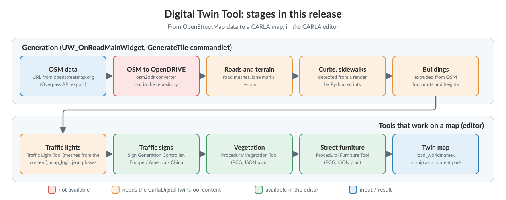
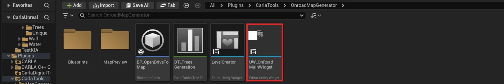
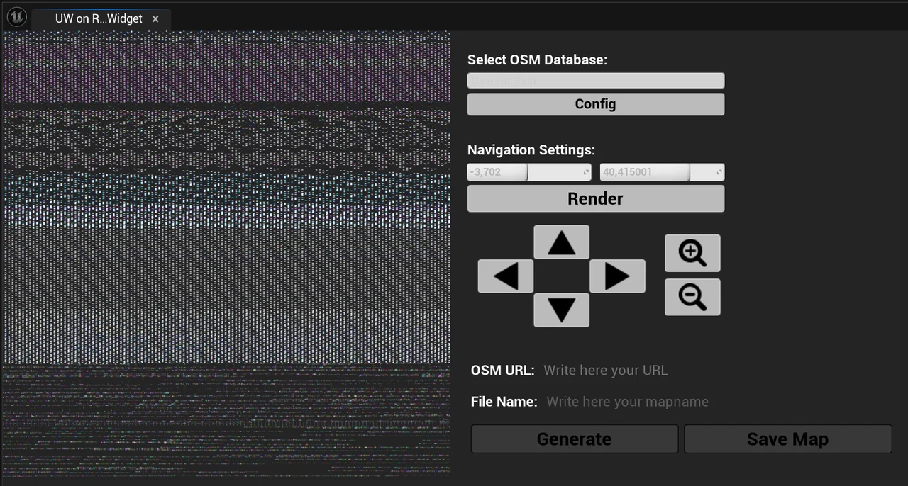
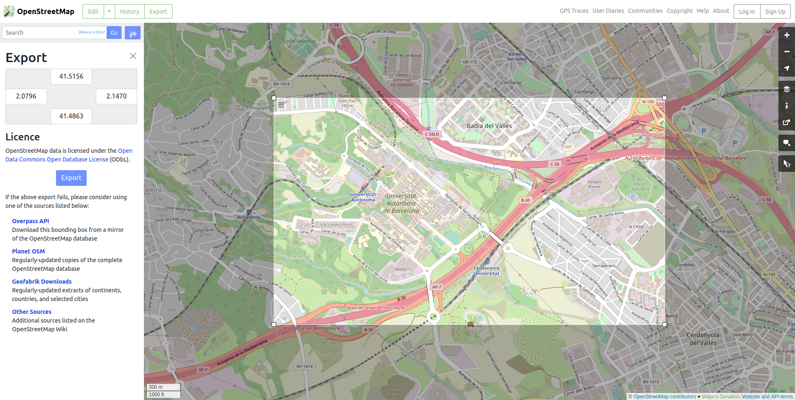
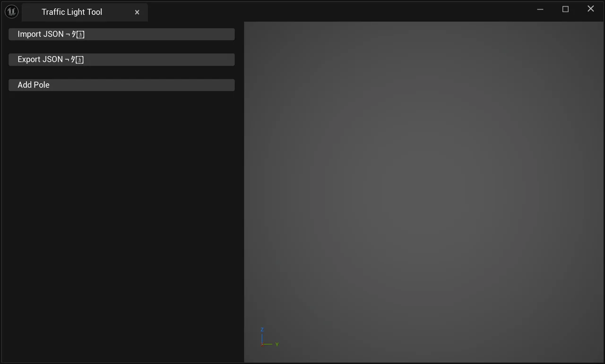
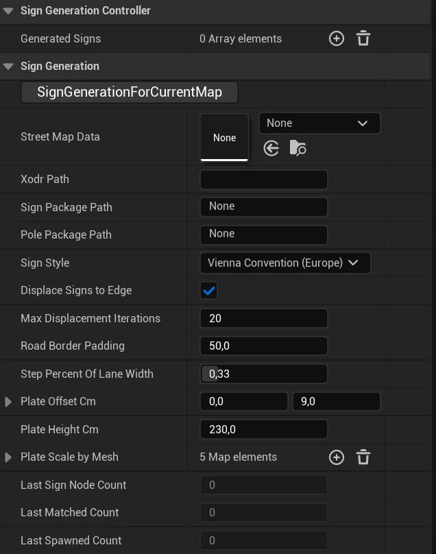

# Digital Twin Tool

The __Digital Twin Tool__ builds a CARLA map of a real place from [OpenStreetMap](https://www.openstreetmap.org) (OSM) data, inside the CARLA editor: the road network becomes an OpenDRIVE file and road meshes, and the spaces between the roads are filled with procedural buildings, vegetation, street furniture, traffic lights and traffic signs.

!!! Warning
    In this release the tool is __not usable end to end__. Generating a map from OSM needs the OSM-to-OpenDRIVE converter (`osm2odr`), which is no longer in the repository, and the content of the current version of the tool (the `CarlaDigitalTwinsTool` plugin) is not distributed with CARLA. The parts that work on their own — traffic signs, vegetation and furniture, the traffic-light phases of a map, and the twin maps already in the content — are described below.

- [__Status in this release__](#status-in-this-release)
- [__How the tool is organised__](#how-the-tool-is-organised)
- [__Generating a map from OSM__](#generating-a-map-from-osm)
- [__Traffic lights__](#traffic-lights)
- [__Traffic signs__](#traffic-signs)
- [__Vegetation and street furniture__](#vegetation-and-street-furniture)
- [__Twin maps in the content__](#twin-maps-in-the-content)
- [__Headless generation__](#headless-generation)

---
## Status in this release

| Part | Status |
| --- | --- |
| OSM download and conversion to OpenDRIVE (*Generate*) | __Not available.__ `osm2odr` moved to another repository and is not fetched by the build. Configuring with `-DENABLE_OSM2ODR=ON` makes the `Carla` and `CarlaTools` modules fail to compile; without it, *Generate* logs `CARLA was built without OSM2ODR support`. |
| Map preview and navigation (*Select OSM Database*, *Render*, arrows, zoom) | __Removed.__ The OSM renderer it talks to was taken out of the repository; the buttons are still in the widget but do nothing. |
| Map generation blueprint, building generator, traffic-light presets, curb detection scripts | __Not distributed.__ They are in the `CarlaDigitalTwinsTool` plugin's content (`Unreal/CarlaUnreal/Plugins/CarlaDigitalTwinsTool/Content`, about 18 GB), which is not in git. |
| Traffic Light Tool | Opens in the editor, but adding a pole needs the `CarlaDigitalTwinsTool` content: without it, *Add Pole* crashes the editor. The phases in a map's `map_logic.json` work at run time. |
| Traffic sign generation | Available in the editor, for a map that has OSM data and an OpenDRIVE file. |
| Vegetation and furniture (PCG) | Available in the editor, from a placement plan in JSON. |
| Twin maps | Four in the content: `Eixample`, `EixampleDemo`, `Sf_Soma`, `Sunnyvale`. All but `Eixample` reference the `CarlaDigitalTwinsTool` content. |

---
## How the tool is organised


<div class="img-caption">The stages of the Digital Twin Tool and which of them work in this release.</div>

The tool lives in the `CarlaTools` editor plugin, with the OSM import of the `StreetMap` plugin (built by default) and the PCG plugin. The current version of the generator, ported from the `carla-digitaltwins` project, keeps its blueprints and assets in a separate content plugin, `CarlaDigitalTwinsTool`, under the mount point `/CarlaDigitalTwinsTool/`.

---
## Generating a map from OSM

The entry point is the editor utility widget `UW_OnRoadMainWidget`, in the Content Browser under *Plugins > CarlaTools > OnroadMapGenerator* (enable *Show Plugin Content* in the Content Browser settings if the *Plugins* folder is not listed). Right click it and launch it as an editor utility widget. The `LevelCreator` blueprint next to it does not compile in this release, so the editor reports a blueprint compilation error for it.


<div class="img-caption"><code>UW_OnRoadMainWidget</code> in the Content Browser, under Plugins &gt; CarlaTools &gt; OnroadMapGenerator.</div>


<div class="img-caption">The widget as it opens in this release: the map preview on the left and its controls at the top right no longer work; <b>OSM URL</b>, <b>File Name</b>, <b>Generate</b> and <b>Save Map</b> are the generation controls.</div>

| Field or button | What it does |
| --- | --- |
| _Select OSM Database_, _Navigation Settings_, _Render_, arrows, zoom | The map preview. It needed the removed OSM renderer and does nothing; the preview area shows uninitialised noise. |
| _OSM URL_ | URL of the OSM data to download. On [openstreetmap.org](https://www.openstreetmap.org), select an area, press *Export*, then right click *Overpass API* and copy the link. |
| _File Name_ | Name of the new map. Required. |
| _Generate_ | Downloads the OSM data, converts it to OpenDRIVE and builds the map. |
| _Save Map_ | Saves the generated map. |


<div class="img-caption">Exporting a region from openstreetmap.org.</div>

When the converter is available, *Generate* runs these steps:

1. Downloads the OSM data to `Unreal/CarlaUnreal/Plugins/<Map>/Content/Maps/OpenDrive/<Map>.osm` and converts it to `<Map>.xodr` next to it.
2. Builds the road meshes from the OpenDRIVE file (driving lanes only), the lane markings and a terrain, under `/Game/CustomMaps/<Map>/Static/`.
3. Detects the curbs from an orthographic render of the roads (Python scripts of the `CarlaDigitalTwinsTool` content, run with `/usr/bin/python3` on Linux) and places the sidewalk splines.
4. Spawns the traffic lights described in the OpenDRIVE file and writes their phases to `map_logic.json`.
5. Fills the blocks between the roads with buildings extruded from the OSM footprints and heights, then adds vegetation, street lights and street furniture.

---
## Traffic lights

__Window > Traffic Light Tool__ (the last entry of the *Window* menu) opens an editor tab to build and edit traffic lights: poles, heads and lamp modules, imported from or exported to JSON. The pole, head and module meshes come from the `CarlaDigitalTwinsTool` content; without it the tab opens, but *Add Pole* crashes the editor, and *Add Head* and *Add Module* only appear once a pole exists. The phases of a twin map's traffic lights live in a `map_logic.json` next to its OpenDRIVE file; the server reads it when the map loads and drives the lights from it. A content pack ships the file with the map (see [Content packs](content_packs.md#traffic-light-phase-files)).


<div class="img-caption">The Traffic Light Tool tab before a pole is added.</div>

---
## Traffic signs

The __Sign Generation Controller__ actor (`ASignGenerationController`) places traffic signs from the OSM sign nodes (`traffic_sign`, `highway`, `crossing`, `maxspeed` tags) on the roads of the current map. Drop one in the level, set its fields in the *Details* panel and press *SignGenerationForCurrentMap*.


<div class="img-caption">The SignGeneration fields of the Sign Generation Controller.</div>

| Field | What it does |
| --- | --- |
| _Street Map Data_ | The OSM data of the map (a `StreetMap` asset). Looked up next to the level when empty. |
| _Xodr Path_ | The map's OpenDRIVE file. Looked up for the current level when empty. |
| _Sign Package Path_, _Pole Package Path_ | Folders of the sign plates and poles to use. |
| _Sign Style_ | The sign catalog: *Vienna Convention (Europe)*, *MUTCD (America)*, *GB (China)* or *None*. |
| _Displace Signs To Edge_, _Max Displacement Iterations_, _Road Border Padding_, _Step Percent Of Lane Width_ | Move each sign off the road to the lane edge. |
| _Plate Offset Cm_, _Plate Height Cm_, _Plate Scale By Mesh_ | Position and scale of the plate on its pole. |
| _Last Sign Node Count_, _Last Matched Count_, _Last Spawned Count_ | Summary of the last run: OSM sign nodes, nodes matched to a road, signs placed. |

The signs are spawned as traffic sign actors that the server adopts like the signs of any other map.

---
## Vegetation and street furniture

Two actors place trees and street furniture with PCG from a placement plan, a JSON file with one entry per object (`twin-vegetation-plan/1` and `twin-furniture-plan/1` schemas):

- __Procedural Vegetation Tool__ (`AProceduralVegetationTool`)
- __Procedural Furniture Tool__ (`AProceduralFurnitureTool`)

Set *Plan File* to the plan. The *Details* panel has two buttons: *Preview* generates the instances with the PCG graph in *Graph* (`PCG_TwinVegetation` for vegetation by default) and *ClearGenerated* removes them. Reading the plan and baking the instances into instanced static meshes saved with the level are not buttons: call `import_plan()` before *Preview* and `bake()` after it from the editor's Python console. *Status*, *Points* and *Baked Instance Count* show the result.


<div class="img-caption">The Vegetation category of the Procedural Vegetation Tool.</div>

---
## Twin maps in the content

The content has four twin maps under `Content/Carla/Maps/Twins/`, each with its OpenDRIVE file and `map_logic.json`. They are World Partition maps and load by name in a source build:

```py
world = client.load_world('Eixample')
```

`Eixample` loads with no missing assets: extruded buildings without façade detail, roads, sidewalks, crosswalks, traffic lights and signs, and no vegetation. `EixampleDemo`, `Sf_Soma` and `Sunnyvale` reference assets of the `CarlaDigitalTwinsTool` content, so without it they load with those assets missing. The default package does not ship the twin maps; a [content pack](content_packs.md) can.


<div class="img-caption">A junction of the Eixample twin map.</div>

---
## Headless generation

The `GenerateTile` commandlet generates one tile of a map without the editor UI, with the map generation blueprint of the `CarlaDigitalTwinsTool` content (`/CarlaDigitalTwinsTool/BP_OpenDriveToMap`):

```sh
$CARLA_UNREAL_ENGINE_PATH/Engine/Binaries/Linux/UnrealEditor-Cmd Unreal/CarlaUnreal/CarlaUnreal.uproject -run=GenerateTile -FilePath=<map.xodr> -BaseLevelName=<Map> -GeoCoordsX=<lat> -GeoCoordsY=<lon> -CTileX=<x> -CTileY=<y>
```

Without that content it stops with `OpenDrive class is not properly set`.
