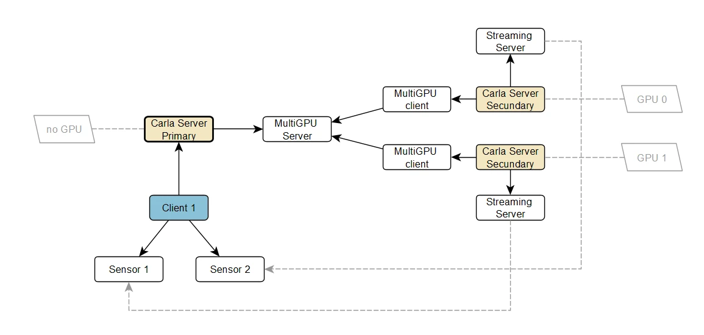

# Multi-GPU

Multi-GPU spreads the rendering of a single simulation across several GPUs. One __primary server__ owns the world — physics, actors and the client connection — and hands the sensor rendering to one or more __secondary servers__, each bound to its own GPU. The primary itself usually renders nothing.


<div class="img-caption">A primary server with two secondary servers, each rendering on its own GPU, and a client with two sensors.</div>

It is transparent to the client: it connects to the primary as always, spawns sensors as always, and receives their data directly from whichever secondary rendered it.

- [__How it works__](#how-it-works)
- [__Start the primary server__](#start-the-primary-server)
- [__Start the secondary servers__](#start-the-secondary-servers)
- [__Choose the GPU__](#choose-the-gpu)
- [__Synchronous mode__](#synchronous-mode)

---
## How it works

The primary server keeps the authoritative world: it runs the physics, owns the actors and answers the client's RPC calls. Each secondary server connects to it, receives the scene state every frame, and renders the sensors the primary assigned to it. The primary distributes new sensors across the secondaries as the client spawns them.

The order to start them in is: primary first, then the secondaries, then the client.

A server becomes a secondary when, and only when, it is given `-carla-primary-host`. Without that flag it is a primary.

---
## Start the primary server

```sh
./CarlaUnreal.sh -nullrhi
```

`-nullrhi` disables rendering entirely, so the primary needs no GPU of its own. It is not required — a primary can render — but on a machine whose GPUs are all driving secondaries it keeps one free.

The primary listens for secondaries on the __secondary port__, 2002 by default:

```sh
./CarlaUnreal.sh -nullrhi -carla-secondary-port=3002
```

| Flag | Default | What it does |
|---|---|---|
| `-nullrhi` | off | Disables rendering, so the server uses no GPU. |
| `-carla-rpc-port=N` | 2000 | Port the client connects to. Also moves the other two ports, see below. |
| `-carla-secondary-port=N` | RPC port + 2 | Port the secondaries connect to. |

The three server ports are derived from the RPC port: RPC `N`, streaming `N+1`, secondary `N+2`. Setting `-carla-rpc-port=3000` therefore moves the secondary port to 3002, and the secondaries have to be told about it. `-carla-streaming-port` and `-carla-secondary-port` override their own port afterwards.

!!! Warning
    `-carla-primary-port` does __not__ set the port the primary listens on. It tells a *secondary* which port to connect to, and on a primary it has no effect at all. The primary's listening port is `-carla-secondary-port`.

---
## Start the secondary servers

Start one secondary per GPU. Each one needs the address of the primary, its own free RPC port, and the GPU it should render on:

```sh
# First secondary, rendering on GPU 0
./CarlaUnreal.sh -carla-rpc-port=3000 -carla-primary-host=127.0.0.1 -graphicsadapter=0

# Second secondary, rendering on GPU 1
./CarlaUnreal.sh -carla-rpc-port=4000 -carla-primary-host=127.0.0.1 -graphicsadapter=1
```

| Flag | Default | What it does |
|---|---|---|
| `-carla-primary-host=IP` | empty | Address of the primary. Giving it is what makes this server a secondary. |
| `-carla-primary-port=N` | 2002 | Port of the primary, matching its `-carla-secondary-port`. |
| `-carla-rpc-port=N` | 2000 | This server's own RPC port. Clients never use it, but it must be free. |
| `-graphicsadapter=N` | — | GPU this server renders on, see [Choose the GPU](#choose-the-gpu). |

A secondary still opens its own RPC, streaming and secondary ports, so on a shared machine give each one an RPC port far enough from the others — the example uses 3000 and 4000, which claim 3000-3002 and 4000-4002.

If the primary was started with a non-default secondary port, pass it:

```sh
./CarlaUnreal.sh -carla-rpc-port=3000 -carla-primary-host=127.0.0.1 -carla-primary-port=3002 -graphicsadapter=0
```

---
## Choose the GPU

`-graphicsadapter=N` picks the rendering device by index, counting from 0, and is read by both the Vulkan and the D3D12 backends. An index beyond the number of devices present falls back to the first one and logs a warning, so check the server log when a secondary seems to land on the wrong GPU.

Two negative values are also accepted: `-1` prefers a discrete GPU over an integrated one and is the default, and `-2` takes the first device the driver reports, unsorted.

The same choice can be made through the engine's `r.GraphicsAdapter` console variable, which the flag overrides. It is read once at startup and cannot be changed afterwards, so it has to come from the command line or from `Config/DefaultEngine.ini`:

```sh
./CarlaUnreal.sh -carla-primary-host=127.0.0.1 -ini:Engine:[/Script/Engine.RendererSettings]:r.GraphicsAdapter=1
```

!!! Note
    The `-ini:` form needs the `Engine:` file name in the middle, and the engine strips `-ini:` overrides out of Shipping builds, which is what a packaged CARLA is. `-graphicsadapter=N` works in every build and is the one to reach for.

---
## Synchronous mode

As soon as the first secondary connects, the primary switches the simulation to synchronous mode with a fixed time step of 1/20 s (20 FPS), whatever the client asked for before. A client connecting afterwards therefore has to tick the world, and can change the step with [`carla.WorldSettings`](python_api.md#carla.WorldSettings) as usual.
