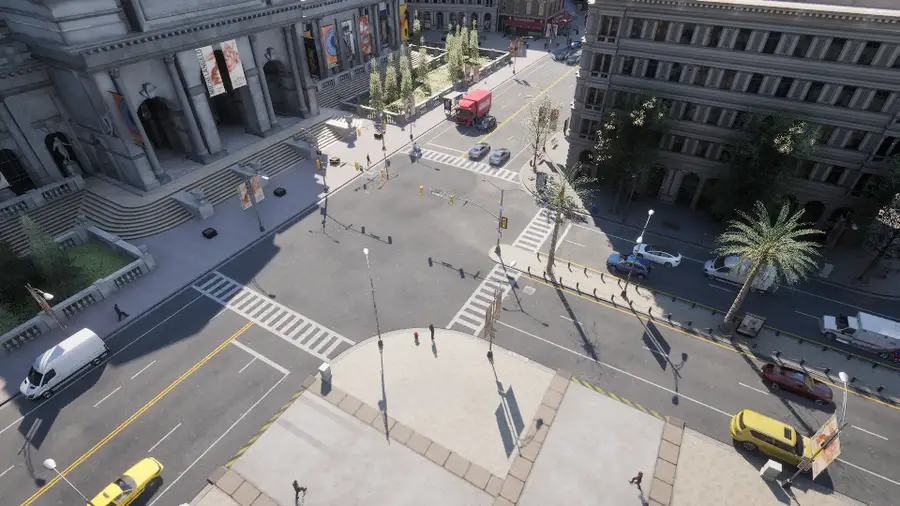
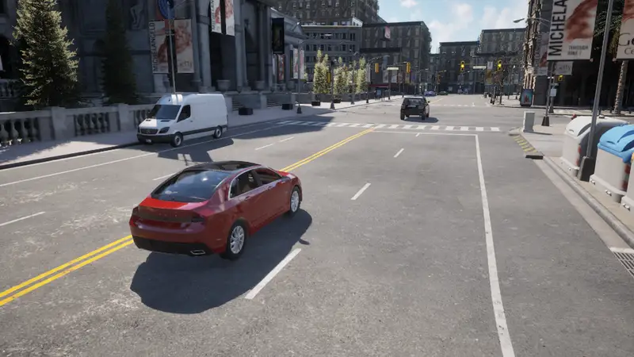

# Recorder

This feature allows to record and reenact a previous simulation. All the events happened are registered in the [recorder file](ref_recorder_binary_file_format.md). There are some high-level queries to trace and study those events.

*   [__Recording__](#recording)  
*   [__Simulation playback__](#simulation-playback)  
	*   [Setting a time factor](#setting-a-time-factor)  
*   [__Recorded file__](#recorded-file)  
*   [__Queries__](#queries)  
	*   [Collisions](#collisions)  
	*   [Blocked actors](#blocked-actors)  
*   [__Sample Python scripts__](#sample-python-scripts)

---
## Recording

All the data is written in a binary file on the server side only. However, the recorder is managed using the [carla.Client](python_api.md#carla.Client).

Actors are updated on every frame according to the data contained in the recorded file. Actors in the current simulation that appear in the recording will be either moved or re-spawned to emulate it. Those that do not appear in the recording will continue their way as if nothing happened.

The recorder file includes:

*   __Actors__ — creation and destruction, bounding and trigger boxes.
*   __Traffic lights__ — state changes and time settings.
*   __Vehicles__ — position and orientation, linear and angular velocity, light state, physics control, door state and wheel animation.
*   __Pedestrians__ — position and orientation, linear and angular velocity, and bone poses.
*   __Bikers__ — the rider's animation state.
*   __Lights__ — light states from buildings, streets and vehicles.
*   __Weather__ — the weather parameters and every change made to them.

To start recording there is only need for a file name. Using `\`, `/` or `:` characters in the file name will define it as an absolute path. If no path is detailed, the file will be saved in `CarlaUnreal/Saved`.

```py
client.start_recorder("/home/carla/recording01.log")
```

By default, the recorder is set to store only the necessary information to play the simulation back. In order to save all the information previously mentioned, the argument `additional_data` has to be configured when starting the recording.

```py
client.start_recorder("/home/carla/recording01.log", True)
```

!!! Note
    Additional data includes: linear and angular velocity of vehicles and pedestrians, traffic light time settings, execution time, actors' trigger and bounding boxes, and physics controls for vehicles.

To stop the recording, the call is also straightforward.

```py
client.stop_recorder()
```

Starting a recording stops any playback that is running, so that the recording captures the live simulation. Pass `stop_replayer=False` to record while a playback continues, which is how a replayed situation is re-recorded with new sensors or new actors in it.

```py
client.start_recorder("/home/carla/recording02.log", False, False)
```

!!! Note
    As an estimate, 1h recording with 50 traffic lights and 100 vehicles takes around 200MB in size.

---
## Simulation playback

A playback can be started at any point during a simulation. Besides the path to the log file, this method needs some parameters.

```py
client.replay_file("recording01.log", time_start, duration, follow_id)
```

| Parameter | Default | Description |
| --- | --- | --- |
| `name` | — | Path of the recording. |
| `time_start` | — | Second of the recording to start at. Positive counts from the beginning, negative from the end. |
| `duration` | — | Seconds to play. `0` plays the whole recording. |
| `follow_id` | — | Id of the actor the spectator follows. `0` leaves the spectator free. |
| `replay_sensors` | `False` | Re-spawn the sensors that were recorded. |
| `replay_weather` | `False` | Restore the weather of the recording, and the changes made to it during it. Otherwise the current weather is kept. |
| `offset` | 10 m behind, 5 m above, pitched 25&deg; down | Where the spectator sits relative to the followed actor. Ignored when `follow_id` is `0`. |
| `map_override` | empty | Name of the map to replay on, instead of the one the recording names. For replaying on a different variant of the same road network. |

At the end of the playback, vehicles may be returned to autopilot and pedestrians stop, depending on how the replayer was configured.


### Setting a time factor

The time factor will determine the playback speed. It can be changed any moment without stopping the playback.

```py
client.set_replayer_time_factor(2.0)
```

| `time_factor` | Playback speed |
| --- | --- |
| `1.0` | Real time, the default |
| `> 1.0` | Fast motion |
| `< 1.0` | Slow motion |

<br>


!!! Important
    From `time_factor` 2.0 upwards the actors' positions are snapped instead of interpolated. Pedestrian animations are not affected by the time factor.

When the time factor is around __20x__ traffic flow is easily appreciated.



---
## Recorded file

The details of a recording can be retrieved using a simple API call. By default, it only retrieves those frames where an event was registered. Setting the parameter `show_all` would return all the information for every frame. The specifics on how the data is stored are detailed in the [recorder's reference](ref_recorder_binary_file_format.md).

```py
# Show info for relevant frames
print(client.show_recorder_file_info("recording01.log", False))
```

* __Opening information.__ Map, date and time when the simulation was recorded.

* __Frame information.__ Any event that could happen such as actors spawning or collisions. It contains the actors' ID and some additional information.

* __Closing information.__ Number of frames and total time recorded.

```
Version: 1
Map: Town05_Opt
Date: 02/21/19 10:46:20

Frame 1 at 0 seconds
 Create 2190: spectator (0) at (-260, -200, 382.001)
 Create 2191: traffic.traffic_light (3) at (4255, 10020, 0)
 Create 2192: traffic.traffic_light (3) at (4025, 7860, 0)
 ...
 Create 2258: traffic.speed_limit.90 (0) at (21651.7, -1347.59, 15)
 Create 2259: traffic.speed_limit.90 (0) at (5357, 21457.1, 15)

Frame 2 at 0.0254253 seconds
 Create 2276: vehicle.mini.cooperst (1) at (4347.63, -8409.51, 120)
  number_of_wheels = 4
  object_type =
  color = 255,241,0
  role_name = autopilot
... 
Frame 2350 at 60.2805 seconds
 Destroy 2276

Frame 2351 at 60.3057 seconds
 Destroy 2277
...

Frames: 2354
Duration: 60.3753 seconds
```

---
## Queries

### Collisions

Vehicles must have a [collision detector](ref_sensors.md#collision-detector) attached to record collisions. These can be queried, using arguments to filter the type of the actors involved in the collisions. For example, `h` identifies actors whose `role_name = hero`, usually assigned to vehicles managed by the user. There is a specific set of actor types available for the query.

* __h__ = Hero  
* __v__ = Vehicle  
* __w__ = Walker  
* __t__ = Traffic light  
* __o__ = Other  
* __a__ = Any

!!! Note
    The `manual_control.py` script assigns `role_name = hero` for the ego vehicle.

The collision query requires two flags to filter the collisions. The following example would show collisions between vehicles, and any other object.

```py
print(client.show_recorder_collisions("recording01.log", "v", "a"))
```

The output summarizes time of the collision, and type, ID and description of the actors involved.

```
Version: 1
Map: Town05_Opt
Date: 02/19/19 15:36:08

    Time  Types     Id Actor 1                                 Id Actor 2
      16   v v     122 vehicle.yamaha.yzf                     118 vehicle.dodge_charger.police
      27   v o     122 vehicle.yamaha.yzf                       0

Frames: 790
Duration: 46 seconds
```

!!! Important
    As it is the `hero` or `ego` vehicle who registers the collision, this will always be `Actor 1`.


The collision can be reenacted by using the recorder and setting it seconds before the event.

```py
client.replay_file("col2.log", 13, 0, 122)
```
In this case, the playback showed this.



### Blocked actors

Detects vehicles that were stuck during the recording. An actor is considered blocked if it does not move a minimum distance in a certain time. This definition is made by the user during the query.

```py
print(client.show_recorder_actors_blocked("recording01.log", min_time, min_distance))
```

| Parameter                                                 | Description                                               | Default                                                   |
| -------------------------------------------------------- | -------------------------------------------------------- | -------------------------------------------------------- |
| `min_time`                                                | Minimum seconds to move \`min\_distance\`.                | 30secs.                                                   |
| `min_distance`                                            | Minimum centimeters to move to not be considered blocked. | 10cm.                                                     |


---

!!! Note
    Sometimes vehicles are stopped at traffic lights for longer than expected.

The following example considers that vehicles are blocked when moving less than 1 meter during 60 seconds.

```py
client.show_recorder_actors_blocked("col3.log", 60, 100)
```

The output is sorted by __duration__, which states how long it took to stop being "blocked" and move the `min_distance`.

```
Version: 1
Map: Town05_Opt
Date: 02/19/19 15:45:01

    Time     Id Actor                                 Duration
      36    173 vehicle.nissan.patrol                      336
      75    214 vehicle.chevrolet.impala                   295
     302    143 vehicle.bmw.grandtourer                     67

Frames: 6985
Duration: 374 seconds
```

The vehicle `173` was stopped for `336` seconds at time `36` seconds. Reenact the simulation a few seconds before the second `36` to check it out.

```py
client.replay_file("col3.log", 34, 0, 173)
```


---
## Sample python scripts

Four scripts ship with CARLA to drive the recorder from the terminal.

__`PythonAPI/util/start_replaying.py`__ — play a recording back.

| Parameter | Description |
| --- | --- |
| `-f`, `--recorder-filename` | File to replay. |
| `-s`, `--start` | Second of the recording to start at. Default `0.0`. |
| `-d`, `--duration` | Seconds to play. `0.0`, the default, plays all of it. |
| `-c`, `--camera` | Id of the actor the spectator follows. |
| `-x`, `--time-factor` | Playback speed. `2.0` is twice as fast. |
| `-i`, `--ignore-hero` | Do not replay the hero vehicle. |
| `--move-spectator` | Move the spectator with the followed actor. |
| `--spawn-sensors` | Re-spawn the sensors recorded in the file. |

__`PythonAPI/util/show_recorder_file_info.py`__ — print what a recording contains.

| Parameter | Description |
| --- | --- |
| `-f`, `--recorder_filename` | File to inspect. |
| `-a`, `--show_all` | Show every frame, not only those with events. |
| `-s`, `--save_to_file` | Write the output to a file. |

__`PythonAPI/util/recorder_comparer.py`__ — compare two recordings frame by frame, which is how a determinism regression is found.

| Parameter | Description |
| --- | --- |
| `-f1`, `--file1` | First recording. |
| `-f2`, `--file2` | Second recording. |

__`PythonAPI/examples/recorder_replay.py`__ — a fuller replay example, with weather, map override and camera control.

| Parameter | Description |
| --- | --- |
| `-f`, `--file` | File to replay. Required. |
| `--start-time`, `--end-time` | Window of the recording to play. |
| `--follow-id`, `--follow-ego` | Actor the spectator follows. |
| `--top-view` | Watch from above instead. |
| `-m`, `--map-override` | Replay on a different map. |
| `--replay-weather` | Replay the recorded weather too. |
| `--factor` | Playback speed. |

Every one of them also takes `--host` and `-p`/`--port`.

---
Now it is time to experiment for a while. Use the recorder to playback a simulation, trace back events, make changes to see new outcomes. Feel free to say your word in the CARLA forum about this matter.

<div class="build-buttons">
<p>
<a href="https://github.com/carla-simulator/carla/discussions/" target="_blank" class="btn btn-neutral" title="Go to the CARLA forum">
CARLA forum</a>
</p>
</div>
