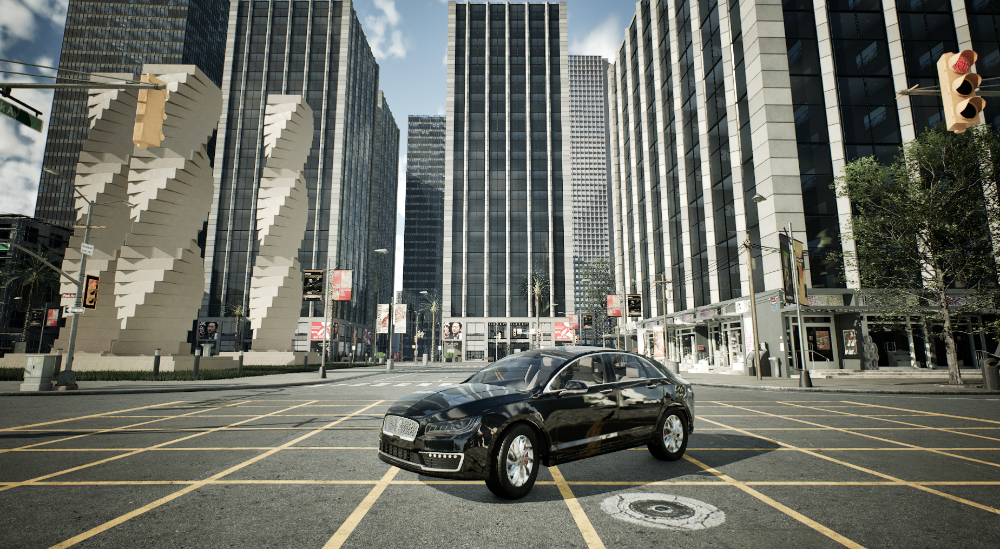
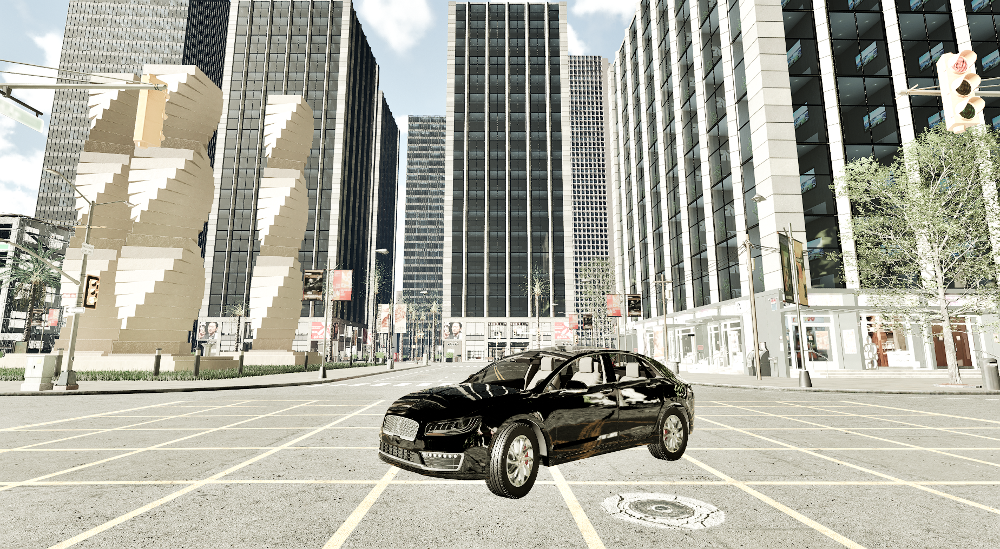

# Rendering options

This guide details the different rendering options available in CARLA, including quality levels, no-rendering mode and off-screen mode.

- [__Lighting and geometry__](#lighting-and-geometry)
- [__Graphics quality__](#graphics-quality)
	- [Quality levels](#quality-levels)
	- [Tier comparison](#tier-comparison)
	- [Ray tracing defaults](#ray-tracing-defaults)
	- [NVIDIA DLSS](#nvidia-dlss)
	- [Ray-traced lens tuning](#ray-traced-lens-tuning)
- [__Off-screen rendering mode__](#off-screen-rendering-mode)
	- [Setting off-screen mode](#setting-off-screen-mode)


!!! Important
    Some of the command options below are not equivalent in the CARLA packaged releases. Read the [Command line options](start_quickstart.md#command-line-options) section to learn more about this.

---
## Lighting and geometry

Two engine systems do most of the work, and neither needs configuring to use CARLA. They are worth knowing about because they explain what the quality tiers trade away.

__[Lumen](https://dev.epicgames.com/documentation/en-us/unreal-engine/lumen-global-illumination-and-reflections-in-unreal-engine)__ is the dynamic global illumination and reflection system. Light bounces off the surfaces it actually hits, so a red wall tints the road beside it and a vehicle under a bridge darkens, with no baked lighting and no precomputation when the weather or the time of day changes. It is what makes the weather API visible on every surface rather than only in the sky. Lumen runs at the `High` and `Epic` tiers, on [hardware ray tracing](https://dev.epicgames.com/documentation/en-us/unreal-engine/hardware-ray-tracing-in-unreal-engine) with ray-traced shadows.

__[Nanite](https://dev.epicgames.com/documentation/en-us/unreal-engine/nanite-virtualized-geometry-in-unreal-engine)__ is virtualized geometry: the engine streams and renders only the triangles a view can resolve, so the towns carry film-grade meshes without a hand-authored LOD chain. It applies to opaque and masked materials only — meshes with translucent materials, such as glass, render through the normal path.

---
## Graphics quality

### Quality levels

CARLA ships four graphics-quality tiers, selected with `-quality-level=<Tier>`. The name is case-sensitive PascalCase — `Low`, `Medium`, `High`, `Epic` — and `Epic` is the default. An unrecognised value falls back to the platform default without applying a CARLA tier, and the log warns with the value it did not understand.

```sh
./CarlaUnreal.sh -quality-level=Epic
./CarlaUnreal.sh -quality-level=Low

# With no flag, Epic is used.
./CarlaUnreal.sh
```

__The tier changes how the world is rendered, never what is in it.__ View distance, foliage and grass density, mesh detail and the simulation itself are identical at every tier: a sensor sees the same objects in the same places on Low as on Epic, only shaded more cheaply. That is what makes a lower tier usable for data collection on a weaker GPU.

What each tier gives up, from the top down:

| Tier | Global illumination | Reflections | Shadows | Also |
| ---- | ------------------- | ----------- | ------- | ---- |
| `Epic` | Lumen, probe spacing 4, 4096 surface cache | Lumen, full resolution, 2 bounces | 4096 px shadow maps, 10 cascades | Hardware ray tracing available to cameras |
| `High` | Lumen, probe spacing 8, 2048 surface cache | Lumen, half resolution, 1 bounce | 2048 px, 4 cascades | No ray tracing on cameras |
| `Medium` | None | Screen-space plus reflection captures (256 px) | 1024 px, 1 cascade, no distance-field shadows | Texture mip bias 0.5, anisotropy 4 |
| `Low` | None | Screen-space plus reflection captures (128 px) | 512 px, 1 cascade, no distance-field shadows, far shadows culled | No motion blur, smaller streaming pools, quarter-rate particle emitters |

What that buys, measured on Town10HD with an empty world and a fixed viewpoint, so only the rendering differs:

| Tier | Frame rate, relative to Epic |
| ---- | ---------------------------- |
| `Epic` | baseline |
| `High` | +25% |
| `Medium` | +65% |
| `Low` | +80% |

The step from Epic to High is Lumen getting cheaper; the step from High to Medium is Lumen going away, which is where most of the gain is. Low adds little over Medium, because by then the expensive lighting is already gone and what remains is shadow resolution and particle rates. The exact figures move with the GPU, the resolution and the map, but the shape holds: the cost is in the global illumination, not the geometry.

Inside the editor, scalability follows the editor's own __Settings / Engine Scalability Settings__ menu rather than this flag.

#### Epic mode


*Epic quality mode screenshot*

#### Low mode


*Low quality mode screenshot*

### Tier comparison

Each tier selects the matching bucket — `Low` 0 through `Epic` 3 — in every [scalability group](https://dev.epicgames.com/documentation/en-us/unreal-engine/scalability-reference-for-unreal-engine) of `Config/DefaultScalability.ini`. The CARLA device profile selector then lowers the few CVars that a project setting pins above scalability priority. The values below are those two sources.

| Setting | Low | Medium | High | Epic |
|---|---|---|---|---|
| `r.ViewDistanceScale` | 1.0 | 1.0 | 1.0 | 1.0 |
| `foliage.DensityScale` / `grass.DensityScale` | 1.0 | 1.0 | 1.0 | 1.0 |
| `r.DynamicGlobalIlluminationMethod` | 0 (off) | 0 (off) | Lumen | Lumen |
| `r.Lumen.ScreenProbeGather.DownsampleFactor` | — | — | 32 | 16 |
| `r.LumenScene.SurfaceCache.AtlasSize` | — | — | 2048 | 4096 |
| `r.ReflectionMethod` | 2 (SSR) | 2 (SSR) | Lumen | Lumen |
| `r.Lumen.Reflections.DownsampleFactor` | — | — | 2 | 1 |
| `r.Lumen.Reflections.MaxBounces` | — | — | 1 | 2 |
| `r.SSR.Quality` | 4 | 4 | 2 | 3 |
| `r.ReflectionCaptureResolution` | 128 | 256 | 512 | 512 |
| `r.Shadow.MaxCSMResolution` | 512 | 1024 | 2048 | 4096 |
| `r.Shadow.CSM.MaxCascades` | 1 | 1 | 4 | 10 |
| `r.Shadow.DistanceScale` | 1.0 | 1.5 | 2.0 | 2.0 |
| `r.DistanceFieldShadowing` | 0 | 0 | 1 | 1 |
| `r.MaxAnisotropy` / `r.VT.MaxAnisotropy` | 4 | 4 | 8 | 8 |
| `r.Streaming.MipBias` | 0.5 | 0.5 | 0 | 0 |
| `r.Streaming.PoolSize` (MB) | 2000 | 3000 | 4000 | 4000 |
| `r.Nanite.Streaming.StreamingPoolSize` (MB) | 768 | *default* | *default* | *default* |
| `r.EmitterSpawnRateScale` | 0.125 | 0.25 | 0.5 | 1.0 |
| `r.FXAA.Quality` | 0 | 2 | 4 | 5 |
| `r.DefaultFeature.MotionBlur` | 0 (off) | *default* | *default* | *default* |
| `r.CustomDepth` | 1 | *default* | *default* | *default* |
| `carla.Camera.UseRayTracing` | 0 | 0 | 0 | per sensor |

!!! Note
    `rt_lens`, `rt_lens_distance` and `rt_lens_instance` path-trace their own primary rays and ignore `carla.Camera.UseRayTracing`, so they work at every tier. The flag only governs hardware ray tracing on the ordinary scene-capture cameras.

### Ray tracing defaults

The hardware ray tracing subsystem is initialized at the project level (`r.RayTracing=True`) and the path tracer is available (`r.PathTracing=True`) — this is what powers the [ray-traced lens camera](ref_sensors.md#ray-traced-lens-camera). Per-effect switches are configured as follows:

| CVar | Project default | Effect when enabled |
|---|---|---|
| `r.RayTracing` | True | Initializes the hardware ray tracing subsystem (RTX-class GPU required). Read-only after engine init. |
| `r.PathTracing` | True | Makes the [path tracer](https://dev.epicgames.com/documentation/en-us/unreal-engine/path-tracer-in-unreal-engine) available for `sensor.camera.rt_lens`. |
| `r.Lumen.HardwareRayTracing` | False | Switches the main view's Lumen GI + reflections from software SDF tracing to hardware RT cores. Kept off by default: the engine keeps a single per-scene ray-tracing command cache, and mixing hardware-RT viewport effects with streaming path-traced sensors re-caches the whole scene every frame (a large flat per-frame cost on big towns). |
| `r.RayTracing.Shadows` | False | Ray-traced direct shadows instead of Virtual Shadow Maps. Kept off by default for the same cache reason. |
| `r.RayTracing.ForceAllRayTracingEffects` | 0 | Force-enables every RT-capable effect in the project. High BVH cost. |

Sensor captures opt into hardware ray tracing individually through the `use_ray_tracing` camera attribute (default `True`), and the console variable `carla.Camera.UseRayTracing` can force it on (`1`) or off (`0`) for every camera at once (`-1` respects the per-sensor attribute).

Changing project defaults requires editing `Config/DefaultEngine.ini` and rebuilding the simulator. The packaged Shipping binary strips the engine's `-execcmds=` command-line parser, so runtime overrides via that flag are not available in distributed CARLA releases; only project-side configuration takes effect.

### NVIDIA DLSS

CARLA integrates two DLSS features (the DLSS SDK is fetched during setup, so both are present in standard builds; an NVIDIA RTX-class GPU is required at runtime):

*   __DLSS Ray Reconstruction (DLSS-RR)__ denoises the path-traced frames of `sensor.camera.rt_lens`. It is the default denoiser (`r.PathTracing.Denoiser.Name=DLSSRR` in `DefaultEngine.ini`) and is controlled per sensor with the `enable_denoiser` attribute.
*   __DLSS Super Resolution (DLSS-SR)__ upscales individual camera sensors: with `enable_dlss=true` a camera renders internally at `dlss_screen_percentage` of its output resolution and DLSS reconstructs the full-size image. It is opt-in per camera (see the [RGB camera attributes](ref_sensors.md#rgb-camera)); on non-NVIDIA hardware an enabled sensor degrades gracefully to a bilinear upscale.

The example `PythonAPI/examples/manual_control_5cam.py` spawns a five-camera 1080p rig on an autopilot vehicle and toggles DLSS-SR live (press `D`) so the frame-rate and quality impact can be compared directly.

### Ray-traced lens tuning

The [ray-traced lens camera family](ref_sensors.md#ray-traced-lens-camera) (`sensor.camera.rt_lens`, `sensor.camera.rt_lens_distance`, `sensor.camera.rt_lens_instance`) is driven by a handful of engine console variables, set project-wide in `Unreal/CarlaUnreal/Config/DefaultEngine.ini` (`[SystemSettings]` and `[/Script/Engine.RendererSettings]` sections). Changing project defaults requires editing that file and rebuilding/repackaging the simulator; the packaged Shipping binary strips the `-execcmds=` command-line parser, so runtime overrides via the launch command are not available in distributed releases. A running editor or development build can still be tuned live from the in-game console.

| CVar | Default | What it does | When to change it |
|---|---|---|---|
| `r.PathTracing.FramePassCount` | Engine: `1`. CARLA project (`DefaultEngine.ini`): `0` | Sample passes the path tracer runs per rendered frame. `0` = automatic: run as many passes as needed to finish the sensor's remaining `samples_per_pixel` that frame (capped at 16 by the engine). `N` = run up to N passes per frame (also capped at 16). | Leave at the CARLA default (`0`). It is what lets a *moving* camera reach and denoise its full `samples_per_pixel` budget every frame instead of restarting accumulation at 1 sample; without it only `samples_per_pixel=1` sensors reach the denoise gate while driving. |
| `r.PathTracing.MaxFramePassCount` | Engine: `16`. CARLA project: `64` | Upper bound on `r.PathTracing.FramePassCount`, i.e. the most sample passes one rendered frame may run. A sensor's `samples_per_pixel` above this value cannot finish (and denoise) within one tick, and with a moving camera never reaches the denoise gate at all: `sensor.camera.rt_lens`'s `Set()` clamps `samples_per_pixel` to this cvar and logs a warning when it does. | Raise it to allow higher `samples_per_pixel` sensors to converge every frame (CARLA already raises it to 64); lower it to cap the worst-case per-frame path-tracing cost. Measured 2026-09-08: 32 samples/pixel run under a 16-pass cap was about 4&times; noisier than the same count run under a cap that lets it finish. |
| `r.PathTracing.DLSSRR.FeatureIdleReleaseSeconds` | `0` (off) | Optional wall-clock fallback: seconds a DLSS Ray Reconstruction / DLSS Super Resolution feature (one per distinct view/lens configuration) may sit unused before its GPU memory is released. `0` disables it. | Not normally needed. A sensor's DLSS-RR feature (measured ~342 MB at 1080p) is released within about a second of the sensor being destroyed, because its lifetime is tied to the sensor's view state rather than to a timeout. That is what lets a live sensor go arbitrarily long between captures (a slow synchronous client, a sparse `sensor_tick`) without losing the denoiser's temporal history: the previous default of `10.0` re-created the feature and reset that history on every capture slower than 10 s. Set a value only as a safety net for a leak you have actually observed; any live sensor slower than the value then pays the reset again. |
| `carla.RTLens.SyncModeBlockingReadback` | `1` | In synchronous mode, `1` delivers each `rt_lens*` image captured on the *same* tick, through a per-tick batched blocking GPU readback shared by every camera. `0` forces the asynchronous, one-tick-late, droppable readback (see [Readback and synchronous-mode delivery](ref_sensors.md#ray-traced-lens-camera)) even in synchronous mode. | Rollback valve. Leave at the default (`1`) for frame-accurate synchronous captures; set to `0` only to debug or work around a regression in the batched readback path. |

 The selector module re-applies the active tier's scalability after `UGameUserSettings::ApplyNonResolutionSettings` runs, so cross-run scalability state cannot shadow the current tier.

<br>

---

## Off-screen rendering mode

The off-screen rendering mode enables the CARLA simulator to run without the spectator. This would be the appropriate mode to use for rendering in a headless configuration, for example on a cloud virtual machine instance. Data from any cameras and other sensors in the simulation will still be rendered to disk or transmitted to other applications, but no rendering data will be passed to the screen. 

### Setting off-screen mode

To start CARLA in off-screen mode, run the following command:

```sh
./CarlaUnreal.sh -RenderOffScreen
```

---

