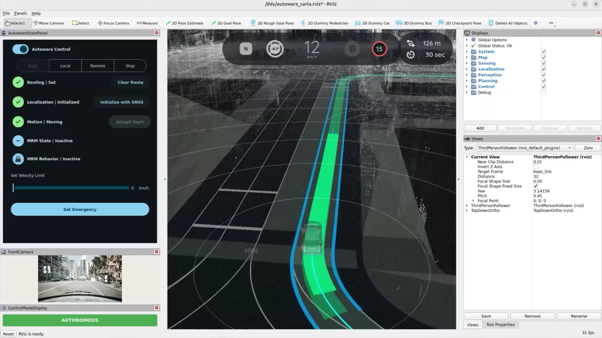
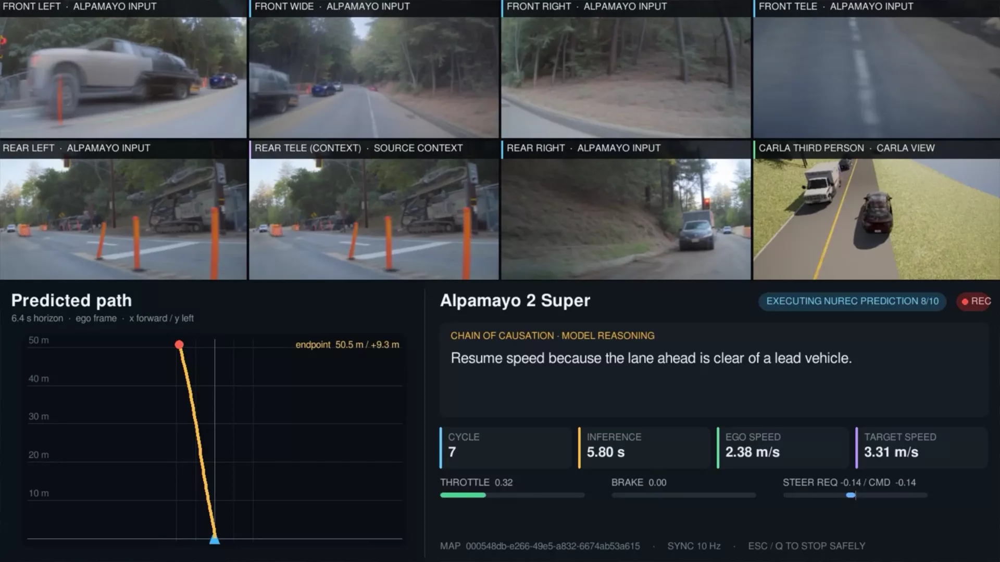

# AV stacks

CARLA integrates open-source autonomous driving stacks, so a complete stack can be tested in closed loop: the stack reads CARLA's sensors, decides, and its commands drive the ego vehicle in the simulation. CARLA keeps the physics, the clock, the other actors and the ground truth, which makes every run repeatable and every failure inspectable.

The integrations live in [`PythonAPI/examples/av_stacks/`](https://github.com/carla-simulator/carla/tree/ue58-dev/PythonAPI/examples/av_stacks), each with an installer and a launcher that starts CARLA and the stack together.

- [__Autoware__](#autoware)
- [__NVIDIA Alpamayo 2 Super__](#nvidia-alpamayo-2-super)

---
## Autoware

Autoware driving the CARLA ego vehicle in autonomous mode: RViz shows the point-cloud map, the planned path and the CARLA front camera.

[Autoware](https://autoware.org/) runs over CARLA's [native ROS 2 interface](ros2_native.md), with no bridge process: the server publishes sensor data and vehicle status straight onto ROS 2 topics and applies Autoware's control commands to the ego vehicle. Two driving modes ship with the integration: `classical`, the full Autoware stack with lidar localization, perception, planning and control, and `e2e`, the camera-only VAD end-to-end model. The integration also builds the maps Autoware needs from a CARLA town.

!!! agent "Ask your agent"
    *"Run Autoware in classical mode against CARLA on Town10, with RViz."*

    Skill: `run-autoware-ue58`. [Connect your agent](agent_skills.md#connect-your-agent).

See [Autoware](autoware.md) for the requirements, the launcher options, the topics and how to prepare a map.

---
## NVIDIA Alpamayo 2 Super

Alpamayo 2 Super driving with NuRec cameras: the model inputs, the CARLA third-person view, the predicted path and the Chain of Causation reasoning.

[NVIDIA Alpamayo 2 Super](nvidia_alpamayo.md) is an end-to-end driving model that reasons about the scene before it drives. The closed-loop example captures the model's calibrated cameras and ego-motion history, runs the trajectory inference, shows the predicted path and the model's Chain of Causation reasoning, and turns the trajectory into vehicle controls. It runs with CARLA-rendered cameras on any CARLA map, or with [NuRec](nvidia_nurec.md) cameras on a scene reconstructed from a real drive.

See [Run NVIDIA Alpamayo 2 Super in CARLA](nvidia_alpamayo.md) for the installation and the run modes, [Architecture and control](nvidia_alpamayo_architecture.md) for how the loop works and [Troubleshooting](nvidia_alpamayo_troubleshooting.md) for operational problems.
