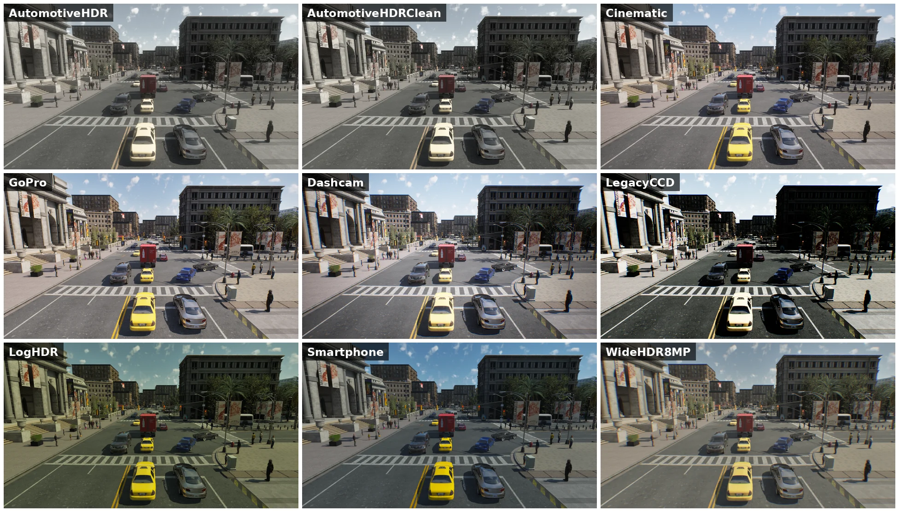
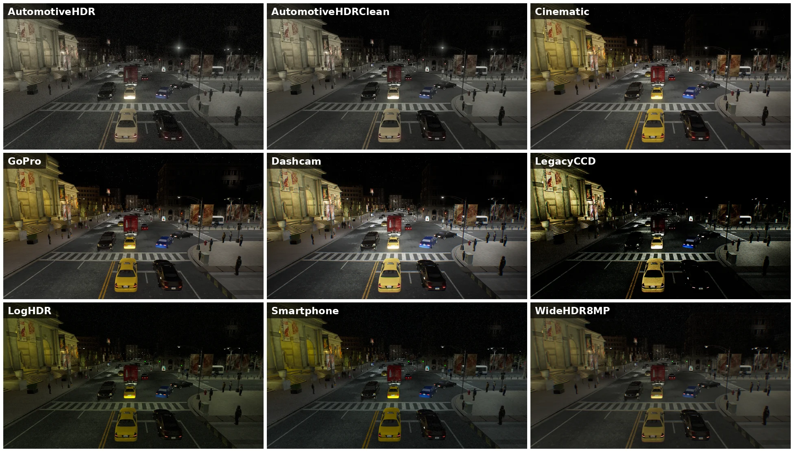
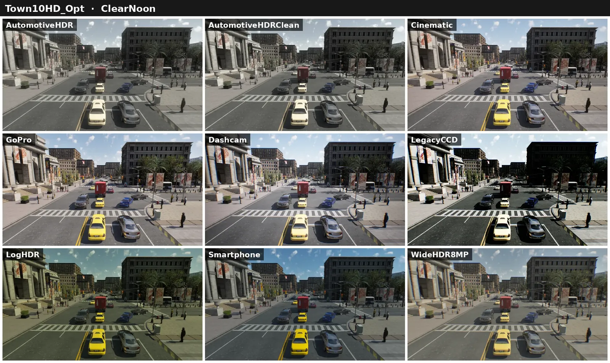
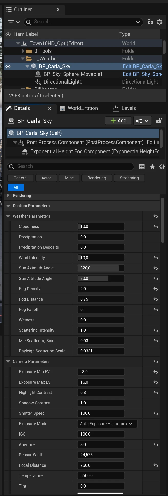
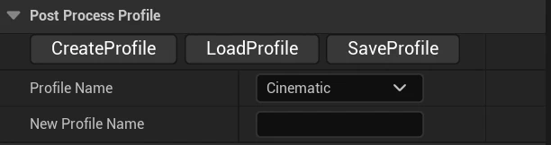
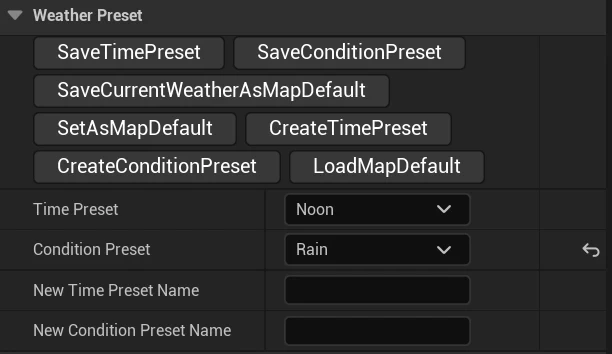

# Camera post-process presets

A camera's look — exposure, tonemapper, white balance, bloom, lens flare, noise — comes from a __post-process preset__, a JSON file the server loads by name. Nine presets ship with CARLA, each reproducing the camera of a public driving dataset, and a sensor picks one with its `post_process_profile` attribute.

- [__Using post-process presets for the RGB camera sensor__](#using-post-process-presets-for-the-rgb-camera-sensor)
- [__Presets shipped with CARLA__](#presets-shipped-with-carla)
    - [Sensor effects](#sensor-effects)
- [__Creating, loading and saving presets__](#creating-loading-and-saving-presets)
    - [Camera profiles](#camera-profiles)
    - [Weather presets](#weather-presets)

---
## Using post-process presets for the RGB camera sensor

Saved post-process presets can be loaded to modify the RGB camera sensor. When spawning a camera in the simulation through the CARLA Python API, set the `post_process_profile` attribute of the camera blueprint to the name of the post-process preset you wish to use (the name of the JSON file minus the `.json` suffix):

```py
camera_bp = bp_lib.find('sensor.camera.rgb')
camera_bp.set_attribute('post_process_profile', 'GoPro')
camera = world.spawn_actor(camera_bp, carla.Transform(carla.Location(0,0,1.5), carla.Rotation()))
```

The fisheye RGB camera (`sensor.camera.rgb_fisheye`) and the ray-traced lens camera (`sensor.camera.rt_lens`) take the same attribute; see [Fisheye cameras](ref_sensors.md#fisheye-cameras) and [Ray-traced lens camera](ref_sensors.md#ray-traced-lens-camera).

The profile is read when the sensor spawns: to change it, set the attribute again and respawn the camera. `PythonAPI/examples/manual_control.py` does this to compare the presets live: `--post-process-profile NAME` picks the first profile and K / Shift+K cycles through the presets shipped with CARLA.


---

## Presets shipped with CARLA

Nine profiles ship in `Content/Carla/Config/PostProcess`. They change the image processing only, never the geometry of the lens.

Each automotive preset reproduces the look of the camera of a public driving dataset, tuned on Town10HD_Opt against frames of that dataset (exposure and contrast percentiles, saturation, white balance, sharpness, noise per brightness). The consumer presets are graded by eye.

| Preset | Imitates | Look |
| --- | --- | --- |
| `AutomotiveHDR` (__sensor default__) | nuScenes front camera (Basler acA1600-60gc) | Flat machine-vision camera: neutral, low saturation, fast auto exposure capped at 20 ms (gain and noise rise in the dark), star-shaped lens flare and bloom on lights, sensor noise, slight optical softness. |
| `AutomotiveHDRClean` | same camera, better sensor and optics | Same tone mapping and exposure as `AutomotiveHDR`, with the bloom cut from 1.0 to 0.35 and little noise. For ground truth that should not carry glare or sensor artefacts. |
| `WideHDR8MP` | 8 MP 120° ADAS front camera (Zenseact ZOD; Mobileye / Tesla HW4 class, 120–140 dB sensors) | Flat multi-exposure HDR: no clipped highlights, lifted blacks, crisp lamps without star flare, strong noise reduction (soft, smeared detail), edge fringing. |
| `LegacyCCD` | KITTI (Point Grey Flea2 CCD, 2011) | Low dynamic range: hard clipped skies, deep contrasty shadows, sharp, little bloom. |
| `LogHDR` | Cityscapes (onsemi AR0331, 16-bit HDR log-compressed to 8 bit) | No clipped highlights, dark mid-tones, green-yellow cast, moderate saturation. |
| `Smartphone` | comma.ai road camera (Sony IMX298, phone ISP, HEVC) | Cool 5600 K white balance, dark mid-tones, saturated, no sharpening, soft codec detail. |
| `Cinematic` (viewport default) | photo / film camera | Neutral 6500 K grading with a filmic curve, slow histogram auto exposure with a brightness-dependent bias curve (shade, dusk and night stay darker as on a real camera), moderate bloom, a noticeable vignette and motion blur. |
| `GoPro` | action camera | Vivid colour, strong local tone compression, crisp detail (sharpen 0.55), light vignette and edge fringing, fast auto exposure, motion blur on. |
| `Dashcam` | consumer dashcam | Low dynamic range (bright skies clip), contrasty, over-sharpened, strong vignette and fringing, sensor grain, slightly cool and overexposed. |


The same Town10HD_Opt frame through the nine presets, at noon and at night. At night the automotive presets raise the gain and show sensor noise, and `AutomotiveHDR` adds its star-shaped flare around the lamps:


<div class="img-caption">The nine camera profiles on the same frame, ClearNoon.</div>


<div class="img-caption">The nine camera profiles on the same frame, ClearNight.</div>

The same comparison under four weathers in Town10HD_Opt and on a Town15 street, three seconds each:


<div class="img-caption">The nine camera profiles in ClearNoon, HardRainNoon, ClearSunset and ClearNight.</div>

Each comparison as a still image: Town10HD_Opt [HardRainNoon](img/camera_postprocess_presets/camera_profiles_hardrainnoon_town10.webp), [ClearSunset](img/camera_postprocess_presets/camera_profiles_clearsunset_town10.webp); Town15 [ClearNoon](img/camera_postprocess_presets/camera_profiles_clearnoon_town15.webp), [HardRainNoon](img/camera_postprocess_presets/camera_profiles_hardrainnoon_town15.webp), [ClearSunset](img/camera_postprocess_presets/camera_profiles_clearsunset_town15.webp), [ClearNight](img/camera_postprocess_presets/camera_profiles_clearnight_town15.webp).

Resolution, field of view and lens are attributes of the camera blueprint, not of the preset. To match the camera a preset imitates:

| Preset | `image_size_x` × `image_size_y` | `fov` |
| --- | --- | --- |
| `AutomotiveHDR`, `AutomotiveHDRClean` | 1600 × 900 | 70 |
| `WideHDR8MP` | 3840 × 2160 (or 1920 × 1080) | 120 |
| `LegacyCCD` | 1242 × 375 | 82 |
| `LogHDR` | 2048 × 1024 | 50 |
| `Smartphone` | 1164 × 874 | 65 |
| `Cinematic` | any | 90 |
| `GoPro`, `Dashcam` | 1920 × 1080 | 110–120 |

```py
camera_bp = bp_lib.find('sensor.camera.rgb')
camera_bp.set_attribute('post_process_profile', 'LegacyCCD')
camera_bp.set_attribute('image_size_x', '1242')
camera_bp.set_attribute('image_size_y', '375')
camera_bp.set_attribute('fov', '82')
```

### Sensor effects

The automotive presets add camera artefacts on top of the grading:

- __Sensor noise and optical softness.__ A post-process material, `M_SensorNoise` (in `Content/Carla/Blueprints/CameraProfiles`), blurs the image slightly (lens, demosaicing and ISP) and adds photon and read noise in linear light. The gain follows the camera's own auto exposure: once the exposure time reaches its cap the gain rises, so noise grows in the dark as on a real camera. `AutomotiveHDRClean`, `WideHDR8MP`, `LegacyCCD`, `LogHDR` and `Smartphone` each reference a material instance, `MI_SensorNoise_<Preset>`, with its own parameters (`Strength`, `BlurSigma`, `NoiseCell`, `ChromaScale`, `FullWell`, `ReadNoise`, `MaxExposureMs`); `AutomotiveHDR` uses `M_SensorNoise` itself, with its default values. `Cinematic`, `GoPro` and `Dashcam` have no sensor-noise material; the grain of `Dashcam` is Unreal's film grain. Remove the material from *Weighted Blendables* to turn both effects off.
- __Lens flare.__ `AutomotiveHDR` and `AutomotiveHDRClean` use the convolution (FFT) bloom with a lens kernel, `Kernels/T_LensPSF_Star`, modelled on the nuScenes night frames: a soft halo and faint star spikes around bright lights. The other presets use the standard bloom.
- __Small lights and temporal anti-aliasing.__ With TSR (the default anti-aliasing) distant or thin lights — small vehicle lamps, far street lights — lose most of their glow, because TSR blends each frame with the previous ones and flattens bright features of a few pixels before the bloom. A real camera has no such filter. FXAA (`r.AntiAliasingMethod 1`) keeps their glow at the cost of more aliasing, shimmer and moiré on foliage, fences and distant lines.
- __Exposure-linked motion blur.__ Applies to every preset: see [RGB camera — exposure-linked motion blur](ref_sensors.md#exposure-linked-motion-blur).

---
## Creating, loading and saving presets

Everything is done from the `BP_Carla_Sky` actor of the map, in the `1_Weather` folder of the *Outliner*: the camera look, the weather, and saving and loading both as presets. Select it and look at its *Details* panel.


<div class="img-caption"><code>BP_Carla_Sky</code> selected in Town10HD_Opt: <b>Custom Parameters</b> holds the <b>Weather Parameters</b> and the <b>Camera Parameters</b>.</div>

__Camera Parameters__ are shortcuts onto the post-process settings of the actor's *Post Process Component*: exposure (`Exposure Min EV`, `Exposure Max EV`, highlight and shadow contrast), camera (`Shutter Speed`, `Exposure Mode`, `ISO`, `Aperture`), depth of field (`Sensor Width`, `Focal Distance`) and color grading (`Temperature`, `Tint`, scene color tint, global saturation, contrast and gamma, `Vignette Intensity`). They edit the same settings as the full *Post Process Volume* category of the component, which has every other parameter; the [Unreal Engine documentation](https://dev.epicgames.com/documentation/en-us/unreal-engine/API/Runtime/Engine/Engine/FPostProcessSettings) describes each one. `ISO` and `Aperture` only have an effect with `Exposure Mode` set to manual.

__Weather Parameters__ are the same fields as [`carla.WeatherParameters`](python_api.md#carla.WeatherParameters): editing them changes the weather in the editor viewport.

### Camera profiles

The __Post Process Profile__ category saves and loads the camera presets, the JSON files in `Content/Carla/Config/PostProcess/`:


<div class="img-caption">The <b>Post Process Profile</b> category of <code>BP_Carla_Sky</code>.</div>

| Control | What it does |
| --- | --- |
| _Profile Name_ | The preset to work with; the dropdown lists the JSON files of the folder. |
| _LoadProfile_ | Loads `<Profile Name>.json` into the post-process settings, replacing them, and refreshes the Camera Parameters. |
| _SaveProfile_ | Writes the current post-process settings to `<Profile Name>.json`. This is exactly what a camera with that `post_process_profile` loads at runtime. |
| _New Profile Name_, _CreateProfile_ | Saves the current settings as a new preset, `<New Profile Name>.json`, and selects it. |

To make a preset, load the closest one, adjust the Camera Parameters or the Post Process Volume while you look at the viewport, and save it, or create it under a new name. A camera spawned with `post_process_profile` set to that name uses it.

The profile selected in the actor is only the editor view. When the simulation starts, the sky rig loads the profile named by the `carla.PostProcess.ViewportProfile` console variable (`Cinematic` unless changed), which is what the spectator view shows; sensors load their own `post_process_profile`, or `carla.PostProcess.Profile` (`AutomotiveHDR`) when they have none.

The variable is read when the simulation starts, so set it before. In the editor, type it in the console before pressing Play:

```sh
carla.PostProcess.ViewportProfile AutomotiveHDR
```

For a server, pass it on the command line:

```sh
-ini:Engine:[ConsoleVariables]:carla.PostProcess.ViewportProfile=AutomotiveHDR
```

`-ExecCmds` runs too late: the sky has already loaded its profile, and the new one only applies after the map reloads (`client.reload_world()`).

### Weather presets

The __Weather Preset__ category does the same for the weather, with two independent kinds of preset stored in `Content/Carla/Config/Weather/Presets.json`: a __time__ preset holds only the sun position (`sunAzimuthAngle`, `sunAltitudeAngle`), and a __condition__ preset holds everything else (cloudiness, precipitation, wind, fog, wetness, scattering). Any time can be combined with any condition.


<div class="img-caption">The <b>Weather Preset</b> category of <code>BP_Carla_Sky</code>.</div>

| Control | What it does |
| --- | --- |
| _Time Preset_, _Condition Preset_ | Pick a preset; it is applied as soon as it is selected. Shipped: `Sunrise`, `Noon`, `Sunset`, `Night`; `Clear`, `Cloudy`, `Rain`. |
| _SaveTimePreset_, _SaveConditionPreset_ | Write the current sun position, or the current conditions, over the selected preset. |
| _New Time Preset Name_, _CreateTimePreset_ | Save the current sun position as a new time preset (the same for _CreateConditionPreset_). |
| _SetAsMapDefault_ | Make the selected time and condition pair this map's default weather. |
| _SaveCurrentWeatherAsMapDefault_ | Store the current Weather Parameters as this map's default directly, without creating a preset. |
| _LoadMapDefault_ | Re-apply this map's default weather. |

The defaults of every map are in `Content/Carla/Config/Weather/MapDefaults.json`, either as a `time` and `condition` pair or as the full set of weather values. The server applies a map's default when the map loads.

Presets are saved into the content repository, `Unreal/CarlaUnreal/Content/Carla`: commit the new or changed JSON files there so that other users and the next package get them.

!!! Note
    `Carla/Config` is packed into the `.pak` of a packaged release, so a package cannot change the camera profiles it ships with, nor its time and condition presets (they all live in `Presets.json`). A camera profile with a new name can be added to a package by copying its JSON file into `CarlaUnreal/Content/Carla/Config/PostProcess/` of the package. Authoring presets in the editor needs a source build.

The presets are plain JSON and can also be edited by hand: copy an existing one and change its values. If in doubt about the schema, save the preset from the editor instead.

---
