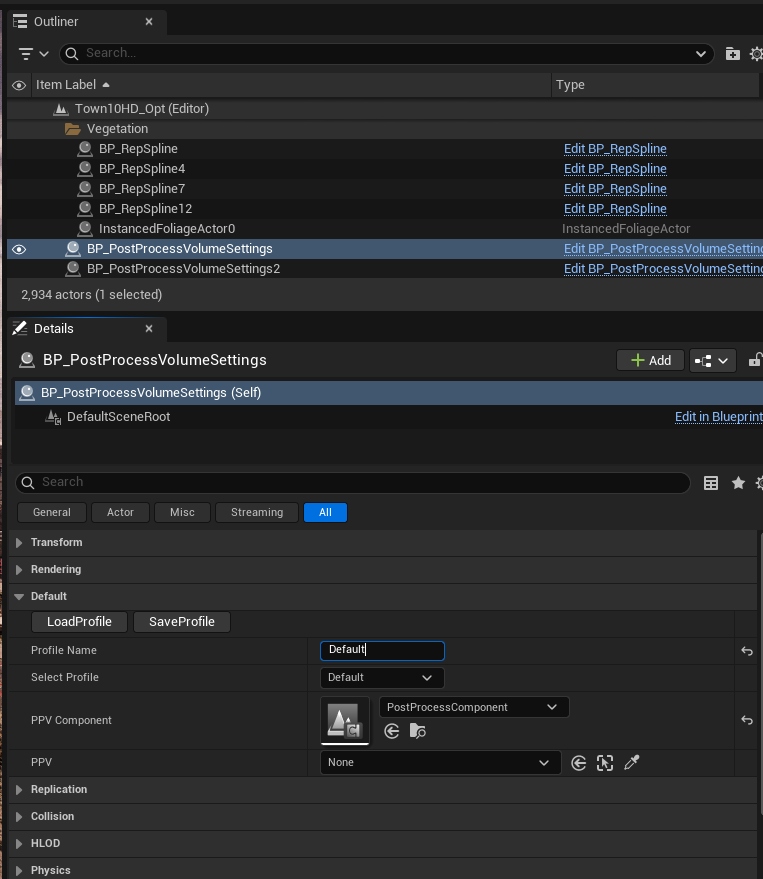

# Camera post-process presets

## Creating, loading and saving presets

The look of the scene through the camera can be adjusted using the post-process settings of the `BP_CarlaSky` blueprint. To adjust post-process settings, select the `BP_CarlaSky` blueprint in the *Outliner* panel of the Unreal Editor interface. Then in the *Details* section, select the *Post Process Component* and expand the *Post Process Volume* section. Here you will find parameters for lens effects like bloom and lens flares, color temperature, exposure, film grain and others. Experiment with the parameters to see the effect each one has on the scene in the spectator. You can find more details about these parameters in the [Unreal Engine documentation](https://dev.epicgames.com/documentation/en-us/unreal-engine/API/Runtime/Engine/Engine/FPostProcessSettings).


Post-process parameter presets can be saved and loaded through the `BP_PostProcessVolumeSettings` blueprint. In the content browser navigate to `Carla/Blueprints/CameraProfiles` or search for the blueprint in the search field. Drag the blueprint into the scene and make sure it is selected in the *Outliner*, you may want to place it out of the way in the sky so it doesn't get in the way of other scene elements. In the details panel, expand the *Default* section.



To save your current post process settings, choose an appropriate name and enter it in the *Profile Name* field, then press *SaveProfile*. The profile will be saved as a JSON file in the `${CARLA_ROOT}/Unreal/CarlaUnreal/Content/Carla/Config/PostProcess` directory, where you will also find other presets. If you want to load an existing preset from this directory, enter the name of the preset (the name of the JSON file minus the `.json` suffix) in the *Profile Name* field and then press *LoadProfile*.

You can also create new post-process presets directly in the JSON files found in the *PostProcess* directory. Create new profiles by copying an existing JSON preset and editing specific parameters. Make sure you follow the expected JSON schema, some options may change the schema. If in doubt, save the preset from the editor interface instead.

---

## Using post-process presets for the RGB camera sensor

Saved post-process presets can be loaded to modify the RGB camera sensor. When spawning a camera in the simulation through the CARLA Python API, set the `post_process_profile` attribute of the camera blueprint to the name of the post-process preset you wish to use (the name of the JSON file minus the `.json` suffix):

```py
camera_bp = bp_lib.find('sensor.camera.rgb')
camera_bp.set_attribute('post_process_profile', 'GoPro')
camera = world.spawn_actor(camera_bp, carla.Transform(carla.location(0,0,1.5), carla.Rotation()))
```


---

## Presets shipped with CARLA

Nine profiles ship in `Content/Carla/Config/PostProcess`. They change the image processing only, never the geometry of the lens.

| Preset | Look |
| --- | --- |
| `Cinematic` | The photoreal grading the spectator and the viewport use. Neutral 6500 K, slow histogram auto exposure, moderate bloom, a noticeable vignette and motion blur. |
| `GoPro` | Action camera. Vivid, crisp (sharpen 0.55), light vignette and edge fringing, fast auto exposure, motion blur on. |
| `AutomotiveHDR` | Front camera of an automated vehicle: an HDR sensor seen through a perception ISP. Flat and highly compressed, cool 7400 K, no vignette, fringing or motion blur, and very fast auto exposure for tunnel entries and exits. |
| `AutomotiveHDRClean` | `AutomotiveHDR` with the bloom cut from 1.0 to 0.35, for ground truth where glare around light sources is unwanted. |
| `Dashcam` | Consumer dashcam. Slightly overexposed, contrasty, over-sharpened, heavy vignette, visible grain and fringing. |
| `LegacyCCD` | Older CCD sensor. Hard highlight clipping, strong contrast and colour fringing, no motion blur. |
| `LogHDR` | Log-like capture for a pipeline that does its own grading: dark, flat, almost no bloom and no lens effects. |
| `Smartphone` | Phone camera. Warm 5600 K, dark exposure, no sharpening, gentle tone curve. |
| `WideHDR8MP` | Wide-angle 8 MP HDR module. Minimal bloom, no sharpening, pronounced fringing towards the edges of the frame. |

A camera with no `post_process_profile` follows the server-wide profile, set with the `carla.PostProcess.Profile` console variable and defaulting to `Cinematic`. The sky rig loads the same profile at `BeginPlay`, so the spectator and those cameras always agree.

The presets only change the image processing. The lens geometry is set on the camera blueprint: for an action-camera or dashcam view, also widen `fov` (for example 110 to 120) and, if needed, use the lens distortion attributes (`lens_k`, `lens_kcube`, `lens_x_size`, `lens_y_size`).

```py
camera_bp = bp_lib.find('sensor.camera.rgb')
camera_bp.set_attribute('post_process_profile', 'AutomotiveHDR')
camera_bp.set_attribute('fov', '100')
```
