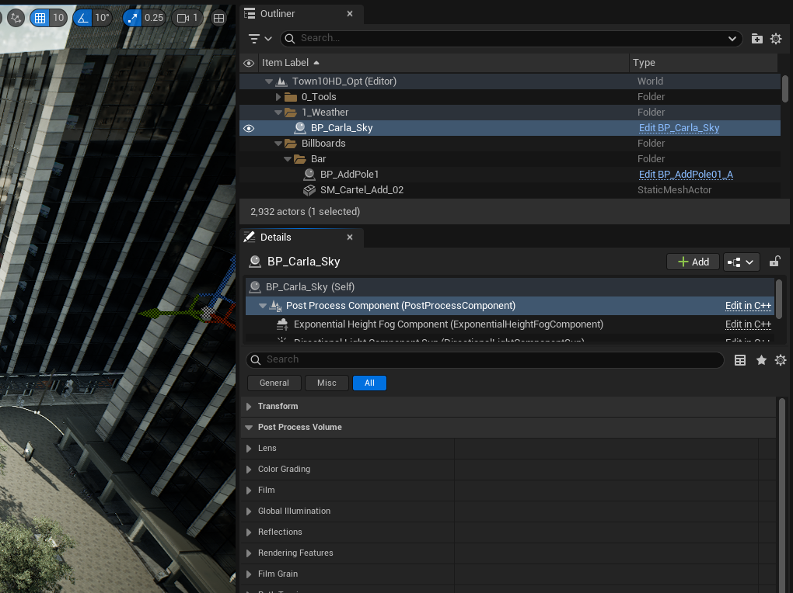

# Camera post-process presets

A camera's look — exposure, tonemapper, white balance, bloom, lens flare, noise — comes from a __post-process preset__, a JSON file the server loads by name. Nine presets ship with CARLA, each reproducing the camera of a public driving dataset, and a sensor picks one with its `post_process_profile` attribute.

- [__Using post-process presets for the RGB camera sensor__](#using-post-process-presets-for-the-rgb-camera-sensor)
- [__Presets shipped with CARLA__](#presets-shipped-with-carla)
    - [Sensor effects](#sensor-effects)
- [__Creating, loading and saving presets__](#creating-loading-and-saving-presets)

---
## Using post-process presets for the RGB camera sensor

Saved post-process presets can be loaded to modify the RGB camera sensor. When spawning a camera in the simulation through the CARLA Python API, set the `post_process_profile` attribute of the camera blueprint to the name of the post-process preset you wish to use (the name of the JSON file minus the `.json` suffix):

```py
camera_bp = bp_lib.find('sensor.camera.rgb')
camera_bp.set_attribute('post_process_profile', 'GoPro')
camera = world.spawn_actor(camera_bp, carla.Transform(carla.Location(0,0,1.5), carla.Rotation()))
```

The profile is read when the sensor spawns: to change it, set the attribute again and respawn the camera. `PythonAPI/examples/manual_control.py` does this to compare the presets live: `--post-process-profile NAME` picks the first profile and K / Shift+K cycles through the presets shipped with CARLA.


---

## Presets shipped with CARLA

Nine profiles ship in `Content/Carla/Config/PostProcess`. They change the image processing only, never the geometry of the lens.

Each automotive preset reproduces the look of the camera of a public driving dataset, tuned on Town10HD_Opt against frames
of that dataset (exposure and contrast percentiles, saturation, white balance, sharpness, noise per brightness). The
consumer presets are graded by eye.

| Preset | Imitates | Look |
| --- | --- | --- |
| `AutomotiveHDR` (__sensor default__) | nuScenes front camera (Basler acA1600-60gc) | Flat machine-vision camera: neutral, low saturation, fast auto exposure capped at 20 ms (gain and noise rise in the dark), star-shaped lens flare and bloom on lights, sensor noise, slight optical softness. |
| `AutomotiveHDRClean` | same camera, better sensor and optics | Same tone mapping and exposure as `AutomotiveHDR`, with the bloom cut from 1.0 to 0.35 and little noise. For ground truth that should not carry glare or sensor artefacts. |
| `WideHDR8MP` | 8 MP 120° ADAS front camera (Zenseact ZOD; Mobileye / Tesla HW4 class, 120–140 dB sensors) | Flat multi-exposure HDR: no clipped highlights, lifted blacks, crisp lamps without star flare, strong noise reduction (soft, smeared detail), edge fringing. |
| `LegacyCCD` | KITTI (Point Grey Flea2 CCD, 2011) | Low dynamic range: hard clipped skies, deep contrasty shadows, saturated colour, sharp, little bloom. |
| `LogHDR` | Cityscapes (onsemi AR0331, 16-bit HDR log-compressed to 8 bit) | No clipped highlights, dark mid-tones, green-yellow cast, moderate saturation. |
| `Smartphone` | comma.ai road camera (Sony IMX298, phone ISP, HEVC) | Warm 5600 K, dark mid-tones, saturated, no sharpening, soft codec detail. |
| `Cinematic` (viewport default) | photo / film camera | Neutral 6500 K grading with a filmic curve, slow histogram auto exposure with a brightness-dependent bias curve (shade, dusk and night stay darker as on a real camera), moderate bloom, a noticeable vignette and motion blur. |
| `GoPro` | action camera | Vivid colour, strong local tone compression, crisp detail (sharpen 0.55), light vignette and edge fringing, fast auto exposure, motion blur on. |
| `Dashcam` | consumer dashcam | Low dynamic range (bright skies clip), contrasty, over-sharpened, strong vignette and fringing, sensor grain, slightly cool and overexposed. |


The same Town10HD_Opt frame through the nine presets, at noon and at night. At night the automotive presets raise the gain and show sensor noise, and `AutomotiveHDR` adds its star-shaped flare around the lamps:


<div style="text-align: right"><i>The nine camera profiles on the same frame, ClearNoon. Town10HD_Opt &middot; sensor.camera.rgb &middot; nine camera profiles &middot; ClearNoon</i></div>


<div style="text-align: right"><i>The nine camera profiles on the same frame, ClearNight. Town10HD_Opt &middot; sensor.camera.rgb &middot; nine camera profiles &middot; ClearNight</i></div>

The same comparison under other weathers: [HardRainNoon](img/camera_postprocess_presets/camera_profiles_hardrainnoon_town10.webp), [ClearSunset](img/camera_postprocess_presets/camera_profiles_clearsunset_town10.webp). On a Town15 street: [ClearNoon](img/camera_postprocess_presets/camera_profiles_clearnoon_town15.webp), [HardRainNoon](img/camera_postprocess_presets/camera_profiles_hardrainnoon_town15.webp), [ClearSunset](img/camera_postprocess_presets/camera_profiles_clearsunset_town15.webp), [ClearNight](img/camera_postprocess_presets/camera_profiles_clearnight_town15.webp).

Resolution, field of view and lens are attributes of the camera blueprint, not of the preset. To match the camera a preset imitates:

| Preset | `image_size_x` × `image_size_y` | `fov` |
| --- | --- | --- |
| `AutomotiveHDR`, `AutomotiveHDRClean` | 1600 × 900 | 70 |
| `WideHDR8MP` | 3840 × 2160 (or 1920 × 1080) | 120 |
| `LegacyCCD` | 1242 × 375 | 82 |
| `LogHDR` | 2048 × 1024 | 50 |
| `Smartphone` | 1164 × 874 | 65 |
| `Cinematic` | any | 90 |
| `GoPro`, `Dashcam` | 1920 × 1080 | 110–120 |

```py
camera_bp = bp_lib.find('sensor.camera.rgb')
camera_bp.set_attribute('post_process_profile', 'LegacyCCD')
camera_bp.set_attribute('image_size_x', '1242')
camera_bp.set_attribute('image_size_y', '375')
camera_bp.set_attribute('fov', '82')
```

### Sensor effects

The automotive presets add camera artefacts on top of the grading:

- __Sensor noise and optical softness.__ A post-process material, `M_SensorNoise` (in
  `Content/Carla/Blueprints/CameraProfiles`), blurs the image slightly (lens, demosaicing and ISP) and adds photon and
  read noise in linear light. The gain follows the camera's own auto exposure: once the exposure time reaches its cap
  the gain rises, so noise grows in the dark as on a real camera. Each preset references a material instance,
  `MI_SensorNoise_<Preset>`, with its own parameters (`Strength`, `BlurSigma`, `NoiseCell`, `ChromaScale`,
  `FullWell`, `ReadNoise`, `MaxExposureMs`). Instances exist for `AutomotiveHDRClean`, `WideHDR8MP`, `LegacyCCD`,
  `LogHDR` and `Smartphone`; the other presets use the parent material's defaults. Remove the
  material from *Weighted Blendables* to turn both off.
- __Lens flare.__ `AutomotiveHDR` and `AutomotiveHDRClean` use the convolution (FFT) bloom with a lens kernel,
  `Kernels/T_LensPSF_Star`, modelled on the nuScenes night frames: a soft halo and faint star spikes around bright
  lights. The other presets use the standard bloom.
- __Small lights and temporal anti-aliasing.__ With TSR (the default anti-aliasing) distant or thin lights —
  small vehicle lamps, far street lights — lose most of their glow, because TSR blends each frame with the
  previous ones and flattens bright features of a few pixels before the bloom. A real camera has no such filter. FXAA
  (`r.AntiAliasingMethod 1`) keeps their glow at the cost of more aliasing, shimmer and moiré on foliage, fences
  and distant lines.
- __Exposure-linked motion blur.__ Applies to every preset: see [RGB camera — exposure-linked motion
  blur](ref_sensors.md#exposure-linked-motion-blur).

---
## Creating, loading and saving presets

The look of the scene through the camera is adjusted with the post-process settings of the `BP_Carla_Sky` blueprint. Select it in the *Outliner* panel of the Unreal Editor, then in *Details* select the *Post Process Component* and expand *Post Process Volume*. That is where the lens effects, color temperature, exposure and film grain live; the [Unreal Engine documentation](https://dev.epicgames.com/documentation/en-us/unreal-engine/API/Runtime/Engine/Engine/FPostProcessSettings) describes each parameter.

At BeginPlay the sky rig loads the profile named by the `carla.PostProcess.ViewportProfile` console variable (`Cinematic` unless changed), which is what the spectator view shows; sensors load `carla.PostProcess.Profile` (`AutomotiveHDR`) instead.


<div style="text-align: right"><i><code>BP_Carla_Sky</code> selected in the Outliner, with its Post Process Component and the Post Process Volume settings in Details.</i></div>

Post-process parameter presets can be saved and loaded through the `BP_PostProcessVolumeSettings` blueprint. In the content browser navigate to `Carla/Blueprints/CameraProfiles` or search for the blueprint in the search field. Drag the blueprint into the scene and make sure it is selected in the *Outliner*, you may want to place it out of the way in the sky so it doesn't get in the way of other scene elements. In the details panel, expand the *Default* section.


<div style="text-align: right"><i><code>BP_PostProcessVolumeSettings</code> in Details: <b>Profile Name</b>, <b>LoadProfile</b> and <b>SaveProfile</b> under Default.</i></div>

To save your current post process settings, choose an appropriate name and enter it in the *Profile Name* field, then press *SaveProfile*. The profile will be saved as a JSON file in the `${CARLA_ROOT}/Unreal/CarlaUnreal/Content/Carla/Config/PostProcess` directory, where you will also find other presets. If you want to load an existing preset from this directory, enter the name of the preset (the name of the JSON file minus the `.json` suffix) in the *Profile Name* field and then press *LoadProfile*.

!!! Note
    `Carla/Config` is packed into the `.pak` of a packaged release, so a new JSON preset cannot simply be dropped into the folder there. Authoring presets needs a source build; a packaged server can only use the presets it shipped with.

You can also create new post-process presets directly in the JSON files found in the *PostProcess* directory. Create new profiles by copying an existing JSON preset and editing specific parameters. Make sure you follow the expected JSON schema, some options may change the schema. If in doubt, save the preset from the editor interface instead.

---
