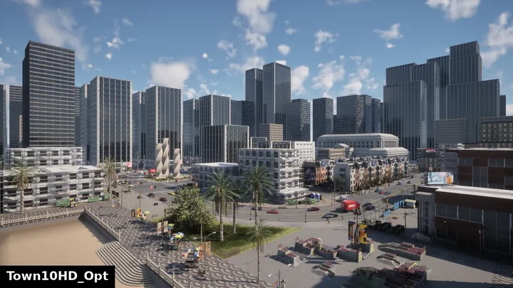
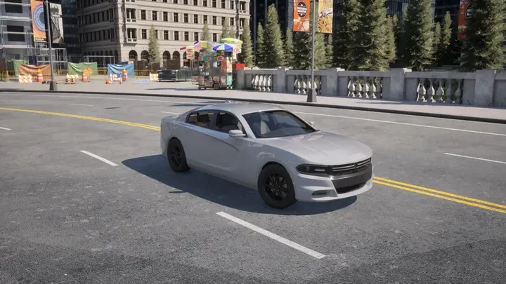
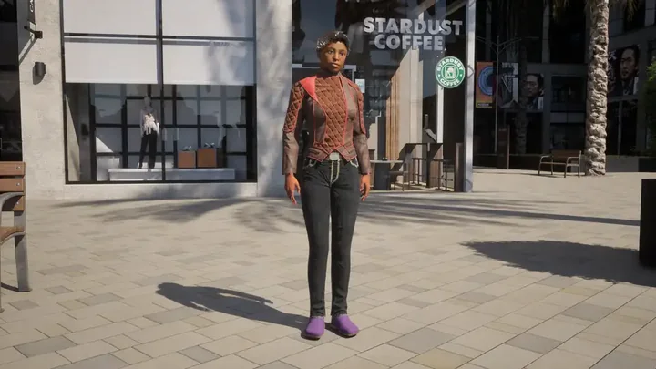
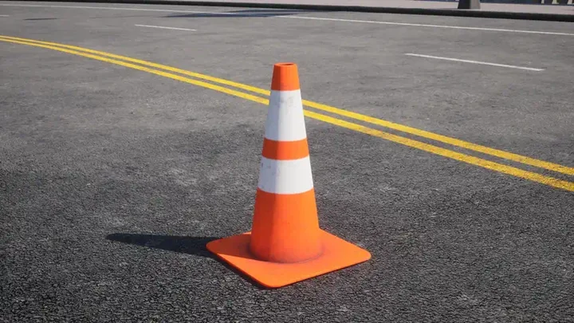

# CARLA catalogue

The CARLA simulator provides a vast library of 3D assets to populate your autonomous agent's virtual environment. The 3D asset library provides numerous pre-built maps to choose from, a diverse array of vehicle models for traffic simulation along with models of pedestrians and other structures or obstacles that can be dynamically added to your simulation during runtime. This catalogue documents all of the 3D assets available to use in your simulations. CARLA also provides a number of example Python scripts to use as guidance for utilizing the API in various contexts.

* [__Vehicles catalogue__](catalogue_vehicles.md)
* [__Pedestrians catalogue__](catalogue_pedestrians.md)
* [__Props catalogue__](catalogue_props.md)
* [__Scripts catalogue__](catalogue_scripts.md)

- [__Maps__](#maps)
- [__Vehicles__](#vehicles)
- [__Pedestrians__](#pedestrians)
- [__Props__](#props)
- [__Inspect the vehicles in the simulator__](#inspect-the-vehicles-in-the-simulator)
- [__Scripts__](#scripts)

## Maps

The default package ships three drivable maps, plus the empty ones used for OpenDRIVE standalone mode. A source build has every town; the rest reach a package through a [content pack](content_authoring_packs.md).


<div class="img-caption">The three maps of the default package (Town10HD_Opt, Town12, Town15), then Mine_01 and the classic towns Town01_Opt to Town07_Opt, one view each.</div>

| Map | In the default package | Summary |
| --- | --- | --- |
| [__Town10HD_Opt__](map_town10.md) | yes | A downtown urban environment with skyscrapers, residential buildings and an ocean promenade. |
| [__Town12__](map_town12.md) | yes | A 10 x 10 km World Partition city with downtown, residential and rural zones and a highway ring road. |
| [__Town15__](map_town15.md) | yes | A large World Partition map of a university campus and its surroundings. |
| [__Town01_Opt__](map_town01.md) | no, content pack | A small town with T-junctions, divided in two by a river with several bridges. |
| [__Town02_Opt__](map_town02.md) | no, content pack | A small town with T-junctions, a park, a high street and residential and commercial areas. |
| [__Town03_Opt__](map_town03.md) | no, content pack | A larger urban town with a central roundabout, an underpass and a raised metro track. |
| [__Town04_Opt__](map_town04.md) | no, content pack | A small mountain town circled by a multi-lane "figure of 8" ring road with an overpass. |
| [__Town05_Opt__](map_town05.md) | no, content pack | A grid town of multi-lane roads and large junctions, with a raised highway around it. |
| [__Town06_Opt__](map_town06.md) | no, content pack | Long multi-lane parallel roads with slip roads, U-turn loops and the Michigan left. |
| [__Town07_Opt__](map_town07.md) | no, content pack | A rural community of cornfields, barns, silos and windmills, with narrow unmarked roads. |
| [__Town11__](map_town11.md) | no, content pack | A large World Partition map without decoration: single-lane roads over hills between clusters of gridded junctions. |
| [__Town13__](map_town13.md) | no, content pack | A World Partition city of Town12's scale with different styles, designed as its train-test pair. |
| [__Town_C__](map_town_c.md) | no, content pack | A Synkrotron city modelled on the Shanghai International Automobile City, with recreations of its landmark buildings. |
| [__Mine_01__](map_mine.md) | no, content pack | An industrial, off-road, open-cast mining environment. |
| [__Eixample__](map_eixample.md) | no, content pack | A digital twin of the street grid of the Eixample district of Barcelona, with untextured buildings. |

The classic towns and the large maps are also available as [content-pack towns](map_content_packs.md) for a packaged release.

Load a map by its exact name, which is the file name: `client.load_world('Town10HD_Opt')`. See [Maps](core_map.md) for what a map contains and how to navigate it.

---
## Vehicles

CARLA provides a diverse array of vehicles, with high fidelity models of real world cars, trucks and bikes, for replicating traffic in your simulations. Browse and choose the vehicles you like in the [__vehicle catalogue__](catalogue_vehicles.md).


<div class="img-caption">A showcase of some of the vehicle blueprints available in CARLA.</div>

---
## Pedestrians

CARLA's asset library includes a variety of pedestrians to simulate foot traffic in the 3D environments surrounding your agent. Browse and choose the pedestrians you want in the [__pedestrian catalogue__](catalogue_pedestrians.md).


<div class="img-caption">A showcase of some of the pedestrian blueprints available in CARLA.</div>

---
## Props

CARLA's props model the various structures and items you might find on or near roads, such as kiosks, statues, benches, boxes, bins, debris or trash. The props can be placed anywhere in your simulation dynamically during runtime. Browse and choose your props in the [__props catalogue__](catalogue_props.md).


<div class="img-caption">A showcase of some of the prop blueprints available in CARLA.</div>

---

## Inspect the vehicles in the simulator

To examine a vehicle from the catalogue, use the following code, retrieve the blueprint ID from the [__vehicles catalogue__](catalogue_vehicles.md) and paste it into the line `bp_lib.find('blueprint.id.goes_here')`:

```py
import carla

client = carla.Client('localhost', 2000)
client.set_timeout(10.0)

# The transforms below are points in Town10HD_Opt
world = client.load_world('Town10HD_Opt')
bp_lib = world.get_blueprint_library()
spectator = world.get_spectator()

# Set up the vehicle transform
vehicle_loc = carla.Location(x=-46.9, y=20.0, z=0.2)
vehicle_rot = carla.Rotation(pitch=0.0, yaw=142.0, roll=0.0)
vehicle_trans = carla.Transform(vehicle_loc,vehicle_rot)

# Paste the blueprint ID here:
vehicle_bp = bp_lib.find('vehicle.lincoln.mkz') 

# Set up the view transform
camera_loc = carla.Location(x=-48.7, y=24.8, z=1.7)
camera_rot = carla.Rotation(pitch=-13.4, yaw=-75.7, roll=0.0)
camera_trans = carla.Transform(camera_loc,camera_rot)

# Spawn the vehicle
vehicle = world.spawn_actor(vehicle_bp, vehicle_trans)

# Move the spectator
spectator.set_transform(camera_trans)
```

Don't forget to destroy the vehicle before you try and spawn another to avoid a collision:

```py
vehicle.destroy()
```

---
## Scripts

CARLA comes provided with a library of example scripts that can be used to explore maps, vehicles or use as guidance for using the API in various contexts. You could also use them as the basis for your own scripts. Choose a script for your application in the [__scripts catalogue__](catalogue_scripts.md).
