<!---

The images in this page were captured by PythonAPI/docs/catalogue_doc_gen.py with these settings:

Town: Town10HD_Opt

Actor transform: Transform(Location(x=-88.099998, y=-73.599998, z=1.000000), Rotation(pitch=0.000000, yaw=90.000000, roll=0.000000))
Camera: framed on each actor's bounding box, bearing=10.0, fill=0.95, min_distance=2.5, pitch=-4.0
Camera resolution: 1920x1080
camera.fov = 60
camera.post_process_profile = Cinematic

weather.cloudiness = 15
weather.dust_storm = 0.0
weather.fog_density = 0.0056
weather.fog_distance = 0.0
weather.fog_falloff = 0.2
weather.mie_scattering_scale = 0.0
weather.precipitation = 0.0
weather.precipitation_deposits = 0.0
weather.rayleigh_scattering_scale = 0.0331
weather.scattering_intensity = 0
weather.sun_altitude_angle = 45
weather.sun_azimuth_angle = 230
weather.wetness = 0.0
weather.wind_intensity = 0.35

Do not edit this page by hand, PythonAPI/docs/catalogue_doc_gen.py overwrites it.

--->

# Pedestrian catalogue

* __Adults__
	* [__0015 - adult pedestrian 1__](#0015-adult-pedestrian-1)
	* [__0016 - adult pedestrian 2__](#0016-adult-pedestrian-2)
	* [__0017 - adult pedestrian 3__](#0017-adult-pedestrian-3)
	* [__0018 - adult pedestrian 4__](#0018-adult-pedestrian-4)
	* [__0019 - adult pedestrian 5__](#0019-adult-pedestrian-5)
	* [__0021 - adult pedestrian 6__](#0021-adult-pedestrian-6)
	* [__0022 - adult pedestrian 7__](#0022-adult-pedestrian-7)
	* [__0023 - adult pedestrian 8__](#0023-adult-pedestrian-8)
	* [__0024 - adult pedestrian 9__](#0024-adult-pedestrian-9)
	* [__0025 - adult pedestrian 10__](#0025-adult-pedestrian-10)
	* [__0026 - adult pedestrian 11__](#0026-adult-pedestrian-11)
	* [__0027 - adult pedestrian 12__](#0027-adult-pedestrian-12)
	* [__0028 - adult pedestrian 13__](#0028-adult-pedestrian-13)
	* [__0029 - adult pedestrian 14__](#0029-adult-pedestrian-14)
	* [__0030 - adult pedestrian 15__](#0030-adult-pedestrian-15)
	* [__0032 - adult pedestrian 16__](#0032-adult-pedestrian-16)
	* [__0033 - adult pedestrian 17__](#0033-adult-pedestrian-17)
	* [__0034 - adult pedestrian 18__](#0034-adult-pedestrian-18)
	* [__0035 - adult pedestrian 19__](#0035-adult-pedestrian-19)
	* [__0036 - adult pedestrian 20__](#0036-adult-pedestrian-20)
	* [__0037 - adult pedestrian 21__](#0037-adult-pedestrian-21)
	* [__0038 - adult pedestrian 22__](#0038-adult-pedestrian-22)
	* [__0039 - adult pedestrian 23__](#0039-adult-pedestrian-23)
	* [__0040 - adult pedestrian 24__](#0040-adult-pedestrian-24)
	* [__0041 - adult pedestrian 25__](#0041-adult-pedestrian-25)
	* [__0042 - adult pedestrian 26__](#0042-adult-pedestrian-26)
	* [__0043 - adult pedestrian 27__](#0043-adult-pedestrian-27)
	* [__0044 - adult pedestrian 28__](#0044-adult-pedestrian-28)
	* [__0045 - adult pedestrian 29__](#0045-adult-pedestrian-29)
	* [__0046 - adult pedestrian 30__](#0046-adult-pedestrian-30)
	* [__0047 - adult pedestrian 31__](#0047-adult-pedestrian-31)
	* [__0048 - adult pedestrian 32__](#0048-adult-pedestrian-32)
* __Children__
	* [__0049 - child pedestrian 1__](#0049-child-pedestrian-1)
	* [__0050 - child pedestrian 2__](#0050-child-pedestrian-2)
	* [__0051 - child pedestrian 3__](#0051-child-pedestrian-3)
	* [__0052 - child pedestrian 4__](#0052-child-pedestrian-4)
* __Special__
	* [__0020 - police pedestrian 1__](#0020-police-pedestrian-1)
	* [__0031 - police pedestrian 2__](#0031-police-pedestrian-2)

---

## Adults

### 0015 - adult pedestrian 1

* __Blueprint ID__: `walker.pedestrian.0015`
* __Age__: adult
* __Gender__: female
* __Generation__: 2
* __Can use wheelchair__: yes

### 0016 - adult pedestrian 2

* __Blueprint ID__: `walker.pedestrian.0016`
* __Age__: adult
* __Gender__: female
* __Generation__: 2
* __Can use wheelchair__: yes

### 0017 - adult pedestrian 3

* __Blueprint ID__: `walker.pedestrian.0017`
* __Age__: adult
* __Gender__: female
* __Generation__: 2
* __Can use wheelchair__: no

### 0018 - adult pedestrian 4

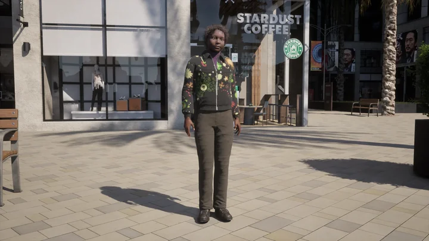

* __Blueprint ID__: `walker.pedestrian.0018`
* __Age__: adult
* __Gender__: female
* __Generation__: 2
* __Can use wheelchair__: no

### 0019 - adult pedestrian 5

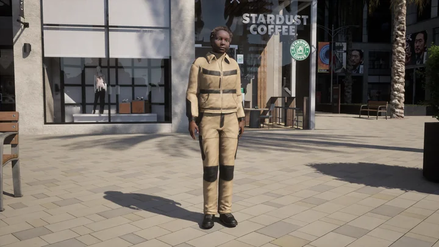

* __Blueprint ID__: `walker.pedestrian.0019`
* __Age__: adult
* __Gender__: female
* __Generation__: 2
* __Can use wheelchair__: no

### 0021 - adult pedestrian 6

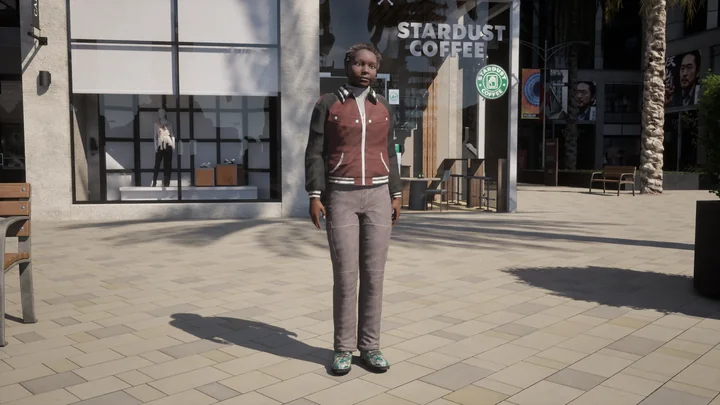

* __Blueprint ID__: `walker.pedestrian.0021`
* __Age__: adult
* __Gender__: female
* __Generation__: 2
* __Can use wheelchair__: no

### 0022 - adult pedestrian 7

* __Blueprint ID__: `walker.pedestrian.0022`
* __Age__: adult
* __Gender__: female
* __Generation__: 2
* __Can use wheelchair__: no

### 0023 - adult pedestrian 8

* __Blueprint ID__: `walker.pedestrian.0023`
* __Age__: adult
* __Gender__: female
* __Generation__: 2
* __Can use wheelchair__: no

### 0024 - adult pedestrian 9

* __Blueprint ID__: `walker.pedestrian.0024`
* __Age__: adult
* __Gender__: female
* __Generation__: 2
* __Can use wheelchair__: no

### 0025 - adult pedestrian 10

* __Blueprint ID__: `walker.pedestrian.0025`
* __Age__: adult
* __Gender__: male
* __Generation__: 2
* __Can use wheelchair__: yes

### 0026 - adult pedestrian 11

* __Blueprint ID__: `walker.pedestrian.0026`
* __Age__: adult
* __Gender__: male
* __Generation__: 2
* __Can use wheelchair__: yes

### 0027 - adult pedestrian 12

* __Blueprint ID__: `walker.pedestrian.0027`
* __Age__: adult
* __Gender__: male
* __Generation__: 2
* __Can use wheelchair__: no

### 0028 - adult pedestrian 13

* __Blueprint ID__: `walker.pedestrian.0028`
* __Age__: adult
* __Gender__: male
* __Generation__: 2
* __Can use wheelchair__: yes

### 0029 - adult pedestrian 14

* __Blueprint ID__: `walker.pedestrian.0029`
* __Age__: adult
* __Gender__: male
* __Generation__: 2
* __Can use wheelchair__: yes

### 0030 - adult pedestrian 15

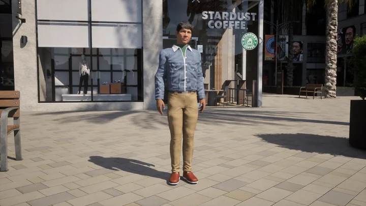

* __Blueprint ID__: `walker.pedestrian.0030`
* __Age__: adult
* __Gender__: male
* __Generation__: 2
* __Can use wheelchair__: no

### 0032 - adult pedestrian 16

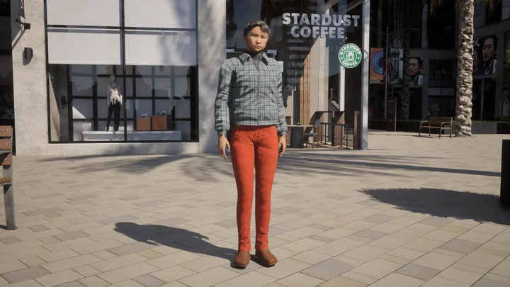

* __Blueprint ID__: `walker.pedestrian.0032`
* __Age__: adult
* __Gender__: female
* __Generation__: 2
* __Can use wheelchair__: no

### 0033 - adult pedestrian 17

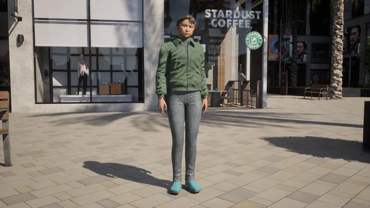

* __Blueprint ID__: `walker.pedestrian.0033`
* __Age__: adult
* __Gender__: female
* __Generation__: 2
* __Can use wheelchair__: no

### 0034 - adult pedestrian 18

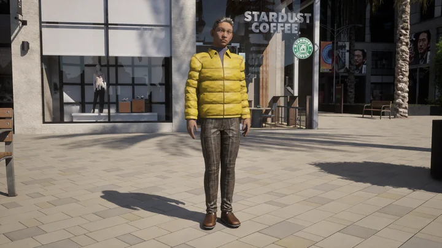

* __Blueprint ID__: `walker.pedestrian.0034`
* __Age__: adult
* __Gender__: male
* __Generation__: 2
* __Can use wheelchair__: no

### 0035 - adult pedestrian 19

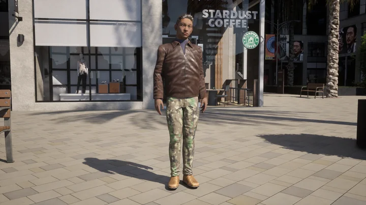

* __Blueprint ID__: `walker.pedestrian.0035`
* __Age__: adult
* __Gender__: male
* __Generation__: 2
* __Can use wheelchair__: no

### 0036 - adult pedestrian 20

* __Blueprint ID__: `walker.pedestrian.0036`
* __Age__: adult
* __Gender__: male
* __Generation__: 2
* __Can use wheelchair__: no

### 0037 - adult pedestrian 21

* __Blueprint ID__: `walker.pedestrian.0037`
* __Age__: adult
* __Gender__: male
* __Generation__: 2
* __Can use wheelchair__: no

### 0038 - adult pedestrian 22

* __Blueprint ID__: `walker.pedestrian.0038`
* __Age__: adult
* __Gender__: male
* __Generation__: 2
* __Can use wheelchair__: no

### 0039 - adult pedestrian 23

* __Blueprint ID__: `walker.pedestrian.0039`
* __Age__: adult
* __Gender__: female
* __Generation__: 2
* __Can use wheelchair__: no

### 0040 - adult pedestrian 24

* __Blueprint ID__: `walker.pedestrian.0040`
* __Age__: adult
* __Gender__: female
* __Generation__: 2
* __Can use wheelchair__: no

### 0041 - adult pedestrian 25

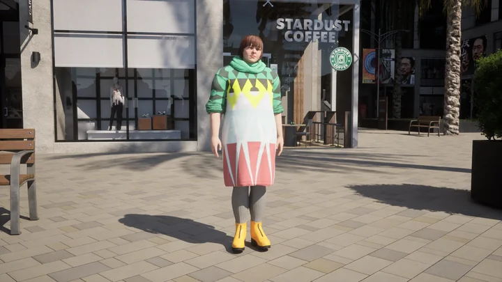

* __Blueprint ID__: `walker.pedestrian.0041`
* __Age__: adult
* __Gender__: female
* __Generation__: 2
* __Can use wheelchair__: no

### 0042 - adult pedestrian 26

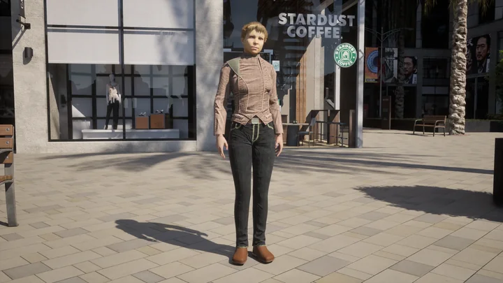

* __Blueprint ID__: `walker.pedestrian.0042`
* __Age__: adult
* __Gender__: female
* __Generation__: 2
* __Can use wheelchair__: no

### 0043 - adult pedestrian 27

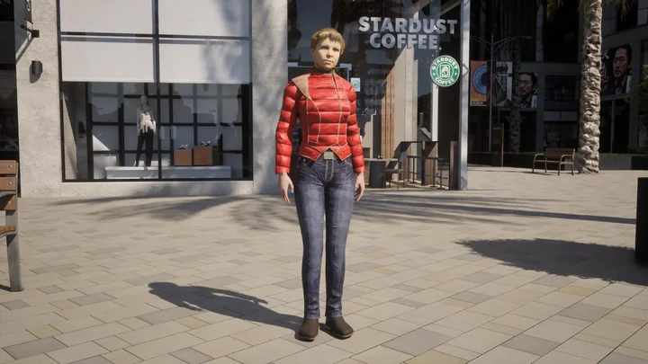

* __Blueprint ID__: `walker.pedestrian.0043`
* __Age__: adult
* __Gender__: female
* __Generation__: 2
* __Can use wheelchair__: no

### 0044 - adult pedestrian 28

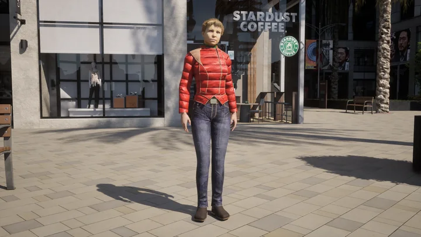

* __Blueprint ID__: `walker.pedestrian.0044`
* __Age__: adult
* __Gender__: female
* __Generation__: 2
* __Can use wheelchair__: no

### 0045 - adult pedestrian 29

* __Blueprint ID__: `walker.pedestrian.0045`
* __Age__: adult
* __Gender__: male
* __Generation__: 2
* __Can use wheelchair__: no

### 0046 - adult pedestrian 30

* __Blueprint ID__: `walker.pedestrian.0046`
* __Age__: adult
* __Gender__: male
* __Generation__: 2
* __Can use wheelchair__: no

### 0047 - adult pedestrian 31

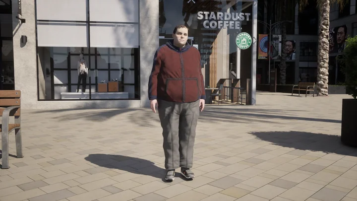

* __Blueprint ID__: `walker.pedestrian.0047`
* __Age__: adult
* __Gender__: male
* __Generation__: 2
* __Can use wheelchair__: no

### 0048 - adult pedestrian 32

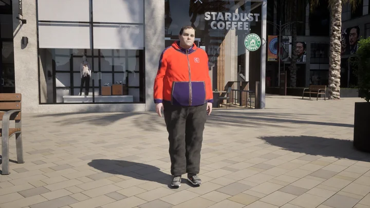

* __Blueprint ID__: `walker.pedestrian.0048`
* __Age__: adult
* __Gender__: male
* __Generation__: 2
* __Can use wheelchair__: no

---

## Children

### 0049 - child pedestrian 1

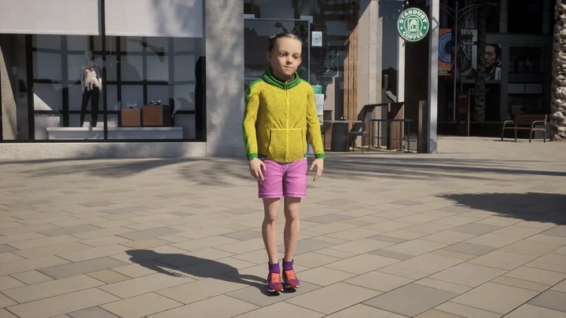

* __Blueprint ID__: `walker.pedestrian.0049`
* __Age__: child
* __Gender__: female
* __Generation__: 2
* __Can use wheelchair__: no

### 0050 - child pedestrian 2

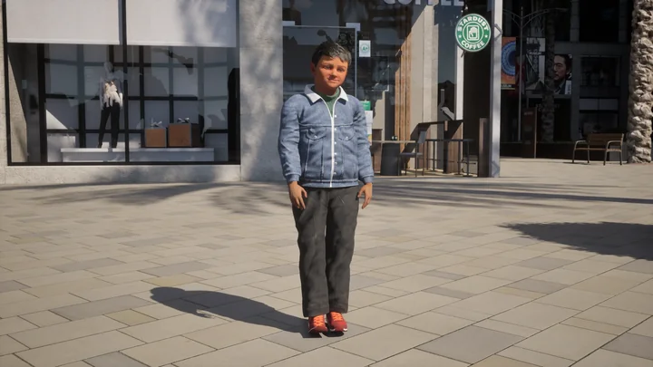

* __Blueprint ID__: `walker.pedestrian.0050`
* __Age__: child
* __Gender__: male
* __Generation__: 2
* __Can use wheelchair__: no

### 0051 - child pedestrian 3

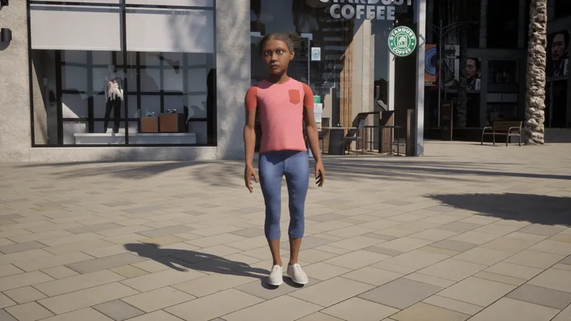

* __Blueprint ID__: `walker.pedestrian.0051`
* __Age__: child
* __Gender__: female
* __Generation__: 3
* __Can use wheelchair__: no

### 0052 - child pedestrian 4

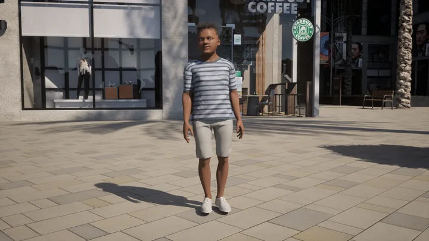

* __Blueprint ID__: `walker.pedestrian.0052`
* __Age__: child
* __Gender__: male
* __Generation__: 3
* __Can use wheelchair__: no

---

## Special

### 0020 - police pedestrian 1

* __Blueprint ID__: `walker.pedestrian.0020`
* __Age__: adult
* __Gender__: female
* __Generation__: 2
* __Special type__: police
* __Can use wheelchair__: no

### 0031 - police pedestrian 2

* __Blueprint ID__: `walker.pedestrian.0031`
* __Age__: adult
* __Gender__: male
* __Generation__: 2
* __Special type__: police
* __Can use wheelchair__: no

