<!---

The images in this page were captured by PythonAPI/docs/catalogue_doc_gen.py with these settings:

Town: Town10HD_Opt

Actor transform: Transform(Location(x=102.900002, y=-20.000000, z=0.300000), Rotation(pitch=0.000000, yaw=90.000000, roll=0.000000))
Camera: framed on each actor's bounding box, bearing=40.0, fill=1.05, min_distance=2.5, pitch=-10.0
Camera resolution: 1920x1080
camera.fov = 60
camera.post_process_profile = Cinematic

weather.cloudiness = 15
weather.dust_storm = 0.0
weather.fog_density = 0.0056
weather.fog_distance = 0.0
weather.fog_falloff = 0.2
weather.mie_scattering_scale = 0.0
weather.precipitation = 0.0
weather.precipitation_deposits = 0.0
weather.rayleigh_scattering_scale = 0.0331
weather.scattering_intensity = 0
weather.sun_altitude_angle = 45
weather.sun_azimuth_angle = 230
weather.wetness = 0.0
weather.wind_intensity = 0.35

Do not edit this page by hand, PythonAPI/docs/catalogue_doc_gen.py overwrites it.

--->

# Vehicle catalogue

* __Cars__
	* [__Dodge - Charger__](#dodge-charger)
	* [__Dodge - Police Charger__](#dodge-police-charger)
	* [__Kia - Niro__](#kia-niro)
	* [__Lincoln - MKZ__](#lincoln-mkz)
	* [__Mini - Cooper S__](#mini-cooper-s)
	* [__Nissan - Patrol__](#nissan-patrol)
	* [__Ford - Crown (taxi)__](#ford-crown-taxi)
	* [__Tesla - Model 3__](#tesla-model-3)
	* [__Audi - TT__](#audi-tt)
	* [__Chevrolet - Impala__](#chevrolet-impala)
	* [__Ford - Crown__](#ford-crown)
	* [__Ford - Mustang__](#ford-mustang)
	* [__Mercedes - Coupe__](#mercedes-coupe)
* __Motorcycles__
	* [__Harley-Davidson - Low Rider__](#harley-davidson-low-rider)
	* [__Kawasaki - Ninja__](#kawasaki-ninja)
	* [__Vespa - ZX125__](#vespa-zx125)
	* [__Yamaha - YZF__](#yamaha-yzf)
* __Bicycles__
	* [__BH - Crossbike__](#bh-crossbike)
	* [__Diamondback - Century__](#diamondback-century)
	* [__Gazelle - Omafiets__](#gazelle-omafiets)
* __Trucks__
	* [__Ford - Ambulance__](#ford-ambulance)
	* [__CARLA Motors - CarlaCola__](#carla-motors-carlacola)
	* [__CARLA Motors - Firetruck__](#carla-motors-firetruck)
* __Vans__
	* [__Mercedes - Sprinter__](#mercedes-sprinter)
* __Buses__
	* [__Mitsubishi - Fusorosa__](#mitsubishi-fusorosa)
* __Industrial__
	* [__Mining earth mover__](#mining-earth-mover)

---

## Cars

### Dodge - Charger

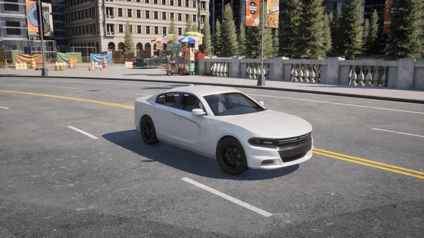

* __Blueprint ID__: `vehicle.dodge.charger`
* __Base type__: car
* __Generation__: 3
* __Number of wheels__: 4
* __Has lights__: yes
* __Has opening doors__: yes

### Dodge - Police Charger

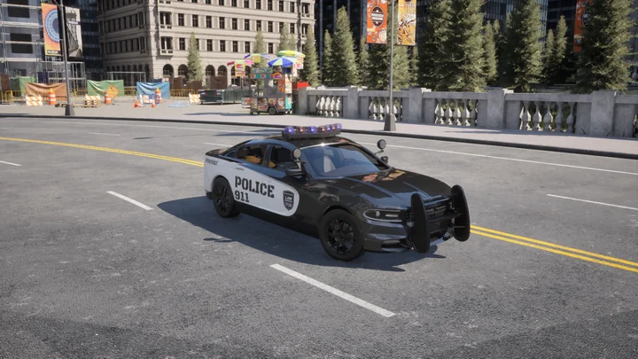

* __Blueprint ID__: `vehicle.dodgecop.charger`
* __Base type__: car
* __Special type__: emergency
* __Generation__: 3
* __Number of wheels__: 4
* __Has lights__: yes
* __Has opening doors__: yes

### Kia - Niro

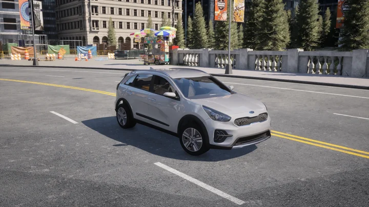

* __Blueprint ID__: `vehicle.kia.niro`
* __Base type__: car
* __Generation__: 3
* __Number of wheels__: 4
* __Has lights__: yes
* __Has opening doors__: yes

### Lincoln - MKZ

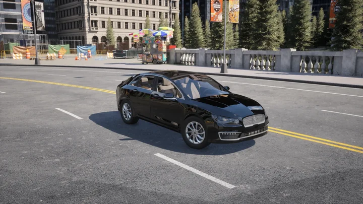

* __Blueprint ID__: `vehicle.lincoln.mkz`
* __Base type__: car
* __Generation__: unspecified
* __Number of wheels__: 4
* __Has lights__: yes
* __Has opening doors__: yes

### Mini - Cooper S

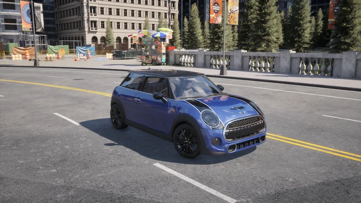

* __Blueprint ID__: `vehicle.mini.cooper`
* __Base type__: car
* __Generation__: 3
* __Number of wheels__: 4
* __Has lights__: yes
* __Has opening doors__: yes

### Nissan - Patrol

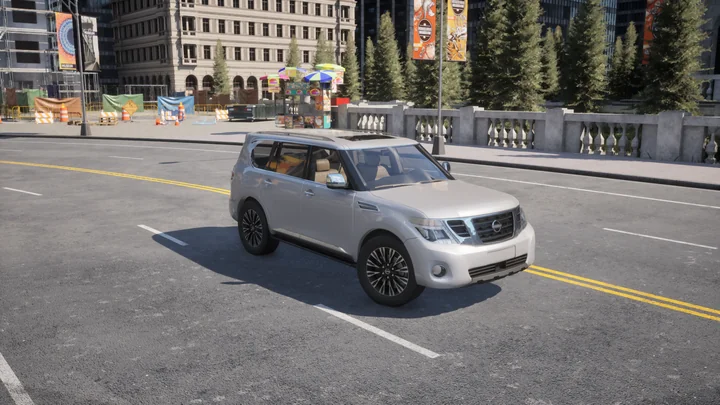

* __Blueprint ID__: `vehicle.nissan.patrol`
* __Base type__: car
* __Generation__: 3
* __Number of wheels__: 4
* __Has lights__: yes
* __Has opening doors__: yes

### Ford - Crown (taxi)

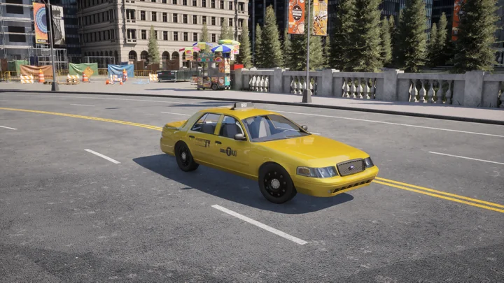

* __Blueprint ID__: `vehicle.taxi.ford`
* __Base type__: car
* __Special type__: taxi
* __Generation__: 3
* __Number of wheels__: 4
* __Has lights__: yes
* __Has opening doors__: yes

### Tesla - Model 3

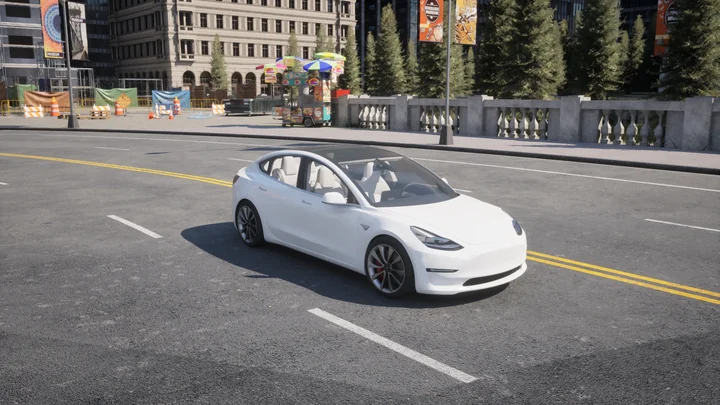

* __Blueprint ID__: `vehicle.tesla.model3`
* __Base type__: car
* __Special type__: electric
* __Generation__: 3
* __Number of wheels__: 4
* __Has lights__: yes
* __Has opening doors__: yes

### Audi - TT

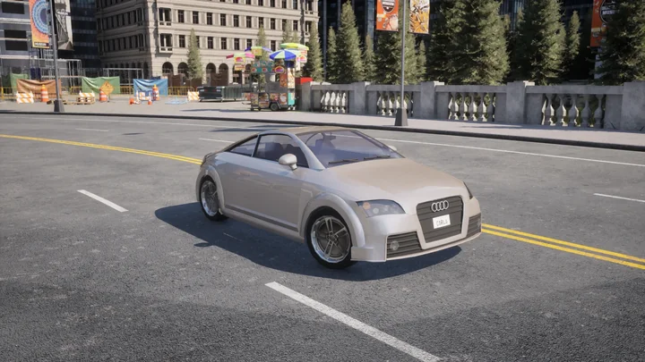

* __Blueprint ID__: `vehicle.ue4.audi.tt`
* __Base type__: car
* __Generation__: 2
* __Number of wheels__: 4
* __Has lights__: yes
* __Has opening doors__: no

### Chevrolet - Impala

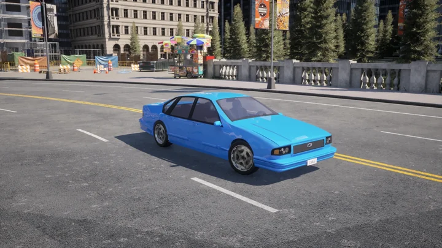

* __Blueprint ID__: `vehicle.ue4.chevrolet.impala`
* __Base type__: car
* __Generation__: 2
* __Number of wheels__: 4
* __Has lights__: yes
* __Has opening doors__: no

### Ford - Crown

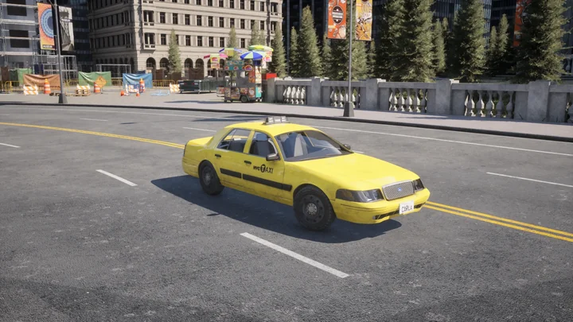

* __Blueprint ID__: `vehicle.ue4.ford.crown`
* __Base type__: car
* __Generation__: unspecified
* __Number of wheels__: 4
* __Has lights__: yes
* __Has opening doors__: no

### Ford - Mustang

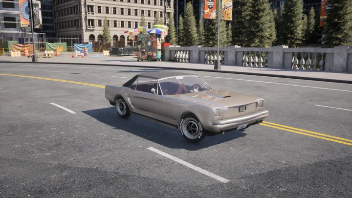

* __Blueprint ID__: `vehicle.ue4.ford.mustang`
* __Base type__: car
* __Generation__: unspecified
* __Number of wheels__: 4
* __Has lights__: yes
* __Has opening doors__: no

### Mercedes - Coupe

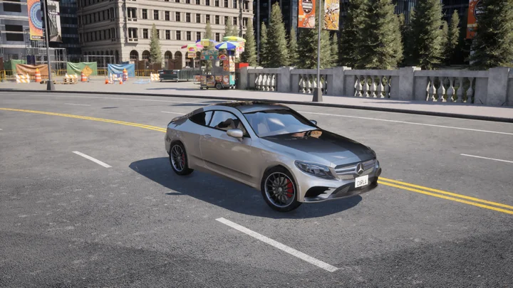

* __Blueprint ID__: `vehicle.ue4.mercedes.ccc`
* __Base type__: car
* __Generation__: 2
* __Number of wheels__: 4
* __Has lights__: yes
* __Has opening doors__: no

---

## Motorcycles

### Harley-Davidson - Low Rider

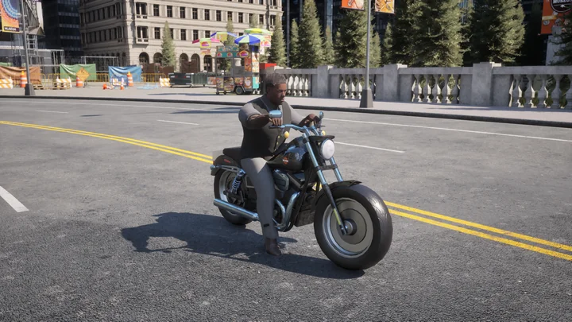

* __Blueprint ID__: `vehicle.harley-davidson.low_rider`
* __Base type__: motorcycle
* __Generation__: unspecified
* __Number of wheels__: 2
* __Has lights__: yes
* __Has opening doors__: no

### Kawasaki - Ninja

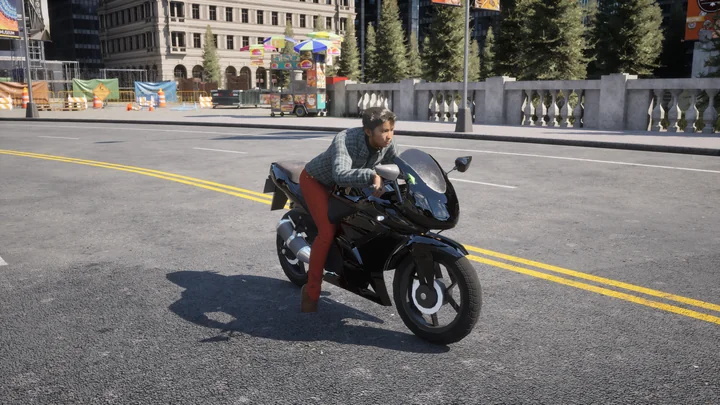

* __Blueprint ID__: `vehicle.kawasaki.ninja`
* __Base type__: motorcycle
* __Generation__: unspecified
* __Number of wheels__: 2
* __Has lights__: yes
* __Has opening doors__: no

### Vespa - ZX125

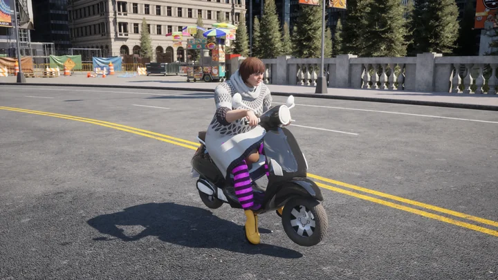

* __Blueprint ID__: `vehicle.vespa.zx125`
* __Base type__: motorcycle
* __Generation__: unspecified
* __Number of wheels__: 2
* __Has lights__: yes
* __Has opening doors__: no

### Yamaha - YZF

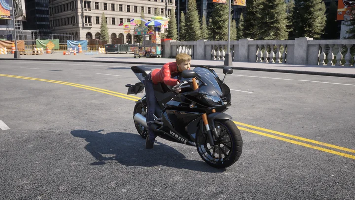

* __Blueprint ID__: `vehicle.yamaha.yzf`
* __Base type__: motorcycle
* __Generation__: unspecified
* __Number of wheels__: 2
* __Has lights__: yes
* __Has opening doors__: no

---

## Bicycles

### BH - Crossbike

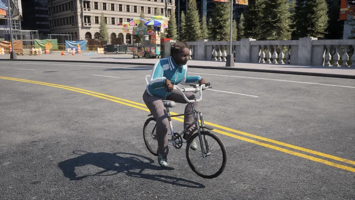

* __Blueprint ID__: `vehicle.bh.crossbike`
* __Base type__: bicycle
* __Generation__: unspecified
* __Number of wheels__: 2
* __Has lights__: yes
* __Has opening doors__: no

### Diamondback - Century

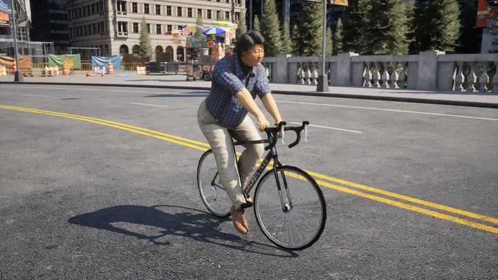

* __Blueprint ID__: `vehicle.diamondback.century`
* __Base type__: bicycle
* __Generation__: unspecified
* __Number of wheels__: 2
* __Has lights__: yes
* __Has opening doors__: no

### Gazelle - Omafiets

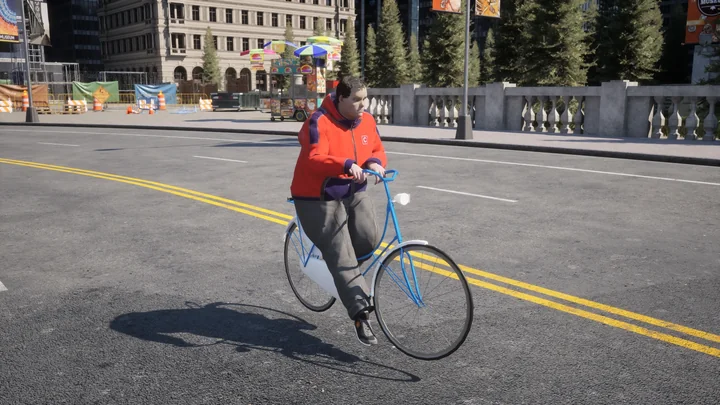

* __Blueprint ID__: `vehicle.gazelle.omafiets`
* __Base type__: bicycle
* __Generation__: unspecified
* __Number of wheels__: 2
* __Has lights__: yes
* __Has opening doors__: no

---

## Trucks

### Ford - Ambulance

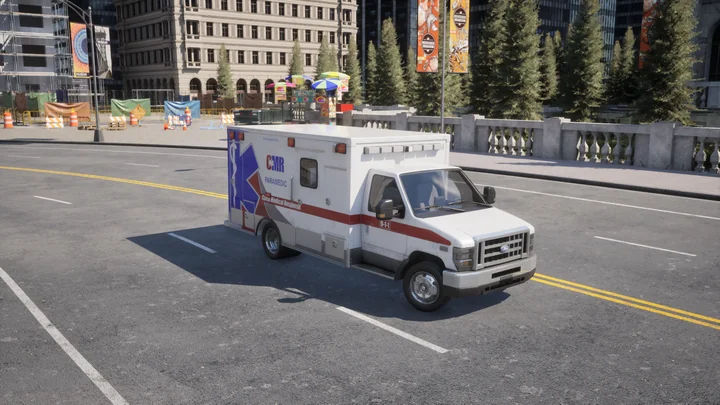

* __Blueprint ID__: `vehicle.ambulance.ford`
* __Base type__: truck
* __Special type__: emergency
* __Generation__: 3
* __Number of wheels__: 4
* __Has lights__: yes
* __Has opening doors__: yes

### CARLA Motors - CarlaCola

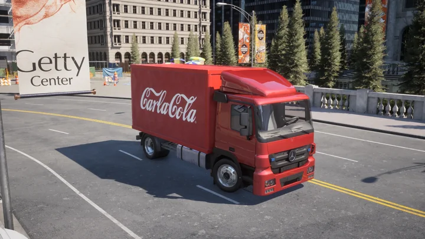

* __Blueprint ID__: `vehicle.carlacola.actors`
* __Base type__: truck
* __Generation__: 3
* __Number of wheels__: 4
* __Has lights__: yes
* __Has opening doors__: yes

### CARLA Motors - Firetruck

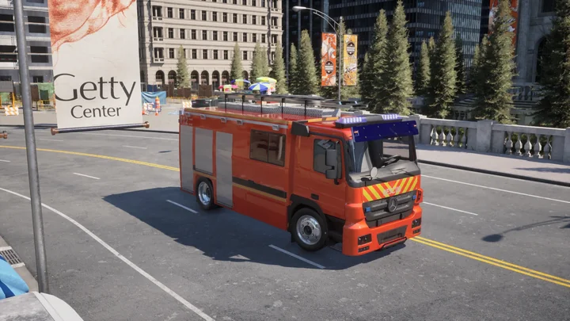

* __Blueprint ID__: `vehicle.firetruck.actors`
* __Base type__: truck
* __Special type__: emergency
* __Generation__: 3
* __Number of wheels__: 4
* __Has lights__: yes
* __Has opening doors__: yes

---

## Vans

### Mercedes - Sprinter

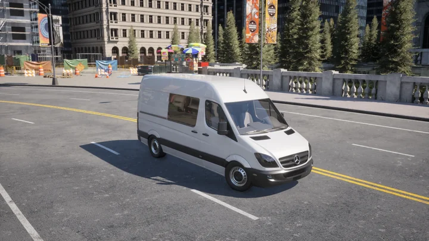

* __Blueprint ID__: `vehicle.sprinter.mercedes`
* __Base type__: van
* __Generation__: 3
* __Number of wheels__: 4
* __Has lights__: yes
* __Has opening doors__: yes

---

## Buses

### Mitsubishi - Fusorosa

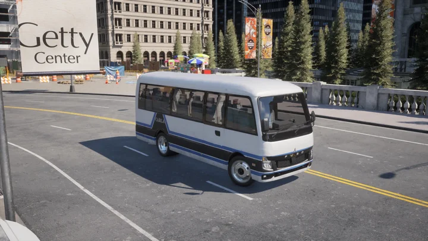

* __Blueprint ID__: `vehicle.fuso.mitsubishi`
* __Base type__: bus
* __Generation__: 3
* __Number of wheels__: 4
* __Has lights__: yes
* __Has opening doors__: no

---

## Industrial

### Mining earth mover

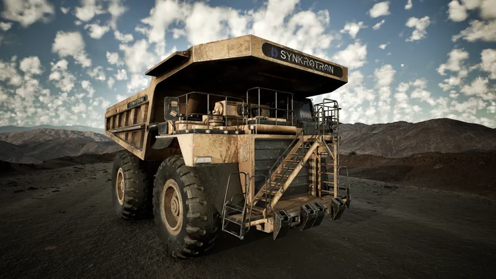

* __Blueprint ID__: `vehicle.miningtruck.miningtruck`
* __Base type__: industrial
* __Generation__: 3
* __Number of wheels__: 4
* __Has lights__: yes
* __Has opening doors__: no
* __Available on__: Mine_01 only

