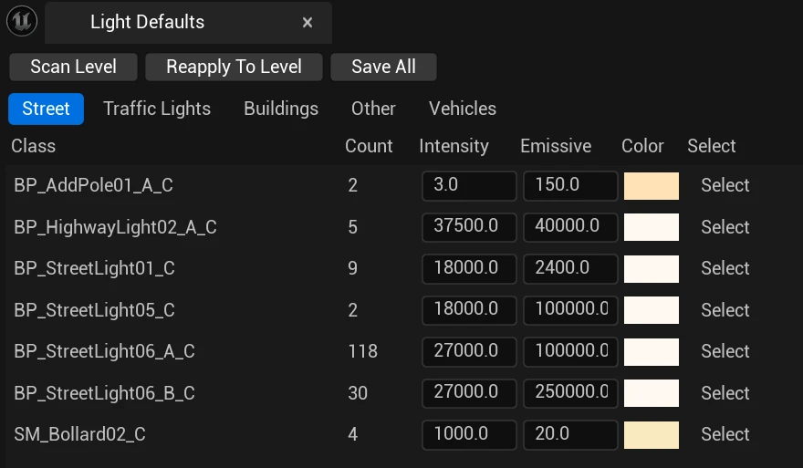

# Content authoring - lights

The brightness and colour of the lights in a CARLA map are set per class of light, not per actor: every street lamp of one blueprint, the windows of every building of one family, every traffic light of one type and every vehicle model share one set of values. Those values are kept in one file, `Content/Carla/Config/Lights/Defaults.json`, and edited with the __Light Defaults__ panel in the editor. CARLA applies them to the maps it loads, as described in [When the defaults are applied](#when-the-defaults-are-applied), so a light set once looks the same in every town.

- [__The Light Defaults panel__](#the-light-defaults-panel)
- [__What each tab controls__](#what-each-tab-controls)
- [__When the defaults are applied__](#when-the-defaults-are-applied)
- [__The JSON file__](#the-json-file)

Running the Unreal Engine editor is required for this process, therefore you need to [build CARLA from source](build_carla.md).

---

## The Light Defaults panel

Open a map in the editor and choose __Window > Light Defaults__. Press __Scan Level__ to list the lights of the open level, one row per class, with the number of lights of that class in the level.


<div class="img-caption">The Street tab of the Light Defaults panel on Town10HD_Opt, one row per street lamp blueprint.</div>

Every value you change is applied to the level at once, so you can judge it in the viewport, at night or by day, before keeping it. Nothing is written to disk until you press __Save All__, which saves every row of every tab to `Defaults.json`. __Reapply To Level__ reads the file again and applies it to the level, discarding the changes you have not saved.

__Select__ selects in the viewport the actors of that row, to find them in the level.

---

## What each tab controls

| Tab | Rows | Fields |
| --- | --- | --- |
| __Street__ | One per street lamp class (`BP_StreetLight01_C`, `BP_HighwayLight02_A_C`...) | __Intensity__ of the light in lumens, __Emissive__ intensity of the lamp material, __Color__ of the light |
| __Other__ | One per class of the other lights of the level, such as billboards and bus stops | __Intensity__, __Emissive__ and __Color__, as in Street |
| __Buildings__ | One per family of building materials (`Apt20`, `MI_Factory`...), plus `ProceduralBuildings` and `LegacyBuildings` for the lit windows | __Intensity__, __Emissive__ and __Color__; for `ProceduralBuildings` and `LegacyBuildings`, __Percent Lit__ instead of Intensity |
| __Traffic Lights__ | One per traffic light class | __Emissive__ intensity of the signal lamps; __Preview On__ lights the signals in the editor to judge them |
| __Vehicles__ | Every vehicle model with lights, whether or not it is in the level | __Intensity__ of the lamp glow, and the intensity of the real lights of each group: Position, Low Beam, High Beam, Fog, Brake, Reverse, L Blink, R Blink, Special1 |

__Street lights__ are photometric: __Intensity__ is in lumens, and a real road luminaire is about 10000 to 25000 lm. Values below `1000` are read as kilolumens, so `18` and `18000` give the same light. The lights of the other tabs keep the scale of the UE4 content: the light component gets __Intensity__ times `10000`.

__Buildings.__ `ProceduralBuildings` sets the windows of the buildings made with the procedural building tool, and __Percent Lit__ is the percentage of their windows that are lit at night. `LegacyBuildings` sets the older building meshes, where __Percent Lit__ is the percentage of whole buildings that are lit. Their __Emissive__ and __Color__ are the glow and colour of the lit windows. How the window material uses these values is described in [Material customization](content_authoring_materials.md#fake-interior-master).

__Vehicles.__ The rows come from the vehicle catalogue, not from the level. __Intensity__ is the glow of the lamps, the same for every group of the vehicle; most CARLA vehicles use `200000`. The group columns set the spot and point lights that light the road, in units of `10000`; a group the vehicle does not have is greyed out. __Preview__ spawns the vehicle on the ground below the editor camera and frames the camera on it, and removes it when you toggle it off; one vehicle is previewed at a time, so to balance it against another model, place that model in the level. How the lamps of a vehicle are built is described in [Content authoring - vehicles](content_authoring_vehicles.md#lights).

To give a new lamp, building or vehicle the right light, place it in a level, press __Scan Level__, adjust its row against the classes that already look right, and press __Save All__.

---

## When the defaults are applied

| Lights | Applied |
| --- | --- |
| Street, Other and building lights | Whenever a light is created: when the map loads and when a World Partition cell streams in, in the editor and on the server |
| Building windows | On the server, when the map loads and when a World Partition cell streams in. In the editor, when the map opens; regions loaded later get them with __Reapply To Level__ |
| Vehicles | When the vehicle spawns, and again every time its light state changes, so only the groups that are on glow |
| Traffic lights | Only in the editor: when the map opens, and with __Reapply To Level__ |

A class with no entry in the file keeps the values set in its blueprint.

At runtime, the [Python API](python_api.md#carla.Light) can still change any street, building or other light: `carla.Light.set_intensity()`, `set_color()` and the [carla.LightManager](python_api.md#carla.LightManager) override the default of that light until the map is loaded again, or, on a World Partition map, until the cell of that light is unloaded. The defaults themselves are not readable from the client; query the lights instead.

---

## The JSON file

`Content/Carla/Config/Lights/Defaults.json` has two sections. `perClass` holds the street, other, building and traffic light rows, keyed by class name or building family, each with `color`, `intensity` and `emissiveIntensity`. `perVehicleClass` holds the vehicles, keyed by blueprint class, with `Intensity` and a `GroupIntensity` value per light group.

```json
{
  "perClass": {
    "BP_StreetLight01_C": { "color": { "r": 1, "g": 0.95, "b": 0.9, "a": 1 }, "intensity": 18000, "emissiveIntensity": 2400 },
    "ProceduralBuildings": { "color": { "r": 1, "g": 0.82, "b": 0.6, "a": 1 }, "intensity": 30, "emissiveIntensity": 2.5 }
  },
  "perVehicleClass": {
    "BP_LincolnMKZ_C": { "Intensity": 200000, "GroupIntensity": { "Low Beam": 2.9, "High Beam": 6.0 } }
  }
}
```

The panel is the normal way to edit the file, but it is plain JSON: it can be edited by hand or by a script, and is staged into packaged builds with the rest of `Content/Carla/Config`.
