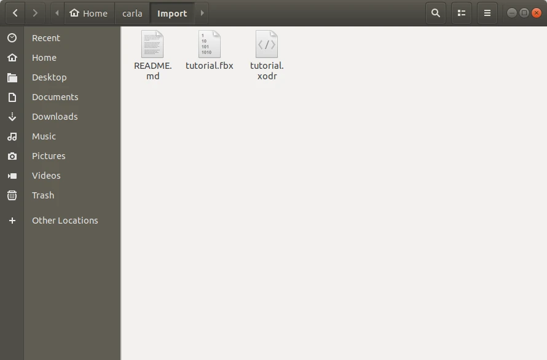
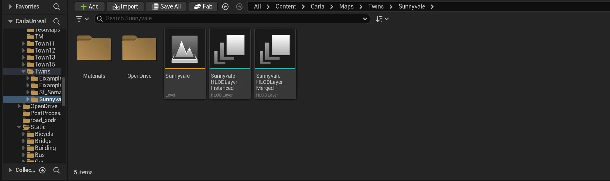

# Content authoring - maps

CARLA comes with a generous complement of assets for creating driving simulations out of the box. However, the real power of CARLA comes in its comprehensive extensibility, allowing users to create entirely custom environments populated with bespoke assets like buildings, benches, trash cans, statues, street lights and bus stops.

This page is the route through making one: the road network, the import into CARLA, and then the pages that cover decorating it.

- [__Prerequisites__](#prerequisites)
- [__Create the road network__](#create-the-road-network)
- [__Import the road network into CARLA__](#import-the-road-network-into-carla)
- [__Convert the map to World Partition__](#convert-the-map-to-world-partition)
- [__Decorate the map__](#decorate-the-map)

---
## Prerequisites

To follow this guide you need CARLA built from source, so that you can use the Unreal Editor: follow the [__build instructions__](build_carla.md) for your operating system and check that the editor opens. You also need RoadRunner (or another OpenDRIVE editor) for the road network, and a 3D modelling application such as Blender, Maya or 3ds Max if you want to create your own assets.

!!! Note
    A map larger than a town is a [large map](core_large_maps.md), streamed with World Partition. The steps below are the same, and a tiled export is imported the same way as a single file; what changes is how you export it, described in [RoadRunner — large maps](roadrunner.md#large-maps), and the conversion step below.

---
## Create the road network

The road network is the part CARLA cannot generate for you: the geometry of the roads and the [__ASAM OpenDRIVE__](https://www.asam.net/standards/detail/opendrive/) description of them. [__RoadRunner__](roadrunner.md) is the recommended editor, and that page covers building a map that imports cleanly and the export settings CARLA expects.

Two alternatives produce the same pair of files:

- [__TrueVision Designer__](https://www.truevision.ai/designer) — an open source editor with many of the same features, for when a RoadRunner licence is out of reach.
- [__OpenStreetMap__](content_authoring_maps_openstreetmap.md) — a road network taken from the real world, with no scenery around it.

The [__Digital Twin Tool__](content_authoring_maps_digital_twin.md) goes further and generates a whole decorated town from an OpenStreetMap region, skipping most of this page.

---
## Import the road network into CARLA

!!! agent "Ask your agent"
    *"Import my RoadRunner map from ~/maps/MyTown (FBX and OpenDRIVE) into CARLA and load it."*

    Skill: `import-carla-ue58-map`. [Connect your agent](agent_skills.md#connect-your-agent).

The export files CARLA needs are the `.xodr` and the `.fbx`, and both must have the same name. Copy or move them into the `Import` folder at the root of the CARLA source tree.


<div class="img-caption">The .fbx and .xodr copied into the Import folder of the CARLA tree.</div>

Then run the importer from the root of the CARLA source tree. It runs the editor headless, so it needs the path to the Unreal Engine and the `carla` Python package installed in the interpreter that runs it (`cmake --build Build --target carla-python-api-install` installs it). If the setup script downloaded the engine, it already added the `export` line to `~/.bashrc`; set it yourself only if your shell does not have it:

```sh
export CARLA_UNREAL_ENGINE_PATH=/path/to/UnrealEngine5_carla
python3 Util/Tools/Import.py --package tutorial
```

`--package` names the package the map is imported into. The importer creates a package descriptor in `Import/` if there is none, imports the geometry, applies CARLA's road materials, prepares the map for cooking and builds the Traffic Manager cache. The result is a map you can open and drive on.

A tiled export — a set of `<Name>_Tile_<X>_<Y>.fbx` files beside one `<Name>.xodr` — is imported as one map, with each tile's meshes kept as separate assets. Nothing extra is needed on the command line.

!!! Warning
    The importer also tries to build the pedestrian navigation mesh, and that step silently does nothing unless `FBX2OBJ` and `RecastBuilder` are in `Util/DockerUtils/dist/`. Without them walkers cannot navigate the new map. Build `FBX2OBJ` from `Util/DockerUtils/fbx`, which needs the Autodesk FBX SDK 2020.0.1 and installs into `Util/DockerUtils/dist/`, and copy `RecastBuilder` from the build tree before importing: `cp Build/_deps/recastnavigation-build/RecastBuilder/RecastBuilder Util/DockerUtils/dist/`. The step calls `python`, so `python` must run Python 3.

Open the editor with `cmake --build Build --target launch`. The map is in the new package folder of the content browser, at `Content > tutorial > Maps > <map name>`, with its OpenDRIVE file in the `OpenDrive` subfolder.


<div class="img-caption">The folder of an imported map in the Content Browser, here the Sunnyvale digital twin, with its level and OpenDRIVE subfolder.</div>

You have now created the road network, the basis of your map.

---
## Convert the map to World Partition

An imported map is not partitioned, so it loads whole and nothing streams. Converting is optional: do it when the map is large enough that streaming matters.

Close the editor, then run the engine's commandlet from the root of the CARLA source tree:

```sh
${CARLA_UNREAL_ENGINE_PATH}/Engine/Binaries/Linux/UnrealEditor-Cmd \
    $PWD/Unreal/CarlaUnreal/CarlaUnreal.uproject \
    -run=WorldPartitionConvert /Game/tutorial/Maps/<map name>/<map name> \
    -AllowCommandletRendering -unattended -nosound
```

The `.uproject` path must be absolute; a relative one fails with `Failed to open descriptor file`. The package path is the one the importer wrote, one folder deeper than the package itself, and the commandlet answers `Unknown level` when it is wrong. Delete `Content/__ExternalActors__/<package>` first if an earlier conversion of the same map left one.

The conversion rewrites the map in place and puts each actor in its own package. Adding `-ConversionSuffix` writes `<map name>_WP` and keeps the original, in which case the `.xodr` and Traffic Manager files have to be renamed to match, since CARLA resolves them by map name.

How much actually streams afterwards is decided by the export, not by the conversion: World Partition streams whole actors, and CARLA places one actor per mesh in the `.fbx`. A map exported as a single file is a few always-resident actors whatever its size. See [RoadRunner — large maps](roadrunner.md#large-maps).

---
## Decorate the map

An imported map is roads and nothing else. These pages add the rest, in the order they are usually done:

| Page | What it adds |
| --- | --- |
| [__Map assets__](content_authoring_maps_assets.md) | Buildings and other models of your own, imported and placed in the level. |
| [__Materials and the road painter__](content_authoring_maps_road_painter.md) | The look of the road surface: materials, decals and meshes painted over the network. |
| [__Traffic lights and signs__](content_authoring_maps_traffic_lights.md) | The signals and signs, and the trigger volumes that give them their area of influence. |
| [__Trees and vegetation__](content_authoring_maps_vegetation.md) | Vegetation, placed one asset at a time or painted with the foliage tool. |

A finished map also needs its sidecar files beside the `.umap`: the `.xodr` road network, the `.bin` pedestrian navigation mesh and, optionally, the Traffic Manager data. [Content packs](content_authoring_packs.md#sidecar-files) explains how to produce them.

---

If you have any questions about the process, then you can ask in the [GitHub Discussions](https://github.com/carla-simulator/carla/discussions).
