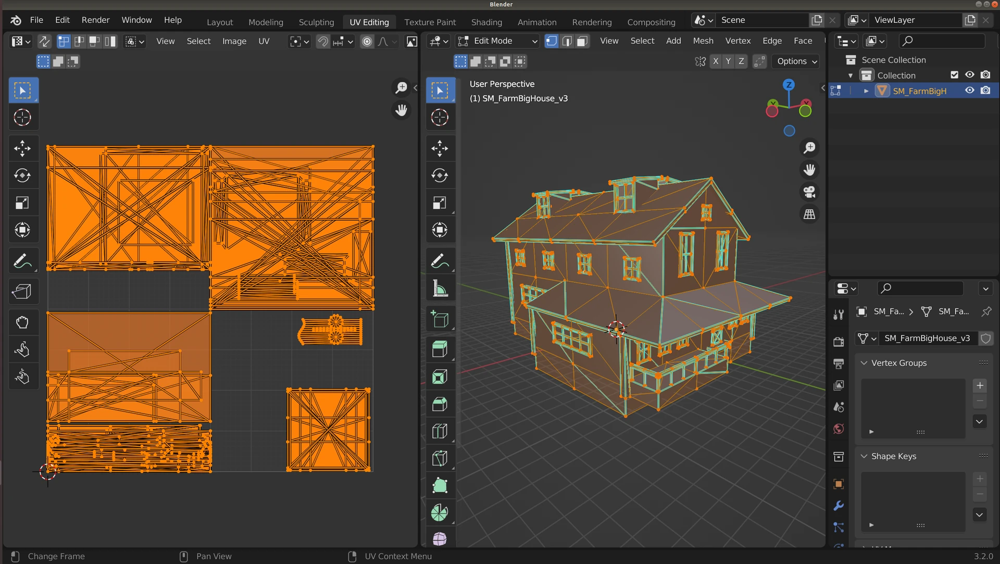
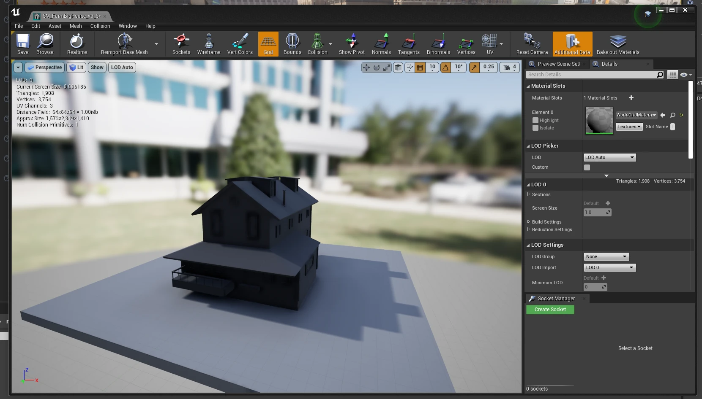
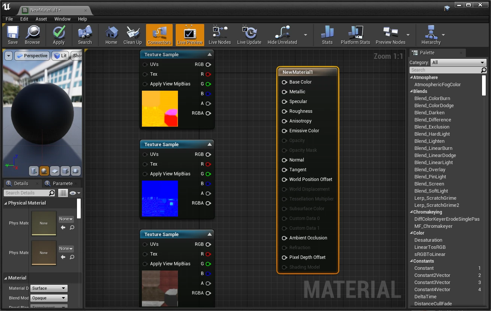
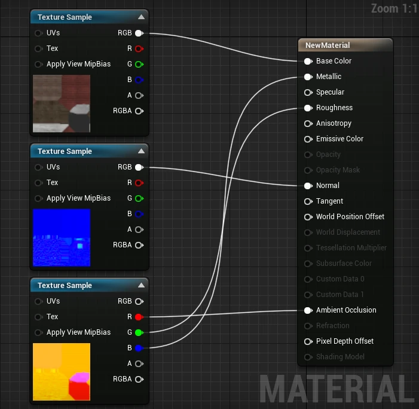
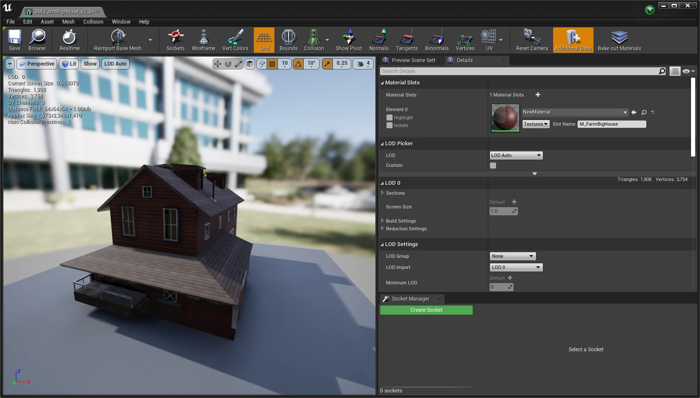
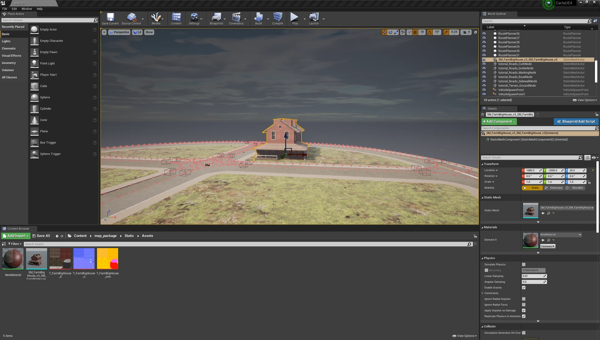

# Content authoring - map assets

A road network is only the start of a map. Buildings, benches, street lights and the rest are assets you model elsewhere and import into the Unreal Editor, where they are placed in the level. This page covers what an asset is made of, how to import one, and how to give it a material.

- [__What an asset is made of__](#what-an-asset-is-made-of)
- [__Importing an asset__](#importing-an-asset)

This is the same import that [Props](content_authoring_props.md) describes for spawnable props; the difference is that a map asset is placed in the level instead of registered as a blueprint.

---
## What an asset is made of

Now we have the road network as the basis for our map, we now want to create some content for the map, such as buildings. These assets can be created using a 3D modelling application such as Autodesk Maya, 3DS Max, Blender or any other 3D application with the appropriate export options. It is important that, at a minimum, the application is capable of `.fbx` export. 

There are several elements needed to create an asset in CARLA:

- [__Mesh__](https://en.wikipedia.org/wiki/Polygon_mesh) - a set of 3D coordinate vertices and the associated joining edges
- [__UV map__](https://en.wikipedia.org/wiki/UV_mapping) - a mapping of 3D vertices and edges to a 2D texture space to match textures with 3D locations
- [__Texture__](https://en.wikipedia.org/wiki/Texture_mapping) - a 2D image defining the colors and patterns to appear on the surface of the 3D object
- [__Normal map__](https://en.wikipedia.org/wiki/Normal_mapping) - a 2D image defining the directions of the normals on the surface of the object, to add 3D variations to the object's surface
- ORM map - a map defining the regions of metallicity, roughness and ambient occlusion

The ORM map uses the channels of a standard RGB image for three maps: the red channel holds the ambient occlusion, the green channel the roughness and the blue channel the metallic map. These maps (as well as the diffuse and normal maps) can be created using an application such as [__Adobe Substance 3D painter__](https://www.adobe.com/products/substance3d-painter.html).

---
## Importing an asset

Create a new folder in some appropriate location using the Unreal content browser. Within this folder you can either right click and select `Import to PATH/TO/FOLDER` near the top of the context menu, or drag and drop files directly into the content browser. 

We will import an FBX file containing the base mesh and the UV map, that we have exported from Blender.

The farmhouse mesh and its UV map in Blender.

In the context menu, ensure that in the __Mesh__ section `Import Normals` is selected
 for `Normal Import Method` and that in the __Material__ section that `Do Not Create Material` is selected. Deselect `Import Textures` in the __Materials__ section since we will import them manually. These choices would differ if you wanted to use some textures already embedded in your FBX file. 

 Select `Import All`. Once the import has completed, double click on the imported asset that appears in the content browser to edit it. 

The imported farmhouse in the static mesh editor, before its material is assigned.

We should now import the textures, the diffuse texture for the diffuse colors, the normal map and the ORM map. 

Open the ORM map by double clicking and deselect the `sRGB` option, to ensure the texture is correctly applied. 

Right click in the content browser and select `Material` from the menu. A new material will be created in the content browser. Double click to edit it. Shift select the textures you imported and drag them into the material edit window, you will now get 3 new nodes in the material node editor. 

A new material with the imported textures dragged into the material editor.

Now connect the nodes according to the following rules:

- Diffuse RGB --> Base Color
- Normal RGB --> Normal
- ORM R --> Ambient occlusion
- ORM G --> Roughness
- ORM B --> Metallic

Your material node graph should now look similar to this: 

The textures connected: diffuse to Base Color, normal to Normal, ORM channels to Ambient Occlusion, Roughness and Metallic.

Save the material, then open the asset again and drag the material into the material slot. Your asset should now be fully textured.

The farmhouse with its material assigned.

Now save the asset and it is ready for use in your map. You can now drag the asset from the content browser and place it into your map:

The farmhouse placed in the map.

Now save the map with __File > Save Current Level__ (`Ctrl + S`) and it is ready to use. Press __Play__ to run the simulation in the editor.
---

If you have any questions about the process, then you can ask in the [GitHub Discussions](https://github.com/carla-simulator/carla/discussions).
