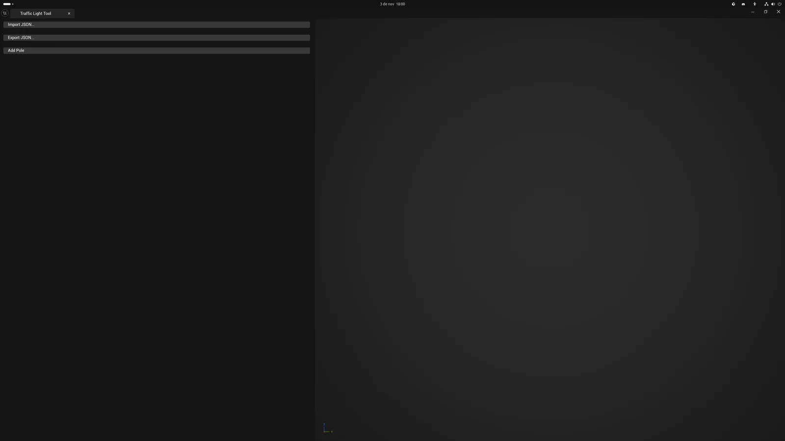
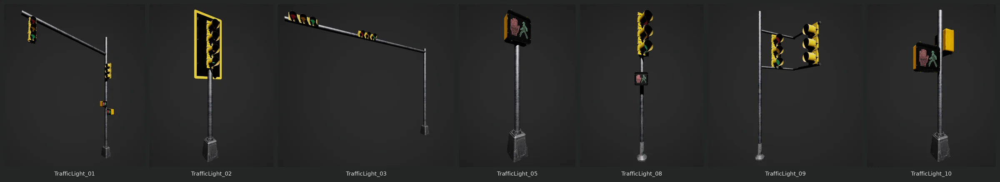
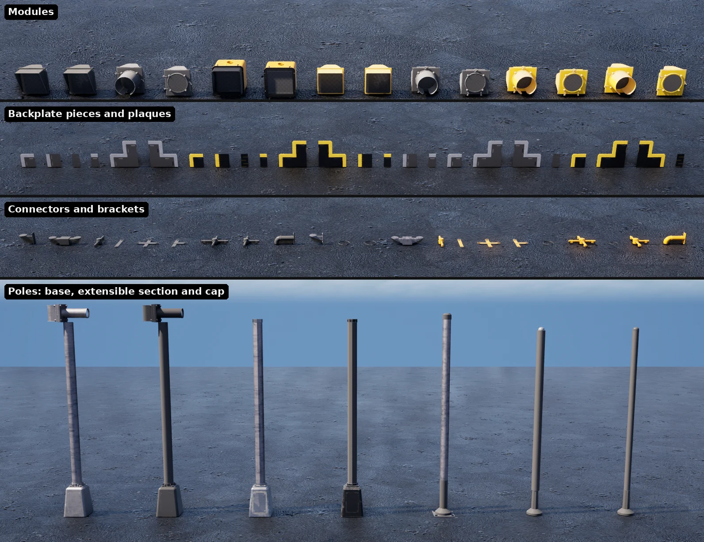
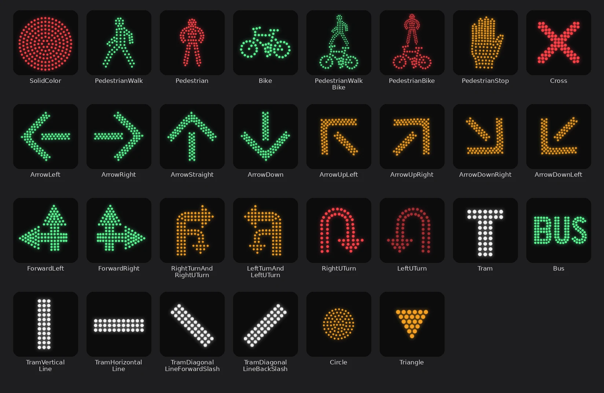
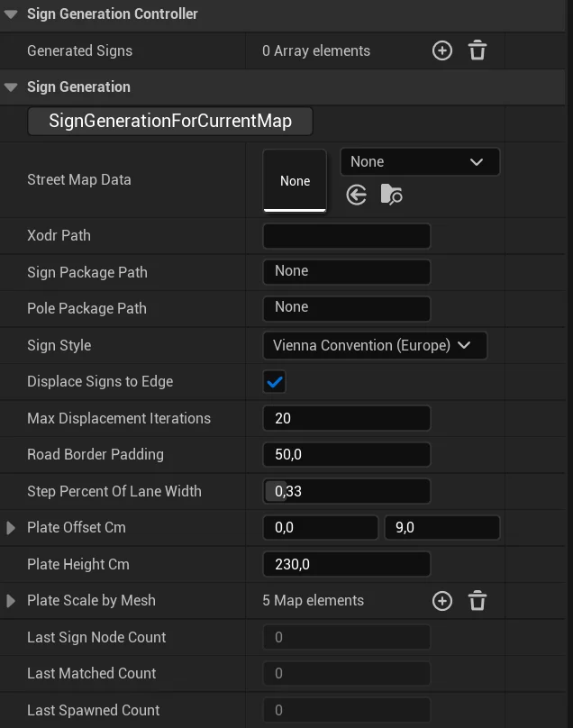
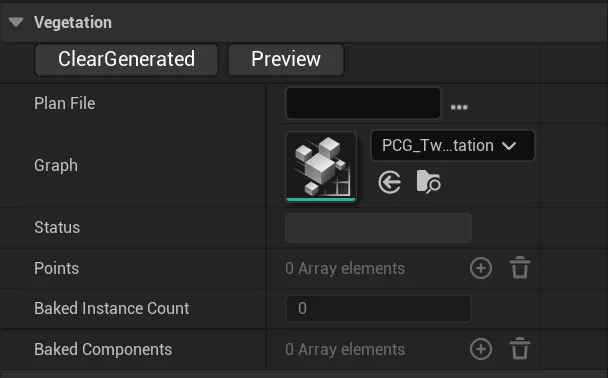
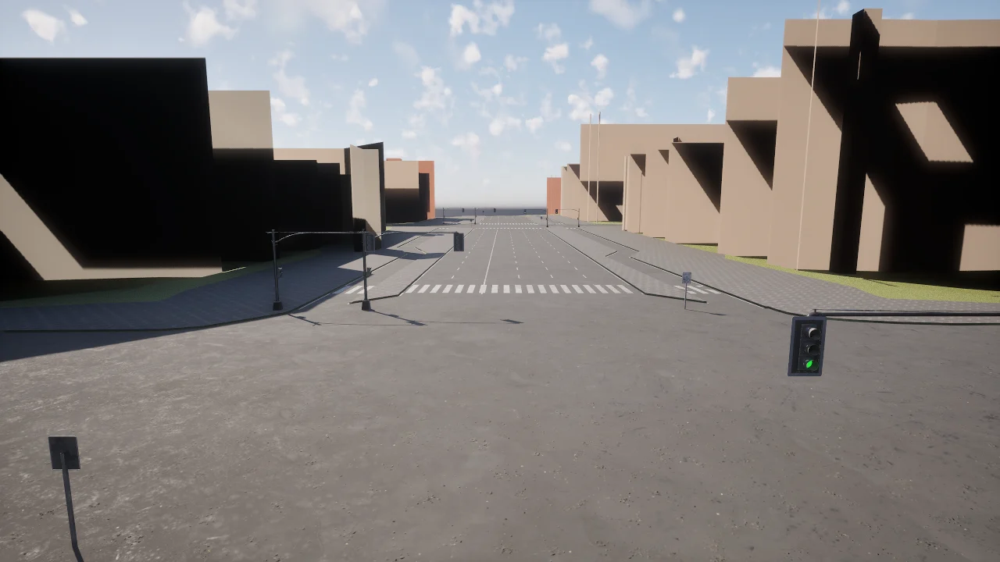

# Digital Twin Tool

The __Digital Twin Tool__ builds a CARLA map of a real place from [OpenStreetMap](https://www.openstreetmap.org) (OSM) data: the road network becomes an OpenDRIVE file and road meshes, and the spaces between the roads are filled with buildings, vegetation, street furniture, traffic lights and traffic signs.

It lives in its own repository, [`carla-simulator/carla-digitaltwins`](https://github.com/carla-simulator/carla-digitaltwins), and has two entry points: a __command line pipeline__ that runs headless and is the supported way to build a twin, and an __editor plugin__ that generates a map from inside Unreal. This page covers the command line pipeline and the parts of the tool that live in CARLA itself; the repository's README documents both.

- [__Status in this release__](#status-in-this-release)
- [__How the tool is organised__](#how-the-tool-is-organised)
- [__Installation__](#installation)
- [__Generating a map from OSM__](#generating-a-map-from-osm)
    - [Shipping the map](#shipping-the-map)
- [__Traffic lights__](#traffic-lights)
- [__Traffic signs__](#traffic-signs)
- [__Vegetation and street furniture__](#vegetation-and-street-furniture)
- [__Twin maps in the content__](#twin-maps-in-the-content)
- [__Headless generation__](#headless-generation)
- [__Troubleshooting__](#troubleshooting)
    - [Installation](#installation-problems)
    - [Generating a map](#generation-problems)
    - [Running the map](#run-time-problems)
    - [Editor tools](#editor-tool-problems)

---
## Status in this release

| Part | Status |
| --- | --- |
| Command line pipeline (`twinmodel build`, `bake-export`, `bake_level.py`) | __Available.__ The supported way to build a twin. Runs headless; produces the OpenDRIVE, the meshes, the baked level, the Traffic Manager cache and the pedestrian navigation. |
| OSM to OpenDRIVE conversion (`carla.Osm2Odr`) | __Available.__ The converter is part of CARLA and is always compiled in; there is no longer an `ENABLE_OSM2ODR` option. See [Generate maps with OpenStreetMap](content_authoring_maps_openstreetmap.md). |
| Packaging a twin | __Available.__ Either in the cook scope (`CARLA_MAPS_TO_COOK`) or as a [content pack](content_authoring_packs.md). |
| `CarlaDigitalTwinsTool` content | __Optional download__, about 18 GB, not distributed with CARLA. See [The CarlaDigitalTwinsTool content](#step-4-download-the-content-optional). The pipeline needs it only for procedural buildings. |
| Editor plugin (`UW_DigitalTwins`) | __Not usable.__ The widget comes with the `CarlaDigitalTwinsTool` content, but its Blueprint does not compile against CARLA's `CarlaTools`: `Could not find a function named "GenerateMap_Editor"`. Use the command line pipeline. |
| Map preview and navigation (*Select OSM Database*, *Render*, arrows, zoom) | __Removed.__ The OSM renderer these controls talk to is no longer in the repository. The buttons remain in the older `UW_OnRoadMainWidget`, and pressing them aborts the editor: `UMapPreviewUserWidget::ConnectToSocket` connects to port 5000 with the throwing Boost.Asio overload, so a refused connection raises an uncaught exception. |
| Traffic Light Tool | Opens in the editor. Adding a pole needs the [`CarlaDigitalTwinsTool` content](#step-4-download-the-content-optional): without it, *Add Pole* crashes the editor. The phases in a map's `map_logic.json` work at run time. |
| Traffic sign generation | Available in the editor, for a map that has OSM data and an OpenDRIVE file. |
| Vegetation and furniture (PCG) | Available in the editor, from a placement plan in JSON. |
| Twin maps | One in the content: `Eixample`. It has no Traffic Manager cache and no pedestrian navigation. |

---
## How the tool is organised

The command line pipeline is pure Python plus one editor commandlet, and depends on nothing in the `CarlaTools` plugin: it writes the OpenDRIVE itself and imports its own meshes.

The editor plugin is the other route. It drives `UOpenDriveToMap` in the `CarlaTools` plugin, which parses the OpenDRIVE with `carla::opendrive::OpenDriveParser`, generates the road meshes with `carla::road::MeshFactory`, and uses the `StreetMap` plugin for building footprints and terrain splines. The two routes build their geometry differently, so the same OSM extract does not produce the same map through both.

---
## Installation

The tool comes from two repositories, neither of which is part of a CARLA checkout:

| What | Repository | Where it goes | Needed for |
| --- | --- | --- | --- |
| The pipeline (`TwinModel/`) | [`carla-simulator/carla-digitaltwins`](https://github.com/carla-simulator/carla-digitaltwins), branch `ue58-twins` | Anywhere __outside__ the CARLA tree | Building a twin |
| The `CarlaDigitalTwinsTool` content | `bitbucket.org/carla-simulator/digitaltwins`, branch `ue5-digitaltwins` | `Unreal/CarlaUnreal/Plugins/CarlaDigitalTwinsTool/Content` | Procedural buildings, *Add Pole* in the Traffic Light Tool, the sign catalog, `GenerateTile`. Optional |

In the commands below, `<carla-root>` is your CARLA checkout and `<repo>` is the `carla-digitaltwins` clone.

### Step 1: Check the prerequisites

* __A built CARLA UE 5.8 checkout__ (`ue58-dev`), with the editor built (`cmake --build Build --target carla-unreal-editor`, or `launch` once). Stage 3 runs the editor as a commandlet. `CARLA_UNREAL_ENGINE_PATH` must point at the engine, as for the [build](build_linux_ue5.md).
* __Python 3.11 or newer.__
* __A CARLA Python wheel built from the same checkout, for that Python.__ The pipeline validates the OpenDRIVE with `carla.Map` and cooks the Traffic Manager cache with it. The wheels are in `<carla-root>/Build/PythonAPI/dist`; to build one for another Python version, see [Build the Python API for several Python versions](build_linux_ue5.md#build-the-python-api-for-several-python-versions).
* __Git LFS__, only for the content (`sudo apt install git-lfs`).
* __Network access.__ Stage 1 downloads the OSM extract from Overpass, along with elevation and imagery for the region.
* __Disk space:__ about 40 MB for the pipeline, about 18 GB for the content, and a few MB per baked twin.

### Step 2: Clone the pipeline

Clone the repository __outside__ `Unreal/CarlaUnreal/Plugins`. Its default branch, `ue58-twins`, is the one that matches CARLA on UE 5.8:

```sh
git clone https://github.com/carla-simulator/carla-digitaltwins.git
```

!!! Warning
    Do not clone `carla-digitaltwins` into `Unreal/CarlaUnreal/Plugins`, and do not run its `Setup.sh` or build its CMake project for CARLA. Its README describes that setup for a standalone Unreal project, not for CARLA. Its `CarlaDigitalTwinsTool.uplugin` has the same name as the content-only plugin CARLA already has in `Plugins/CarlaDigitalTwinsTool`. Its editor module declares classes that CARLA already carries in `CarlaTools` and `Carla`, mapped by the `CoreRedirects` in `Config/DefaultEngine.ini`. It also depends on a `CarlaMeshGeneration` plugin that CARLA does not have. CARLA only needs the repository's `TwinModel/` directory.

### Step 3: Install the Python environment

Create a virtual environment with the Python your wheel was built for, and install the CARLA wheel and the `twinmodel` package into it. For Python 3.12:

```sh
cd <repo>
python3.12 -m venv .venv
.venv/bin/pip install <carla-root>/Build/PythonAPI/dist/carla-*-cp312-cp312-linux_x86_64.whl
.venv/bin/pip install -e TwinModel
```

Run the `python -m twinmodel` commands of this page with that environment active (`source .venv/bin/activate`), and pass its interpreter to stage 3 with `--python-bin`.

### Step 4: Download the content (optional)

The `CarlaDigitalTwinsTool` content is a Git LFS repository of about 18 GB on disk (about 9 GB to download). CARLA mounts it through its own `Unreal/CarlaUnreal/Plugins/CarlaDigitalTwinsTool/CarlaDigitalTwinsTool.uplugin`, which expects it in that plugin's `Content/` folder. CARLA's git ignores that folder. It contains:

* the procedural building generator (`BP_BuildingGen`)
* the Traffic Light Tool's pieces and presets
* the sign catalog
* the editor widget

Close the editor and run:

```sh
git lfs install
git clone --depth 1 -b ue5-digitaltwins https://bitbucket.org/carla-simulator/digitaltwins.git \
    <carla-root>/Unreal/CarlaUnreal/Plugins/CarlaDigitalTwinsTool/Content
```

Despite its name, the `ue5-digitaltwins` branch is the one CARLA on UE 5.8 uses: there is no UE 5.8 branch. To update it later, run `git pull` in that folder.

Skip this step if you only need the default pipeline (extruded buildings) and the vegetation and furniture tools: they work without the content.

### Step 5: Check the installation

```sh
# The pipeline and the CARLA wheel are installed
<repo>/.venv/bin/python -m twinmodel --help
<repo>/.venv/bin/python -c "import importlib.metadata as m; print('carla', m.version('carla'))"

# The editor is built
ls $CARLA_UNREAL_ENGINE_PATH/Engine/Binaries/Linux/UnrealEditor-Cmd
ls <carla-root>/Unreal/CarlaUnreal/Plugins/CarlaTools/Binaries/Linux/libUnrealEditor-CarlaTools.so

# The content (if installed) is downloaded, not LFS pointers: the second line must print 0
ls <carla-root>/Unreal/CarlaUnreal/Plugins/CarlaDigitalTwinsTool/Content/Blueprints/BP_BuildingGen.uasset
git -C <carla-root>/Unreal/CarlaUnreal/Plugins/CarlaDigitalTwinsTool/Content lfs ls-files | grep -c ' - '
```

`twinmodel --help` lists the `build` and `bake-export` commands. The `carla` version is the one of your checkout (`1.0` on `ue58-dev`).

The whole chain can then be tried on a small area: run the [three stages](#generating-a-map-from-osm) on a bounding box of a few blocks and load the result in a server.

---
## Generating a map from OSM

The pipeline runs in three stages. The first two are pure Python and need no Unreal; the third runs inside the editor as a commandlet. [Install](#installation) the `twinmodel` package first.

```sh
# 1. OSM -> twin model + OpenDRIVE
python -m twinmodel build --bbox <south> <west> <north> <east> --name MyCity --out build/mycity

# 2. twin model -> per-tile .glb + manifest
python -m twinmodel bake-export build/mycity MyCity

# 3. manifest -> Unreal World Partition level (absolute paths)
$CARLA_UNREAL_ENGINE_PATH/Engine/Binaries/Linux/UnrealEditor-Cmd \
    <carla-root>/Unreal/CarlaUnreal/CarlaUnreal.uproject -run=pythonscript \
    -script="<repo>/TwinModel/ue/bake_level.py --manifest <repo>/build/mycity/ue/manifest.json --name MyCity --python-bin <repo>/.venv/bin/python" \
    -unattended -nosplash -nullrhi
```

Stage 1 fetches the OSM extract, builds the lane graph and writes the OpenDRIVE, then validates it by parsing it with `carla.Map`. It ends with a `PASS`/`FAIL` summary and writes `report.json`; a non-zero exit means the OpenDRIVE did not validate. Stage 2 writes one `.glb` per layer, kind and tile, plus the spawn points. Stage 3 imports the meshes with Nanite, places them in a World Partition level, copies the OpenDRIVE next to the map, cooks the Traffic Manager cache and builds the pedestrian navigation. It writes `bake_report.json` next to the manifest.

For a bounding box of about 300 × 500 m, stage 1 takes about 2 minutes, stage 2 about 10 seconds and stage 3 about 6 minutes.

Stage 3 writes into the CARLA content:

| Path under `Unreal/CarlaUnreal/Content/Carla` | What |
| --- | --- |
| `Maps/Twins/<Name>/<Name>.umap` | The World Partition level, with its spawn points |
| `Maps/Twins/<Name>/Materials/` | The material instances |
| `Maps/Twins/<Name>/OpenDrive/<Name>.xodr` | The OpenDRIVE the server loads with the map |
| `Maps/Twins/<Name>/TM/<Name>.bin` | The Traffic Manager cache |
| `Static/<Semantic>/Twins/<Name>/` | The meshes, one folder per semantic tag (`Road`, `SideWalk`, `RoadLine`, `Building`, `Terrain`, `Static`) |

Useful options of `bake_level.py`:

| Option | Effect |
| --- | --- |
| `--python-bin` | Interpreter with the CARLA wheel, used to cook the Traffic Manager cache. Defaults to `$CARLA_PYTHON`, then `python3`. |
| `--buildings procedural` | Builds the façades with the procedural building generator instead of extruded slabs. Needs the [`CarlaDigitalTwinsTool` content](#step-4-download-the-content-optional). |
| `--skip-import` | Reuses the meshes already imported. |
| `--no-navmesh`, `--no-tm-cache` | Skip the pedestrian navigation and the Traffic Manager cache. |

!!! Note
    Stage 3 currently logs `CarlaCrosswalkNavBuilder failed` and `WorldPartitionNavigationDataBuilder failed` even when both builders succeed. See [Troubleshooting](#the-navigation-builders-are-reported-as-failed).

The level then opens in the editor and loads in a CARLA server like any other map. With the server started from the editor binary in `-game` mode:

```py
world = client.load_world('MyCity')
```

### Shipping the map

A baked twin reaches a packaged CARLA in one of two ways.

Cook it into the package, by adding it to the cook scope:

```sh
cmake -S . -B Build/Release -DCARLA_MAPS_TO_COOK=/Game/Carla/Maps/Twins/MyCity/MyCity
cmake --build Build/Release --target package
```

Or ship it as a [content pack](content_authoring_packs.md), which needs no repackaging of CARLA:

```sh
carla-pack init MyCityPack
carla-pack add MyCityPack --map /Game/Carla/Maps/Twins/MyCity/MyCity
carla-pack build MyCityPack --base <release-metadata.tar.gz>
carla-pack install MyCityPack-1.0.0-<release>.tar.gz --server /opt/carla
```

The pack carries the map's OpenDRIVE and Traffic Manager files as sidecars, so the server picks them up when it mounts the pack.

---
## Traffic lights

__Window > Traffic Light Tool__ (the last entry of the *Window* menu) opens an editor tab to build and edit traffic lights: poles, heads and lamp modules, imported from or exported to JSON. The pole, head and module meshes come from the `CarlaDigitalTwinsTool` content; without it the tab opens, but *Add Pole* crashes the editor, and *Add Head* and *Add Module* only appear once a pole exists. The phases of a twin map's traffic lights live in a `map_logic.json` next to its OpenDRIVE file. The server reads it when the map loads and drives the lights from it; without the file, the lights run on the default timing. A content pack ships the file with the map (see [Content packs](content_authoring_packs.md#traffic-light-phase-files)).


<div class="img-caption">Building a traffic light from scratch: <i>Add Pole</i>, its base, extensible and cap meshes, <i>Add Head</i>, the head raised to 3.5 m and scaled to 1.25, and three modules with visors. Each <i>Add Module</i> stacks the new module on top, so the lights are set bottom to top: <i>Arrow Left (Green)</i>, <i>Solid Color (Amber)</i> and <i>Solid Color (Red)</i>. From the head on, the close-ups show the panel and the head side by side.</div>

The `CarlaDigitalTwinsTool` content ships eleven presets to start from, `TrafficLight_01.json` to `TrafficLight_11.json` in `Content/Carla/Static/TrafficLight/TrafficLights2025/Presets`. Load one with *Import JSON...*, change it, and save the result with *Export JSON...*.


<div class="img-caption">Seven of the shipped presets in the preview of the tool: mast arms with hanging heads (01, 03), a head with a backplate and four arrow modules (02), pedestrian signals (05, 10) and poles with several heads (08, 09).</div>

A traffic light is assembled from the meshes in `Content/Carla/Static/TrafficLight/TrafficLights2025` of the `CarlaDigitalTwinsTool` content, listed by style in the `Modules`, `Poles` and `Backplates` data tables of its `DataTables` folder. A pole is a base, an extensible section stretched to _Pole Height_ and a cap or an arm connector; a head is a column or row of modules, with a visor or without, and an optional backplate built from corner, edge and middle pieces.


<div class="img-caption">The pieces the tool builds from. The meshes with <code>Black</code> in their name are the European style of the data tables; the others are North American.</div>

Each module lights one cell of the atlas `T_TrafficLights_Atlas` (`TrafficLights2025/TrafficLights`), chosen by its __light type__. The types are the rows of the `LightTypes` data table in `TrafficLights2025/DataTables`: an atlas cell, a colour and an emissive intensity. Most shapes come in a `Green`, `Amber` and `Red` row (`PedestrianWalkGreen`, `ArrowLeftRed`); the tram signals, `PedestrianStop`, `Circle` and `Triangle` have a single row.


<div class="img-caption">The 30 shapes of <code>T_TrafficLights_Atlas</code>, named after their light type without the colour, each drawn in one of the colours it ships in.</div>

---
## Traffic signs

The __Sign Generation Controller__ actor (`ASignGenerationController`) places traffic signs from the OSM sign nodes (`traffic_sign`, `highway`, `crossing`, `maxspeed` tags) on the roads of the current map. Drop one in the level, set its fields in the *Details* panel and press *SignGenerationForCurrentMap*.


<div class="img-caption">The SignGeneration fields of the Sign Generation Controller.</div>

| Field | What it does |
| --- | --- |
| _Street Map Data_ | The OSM data of the map (a `StreetMap` asset). Looked up next to the level when empty. |
| _Xodr Path_ | The map's OpenDRIVE file. Looked up for the current level when empty. |
| _Sign Package Path_, _Pole Package Path_ | Folders of the sign plates and poles to use. |
| _Sign Style_ | The sign catalog: *Vienna Convention (Europe)*, *MUTCD (America)*, *GB (China)* or *None*. |
| _Displace Signs To Edge_, _Max Displacement Iterations_, _Road Border Padding_ | Move each sign just past the outer edge of the carriageway (driving, shoulder, parking and bike lanes), _Road Border Padding_ centimetres beyond it. A sign still in a lane after _Max Displacement Iterations_ is removed. _Step Percent Of Lane Width_ is no longer used. |
| _Plate Offset Cm_, _Plate Height Cm_, _Plate Scale By Mesh_ | Position and scale of the plate on its pole. |
| _Last Sign Node Count_, _Last Matched Count_, _Last Spawned Count_ | Summary of the last run: OSM sign nodes, nodes matched to a road, signs placed. |

The signs are spawned as traffic sign actors that the server adopts like the signs of any other map.

---
## Vegetation and street furniture

Two actors place trees and street furniture with PCG from a placement plan, a JSON file with one entry per object (`twin-vegetation-plan/1` and `twin-furniture-plan/1` schemas):

- __Procedural Vegetation Tool__ (`AProceduralVegetationTool`)
- __Procedural Furniture Tool__ (`AProceduralFurnitureTool`)

Set *Plan File* to the plan. The *Details* panel has two buttons: *Preview* generates the instances with the PCG graph in *Graph* (`PCG_TwinVegetation` for vegetation by default) and *ClearGenerated* removes them. Reading the plan and baking the instances into instanced static meshes saved with the level are not buttons: call `import_plan()` before *Preview* and `bake()` after it from the editor's Python console. *Status*, *Points* and *Baked Instance Count* show the result.


<div class="img-caption">The Vegetation category of the Procedural Vegetation Tool.</div>

---
## Twin maps in the content

The content has one twin map, `Eixample`, in `Content/Carla/Maps/Twins/Eixample/` with its OpenDRIVE file. It is a World Partition map and loads by name in a source build:

```py
world = client.load_world('Eixample')
```

`Eixample` loads with no missing assets and does not need the `CarlaDigitalTwinsTool` content. It has extruded buildings without façade detail, roads, sidewalks, crosswalks, traffic lights and signs, and no vegetation. Vehicles and the Traffic Manager work, but the map lacks two things a baked twin has:

* __No Traffic Manager cache.__ The first Traffic Manager client prints `No InMemoryMap cache found` and builds the map graph itself, which takes about a minute.
* __No pedestrian navigation.__ `get_random_location_from_navigation()` returns the origin, so walkers cannot be spawned on it.

It has no `map_logic.json` either, so its traffic lights run on the default timing. The earlier twin maps `EixampleDemo`, `Sf_Soma` and `Sunnyvale` are no longer in the content; to get a city like them, [generate it](#generating-a-map-from-osm). The default package does not ship `Eixample`; a [content pack](content_authoring_packs.md) can.


<div class="img-caption">A junction of the Eixample twin map.</div>

---
## Headless generation

The command line pipeline is already headless: stage 3 above runs the editor as a commandlet with `-run=pythonscript -unattended -nosplash -nullrhi`, so a twin can be built on a machine with no display.

The editor plugin has its own commandlet, `GenerateTile`, which generates one tile of a map with the generation blueprint of the `CarlaDigitalTwinsTool` content (`/CarlaDigitalTwinsTool/BP_OpenDriveToMap`):

```sh
$CARLA_UNREAL_ENGINE_PATH/Engine/Binaries/Linux/UnrealEditor-Cmd Unreal/CarlaUnreal/CarlaUnreal.uproject -run=GenerateTile -FilePath=<map.xodr> -BaseLevelName=<Map> -GeoCoordsX=<lat> -GeoCoordsY=<lon> -CTileX=<x> -CTileY=<y>
```

Without that content it stops with `OpenDrive class is not properly set`.

---
## Troubleshooting

### Installation problems

#### The editor fails to start after cloning `carla-digitaltwins` into `Plugins`

__Cause:__ the repository's `CarlaDigitalTwinsTool.uplugin` clashes with the plugin of the same name that CARLA already has. Its editor module also duplicates classes of `CarlaTools`, and it needs a `CarlaMeshGeneration` plugin CARLA does not have.

__Fix:__ move the clone out of the CARLA tree and delete any build output it left behind. Keep CARLA's own `Plugins/CarlaDigitalTwinsTool/CarlaDigitalTwinsTool.uplugin`:

```sh
mv <carla-root>/Unreal/CarlaUnreal/Plugins/carla-digitaltwins ~/carla-digitaltwins
git -C <carla-root> status --short Unreal/CarlaUnreal/Plugins   # must not show the uplugin as deleted or modified
```

If the clone went into `Plugins/CarlaDigitalTwinsTool` itself, restore CARLA's file with `git -C <carla-root> checkout -- Unreal/CarlaUnreal/Plugins/CarlaDigitalTwinsTool`. Then put the content in its `Content/` folder as in [Step 4](#step-4-download-the-content-optional).

#### `pip` refuses the CARLA wheel: `is not a supported wheel on this platform`

__Cause:__ the wheel was built for another Python version. The `cpXY` tag in its name must match the interpreter of the virtual environment.

__Fix:__ create the environment with the matching Python (`python3.11 -m venv .venv` for a `cp311` wheel), or [build a wheel](build_linux_ue5.md#build-the-python-api-for-several-python-versions) for the Python you have.

#### `ModuleNotFoundError: No module named 'carla'` in stage 1

__Cause:__ the CARLA wheel is not installed in the environment that runs `twinmodel`.

__Fix:__ install it there, as in [Step 3](#step-3-install-the-python-environment), and run `twinmodel` with that environment's `python`.

#### `WARNING: Version mismatch detected` when connecting to the server

__Cause:__ the `carla` package is from another build than the server, for example a wheel from an older checkout (`Client API version = 0.10.0`, `Simulator API version = 1.0`).

__Fix:__ reinstall the wheel from the same checkout as the server:

```sh
<repo>/.venv/bin/pip install --force-reinstall <carla-root>/Build/PythonAPI/dist/carla-*-cp312-cp312-linux_x86_64.whl
```

#### The content is cloned but its assets fail to load

__Cause:__ the repository was cloned without Git LFS, so the `.uasset` files are small text pointers instead of the assets. `git lfs ls-files` marks them with `-` instead of `*`.

__Fix:__ install Git LFS and download the files in place:

```sh
sudo apt install git-lfs
cd <carla-root>/Unreal/CarlaUnreal/Plugins/CarlaDigitalTwinsTool/Content
git lfs install
git lfs pull
git lfs ls-files | grep -c ' - '   # must print 0
```

### Generation problems

#### Stage 1 stops with `overpass busy: HTTP 429` (or `504`), or `overpass fetch failed after 3 attempts`

__Cause:__ the public Overpass server is rate-limited or overloaded. Large bounding boxes make this more likely.

__Fix:__ wait a few minutes and run the command again, or use a smaller bounding box. Successful downloads (OSM, elevation, imagery) are cached in `data/` under the directory you run the command from, or in the directory given with `--cache`, so a later run on the same bounding box does not download them again. To build from a saved Overpass extract, pass it with `--fixture <file>`.

#### Stage 1 exits with a non-zero status

__Cause:__ the generated OpenDRIVE did not pass validation. The summary at the end of the output marks the failing check with `FAIL`, and `report.json` in the output directory has the details.

__Fix:__ change the bounding box so it does not cut through a junction or a road with odd tagging, or try another region profile with `--profile` (`eu_dense`, `us_urban`, `us_suburban`). To isolate the problem, skip the optional stages with `--no-imagery`, `--no-dem` and `--no-refine`.

#### Stage 3 fails with `BP_BuildingGen not mounted at /CarlaDigitalTwinsTool/Blueprints/BP_BuildingGen`

__Cause:__ `--buildings procedural` needs the `CarlaDigitalTwinsTool` content, which is not installed or is incomplete.

__Fix:__ install the content as in [Step 4](#step-4-download-the-content-optional), or bake without `--buildings procedural` to get extruded buildings.

#### Stage 3 warns `TM cache: python3 could not cook it`

__Cause:__ the interpreter stage 3 uses to cook the Traffic Manager cache has no matching `carla` package. The map still works, but every client rebuilds the Traffic Manager graph when it connects.

__Fix:__ pass the environment that has the wheel with `--python-bin <repo>/.venv/bin/python`, or set `CARLA_PYTHON` to it. Then bake again with `--skip-import`, which reuses the meshes already imported.

#### The navigation builders are reported as failed

__Symptom:__ stage 3 logs `[bake_level] CarlaCrosswalkNavBuilder failed (Shutdown handler: cleanup.)` and `[bake_level] WorldPartitionNavigationDataBuilder failed (Shutdown handler: cleanup.)`, and `bake_report.json` has `"navigation_builders"` set to `false`.

__Cause:__ `bake_level.py` reads the exit status of the two builder processes wrongly. In the tests for this page, both builders had done their work.

__Fix:__ run the builders again by hand. Each must end with `Success - 0 error(s)`:

```sh
for b in CarlaCrosswalkNavBuilder WorldPartitionNavigationDataBuilder; do
  $CARLA_UNREAL_ENGINE_PATH/Engine/Binaries/Linux/UnrealEditor \
      <carla-root>/Unreal/CarlaUnreal/CarlaUnreal.uproject /Game/Carla/Maps/Twins/MyCity/MyCity \
      -run=WorldPartitionBuilderCommandlet -Builder=$b -SCCProvider=None -nullrhi -unattended
done
```

#### Removing a twin, or baking it again from scratch

Stage 3 replaces the meshes and recreates the level when it runs again with the same `--name`. To remove a twin completely, close the editor and delete everything stage 3 wrote for it, including the World Partition actor files:

```sh
cd <carla-root>/Unreal/CarlaUnreal/Content/Carla
rm -rf Maps/Twins/MyCity Static/*/Twins/MyCity __ExternalActors__/Carla/Maps/Twins/MyCity __ExternalObjects__/Carla/Maps/Twins/MyCity
```

### Run-time problems

#### `load_world('MyCity')` does not find the map

__Cause:__ the server does not have the map. A packaged server only has the maps that were cooked into it or mounted from a content pack, and a server started before the bake does not see the new map.

__Fix:__ in a source build, start the server from the editor binary in `-game` mode after the bake. For a packaged server, [ship the map](#shipping-the-map) in the cook scope or as a content pack. The map must appear in `client.get_available_maps()`.

#### `No InMemoryMap cache found. Setting up local map. This may take a while...`

__Cause:__ the map has no Traffic Manager cache in `Maps/Twins/<Name>/TM/<Name>.bin`. This is the case for `Eixample`, and for a twin baked with `--no-tm-cache` or whose cache could not be cooked. The Traffic Manager still works, but builds its graph on every connection.

__Fix:__ bake the twin again with a working `--python-bin`. The [TM cache warning](#stage-3-warns-tm-cache-python3-could-not-cook-it) above has the details. Then check that the file exists:

```sh
ls <carla-root>/Unreal/CarlaUnreal/Content/Carla/Maps/Twins/MyCity/TM/MyCity.bin
```

#### Walkers do not spawn, or `get_random_location_from_navigation()` returns the origin

__Cause:__ the map has no pedestrian navigation. This is the case for `Eixample`, for a twin baked with `--no-navmesh`, and for a twin whose navigation builders really failed.

__Fix:__ run the two navigation builders by hand, as in [The navigation builders are reported as failed](#the-navigation-builders-are-reported-as-failed), and restart the server.

#### The traffic lights do not follow the expected phases

__Cause:__ the map has no `map_logic.json` next to its OpenDRIVE file, so the lights run on the default timing. The server log shows `MapLogicParser: No map_logic.json found for <xodr>, using default timing`.

__Fix:__ add a `map_logic.json` to `Maps/Twins/<Name>/OpenDrive/`, and restart the server.

### Editor tool problems

#### *Add Pole* in the Traffic Light Tool crashes the editor

__Cause:__ the pole, head and module meshes, and their data tables, are loaded from `/CarlaDigitalTwinsTool/...`, which is empty without the content.

__Fix:__ install the content as in [Step 4](#step-4-download-the-content-optional), and restart the editor.

#### `GenerateTile` stops with `OpenDrive class is not properly set`

__Cause:__ the commandlet uses `/CarlaDigitalTwinsTool/BP_OpenDriveToMap` from the content, which is not installed.

__Fix:__ install the content as in [Step 4](#step-4-download-the-content-optional).

