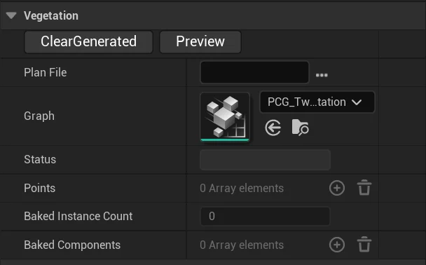
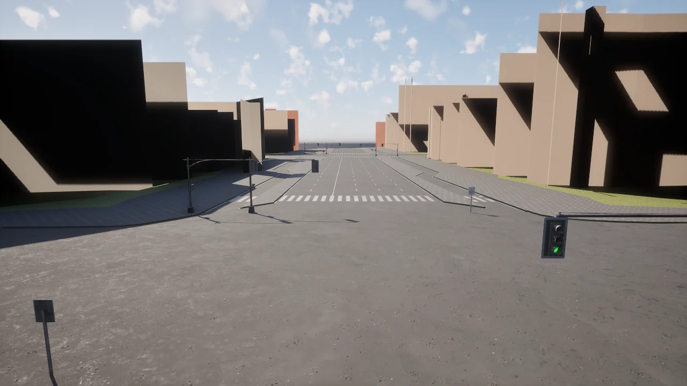

# Digital Twin Tool

The __Digital Twin Tool__ builds a CARLA map of a real place from [OpenStreetMap](https://www.openstreetmap.org) (OSM) data: the road network becomes an OpenDRIVE file and road meshes, and the spaces between the roads are filled with buildings, vegetation, street furniture, traffic lights and traffic signs.

It lives in its own repository, [`carla-simulator/carla-digitaltwins`](https://github.com/carla-simulator/carla-digitaltwins), and has two entry points: a __command line pipeline__ that runs headless and is the supported way to build a twin, and an __editor plugin__ that generates a map from inside Unreal. This page covers the command line pipeline and the parts of the tool that live in CARLA itself; the repository's README documents both.

- [__Status in this release__](#status-in-this-release)
- [__How the tool is organised__](#how-the-tool-is-organised)
- [__Generating a map from OSM__](#generating-a-map-from-osm)
    - [Shipping the map](#shipping-the-map)
- [__Traffic lights__](#traffic-lights)
- [__Traffic signs__](#traffic-signs)
- [__Vegetation and street furniture__](#vegetation-and-street-furniture)
- [__Twin maps in the content__](#twin-maps-in-the-content)
- [__Headless generation__](#headless-generation)

---
## Status in this release

| Part | Status |
| --- | --- |
| Command line pipeline (`twinmodel build`, `bake-export`, `bake_level.py`) | __Available.__ The supported way to build a twin. Runs headless; produces the OpenDRIVE, the meshes, the baked level, the Traffic Manager cache and the pedestrian navigation. |
| OSM to OpenDRIVE conversion (`carla.Osm2Odr`) | __Available.__ The converter is part of CARLA and is always compiled in; there is no longer an `ENABLE_OSM2ODR` option. See [Generate maps with OpenStreetMap](content_authoring_maps_openstreetmap.md). |
| Packaging a twin | __Available.__ Either in the cook scope (`CARLA_MAPS_TO_COOK`) or as a [content pack](content_authoring_packs.md). |
| Editor plugin (`UW_DigitalTwins`) | In the [`carla-digitaltwins`](https://github.com/carla-simulator/carla-digitaltwins) repository, with its own build instructions. Its content plugin (`CarlaDigitalTwinsTool`, about 18 GB) is not distributed with CARLA. |
| Map preview and navigation (*Select OSM Database*, *Render*, arrows, zoom) | __Removed.__ The OSM renderer these controls talk to is no longer in the repository. The buttons remain in the older `UW_OnRoadMainWidget`, and pressing them aborts the editor: `UMapPreviewUserWidget::ConnectToSocket` connects to port 5000 with the throwing Boost.Asio overload, so a refused connection raises an uncaught exception. |
| Traffic Light Tool | Opens in the editor, but adding a pole needs the `CarlaDigitalTwinsTool` content: without it, *Add Pole* crashes the editor. The phases in a map's `map_logic.json` work at run time. |
| Traffic sign generation | Available in the editor, for a map that has OSM data and an OpenDRIVE file. |
| Vegetation and furniture (PCG) | Available in the editor, from a placement plan in JSON. |
| Twin maps | Four in the content: `Eixample`, `EixampleDemo`, `Sf_Soma`, `Sunnyvale`. All but `Eixample` reference the `CarlaDigitalTwinsTool` content. |

---
## How the tool is organised

The command line pipeline is pure Python plus one editor commandlet, and depends on nothing in the `CarlaTools` plugin: it writes the OpenDRIVE itself and imports its own meshes.

The editor plugin is the other route. It drives `UOpenDriveToMap` in the `CarlaTools` plugin, which parses the OpenDRIVE with `carla::opendrive::OpenDriveParser`, generates the road meshes with `carla::road::MeshFactory`, and uses the `StreetMap` plugin for building footprints and terrain splines. The two routes build their geometry differently, so the same OSM extract does not produce the same map through both.

---
---
## Generating a map from OSM

The pipeline runs in three stages. The first two are pure Python and need no Unreal; the third runs inside the editor as a commandlet. Install the `twinmodel` package from the repository's `TwinModel/` directory first.

```sh
# 1. OSM -> twin model + OpenDRIVE
python -m twinmodel build --bbox <south> <west> <north> <east> --name MyCity --out build/mycity

# 2. twin model -> per-tile .glb + manifest
python -m twinmodel bake-export build/mycity MyCity

# 3. manifest -> Unreal World Partition level
UnrealEditor-Cmd Unreal/CarlaUnreal/CarlaUnreal.uproject -run=pythonscript \
    -script="<repo>/TwinModel/ue/bake_level.py --manifest <abs>/build/mycity/ue/manifest.json --name MyCity" \
    -unattended -nosplash -nullrhi
```

Stage 1 fetches the OSM extract, builds the lane graph and writes the OpenDRIVE, then validates it by parsing it with `carla.Map`. Stage 2 writes one `.glb` per layer, kind and tile, plus the spawn points. Stage 3 imports the meshes with Nanite, places them in a World Partition level, copies the OpenDRIVE next to the map, cooks the Traffic Manager cache and builds the pedestrian navigation.

The level then opens in the editor and loads in a CARLA server like any other map.

### Shipping the map

A baked twin reaches a packaged CARLA in one of two ways.

Cook it into the package, by adding it to the cook scope:

```sh
cmake -S . -B Build/Release -DCARLA_MAPS_TO_COOK=/Game/Carla/Maps/Twins/MyCity/MyCity
cmake --build Build/Release --target package
```

Or ship it as a [content pack](content_authoring_packs.md), which needs no repackaging of CARLA:

```sh
carla-pack init MyCityPack
carla-pack add MyCityPack --map /Game/Carla/Maps/Twins/MyCity/MyCity
carla-pack build MyCityPack --base <release-metadata.tar.gz>
carla-pack install MyCityPack-1.0.0-<release>.tar.gz --server /opt/carla/Linux
```

The pack carries the map's OpenDRIVE and Traffic Manager files as sidecars, so the server picks them up when it mounts the pack.

---
## Traffic lights

__Window > Traffic Light Tool__ (the last entry of the *Window* menu) opens an editor tab to build and edit traffic lights: poles, heads and lamp modules, imported from or exported to JSON. The pole, head and module meshes come from the `CarlaDigitalTwinsTool` content; without it the tab opens, but *Add Pole* crashes the editor, and *Add Head* and *Add Module* only appear once a pole exists. The phases of a twin map's traffic lights live in a `map_logic.json` next to its OpenDRIVE file; the server reads it when the map loads and drives the lights from it. A content pack ships the file with the map (see [Content packs](content_authoring_packs.md#traffic-light-phase-files)).


<div class="img-caption">The Traffic Light Tool tab before a pole is added.</div>

---
## Traffic signs

The __Sign Generation Controller__ actor (`ASignGenerationController`) places traffic signs from the OSM sign nodes (`traffic_sign`, `highway`, `crossing`, `maxspeed` tags) on the roads of the current map. Drop one in the level, set its fields in the *Details* panel and press *SignGenerationForCurrentMap*.


<div class="img-caption">The SignGeneration fields of the Sign Generation Controller.</div>

| Field | What it does |
| --- | --- |
| _Street Map Data_ | The OSM data of the map (a `StreetMap` asset). Looked up next to the level when empty. |
| _Xodr Path_ | The map's OpenDRIVE file. Looked up for the current level when empty. |
| _Sign Package Path_, _Pole Package Path_ | Folders of the sign plates and poles to use. |
| _Sign Style_ | The sign catalog: *Vienna Convention (Europe)*, *MUTCD (America)*, *GB (China)* or *None*. |
| _Displace Signs To Edge_, _Max Displacement Iterations_, _Road Border Padding_, _Step Percent Of Lane Width_ | Move each sign off the road to the lane edge. |
| _Plate Offset Cm_, _Plate Height Cm_, _Plate Scale By Mesh_ | Position and scale of the plate on its pole. |
| _Last Sign Node Count_, _Last Matched Count_, _Last Spawned Count_ | Summary of the last run: OSM sign nodes, nodes matched to a road, signs placed. |

The signs are spawned as traffic sign actors that the server adopts like the signs of any other map.

---
## Vegetation and street furniture

Two actors place trees and street furniture with PCG from a placement plan, a JSON file with one entry per object (`twin-vegetation-plan/1` and `twin-furniture-plan/1` schemas):

- __Procedural Vegetation Tool__ (`AProceduralVegetationTool`)
- __Procedural Furniture Tool__ (`AProceduralFurnitureTool`)

Set *Plan File* to the plan. The *Details* panel has two buttons: *Preview* generates the instances with the PCG graph in *Graph* (`PCG_TwinVegetation` for vegetation by default) and *ClearGenerated* removes them. Reading the plan and baking the instances into instanced static meshes saved with the level are not buttons: call `import_plan()` before *Preview* and `bake()` after it from the editor's Python console. *Status*, *Points* and *Baked Instance Count* show the result.


<div class="img-caption">The Vegetation category of the Procedural Vegetation Tool.</div>

---
## Twin maps in the content

The content has four twin maps under `Content/Carla/Maps/Twins/`, each with its OpenDRIVE file and `map_logic.json`. They are World Partition maps and load by name in a source build:

```py
world = client.load_world('Eixample')
```

`Eixample` loads with no missing assets: extruded buildings without façade detail, roads, sidewalks, crosswalks, traffic lights and signs, and no vegetation. `EixampleDemo`, `Sf_Soma` and `Sunnyvale` reference assets of the `CarlaDigitalTwinsTool` content, so without it they load with those assets missing. The default package does not ship the twin maps; a [content pack](content_authoring_packs.md) can.


<div class="img-caption">A junction of the Eixample twin map.</div>

---
## Headless generation

The command line pipeline is already headless: stage 3 above runs the editor as a commandlet with `-run=pythonscript -unattended -nosplash -nullrhi`, so a twin can be built on a machine with no display.

The editor plugin has its own commandlet, `GenerateTile`, which generates one tile of a map with the generation blueprint of the `CarlaDigitalTwinsTool` content (`/CarlaDigitalTwinsTool/BP_OpenDriveToMap`):

```sh
$CARLA_UNREAL_ENGINE_PATH/Engine/Binaries/Linux/UnrealEditor-Cmd Unreal/CarlaUnreal/CarlaUnreal.uproject -run=GenerateTile -FilePath=<map.xodr> -BaseLevelName=<Map> -GeoCoordsX=<lat> -GeoCoordsY=<lon> -CTileX=<x> -CTileY=<y>
```

Without that content it stops with `OpenDrive class is not properly set`.

