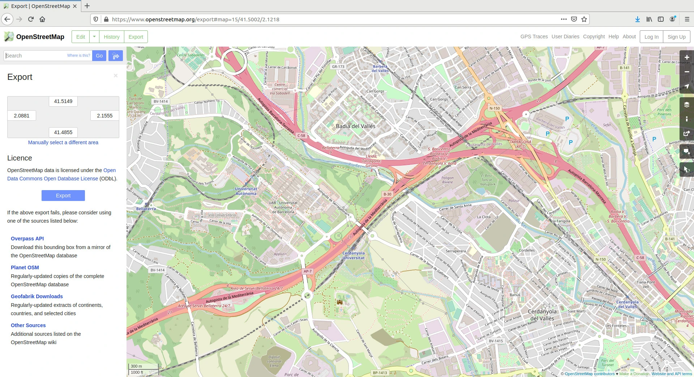
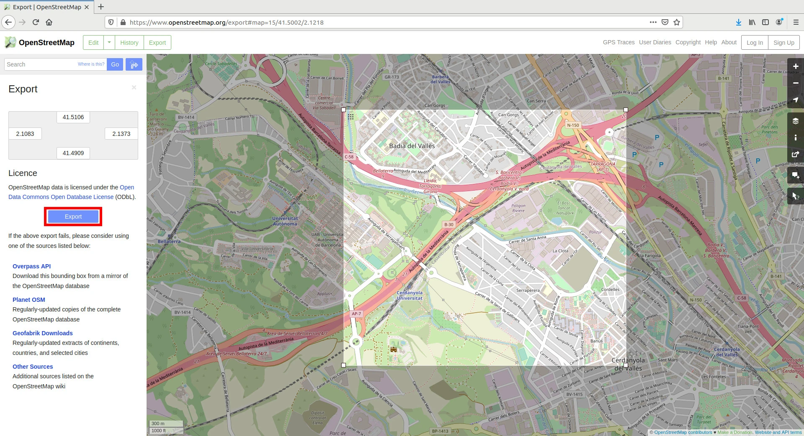
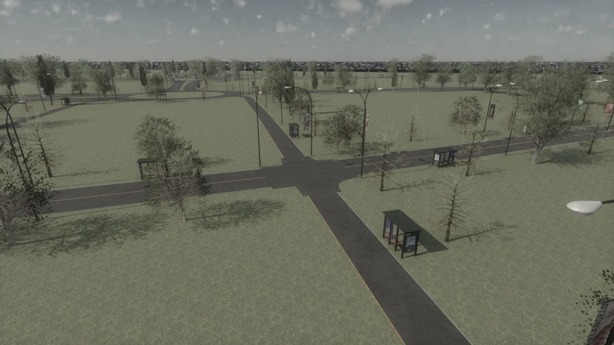

# Generate maps with OpenStreetMap

[OpenStreetMap](https://www.openstreetmap.org) is an open data map of the world developed by thousands of contributors and licensed under the [Open Data Commons Open Database License](https://opendatacommons.org/licenses/odbl/). Sections of the map can be exported to an XML formatted `.osm` file. Convert that file to OpenDRIVE with an external tool such as SUMO `netconvert`, then load the `.xodr` into CARLA with [OpenDRIVE standalone mode](core_opendrive.md).

- [__Export a map with OpenStreetMap__](#export-a-map-with-openstreetmap)
- [__Using OpenStreetMap in CARLA__](#using-openstreetmap-in-carla)
- [__Convert OpenStreetMap format to OpenDRIVE format__](#convert-openstreetmap-format-to-opendrive-format)
- [__Ingest into CARLA__](#ingest-into-carla)

!!! Warning
    The built-in OSM converter is __not available on `ue58-dev`__. The build does not fetch the `osm2odr` dependency, so `carla.Osm2Odr`, `carla.Osm2OdrSettings` and `config.py --osm-path` cannot be used with a standard build. Setting `-DENABLE_OSM2ODR=ON` does not supply the missing converter and makes the Unreal modules fail to build. Keep that option off and convert the file externally before loading it into CARLA. This is the same converter limitation described for the [Digital Twin Tool](content_authoring_maps_digital_twin.md).

---
## Export a map with OpenStreetMap

This section explains how to export your desired map information from OpenStreetMap:

__1.__ Navigate to the [OpenStreetMap website](https://www.openstreetmap.org). You will see the map view and a panel on the right side of the window where you can configure different map layers, query different features, toggle the legend, and more.

__2.__ Search for your desired location and zoom in to a specific area.


<div class="img-caption">The <b>Export</b> panel on openstreetmap.org.</div>

!!! Note
    If you would like to use a map of a large area, for example, Paris, you may consider using CARLA's [large map support](core_map.md#large-maps-and-world-partition).

__3.__ Click on _Export_ on the upper left side of the window to open the _Export_ panel.

__4.__ Click on _Manually select a different area_ in the _Export_ panel.

__5.__ Select a custom area by dragging the corners of the square area in the viewport.

__6.__ Click the _Export_ button in the _Export_ panel and save the map information of the selected area as a `.osm` file.


<div class="img-caption">Selecting the area to export with <b>Manually select a different area</b>, then <b>Export</b>.</div>

---
## Using OpenStreetMap in CARLA

First convert the `.osm` file to `.xodr` with an external converter. Then load the OpenDRIVE file with either of these methods:

| Input | Method | Parameterizable |
| --- | --- | --- |
| `.xodr` | [Your own script](#a-use-your-own-script), through `client.generate_opendrive_world()` | yes |
| `.xodr` | [`config.py --xodr-path`](#b-pass-xodr-to-configpy) | no |

The sections below cover conversion and both loading methods.

---

## Convert OpenStreetMap format to OpenDRIVE format

Install [Eclipse SUMO](https://sumo.dlr.de/docs/Downloads.php) separately and make its `netconvert` executable available on your `PATH`. SUMO supports [OpenStreetMap import](https://sumo.dlr.de/docs/Networks/Import/OpenStreetMap.html) and [OpenDRIVE export](https://sumo.dlr.de/docs/Networks/Export.html#opendrive).

For an exported file named `map.osm`, run:

```sh
netconvert --osm-files map.osm --opendrive-output map.xodr
```

`--osm-files` selects the input and `--opendrive-output` writes the OpenDRIVE road network. Road types, sidewalks and traffic-light inference are configured in the external converter; see SUMO's [OpenStreetMap import options](https://sumo.dlr.de/docs/Networks/Import/OpenStreetMap.html) and [netconvert reference](https://sumo.dlr.de/docs/netconvert.html). Check the conversion warnings and inspect the resulting network before using it for a simulation.

---
## Ingest into CARLA

This section explains how to use the different options available to ingest your OpenStreetMap information into CARLA using the [OpenDRIVE Standalone Mode](core_opendrive.md).

### A) Use your own script

Generate the new map and block the simulation until it is ready by calling [`client.generate_opendrive_world()`](python_api.md#carla.Client.generate_opendrive_world). Use the [carla.OpendriveGenerationParameters](python_api.md#carla.OpendriveGenerationParameters) class to configure the mesh generation. See below for an example:

```py
import carla

client = carla.Client('localhost', 2000)
client.set_timeout(60.0)   # the mesh generation can take a while

with open('path/to/map.xodr', encoding='utf-8') as f:
    xodr_data = f.read()

vertex_distance = 2.0   # in meters
max_road_length = 500.0 # in meters
wall_height = 0.0       # in meters
extra_width = 0.6       # in meters
world = client.generate_opendrive_world(
    xodr_data, carla.OpendriveGenerationParameters(
        vertex_distance=vertex_distance,
        max_road_length=max_road_length,
        wall_height=wall_height,
        additional_width=extra_width,
        smooth_junctions=True,
        enable_mesh_visibility=True))
```

!!! Note
    `wall_height = 0.0` is strongly recommended. OpenStreetMap defines lanes in opposing directions as different roads. If walls are generated, this will result in wall overlapping and undesired collisions.

### B) Pass `.xodr` to `config.py`

After you have started a CARLA server, run the following command in a separate terminal to load your OpenStreetMap:

```sh
cd PythonAPI/util

python3 config.py -x=/path/to/xodr/file
```

`config.py` uses fixed mesh-generation settings, including `wall_height=1.0`. Use your own script as shown above to set `wall_height=0.0` or change other [generation parameters](python_api.md#carla.OpendriveGenerationParameters).



<div class="img-caption">A world generated at runtime from an OpenStreetMap extract of about 400 x 400 m: terrain, lane markings, bus stops, street lights and trees come from the OpenDRIVE description alone. The .osm was converted to OpenDRIVE with SUMO netconvert. Generated OpenDRIVE world.</div>

### What the generated map includes

Runtime map generation builds a complete drivable environment from the OpenDRIVE description alone:

*   __Terrain that follows the roads.__ A ground heightfield is generated under and around the road network, following the road elevation profile, so the world does not float over a flat plane. Gaps between carriageways (medians) are filled and kept flush with the road surface.
*   __Road detail.__ Lane markings are generated for the whole network, including through junctions; crosswalks defined in the OpenDRIVE file get real zebra markings; road materials and semantic segmentation tags are applied so camera and LiDAR ground truth works on generated maps.
*   __Elevation profiles.__ Each road follows its elevation profile, and the `shape` records of its `lateralProfile` are honored, so a crowned road keeps its real cross-section. `superelevation` is not applied: a banked curve is built flat.
*   __Street furniture.__ Street lights and other roadside props are procedurally scattered along the network, grounded on the terrain, and their lamps light up at night like the ones on the built-in maps.

Additional static geometry can be added at runtime with [`world.spawn_custom_mesh()`](python_api.md#carla.World.spawn_custom_mesh), which spawns a procedural mesh with collision from a vertex/triangle list and a material hint (`"grass"`, `"road"`, `"dirt"`, `"sidewalk"`, or a full Unreal material path).

!!! Warning
    The roads generated end abruptly at the borders of the map. This will cause the Traffic Manager to crash when vehicles are not able to find the next waypoint. To avoid this, the OSM mode in the Traffic Manager is set to __True__ by default ([`set_osm_mode()`](python_api.md#carla.TrafficManager.set_osm_mode)). This will show a warning and destroy vehicles when necessary.

---

Any issues or doubts about this topic can be posted in [GitHub Discussions](https://github.com/carla-simulator/carla/discussions).

<div class="build-buttons">
<p>
<a href="https://github.com/carla-simulator/carla/discussions" target="_blank" class="btn btn-neutral" title="Go to CARLA's GitHub Discussions">
GitHub Discussions</a>
</p>
</div>
