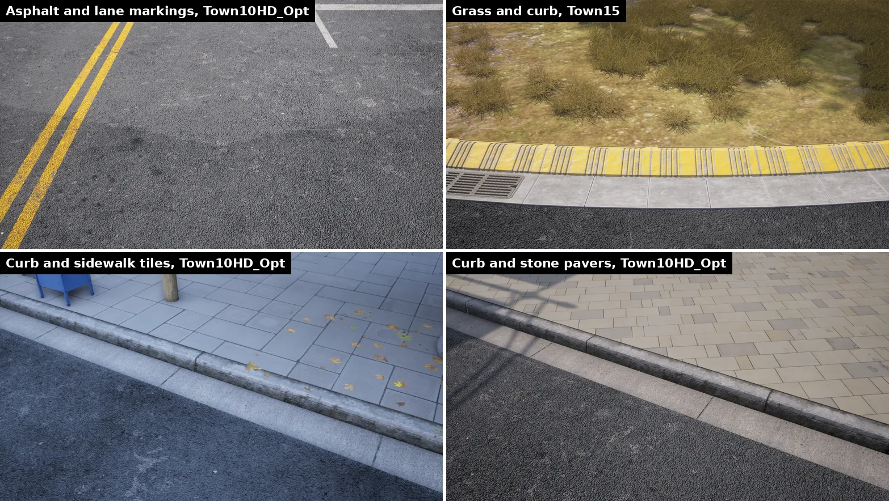
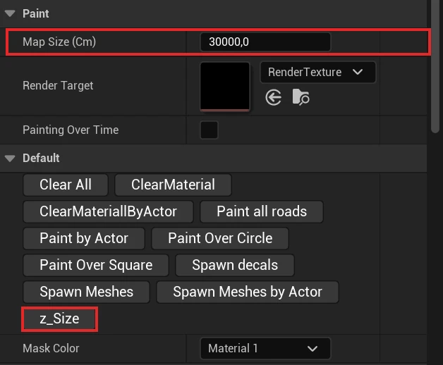
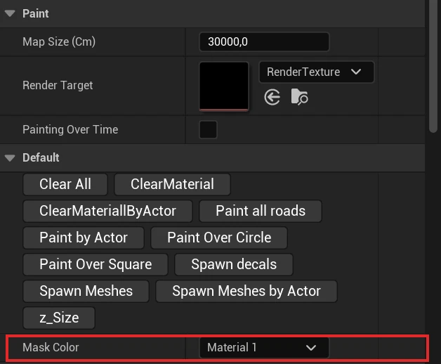
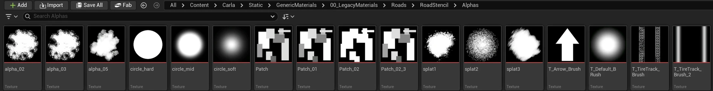
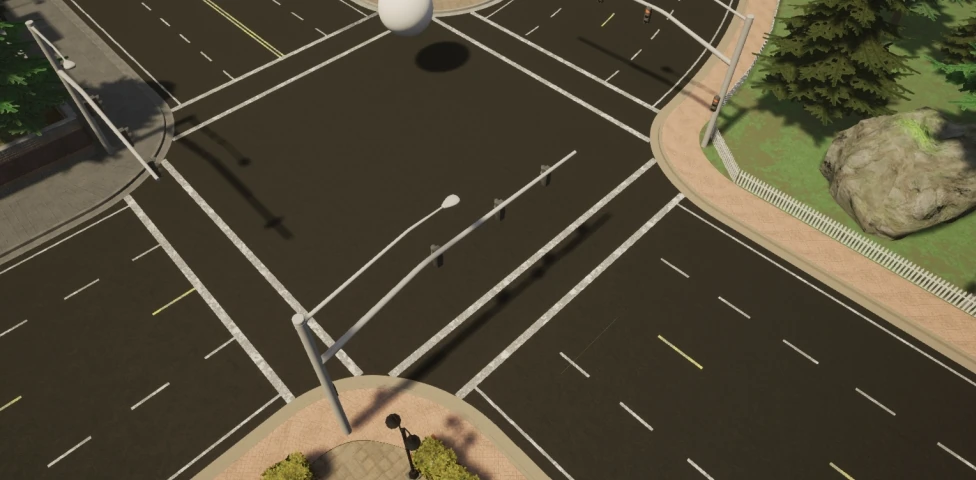
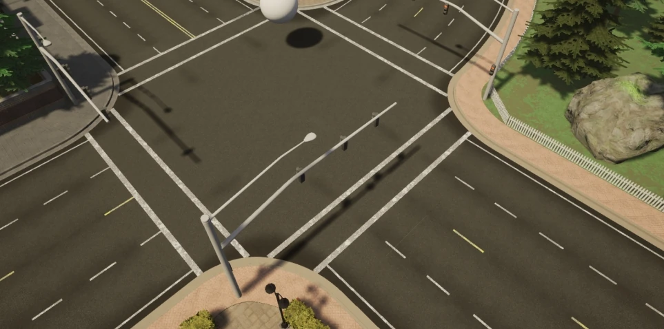
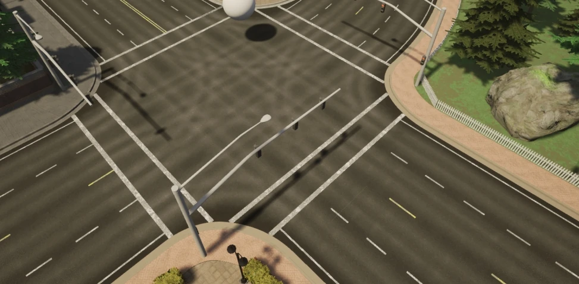
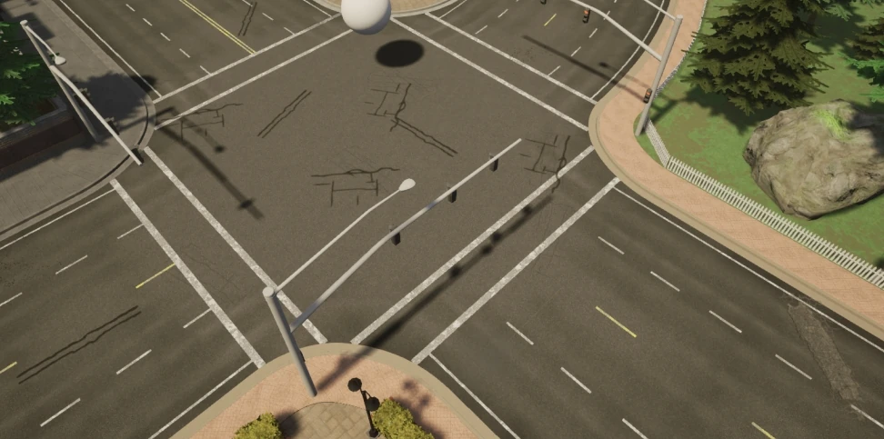

# Content authoring - materials and the road painter

A new map arrives with plain roads. The CARLA content library has the materials to dress them, and the road painter paints those materials over the road network with decals and meshes. This page covers both.

- [__Materials__](#materials)
- [__Road painter__](#road-painter)

---
## Materials

The surfaces of a CARLA map use instances of the master materials in `Content > Carla > Static > GenericMaterials > 000_Masters`. To dress a new map, drag the ready-made instances below onto its meshes to test them, or create an instance of the master and change its parameters.

| Surface | Master material | Ready-made instances |
| --- | --- | --- |
| Roads | `M_RoadMaster` | `GenericMaterials/Roads`: `MI_Road_Asphalt_A`, `MI_Road_Asphalt_B`, `MI_Road_Asphalt_B_Wet`, `MI_Road_Rural_A`. |
| Lane markings | `M_RoadMaster`, with its `LaneMark` switch on | `GenericMaterials/Roads`: `MI_Road_Asphalt_B_LaneMarkingWhite`, `MI_Road_Asphalt_B_LaneMarkingYellow`, and the same pair for `MI_Road_Rural_A`. |
| Sidewalks and curbs | `M_GeneralMaster` | `GenericMaterials/Sidewalk` (`MI_sidewalk_01`, `MI_Sidewalk_Residential` and the rest) and `GenericMaterials/Gutters_Curbs/Curb`. |
| Grass and dirt | `M_GeneralMaster` | `GenericMaterials/Ground`: `MI_Grass_Park`, `MI_Grass_Cutted_Yard`, `MI_Dirt`. |
| Landscape terrain | `M_AutomaterialLandscape_2MatMaster` and `M_AutomaterialLandscape_3MatMaster`, in `000_Masters/Landscape` | `GenericMaterials/Ground`: `MI_LargeLandscape_Highway`, `MI_LargeLandscape_Interurban`, `MI_LargeLandscape_Mountain`, `MI_LargeLandscape_Rural`. |
| Decals over roads and sidewalks: cracks, potholes, oil, manholes | `M_DecalMaster` | The `DI_*` instances in `Content > Carla > Static > FX > Decals`. |
| Water | The masters in `000_Masters/Water` | `GenericMaterials/Water`: `MI_Water_Lake`, `MI_Water_River`, `MI_Beach`. |

Map surfaces made with these materials, seen from a camera with the <code>Cinematic</code> profile: asphalt with lane markings and two curbs with sidewalk tiles and stone pavers on Town10HD_Opt, and dry grass beside a painted curb on Town15.

[Material customization](content_authoring_materials.md) explains each master: the textures it reads and the parameters of its instances. The road, general and decal masters are in [Road master](content_authoring_materials.md#road-master), [General master](content_authoring_materials.md#general-master) and [Decal master](content_authoring_materials.md#decal-master).

---
## Road painter

The road painter is a tool that can be used to customize the appearance of the road, adding extra realism with additional textures, decals and meshes.

### What is the road painter?

The Road Painter tool is a blueprint that uses OpenDRIVE information to paint roads quickly. It takes a master material and applies it to a render target of the road to use as a canvas. The master material is made up of a collection of materials that can be blended using brushes and applied as masks. There is no need to apply photometry techniques nor consider the UVs of the geometry.

The road painter uses the OpenDRIVE information to paint the roads. Make sure that your `.xodr` file has the same name as your map for this to work correctly.

### Establish the road painter, master material and render target

__1. Create the `RoadPainter` actor.__

1. In the _Content Browser_, navigate to `Content > Carla > Blueprints > LevelDesign`.
2. Drag the `RoadPainter` into the scene.

__2. Calibrate the _Map Size (Cm)_ so that it is equal to the actual size of the map.__

1. Select the `RoadPainter` actor in the scene.
2. Go to the _Details_ panel and press the _z_Size_ button. You will see the value in _Map Size (Cm)_ change.

The <code>RoadPainter</code> actor selected: <b>Map Size (Cm)</b> and the <b>z_Size</b> button that recomputes it.

__3. The render target.__

The road painter paints into the texture set in _Paint > Render Target_, `RenderTexture` from `Content > Carla > Blueprints > LevelDesign > RoadPainterAssets` by default.

!!! Warning
    In this release `M_RoadMaster` has no texture parameter for the painted mask. It reads the mask from `RoadPainterAssets/RenderTexture_Town10HD` through the `WorldMaskFunction` material function, scaled by its _Map units (CM)_ parameter. A mask painted into any other render target does not reach the road materials, and a mask painted into `RenderTexture_Town10HD` changes every map whose roads use `M_RoadMaster`.

---

### Prepare the master material

CARLA's road materials are instances of `M_RoadMaster`, in `Content > Carla > Static > GenericMaterials > 000_Masters`. Ready-made instances are in `Content > Carla > Static > GenericMaterials > Roads`, such as `MI_Road_Asphalt_A`. Right-click `M_RoadMaster`, select _Create Material Instance_, and rename it `Tutorial_RoadMaster`.

A material instance of <code>M_RoadMaster</code>, the master the road materials are made from, with its parameter groups.

The instance groups its parameters by layer:

| Group | What it controls |
| --- | --- |
| 1-Base | The base asphalt: `Base Color`, `Base Normal` and `Base Roughness` textures, a second base (`Base 2 *`), tints, scales and sharpness. |
| 2- Rubble, 3- OilSpill, and the following groups | Optional layers, each enabled by its switch: `Do Rubble`, `Do OilSpill`, `Do Grime`, `Do MacroVary`, `Do Patches`, `Do Cracks`, `Road Wheel Marks`, `Do Puddle`. |
| Additional materials | The `AddNewMaterials` switch enables a second and a third material (`SecondMaterialColor`, `SecondMaterialNormal`, `SecondMaterialOrm`, and the same for `ThirdMaterial*`), blended with `BlendingSecondMaterial` and `ThirdMaterialBlendingTexture`. |
| Global | `Map units (CM)`, which has to match the _Map Size (Cm)_ of the road painter. |

---

### Paint the road

__1. Create the link between the road painter and the roads.__

1. In the main editor window, search for `Road_Road` in the _Outliner_ search box.
2. Press `Ctrl + A` to select all the roads.
3. In the _Details_ panel, go to the _Materials_ section and apply `Tutorial_RoadMaster` to _Element 0_, _Element 1_, _Element 2_, and _Element 3_.

__2. Choose the material to customize.__

Each of the materials we added to `Tutorial_RoadMaster` are applied to the roads separately and application is configured with the _Brush_ tool. To apply and customize a material:

1. Select the road painter actor
2. In the _Details_ panel, select the material to work with in the _Mask Color_ dropdown menu.

<b>Mask Color</b> selects which material the next strokes paint.

__3. Set the brush and stencil parameters.__

There are a variety of stencils to choose from in `GenericMaterials/00_LegacyMaterials/Roads/RoadStencil/Alphas`. The stencil is used to paint the road according to your needs and can be adjusted using the following values:

- _Stencil size_: Size of the brush.
- _Brush Strenght_: Roughness of the outline.
- _Spacebeween Brushes_: Distance between strokes (the variable names keep their original spelling).
- _Max Jitter_: Size variation of the brush between strokes.
- _Stencil_: The brush to use.
- _Rotation_: Rotation applied to the stroke.

 

The brush stencils in <code>GenericMaterials/00_LegacyMaterials/Roads/RoadStencil/Alphas</code>.

 
__4. Apply each material to the desired portions of the road.__

Choose where to apply the selected material via the buttons in the _Default_ section of the _Details_ panel:

* _Paint all roads_: Paint all the roads.
* _Paint by actor_: Paint a specific, selected actor.
* _Paint over circle_: Paint using a circular pattern, useful to provide variation.
* _Paint over square_: Paint using a square pattern, useful to provide variation.

This section also contains options to erase the applied changes.

* _Clear all_: Erase all the painted material.
* _Clear materials_: Remove the currently active materials.
* _Clear material by actor_: Remove the material closest to the selected actor.

The <code>RoadPainter</code> buttons in the Default category of its Details panel.

 
__5. Add decals and meshes.__

You can explore the available decals and meshes in `Content > Carla > Static > FX > Decals` and `Content > Carla > Static`. Add them to road painter by extending and adding to the _Decals Spawn_ and _Meshes Spawn_ arrays. For each one you can configure the following parameters:

- _Number of Decals/Meshes_: The amount of each decal or mesh to paint.
- _Decal/Mesh Scale_: Scale of the decal/mesh per axis.
- _Fixed Decal/Mesh Offset_: Deviation from the center of the lane per axis.
- _Random Offset_: Max deviation from the center of the lane per axis.
- _Decal/Mesh Random Yaw_: Max random yaw rotation.
- _Decal/Mesh Min Scale_: Minimum random scale applied to the decal/mesh.
- _Decal/Mesh Max Scale_: Max random scale applied to the decal/mesh.

The Decals and Meshes categories of the <code>RoadPainter</code>.

 

Once you have configured your meshes and decals, spawn them by pressing `Spawn decals` and `Spawn meshes`.

!!! Note
    Make sure that meshes and decals do not have collisions enabled that can interfere with cars on the road and lower any bounding boxes to the level of the road.

__6. Experiment to get your desired appearance.__ 

Experiment with different materials, textures, settings, decals, and meshes to get your desired look. Below are some example images of how the appearance of the road changes during the process of painting each material.

Example of base road material. Captured on the UE4 version of CARLA.

 

Example after material 1 is applied. Captured on the UE4 version of CARLA.

 

Example after material 2 is applied. Captured on the UE4 version of CARLA.

 

Example after material 3 is applied. Captured on the UE4 version of CARLA.

 

Example after decals are applied. Captured on the UE4 version of CARLA.

 

Example after meshes are applied. Captured on the UE4 version of CARLA.

 

---

### Update the appearance of lane markings

Lane markings use `M_RoadMaster` too, with its `LaneMark` switch on. `Content > Carla > Static > GenericMaterials > Roads` has ready-made instances, `MI_Road_Asphalt_B_LaneMarkingWhite` and `MI_Road_Asphalt_B_LaneMarkingYellow`. To make your own:

1. Right-click one of them, or your road instance, and select _Create Material Instance_. Rename it `Tutorial_LaneMarkings`.
2. Open it, and in _Static Switch Parameter Values_ enable `LaneMark`.
3. Set the color of the markings in `LaneColor`, and their texture scale in `UV Size HF`.
4. Save and close.
5. Drag the material onto the lane marking meshes you wish to color. Repeat for each color of lane marking.

---

If you have any questions about the process, then you can ask in the [GitHub Discussions](https://github.com/carla-simulator/carla/discussions).
