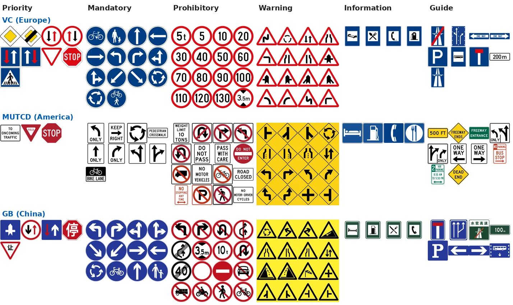
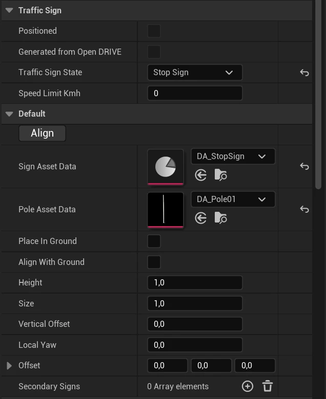
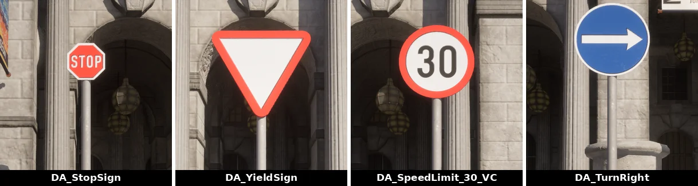
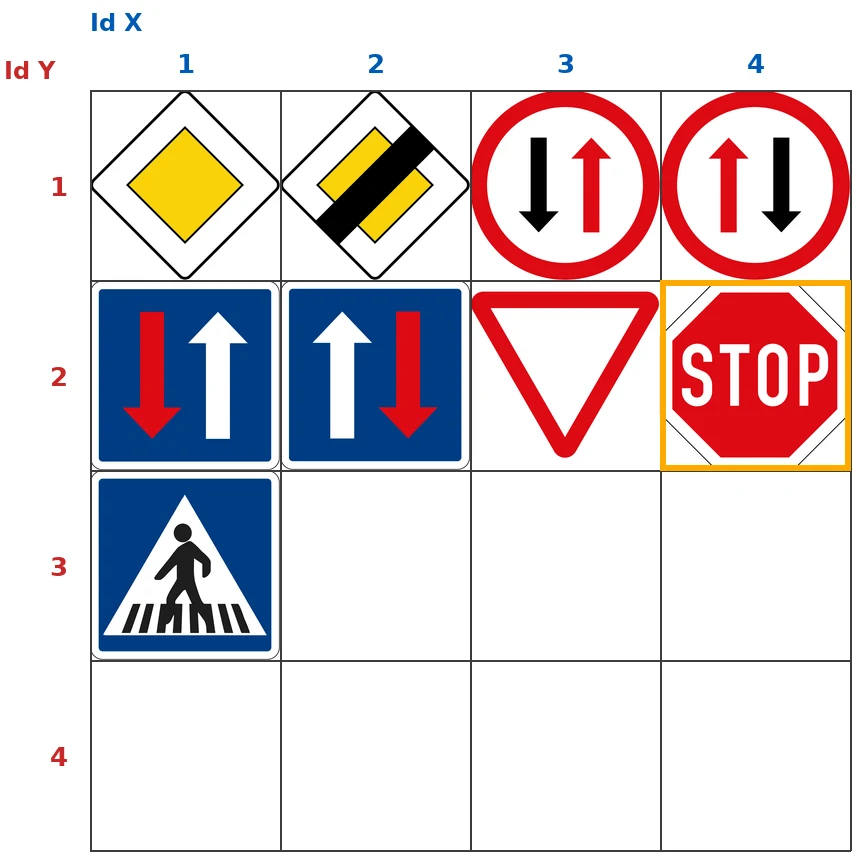
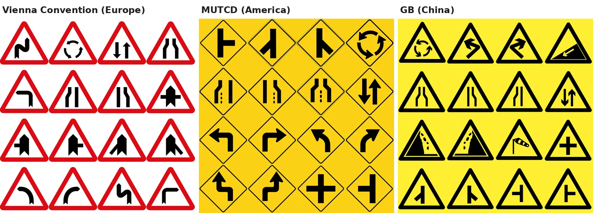
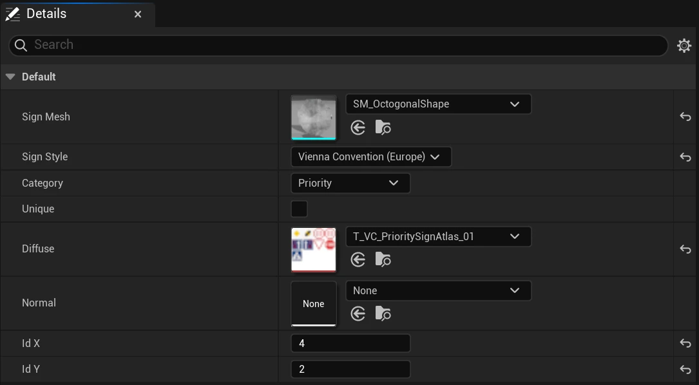

# Content authoring - traffic lights and signs

Traffic lights and traffic signs are blueprints from the CARLA content library, dragged into the level and given a trigger volume: the area in which they affect a vehicle. This page covers placing both, and the regional sign system that builds sign plates of the European, American and Chinese conventions from texture atlases.

- [__Traffic lights__](#traffic-lights)
- [__Traffic signs__](#traffic-signs)
- [__Regional traffic signs__](#regional-traffic-signs)
- [__Sign atlases__](#sign-atlases)
- [__Sign data assets__](#sign-data-assets)
- [__Add a sign__](#add-a-sign)
- [__Generate signs in bulk__](#generate-signs-in-bulk)

---
## Traffic lights

To add traffic lights to your new map:

__1.__ From the _Content Browser_, navigate to `Content > Carla > Blueprints > TrafficLight`. The `BP_TrafficLightNew_T10_master_*` blueprints are the traffic lights used in Town10HD_Opt; more are in `Content > Carla > Static > TrafficLight`.

__2.__ Drag the traffic lights into the scene and position them in the desired location. Press the space bar on your keyboard to toggle between positioning, rotation, and scaling tools.

__3.__ Adjust the [`trigger volume`][triggerlink] for each traffic light by selecting the _BoxTrigger_ component in the _Details_ panel and adjusting the values in the _Transform_ section. This will determine the traffic light's area of influence.

A traffic light selected in Town10HD_Opt (yellow outline); its <code>BoxTrigger</code> component, outlined in the component list, is the trigger volume drawn over the lane in front of it.

__4.__ For junctions, drag the `BP_TrafficLightGroup` actor into the level. Assign all the traffic lights in the junction to the traffic light group by adding them to the _Traffic Lights_ array in the _Details_ panel.

A <code>BP_TrafficLightGroup</code> selected: its <b>Traffic Lights</b> array holds the lights of the junction.

__5.__ Traffic light timing is only configurable through the Python API. See the documentation [here](core_actors.md#traffic-signs-and-traffic-lights) for more information.

A Town10HD_Opt junction with its traffic lights and signs placed.

---
## Traffic signs

To add traffic signs to your new map:

__1.__ From the _Content Browser_, navigate to `Content > Carla > Static > TrafficSign`. You will find several different traffic sign blueprints to choose from.

__2.__ Drag the traffic signs into the scene and position them in the desired location. Press the space bar on your keyboard to toggle between positioning, rotation, and scaling tools.

__3.__ Adjust the [`trigger volume`][triggerlink] for each traffic sign by selecting the _BoxTrigger_ component in the _Details_ panel and adjusting the values in the _Transform_ section. This will determine the traffic sign's area of influence. Not all traffic signs have a trigger volume. Those that do, include the yield, stop and speed limit signs.

[triggerlink]: python_api.md#carla.TrafficSign.trigger_volume

---
## Regional traffic signs

The blueprints in `Content > Carla > Static > TrafficSign` are one fixed sign each. The regional sign system builds a sign from data instead: one actor, `BP_Sign`, mounts a plate mesh on a pole and paints the plate with one cell of a texture atlas. A data asset says which plate, which atlas and which cell, so a new sign is a new data asset, not a new blueprint. Town15 is built with it.

The first atlas of each category in the three styles: every face here is a sign <code>BP_Sign</code> can show, picked by a data asset. Prohibitory and Warning have more atlases than the one shown.

It lives in `Content > Carla > Blueprints > LevelDesign > Signs`:

| Asset | What it is |
| --- | --- |
| `BP_Sign` | The sign actor. A traffic sign actor (`ATrafficSignBase`) with a pole, a plate and a trigger box. |
| `BDAs` | The data asset classes: `BDA_TrafficSign_Base` for plates, `BDA_Pole_Base` and `BDA_Poles` for poles. |
| `DataAssets` | The plate data assets, by category and style. |
| `DataAssets_Pole` | The pole data assets. |
| `Enums` | `Enum_SignsStyle` and `Enum_TrafficSignCategories`, the styles and categories below. |

Every plate has a __style__, the convention it follows, and a __category__, its function in that convention:

| Style | Folder code | Convention |
| --- | --- | --- |
| Vienna Convention (Europe) | `VC` | The Vienna Convention on Road Signs and Signals, used across Europe. |
| MUTCD (America) | `MUTCD` | The US Manual on Uniform Traffic Control Devices. |
| GB (China) | `GB` | The Chinese national standard GB 5768. |

| Category | Signs |
| --- | --- |
| Priority | Stop, yield and right of way. |
| Mandatory | Compulsory direction, roundabout, cycle and pedestrian paths. |
| Prohibitory | No entry, no turn, no parking, speed limits. |
| Warning | Hazards ahead. |
| Information | Pedestrian crossing, parking and other information. |
| Guide | Directions and destinations. |
| Others | Anything else. |
| SpeedLimit | Speed limit plates. |

To place one, drag `BP_Sign` into the level and set, in its *Details* panel:

The <i>Details</i> panel of a placed <code>BP_Sign</code> with <code>DA_StopSign</code> and <code>DA_Pole01</code>. <i>Traffic Sign State</i> shows <i>Stop Sign</i>: it was not set by hand.

| Field | What it does |
| --- | --- |
| _Sign Asset Data_ | The plate: a sign data asset. |
| _Pole Asset Data_ | The pole: a pole data asset from `DataAssets_Pole`. |
| _Secondary Signs_ | More plates on the same pole, each with its own _Secondary Sign_ data asset, _Offset_, _Local Yaw_ and _Size_. |
| _Vertical Offset_ | Moves the plate up or down the pole. |
| _Height_, _Size_, _Local Yaw_, _Offset_ | Scale and place the plate and the pole. |

Four <code>BP_Sign</code> actors on Town10HD_Opt, the same blueprint and pole (<code>DA_Pole01</code>) with a different <i>Sign Asset Data</i> each.

The pole data assets are `DA_Pole01` (`SM_Pole05`), `DA_Pole02` (`SM_Pole07`), `DA_Pole03` (`SM_PoleWithGroundDamage_01`, the one Town15 uses), `DA_DoblePole01` (`SM_DoblePole01`) and `DA_SolarPole` (`SM_SolarPole`), each a _Pole Mesh_ and a _Sign Style_.

A `BP_Sign` only regulates traffic when it stands for a signal of the map's OpenDRIVE. When the map loads, the server looks for a sign actor within 5 m of each stop, yield and speed limit signal whose _Traffic Sign State_ (category _Traffic Sign_ of the *Details* panel) matches the signal, and gives that actor the signal's behaviour instead of spawning a stock sign. For a custom speed limit, set _Traffic Sign State_ to *Speed Limit - custom (km/h)* and the value in _Speed Limit Kmh_. A sign that matches no signal is decoration.

---
## Sign atlases

The faces of the signs are drawn in texture atlases in `Content > Carla > Static > Signs > DataAssetsTextures > SignsAtlases`, one folder per style. Each atlas is a 4096 x 4096 texture divided in a grid of 4 x 4 cells of 1024 x 1024, one sign per cell, and holds signs of one category. The name says which: `T_<style>_<category>SignAtlas_<number>`.

<code>T_VC_PrioritySignAtlas_01</code> with its 4 x 4 grid. <b>Id X</b> counts the columns from the left and <b>Id Y</b> the rows from the top: cell 4, 2 (outlined) is the stop sign that <code>DA_StopSign</code> uses. The empty cells are free for new signs.

The same category, Warning, in the three styles: <code>T_VC_WarningSignAtlas_01</code>, <code>T_MUTCD_WarningSignAtlas_01</code> and <code>T_GB_WarningSignAtlas_01</code>.

| Folder | Atlases |
| --- | --- |
| `VC` | `Guide` 1, `Information` 1, `Mandatory` 1, `Priority` 1, `Prohibitory` 3, `Warning` 3 |
| `MUTCD` | `Guide` 1, `Information` 1, `Mandatory` 1, `Priority` 1, `Prohibitory` 5, `Warning` 2 |
| `GB` | `Guide` 1, `Information` 1, `Mandatory` 1, `Priority` 1, `Prohibitory` 3, `Warning` 2 |
| `Miscellaneous` | `T_MiscellaneousSignAtlas_01`, signs outside the three styles. |

The 31 atlases have room for 496 signs. A sign that does not fit a cell, such as a long direction panel, has a texture of its own instead, a __unique__ sign: the 1024 x 1024 textures in `Content > Carla > Static > Signs > DataAssetsTextures > Textures > VC`, each with its normal map (`_N`). `Content > Carla > Static > Signs > TextureAtlas > ViennaConvention` holds an older set of Vienna Convention atlases with their normal maps; some data assets take their normal map from them.

The plate material is `M_SignTextureAtlasSelector`, in `Content > Carla > Static > Signs > Materials > Atlas`. It shows one cell of the texture in its `Diffuse` parameter, the one in `Index_X` and `Index_Y`. `BP_Sign` sets those three parameters from the data asset.

---
## Sign data assets

A sign data asset describes one plate. The class is `BDA_TrafficSign_Base`, and its children (`BDA_Prohibited`, `BDA_Warning`, `BDA_Yields`, `BDA_Signal`, `BDA_SquareSignal`, `BDA_SpeedLimits`, `BDA_Unique`) add no fields; the shipped data assets are mostly `BDA_Prohibited` or `BDA_Warning`, whatever their category.

<code>DA_StopSign</code> open in the editor: an octagonal plate mesh, the Vienna Convention style, the Priority category, the atlas <code>T_VC_PrioritySignAtlas_01</code> and its cell 4, 2.

| Field | What it holds |
| --- | --- |
| _Sign Mesh_ | The plate mesh, its shape: `SM_CircleShape`, `SM_DangerSignShape` (triangle), `SM_InvertedTriangleShape`, `SM_OctogonalShape`, `SM_SquareShape`, `SM_RomboidShape`, `SM_ArrowShape`, the `SM_HorRect_*` and `SM_VertRect_*` panels and the others in `Content > Carla > Static > TrafficSign > Signs`. |
| _Sign Style_ | The convention: *Vienna Convention (Europe)*, *MUTCD (America)* or *GB (China)*. |
| _Category_ | The category, from the table above. |
| _Unique_ | On for a unique sign: _Diffuse_ is a texture of its own and _Id X_ and _Id Y_ are ignored. |
| _Diffuse_ | The atlas, or the texture of a unique sign. |
| _Normal_ | The normal map: an `_N` texture, or `T_Flat_n` for a flat plate. |
| _Id X_ | Column of the cell in the atlas, from 1 (left) to 4. |
| _Id Y_ | Row of the cell in the atlas, from 1 (top) to 4. |

The data assets are in `Content > Carla > Blueprints > LevelDesign > Signs > DataAssets`. `SignsDA` sorts them by category and style (`SignsDA/Priority/VC/DA_StopSign` is cell 4, 2 of `T_VC_PrioritySignAtlas_01`), `SignsDataAssets` by sign type. `SignsNoNamed` holds 150 numbered data assets, `DA_1` to `DA_101` by category and style, that set the plate and the cell but no _Diffuse_: assign the atlas before you use one.

---
## Add a sign

A new sign is a picture in a free cell of an atlas and a data asset that points at it. Nothing is regenerated afterwards: a `BP_Sign` paints its plate from the data asset.

__1. Choose the atlas.__ Take the atlas of the sign's style and category with a free cell. If they are all full, the sign starts a new atlas: right-click the last one, select _Duplicate_, and name the copy with the next number, for example `T_VC_WarningSignAtlas_04`. The copy keeps the texture settings of the original.

__2. Draw the sign into the cell.__ The source images of the atlases are not in the repository. Right-click the atlas, select _Asset Actions > Export_, and open the exported image. Draw the sign in the free 1024 x 1024 cell, with the same margins and background as its neighbours, and save it at 4096 x 4096.

__3. Reimport it.__ Right-click the atlas and select _Reimport With New File_, then pick your image. Every data asset that uses the atlas keeps pointing at it.

__4. Create the data asset.__ In `DataAssets/SignsDA/<category>/<style>`, duplicate a data asset with the same plate shape (`DA_StopSign` for an octagon, `DA_YieldSign` for an inverted triangle) or right-click and select _Miscellaneous > Data Asset_ and the class `BDA_TrafficSign_Base`. Set _Sign Mesh_, _Sign Style_, _Category_, _Diffuse_ (the atlas), and _Id X_ and _Id Y_ (the cell: column, then row, counted from 1 at the top left). For a unique sign, tick _Unique_ and set _Diffuse_ and _Normal_ to its own textures.

__5. Place it.__ Drag `BP_Sign` into the level and set _Sign Asset Data_ to the new data asset and _Pole Asset Data_ to a pole. If the sign is a stop, yield or speed limit sign, check its _Traffic Sign State_ as described in [Regional traffic signs](#regional-traffic-signs): with `DA_StopSign` it is already _Stop Sign_ when the sign is placed.

---
## Generate signs in bulk

An atlas holds 16 signs, so a style's set of signs is many data assets that differ only in their cell. Create the first one, duplicate it, and change _Id X_ and _Id Y_ in each copy. To edit many at once, select them in the _Content Browser_, right-click, and open them in the _Property Matrix_ from _Asset Actions_: it shows one row per asset and one column per field.

For maps built from OpenStreetMap, CARLA also has a regional sign __catalog__ that places the signs for you. Its data assets are of the C++ class `USignDataAsset` (`CarlaTools` plugin, `Public/Generation/SignDataAsset.h`), and the __Sign Generation Controller__ of the [Digital Twin Tool](content_authoring_maps_digital_twin.md#traffic-signs) stands one at each OSM sign node of the map, matched by its OSM tags, facing the traffic of the nearest lane. It reads the catalog from `<Sign Package Path>/VC`, `/MUTCD` or `/GB`, after its _Sign Style_. The `BDA_*` data assets above are not `USignDataAsset` and the controller ignores them.

| Field | What it holds |
| --- | --- |
| _Sign Mesh_, _Unique_, _Diffuse_, _Id X_, _Id Y_ | As in the sign data assets: plate, atlas and cell (1 to 4, from the top left). |
| _Material_ | A material instance of the atlas selector with the cell already set. When it is empty, the controller builds one from `MI_SignTextureAtlasSelector` of the `CarlaDigitalTwinsTool` content. |
| _Style_ | `VC`, `MUTCD`, `GB` or `None`. |
| _Category_ | Priority, Mandatory, Prohibitory, Warning, Information, Guide, Others, SpeedLimit or None. |
| _Sign Name_ | Identifier of the sign, unique within its style, such as `max_speed_30`. |
| _Description_ | What a person recognises the sign by. |
| _Meaning_ | Code of the sign in its convention, such as `B2a` (Vienna) or `R1-1` (MUTCD). May be empty. |
| _Xodr Type_, _Xodr Subtype_ | The OpenDRIVE signal the sign stands for: type `206` is stop, `274` maximum speed with the speed as subtype. Empty for signs with no OpenDRIVE counterpart. |
| _Osm Tags_ | The OSM tags (`key=value`) of the nodes the sign is placed at, such as `highway=stop` or `maxspeed=30`. The match is exact. |

The sign actors it spawns (`AGeoTrafficSign`) carry the OpenDRIVE type and subtype of their catalog entry, so the server adopts them for the signal they stand at, like a `BP_Sign`. A second run of the controller replaces the signs of the first. The shipped catalog belongs to the `CarlaDigitalTwinsTool` content, which CARLA does not distribute; according to `SignDataAsset.h` it is generated from a table of atlas cells by a script of the twin model tools (`TwinModel/ue/gen_sign_dataassets.py`). Without that content, give every catalog entry its own _Material_: an instance of `M_SignTextureAtlasSelector` with `Diffuse`, `Index_X` and `Index_Y` set.

---

If you have any questions about the process, then you can ask in the [GitHub Discussions](https://github.com/carla-simulator/carla/discussions).
