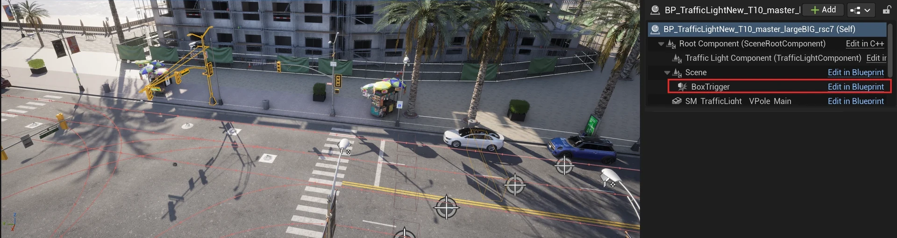
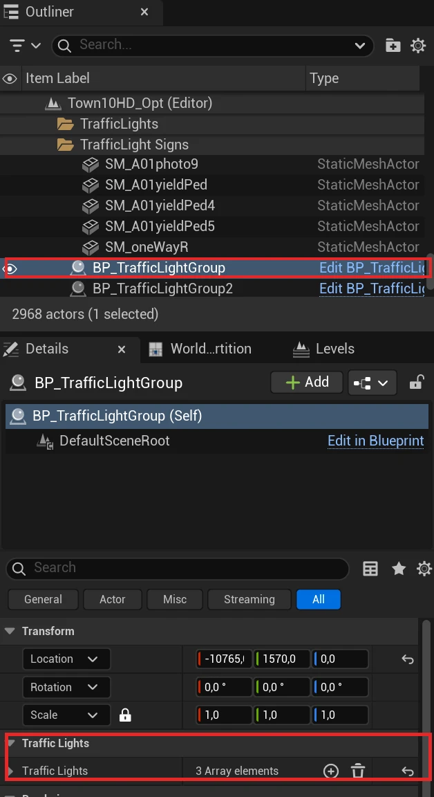
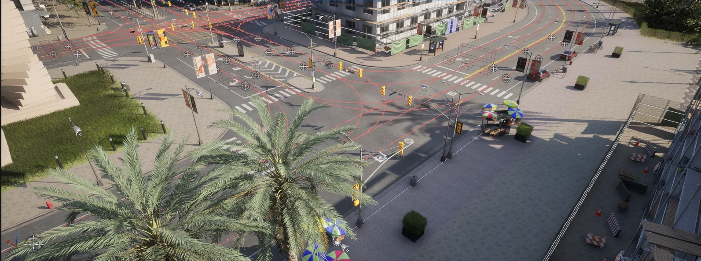

# Content authoring - traffic lights and signs

Traffic lights and traffic signs are blueprints from the CARLA content library, dragged into the level and given a trigger volume: the area in which they affect a vehicle. This page covers placing both.

- [__Traffic lights__](#traffic-lights)
- [__Traffic signs__](#traffic-signs)

---
## Traffic lights

To add traffic lights to your new map:

__1.__ From the _Content Browser_, navigate to `Content > Carla > Blueprints > TrafficLight`. The `BP_TrafficLightNew_T10_master_*` blueprints are the traffic lights used in Town10HD_Opt; more are in `Content > Carla > Static > TrafficLight`.

__2.__ Drag the traffic lights into the scene and position them in the desired location. Press the space bar on your keyboard to toggle between positioning, rotation, and scaling tools.

__3.__ Adjust the [`trigger volume`][triggerlink] for each traffic light by selecting the _BoxTrigger_ component in the _Details_ panel and adjusting the values in the _Transform_ section. This will determine the traffic light's area of influence.

A traffic light selected in Town10HD_Opt (yellow outline); its <code>BoxTrigger</code> component, outlined in the component list, is the trigger volume drawn over the lane in front of it.

__4.__ For junctions, drag the `BP_TrafficLightGroup` actor into the level. Assign all the traffic lights in the junction to the traffic light group by adding them to the _Traffic Lights_ array in the _Details_ panel.

A <code>BP_TrafficLightGroup</code> selected: its <b>Traffic Lights</b> array holds the lights of the junction.

__5.__ Traffic light timing is only configurable through the Python API. See the documentation [here](core_actors.md#traffic-signs-and-traffic-lights) for more information.

A Town10HD_Opt junction with its traffic lights and signs placed.

---
## Traffic signs

To add traffic signs to your new map:

__1.__ From the _Content Browser_, navigate to `Content > Carla > Static > TrafficSign`. You will find several different traffic sign blueprints to choose from.

__2.__ Drag the traffic signs into the scene and position them in the desired location. Press the space bar on your keyboard to toggle between positioning, rotation, and scaling tools.

__3.__ Adjust the [`trigger volume`][triggerlink] for each traffic sign by selecting the _BoxTrigger_ component in the _Details_ panel and adjusting the values in the _Transform_ section. This will determine the traffic sign's area of influence. Not all traffic signs have a trigger volume. Those that do, include the yield, stop and speed limit signs.

[triggerlink]: python_api.md#carla.TrafficSign.trigger_volume

---

If you have any questions about the process, then you can ask in the [GitHub Discussions](https://github.com/carla-simulator/carla/discussions).
