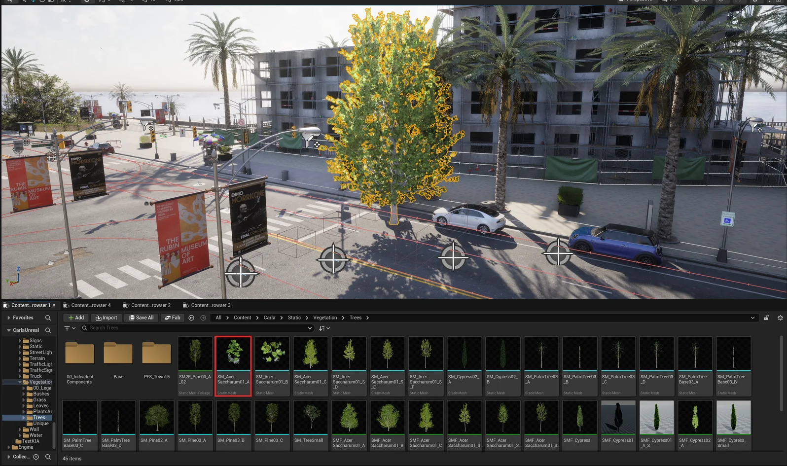

# Content authoring - trees and vegetation

Vegetation is placed from the content library, one asset at a time or painted in bulk with Unreal's foliage tool.

- [__Vegetation assets__](#vegetation-assets)
- [__Foliage tool__](#foliage-tool)

---
## Vegetation assets

The CARLA content library has a comprehensive set of vegetation blueprints for you to add further realism to the off-road areas of your maps like sidewalks, parks, hillsides, fields and forests. 

Navigate to the vegetation folder in the CARLA content library: `Carla > Static > Vegetation`. You will find meshes and blueprints for many types of trees, bushes and shrubs. You can drag these elements into your map from the content browser. 

A tree from <code>Static/Vegetation/Trees</code> (outlined in the Content Browser) dragged into the map.

## Foliage tool

A useful tool for trees and vegetation is the [__Unreal Engine foliage tool__](https://dev.epicgames.com/documentation/en-us/unreal-engine/foliage-mode-in-unreal-engine). Activate it from the _Selection Mode_ dropdown in the toolbar, or with `Shift + 3`.

Drag your desired foliage item into the box labeled `+ Drop Foliage Here`. Set an appropriate density in the density field, then paint into the map with your foliage item. 

---

If you have any questions about the process, then you can ask in the [GitHub Discussions](https://github.com/carla-simulator/carla/discussions).
