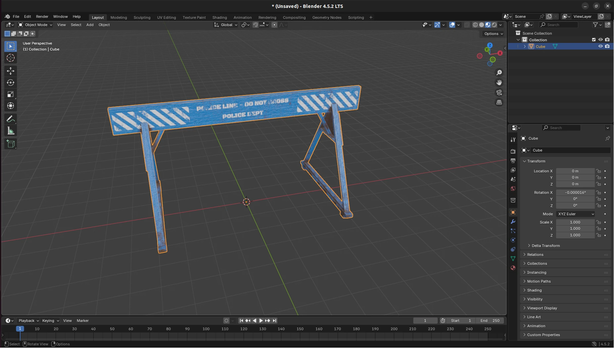
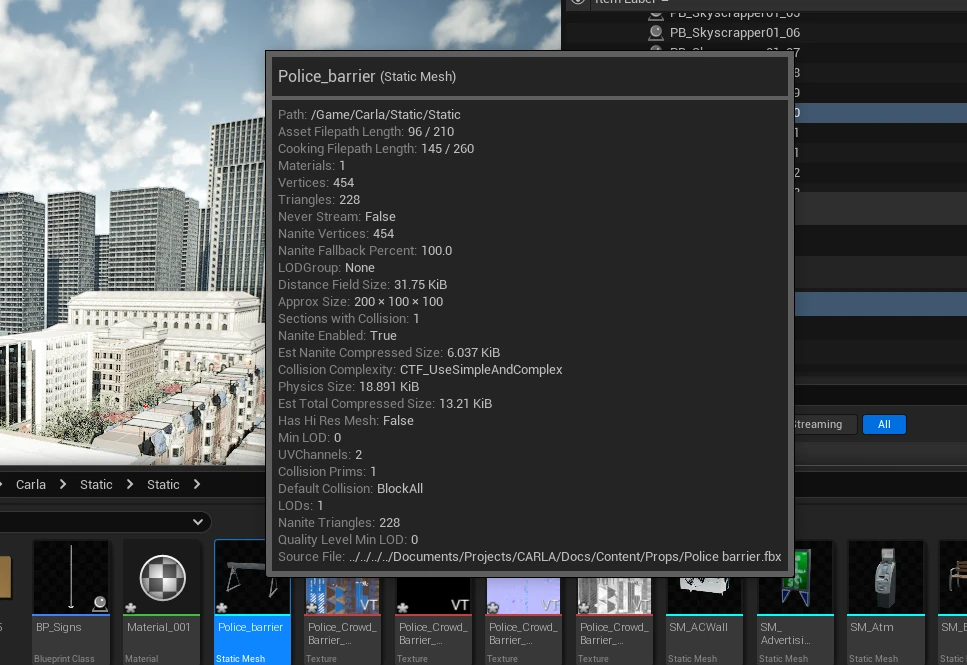
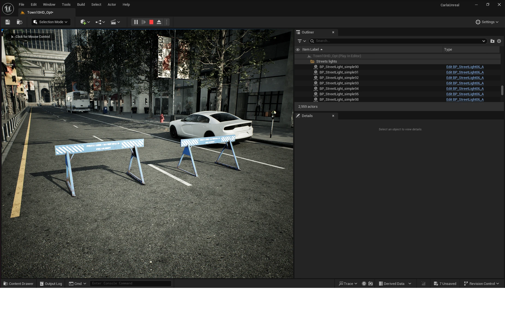
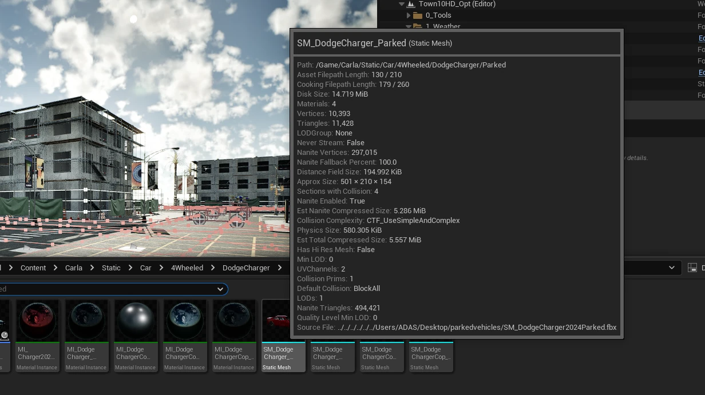
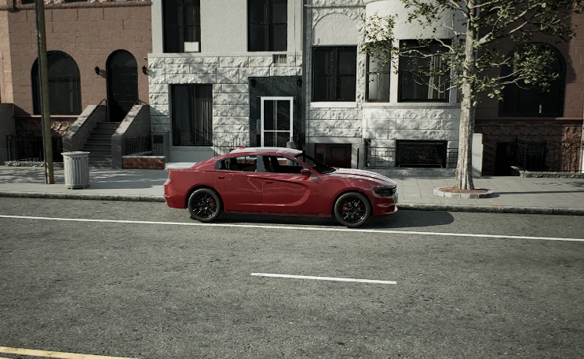

# Content authoring - props

Creating a custom prop in CARLA is quick and straightforward. Follow these steps to import and use a custom asset as a prop inside a CARLA simulation.

- [__Download or model an asset__](#download-or-model-an-asset)
- [__Import the asset into the Unreal Editor__](#import-the-asset-into-the-unreal-editor)
- [__Add the new prop to the JSON configuration file__](#add-the-new-prop-to-the-json-configuration-file)
- [__Use the new prop in the simulation__](#use-the-new-prop-in-the-simulation)
- [__Make a CARLA package with new props__](#make-a-carla-package-with-new-props)
- [__Use static mesh as a prop through the API__](#use-static-mesh-as-a-prop-through-the-api)

Running the Unreal Engine editor is required for this process, therefore you need to [build CARLA from source](build_carla.md).

---

## Download or model an asset

You may find ready-made 3D assets on sites such as [TurboSquid](https://www.turbosquid.com/) or [Sketchfab](https://sketchfab.com/) that suit your use case (**make sure to check that the license suits your intended use**). Alternatively, if you are adept at 3D modelling, you may choose to model the object in a 3D modelling application such as Blender or Maya.


<div class="img-caption">The police barrier model in Blender, ready to export as FBX.</div>

For this example, we [download an asset](https://skfb.ly/ozJB6) from Sketchfab that has a creative commons license. First, import the asset into Blender to inspect it to ensure it suits our intended use. For this asset, a couple of modifications were required to prepare it for use in CARLA:

* __Rescaling__: The asset was unrealistically large (5m tall), scaling down to 1m tall was required to suit our intended use in CARLA. Check the dimensions carefully in Blender before exporting.
* __Origin of geometry__: The origin of geometry for this asset was above the ground plane. This was moved to the scene origin since this will serve as our anchor point for the prop inside the CARLA simulation.

If the model is not already in FBX format or needed modification, export it as FBX from Blender or your preferred 3D application.

---

## Import the asset into the Unreal Editor

Now that we have an asset in FBX format, we can import it into the CARLA content library. Launch the CARLA Unreal Engine editor by running `cmake --build Build --target launch` in the root directory of the CARLA source code repository. Once the editor is open, navigate to an appropriate place in the content directories (`Content/Carla/Static/Static` in this example). Drag the FBX file into the content browser, import with the default options. Once the import is complete we can see our new prop as a static mesh in the content folder:


<div class="img-caption">The imported <code>Police_barrier</code> static mesh in the Content Browser, with its asset details.</div>

!!! Warning
    Check the imported mesh's dimensions before going further. An FBX exported in centimeters and imported at scale 1.0 comes in a hundred times too large — a door becomes 400 m tall — and the prop is unusable without reimporting it at the right scale.

---

## Add the new prop to the JSON configuration file

To register the asset as a prop and use it through the CARLA API, add it to `PropParameters.json` in `${CARLA_ROOT}/Unreal/CarlaUnreal/Content/Carla/Config`. Match the format of the existing entries, with the path of the mesh you imported — hover over the asset in the content browser to check it — and a memorable name:

```json
{
    "Props": [
        {
            "Name": "ATM",
            "Mesh": "/Game/Carla/Static/Static/SM_Atm.SM_Atm",
            "Size": "Medium",
            "BaseType": "sidewalk",
            "SubType": "utilities"
        },

        ...,

        {
            "Name": "PoliceBarrier",
            "Mesh": "/Game/Carla/Static/Static/Police_barrier.Police_barrier",
            "Size": "Medium"
        }
    ]
}
```

The keys are case-sensitive: the factory reads `Name`, `Mesh` and `Size`, plus the optional `BaseType` and `SubType` that put the prop in a catalogue group. A lowercase `path` is simply ignored, and the prop registers with no mesh.

!!! Warning
    The file is read again every time an episode starts. After editing it, press __Play__ again in the editor, or call `client.reload_world()` on a running server, otherwise the new prop does not appear in the blueprint library. The mesh also has to stay under `/Game/Carla` to survive a package cook.

---

## Use the new prop in the simulation

Start the CARLA simulation Unreal Engine editor with the play command. Once it is running, open a Python script or notebook. The new prop will be assigned the blueprint ID `static.prop.policebarrier` (i.e. `static.prop.<name_lower_case>`).

Filter for the name you entered in the name field in `PropParameters.json` in lower case and you will find a new blueprint ID for your new prop:

```py
import carla

client = carla.Client()
world  = client.get_world()
bp_lib = world.get_blueprint_library()

for bp in bp_lib.filter('*policebarrier*'):
    print(bp.id)
```

This should return:

```text
static.prop.policebarrier
```

Now you can place your new prop in the simulation in the same way as native CARLA props:

```py
barrier_bp = bp_lib.find('static.prop.policebarrier')

for spawn_point in world.get_map().get_spawn_points()[:3]:
    world.spawn_actor(barrier_bp, spawn_point)

```


<div class="img-caption">Police barriers spawned through the Python API in Town10HD_Opt.</div>

---

## Make a CARLA package with new props

Once the props are imported and everything is saved in the Unreal Editor, build a package that contains them:

```sh
cmake --build Build --target package
```

The result is an archive under `Build/Package/` — `.tar.gz` on Linux, `.zip` on Windows. A build configured with a preset writes to `Build/<preset>/Package/` instead.

!!! Note
    Rebuilding the whole simulator to ship a handful of props is rarely what you want. A [content pack](content_authoring_packs.md) carries new props on their own and drops into any CARLA package of the same release.

---

## Use static mesh as a prop through the API

Static meshes already included in the CARLA content library can be nominated for use as props through the Python API using the `static.prop.mesh` blueprint. Locate the desired mesh in the CARLA content browser and take note of its path. For this example we will choose the Dodge Charger model from the `/Game/Carla/Static/Car/4Wheeled/DodgeCharger/Parked` directory.


<div class="img-caption"><code>SM_DodgeCharger_Parked</code> in the Content Browser: its path is what <code>mesh_path</code> takes.</div>

We can use the following code to place the vehicle in the map as a prop:

```py
# Set the path for the chosen static mesh
mesh_path = '/Game/Carla/Static/Car/4Wheeled/DodgeCharger/Parked/SM_DodgeCharger_Parked.SM_DodgeCharger_Parked'
spawn_point = carla.Transform(carla.Location(x=52.7, y=127.7, z=0), carla.Rotation())

# Use the static.prop.mesh bp and set the mesh_path attribute
parked_vehicle_bp = bp_lib.find('static.prop.mesh')
parked_vehicle_bp.set_attribute('mesh_path', mesh_path)

parked_vehicle = world.spawn_actor(parked_vehicle_bp, spawn_point)
```


<div class="img-caption">The parked Dodge Charger spawned as a <code>static.prop.mesh</code> prop.</div>

This method works both with the built-from-source version of CARLA and also a package version of CARLA, as long as the package contains the nominated static mesh in the correct location.