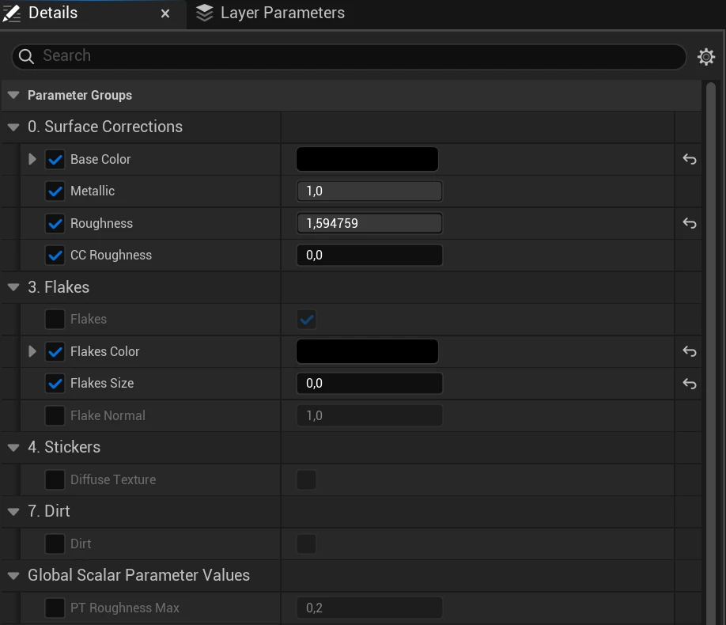
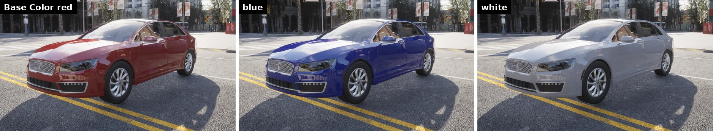
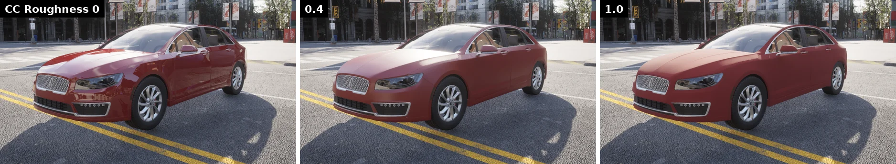
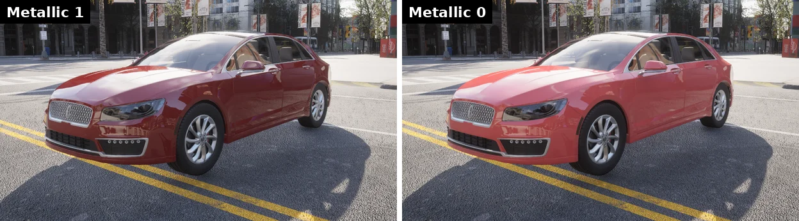
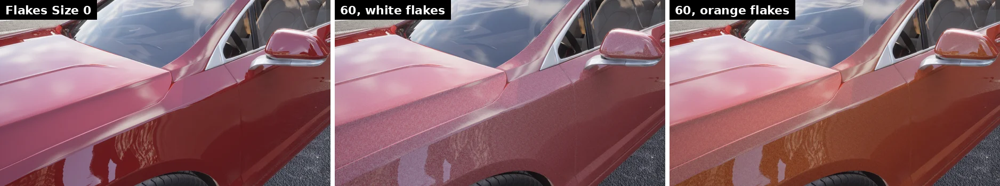

# Content authoring - vehicle materials

With the vehicle imported and its blueprints in place, the next step is its paint. The Unreal Editor's material workflow is comprehensive and correspondingly complex, so CARLA ships a car-paint master material to instance rather than starting from scratch.

This page covers the vehicle paint only; the building and environment materials are in [Material customization](content_authoring_materials.md), and importing the vehicle itself in [Content authoring - vehicles](content_authoring_vehicles.md).

- [__Applying a material to your vehicle__](#applying-a-material-to-your-vehicle)

---
## Applying a material to your vehicle

CARLA provides a prototype material for replicating the glossy finish of vehicles that can mimic numerous different types of vehicle paint jobs and features. Open Unreal editor and in the content browser, locate the material in `Content > Carla > Static > GenericMaterials > 000_Masters > Vehicles`. The basic material is called *M_CarPaintMaster*. Right click on this material and choose *Create Material Instance* from the context material. Name it and move it into the folder where your new vehicle content is stored.

In the Unreal Editor, drag the skeletal mesh of the vehicle from the content browser into the scene. In the *Details* panel, drag your new material instance into the *Materials* slot of the bodywork, usually *Element 0* and named `Bodywork_Mat`. The bodywork takes the grey, glossy default of the master.

Double click the material instance in the content browser to edit its parameters. They are grouped as follows; tick a parameter to override the master's value.

The parameters of <code>MI_LincolnMKZ_Bodywork</code>, an instance of <code>M_CarPaintMaster</code>.

| Group | Parameters | What they control |
| --- | --- | --- |
| 0. Surface Corrections | `Base Color`, `Metallic`, `Roughness`, `CC Roughness` | The paint color, how metallic it is, the roughness of the paint, and the roughness of the clear coat over it. |
| 3. Flakes | `Flakes` (switch), `Flakes Size`, `Flakes Color`, `Flake Normal` | Metallic or pearlescent flakes suspended in the paint. |
| 4. Stickers | `Diffuse Texture` (switch), `Sticker Diffuse` | A texture over the paint, for liveries and logos. |
| 7. Dirt | `Dirt` (switch), `DirtMasks`, `Dirt Color 1-3`, `Dirt Opacity 1-3`, `Dirt Roughness 1-3` | Up to three layers of dirt and dust, each with its mask channel, color, opacity and roughness. |

The renders below change one parameter at a time on the Lincoln MKZ, with the others as in the first image: red `Base Color`, `Metallic` 1, `CC Roughness` 0, no flakes.

__Base color__ — the primary color of the bodywork. A vehicle's `color` blueprint attribute overrides it at spawn time, so the instance value is the color a vehicle shows when the client does not set one.

The same instance with three values of <code>Base Color</code>.

__Clear coat roughness__ — the clear coat is the glossy layer over the paint. `CC Roughness` scatters its reflection: low values give the usual shiny finish, high values a matte one. Car paint is normally smooth and reflective; reserve high values for matte custom finishes.

<code>CC Roughness</code> at 0, 0.4 and 1.0.

__Metallic__ — metallic paint takes its reflections tinted by the base color; with `Metallic` at 0 the paint behaves like a plain, solid color under the clear coat.

<code>Metallic</code> at 1 and 0.

__Flakes__ — some paints carry flakes of metal or ceramic that add glints under direct light, for a *metallic* or *pearlescent* look. `Flakes Size` scales the flake pattern (at 0 there are none) and `Flakes Color` their tint: keep it close to the base color for a metallic finish, use a contrasting one for a pearlescent finish. The flakes are only visible up close.

Close-up of the front wing with no flakes, white flakes and orange flakes at <code>Flakes Size</code> 60.

__Dirt__ — cars accumulate grease and dust that dull the paint. Enable the `Dirt` switch and assign a `DirtMasks` texture: each of its channels masks one dirt layer, with its own color, opacity and roughness.

!!! Note
    `Flakes`, `Dirt` and `Diffuse Texture` are static switches. They are set on the material instance in the editor and cannot be toggled at runtime.
