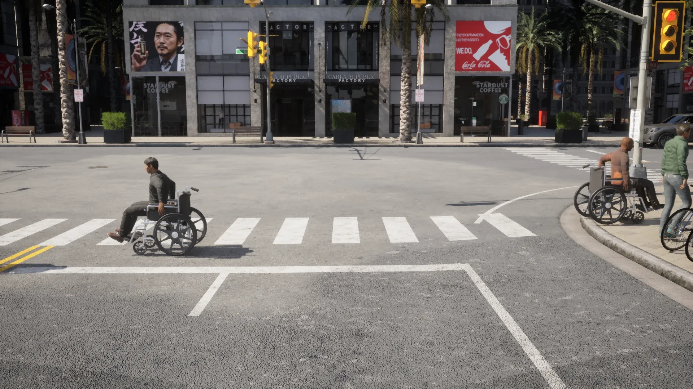

# Actors and blueprints

Actors in CARLA are the elements that perform actions within the simulation, and they can affect other actors. Actors in CARLA includes vehicles and walkers and also sensors, traffic signs, traffic lights and the spectator. It is crucial to have full understanding on how to operate on them.

This section will cover spawning, destruction, types, and how to manage them. However, the possibilities are almost endless. Experiment, take a look at the [__tutorials__](tutorials.md) in this documentation and share doubts and ideas in the [GitHub Discussions](https://github.com/carla-simulator/carla/discussions).

- [__Blueprints__](#blueprints)
- [__Actor life cycle__](#actor-life-cycle)
- [__Types of actors__](#types-of-actors)

!!! agent "Ask your agent"
    *"Spawn a red Tesla Model 3 at a free spawn point, 20 pedestrians that walk around, and tell me the speed of the Tesla."*

    Skills: `spawn-vehicles`, `spawn-walkers`, `world-data`, `telemetry`. [Connect your agent](agent_skills.md#connect-your-agent).

---
## Blueprints

These layouts allow the user to smoothly incorporate new actors into the simulation. They are already-made models with animations and a series of attributes. Some of these are modifiable and others are not. These attributes include, among others, vehicle color, amount of channels in a lidar sensor, a walker's speed, and much more.

Available blueprints are listed in the [blueprint library](bp_library.md), along with their attributes.

### Managing the blueprint library

The [carla.BlueprintLibrary](python_api.md#carla.BlueprintLibrary) class contains a list of [carla.ActorBlueprint](python_api.md#carla.ActorBlueprint) elements. It is the world object who can provide access to it.
```py
blueprint_library = world.get_blueprint_library()
```
Blueprints have an ID to identify them and the actors spawned with it. The library can be read to find a certain ID, choose a blueprint at random, or filter results using a [wildcard pattern](https://tldp.org/LDP/GNU-Linux-Tools-Summary/html/x11655.htm).

```py
# Find a specific blueprint.
collision_sensor_bp = blueprint_library.find('sensor.other.collision')
# Choose a vehicle blueprint at random.
vehicle_bp = random.choice(blueprint_library.filter('vehicle.*.*'))
```

Besides that, each [carla.ActorBlueprint](python_api.md#carla.ActorBlueprint) has a series of [carla.ActorAttribute](python_api.md#carla.ActorAttribute) that can be _get_ and _set_.
```py
is_bike = vehicle_bp.get_attribute('number_of_wheels') == 2
if is_bike:
    vehicle_bp.set_attribute('color', '255,0,0')
```
!!! Note
    Some of the attributes cannot be modified. Check it out in the [blueprint library](bp_library.md).

Vehicles, walkers and props carry attributes that describe __what the blueprint is__, so a selection can be made without matching names. They are read-only and present on every blueprint of their kind.

| Attribute | On | Values |
| --------- | -- | ------ |
| `base_type` | vehicles | `car`, `truck`, `van`, `bus`, `motorcycle`, `bicycle`, and `industrial` for the off-road machinery of a map such as [Mine_01](map_mine.md) |
| `base_type` | props | `road`, `sidewalk`, `park_garden`, `containers`, `garbage`, `personal`, `utility` |
| `subtype` | props | the family within the base type: `cones`, `benches`, `bins`, `signs`, `plantpots`, `debris`, ... |
| `special_type` | vehicles | `emergency`, `taxi`, `electric`, or empty |
| `special_type` | walkers | `police`, or empty |

```py
# Every two-wheeler, whatever it is called
bikes = [bp for bp in blueprint_library.filter('vehicle.*')
         if bp.get_attribute('base_type') in ('bicycle', 'motorcycle')]

# Traffic cones only
cones = [bp for bp in blueprint_library.filter('static.prop.*')
         if bp.get_attribute('subtype') == 'cones']
```

!!! Note
    A map can ship its own vehicles, in `Config/<map>/Vehicles.json`, with values of their own. They are in the blueprint library only while that map is loaded.

Attributes have an [carla.ActorAttributeType](python_api.md#carla.ActorAttributeType) variable. It states its type from a list of enums. Also, modifiable attributes come with a __list of recommended values__.

```py
for attr in blueprint:
    if attr.is_modifiable:
        blueprint.set_attribute(attr.id, random.choice(attr.recommended_values))
```
### The catalogue

The [catalogue](catalogue.md) shows what the blueprint library ships: every [vehicle](catalogue_vehicles.md), [pedestrian](catalogue_pedestrians.md) and [prop](catalogue_props.md), with a picture of each one and the blueprint id to spawn it with.

### Creating your own actors

Vehicles, walkers and props can all be assets of your own. [Custom assets](content_authoring_overview.md) is the entry point: it covers [props](content_authoring_props.md), [vehicles](content_authoring_vehicles.md), and [content packs](content_authoring_packs.md) to ship them with. 

---
## Actor life cycle

!!! Important
    This section mentions different methods regarding actors. The Python API provides for __[commands](python_api.md#command.SpawnActor)__ to apply batches of the most common ones, in just one frame.

### Spawning

__The world object is responsible of spawning actors and keeping track of these.__ Spawning only requires a blueprint, and a [carla.Transform](python_api.md#carla.Transform) stating a location and rotation for the actor.

The world has two different methods to spawn actors.

* [`spawn_actor()`](python_api.md#carla.World.spawn_actor) raises an exception if the spawning fails.
* [`try_spawn_actor()`](python_api.md#carla.World.try_spawn_actor) returns `None` if the spawning fails.

```py
transform = carla.Transform(carla.Location(x=230, y=195, z=40), carla.Rotation(yaw=180))
actor = world.spawn_actor(blueprint, transform)
```

!!! Important
    CARLA uses the [Unreal Engine coordinate system](core_coordinate_conventions.md). Remember that the [`carla.Rotation`](python_api.md#carla.Rotation) constructor is defined as `(pitch, yaw, roll)`, which differs from the Unreal Engine editor's `(roll, pitch, yaw)`.

The actor will not be spawned in case of collision at the specified location. No matter if this happens with a static object or another actor. It is possible to try avoiding these undesired spawning collisions.

* `map.get_spawn_points()` __for vehicles__. Returns a list of recommended spawning points.

```py
spawn_points = world.get_map().get_spawn_points()
```

* `world.get_random_location_from_navigation()` __for walkers__. Returns a random point on the navigation mesh, which is also how a goal location is chosen for a walker.

```py
spawn_point = carla.Transform()
spawn_point.location = world.get_random_location_from_navigation()
```

An actor can be attached to another one when spawned. Actors follow the parent they are attached to. This is specially useful for sensors. The attachment can be rigid (proper to retrieve precise data) or with an eased movement according to its parent. It is defined by the helper class [carla.AttachmentType](python_api.md#carla.AttachmentType).

The next example attaches a camera rigidly to a vehicle, so their relative position remains fixed.

```py
camera = world.spawn_actor(camera_bp, relative_transform, attach_to=my_vehicle, attachment_type=carla.AttachmentType.Rigid)
```
!!! Important
    When spawning attached actors, the transform provided must be relative to the parent actor.

Once spawned, the world object adds the actors to a list. This can be easily searched or iterated on. 
```py
actor_list = world.get_actors()
# Find an actor by id.
actor = actor_list.find(id)
# Print the location of every vehicle in the world.
for vehicle in actor_list.filter('vehicle.*'):
    print(vehicle.get_location())
```

### Handling

[carla.Actor](python_api.md#carla.Actor) mostly consists of _get()_ and _set()_ methods to manage the actors around the map.

```py
print(actor.get_acceleration())
print(actor.get_velocity())

location = actor.get_location()
location.z += 10.0
actor.set_location(location)
```

The actor's physics can be disabled to freeze it in place.

```py
actor.set_simulate_physics(False)
```
Besides that, actors also have tags provided by their blueprints. These are mostly useful for semantic segmentation sensors.

!!! Warning
    Most of the methods send requests to the simulator asynchronously. The simulator has a limited amount of time each update to parse them. Flooding the simulator with _set()_ methods will accumulate a significant lag.

### Components, bones and sockets

An actor is built from named parts, and each of them can be located in the world or relative to the actor. This is how a sensor is placed on a part the actor already defines — a wing mirror, a roof socket, a wheel — instead of on a measured offset.

| Parts | Names | Transforms |
| ----- | ----- | ---------- |
| Components, the actor's Unreal components | `get_component_names()` | `get_component_world_transform(name)`, `get_component_relative_transform(name)` |
| Bones, the skeleton of a walker or a vehicle | `get_bone_names()` | `get_bone_world_transforms()`, `get_bone_relative_transforms()` |
| Sockets, the attachment points the asset declares | `get_socket_names()` | `get_socket_world_transforms()`, `get_socket_relative_transforms()` |

```py
for name in vehicle.get_component_names():
    print(name, vehicle.get_component_relative_transform(name))
```

!!! Note
    Component transforms are queried one name at a time; bones and sockets are returned for the whole actor at once.

### Destruction

Actors are not destroyed when a Python script finishes. They have to explicitly destroy themselves.

```py
destroyed_sucessfully = actor.destroy() # Returns True if successful
```

!!! Important
    Destroying an actor blocks the calling client until the server confirms it.

---
## Types of actors  
### Sensors

Sensors are actors that produce a stream of data. They have their own section, [4th. Sensors and data](core_sensors.md). For now, let's just take a look at a common sensor spawning cycle.

This example spawns a camera sensor, attaches it to a vehicle, and tells the camera to save the images generated to disk.

```py
camera_bp = blueprint_library.find('sensor.camera.rgb')
camera = world.spawn_actor(camera_bp, relative_transform, attach_to=my_vehicle)
camera.listen(lambda image: image.save_to_disk('output/%06d.png' % image.frame))
```
* Sensors have blueprints too. Setting attributes is crucial.  
* Most of the sensors will be attached to a vehicle to gather information on its surroundings. 
* Sensors __listen__ to data. When data is received, they call a function described with a __[lambda expression](https://docs.python.org/3/reference/expressions.html#lambda)__.

### Spectator

Placed by Unreal Engine to provide an in-game point of view. It can be used to move the view of the simulator window. The following example would move the spectator actor, to point the view towards a desired vehicle.

```py
spectator = world.get_spectator()
transform = vehicle.get_transform()
spectator.set_transform(carla.Transform(transform.location + carla.Location(z=50),
carla.Rotation(pitch=-90)))

```

### Traffic signs and traffic lights

Stops, yields, speed limit signs and traffic lights are actors in CARLA. The rest of the OpenDRIVE signs are accessible from the API as [__carla.Landmark__](python_api.md#carla.Landmark). Their information is accessible using these instances, but they do no exist in the simulation as actors. Landmarks are explained in detail in [Maps and navigation](core_map.md).

When the simulation starts, stops, yields and traffic lights are generated automatically from the signals in the map's OpenDRIVE file, if not already present in the scene. They are actors like any other and can be found with `world.get_actors()`, but __none of them is in the blueprint library__, so they cannot be spawned.

[__Traffic signs__](python_api.md#carla.TrafficSign) are not defined in the road map itself, as explained in the following page. Instead, they have a [carla.BoundingBox](python_api.md#carla.BoundingBox) to affect vehicles inside of it.  
```py
# Get the traffic light affecting a vehicle
if vehicle_actor.is_at_traffic_light():
    traffic_light = vehicle_actor.get_traffic_light()
``` 
[__Traffic lights__](python_api.md#carla.TrafficLight) are found in junctions. They have their unique ID, as any actor, but also a `group` ID for the junction. To identify the traffic lights in the same group, a `pole` ID is used.

The traffic lights in the same group follow a cycle. The first one is set to green while the rest remain frozen in red. The active one spends a few seconds in green, yellow and red, so there is a period of time where all the lights are red. Then, the next traffic light starts its cycle, and the previous one is frozen with the rest.

The state of a traffic light can be set using the API. So does the seconds spent on each state. Possible states are described with [carla.TrafficLightState](python_api.md#carla.TrafficLightState) as a series of enum values. 
```py
# Change a red traffic light to green
if traffic_light.get_state() == carla.TrafficLightState.Red:
    traffic_light.set_state(carla.TrafficLightState.Green)
    traffic_light.set_green_time(4.0)
```

!!! Note
    A vehicle is aware of a traffic light while it stands inside the light's trigger box, whatever colour the light is showing. Outside one, [`carla.Vehicle.get_traffic_light_state`](python_api.md#carla.Vehicle.get_traffic_light_state) reports `Green` and [`is_at_traffic_light`](python_api.md#carla.Vehicle.is_at_traffic_light) is `False`.

### Vehicles

[__carla.Vehicle__](python_api.md#carla.Vehicle) is a special type of actor. It incorporates special internal components that simulate the physics of wheeled vehicles. This is achieved by applying three types of control:

* __[carla.VehicleControl](python_api.md#carla.VehicleControl)__ provides input for driving commands such as throttle, steering, brake, etc. 
```py
vehicle.apply_control(carla.VehicleControl(throttle=1.0, steer=-1.0))
```
* __[carla.VehicleAckermannControl](python_api.md#carla.VehicleAckermannControl)__ drives the vehicle by target speed and steering angle instead of by throttle and brake, and a PID controller works out the rest. Its gains are set with [`apply_ackermann_controller_settings()`](python_api.md#carla.Vehicle.apply_ackermann_controller_settings).
```py
vehicle.apply_ackermann_control(carla.VehicleAckermannControl(steer=0.0, speed=10.0))
```
* __[carla.VehiclePhysicsControl](python_api.md#carla.VehiclePhysicsControl)__ defines physical attributes of the vehicle and contains one controller:

    * [carla.WheelPhysicsControl](python_api.md#carla.WheelPhysicsControl) which provides specific control over each wheel.

```py
physics_control = vehicle.get_physics_control()
physics_control.max_rpm = 5000.0
physics_control.center_of_mass = carla.Vector3D(0.0, 0.0, 0.0)
physics_control.torque_curve = [carla.Vector2D(0, 400), carla.Vector2D(5000, 400)]
vehicle.apply_physics_control(physics_control)
```

Vehicles have a [carla.BoundingBox](python_api.md#carla.BoundingBox) encapsulating them. This bounding box allows physics to be applied to the vehicle and enables collisions to be detected.

```py
box = vehicle.bounding_box
print(box.location)         # Location relative to the vehicle.
print(box.extent)           # XYZ half-box extents in meters.
```

The physics of vehicle wheels can be improved by enabling the [sweep wheel collision parameter][enable_sweep]. The default wheel physics uses single ray casting from the axis to the floor for each wheel but when sweep wheel collision is enabled, the full volume of the wheel is checked against collisions. It can be enabled as such:

```py
physics_control = vehicle.get_physics_control()
physics_control.use_sweep_wheel_collision = True
vehicle.apply_physics_control(physics_control)
```

[enable_sweep]: python_api.md#carla.VehiclePhysicsControl.use_sweep_wheel_collision


__Telemetry__ reports what the physics solver is doing with the vehicle, as a [carla.VehicleTelemetryData](python_api.md#carla.VehicleTelemetryData): the control it last applied, forward speed, engine RPM and gear, and a [carla.WheelTelemetryData](python_api.md#carla.WheelTelemetryData) per wheel with its slip and angular velocity.

```py
telemetry = vehicle.get_telemetry_data()
print(telemetry.speed, telemetry.engine_rpm, telemetry.gear)
print(telemetry.wheels[0].lat_slip, telemetry.wheels[0].omega)
```

__The wheel animation can be driven by hand__ instead of by the physics. With the override enabled, the wheels show only what is set explicitly, whether or not Chaos simulates the vehicle. This is for replays and co-simulation platforms that bring their own wheel state.

```py
vehicle.set_wheel_animation_override(True)
vehicle.set_wheel_steer_direction(carla.VehicleWheelLocation.FL_Wheel, 30.0)
vehicle.set_wheel_pitch_angle(carla.VehicleWheelLocation.FL_Wheel, 90.0)
vehicle.set_wheel_suspension_offset(carla.VehicleWheelLocation.FL_Wheel, 0.05)
```

!!! Note
    The override is visual only: it moves no physics. The three setters raise an error while it is off.

Vehicles include other functionalities unique to them:

* __Autopilot mode__ will subscribe a vehicle to the [Traffic Manager](core_traffic_manager.md) to simulate real urban conditions. This module is hard-coded, not based on machine learning.

```py
vehicle.set_autopilot(True)
```
* __Vehicle lights__ have to be turned on and off by the user. The full set is listed in [__carla.VehicleLightState__](python_api.md#carla.VehicleLightState), but which of them a model actually carries depends on the model: bikes have a front and back position light, most cars have headlights, brake lights and indicators, and the emergency vehicles add sirens. Check a model's lights against the [vehicle catalogue](catalogue_vehicles.md), or turn them on and look.


<div class="img-caption">carla.VehicleLightState combinations on a Lincoln MKZ at night, front (top) and rear (bottom).</div>


The lights of a vehicle can be retrieved and updated anytime using the methods [carla.Vehicle.get_light_state](python_api.md#carla.Vehicle.get_light_state) and [carla.Vehicle.set_light_state](python_api.md#carla.Vehicle.set_light_state). These use binary operations to customize the light setting.

```py
# Turn on position lights
current_lights = carla.VehicleLightState.NONE
current_lights |= carla.VehicleLightState.Position
vehicle.set_light_state(current_lights)
```

### Walkers

[__carla.Walker__](python_api.md#carla.Walker) work in a similar way as vehicles do. Control over them is provided by controllers.

* [__carla.WalkerControl__](python_api.md#carla.WalkerControl) moves the pedestrian around with a certain direction and speed. It also allows them to jump. 
* [__carla.WalkerBoneControlIn__](python_api.md#carla.WalkerBoneControlIn) provides control over the 3D skeleton. [This tutorial](tuto_walker_skeletons.md) explains how to control it.

Walkers can be AI controlled. They do not have an autopilot mode. The [__carla.WalkerAIController__](python_api.md#carla.WalkerAIController) actor moves around the actor it is attached to.

```py
walker_controller_bp = world.get_blueprint_library().find('controller.ai.walker')
ai_controller = world.spawn_actor(walker_controller_bp, carla.Transform(), attach_to=parent_walker)
```
!!! Note
    The AI controller is bodiless and has no physics. It will not appear on scene. Also, location `(0,0,0)` relative to its parent will not cause a collision.


__Each AI controller needs initialization, a goal and, optionally, a speed__. Stopping the controller works in the same manner.

```py
ai_controller.start()
ai_controller.go_to_location(world.get_random_location_from_navigation())
ai_controller.set_max_speed(1 + random.random())  # Between 1 and 2 m/s (default is 1.47 m/s).
...
ai_controller.stop()
```
When a walker reaches the target location, they will automatically walk to another random point. If the target point is not reachable, walkers will go to the closest point from their current location.

`PythonAPI/examples/generate_traffic.py` uses batches to spawn a crowd of walkers and set them wandering.

!!! Important
    __To destroy AI pedestrians__, stop the AI controller and destroy both, the actor, and the controller.

#### Pedestrians in wheelchairs

Some pedestrians can be spawned in a wheelchair. Their blueprint has the read-only attribute `can_use_wheelchair` set to `true` (six of them in the [pedestrian catalogue](catalogue_pedestrians.md): `walker.pedestrian.0015`, `0016`, `0025`, `0026`, `0028` and `0029`), and setting its `use_wheelchair` attribute to `true` spawns the pedestrian seated in a wheelchair, with the sitting animation. The wheelchair is part of the walker: it moves with it, carries the walker's semantic tag and is included in its bounding box.


<div class="img-caption">Two pedestrians in wheelchairs crossing a Town10HD_Opt junction.</div>

```py
import random

# Pick a pedestrian that can use a wheelchair and seat it in one
blueprints = world.get_blueprint_library().filter('walker.pedestrian.*')
wheelchair_bps = [bp for bp in blueprints if bp.get_attribute('can_use_wheelchair').as_bool()]
walker_bp = random.choice(wheelchair_bps)
walker_bp.set_attribute('use_wheelchair', 'true')

# Spawn it on the navigation mesh
spawn_point = carla.Transform(world.get_random_location_from_navigation())
walker = world.try_spawn_actor(walker_bp, spawn_point)
```

Move it with [`carla.WalkerControl`](python_api.md#carla.WalkerControl), as any other walker.

---
That is a wrap as regarding actors in CARLA. The next step takes a closer look into the map, roads and traffic in CARLA.

Keep reading to learn more, or post any doubts and suggestions in [GitHub Discussions](https://github.com/carla-simulator/carla/discussions). 
<div text-align: center>
<div class="build-buttons">
<p>
<a href="https://github.com/carla-simulator/carla/discussions" target="_blank" class="btn btn-neutral" title="Go to CARLA's GitHub Discussions">
GitHub Discussions</a>
</p>
</div>
<div class="build-buttons">
<p>
<a href="../core_map" class="btn btn-neutral" title="Maps and navigation">
Maps and navigation</a>
</p>
</div>
</div>
