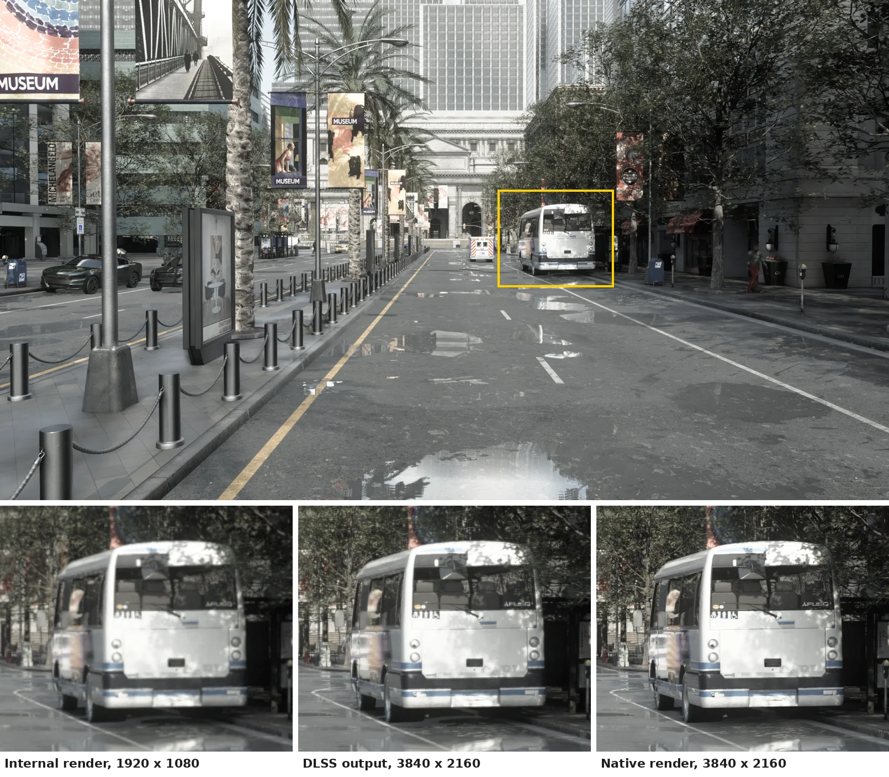

# NVIDIA DLSS

NVIDIA Deep Learning Super Sampling (DLSS) is built into the CARLA simulator. It uses a neural network on the GPU's Tensor Cores to reconstruct images, and CARLA uses it in two ways: to make cameras cheaper to render (Super Resolution) and to make the path-traced cameras usable in real time (Ray Reconstruction).

- [__DLSS Super Resolution__](#dlss-super-resolution)
- [__DLSS Ray Reconstruction__](#dlss-ray-reconstruction)
- [__Requirements__](#requirements)

---
## DLSS Super Resolution


<div class="img-caption">A 3840 &times; 2160 RGB camera with DLSS Super Resolution at <code>dlss_screen_percentage=50</code>: it renders internally at 1920 &times; 1080 and DLSS reconstructs the 4K image. The crops of the framed area compare the internal render (scaled up), the DLSS output and a native 4K render.</div>

DLSS Super Resolution (DLSS-SR) lowers the cost of a camera. With `enable_dlss=True` the camera renders internally at `dlss_screen_percentage` of its output resolution (`50.0` by default, so a quarter of the pixels) and DLSS reconstructs the full-size image from that render and from the previous frames. It is opt-in per camera and needs `enable_postprocess_effects=True`; both attributes are listed with the [RGB camera attributes](ref_sensors.md#rgb-camera).

```py
camera_bp = world.get_blueprint_library().find('sensor.camera.rgb')
camera_bp.set_attribute('image_size_x', '3840')
camera_bp.set_attribute('image_size_y', '2160')
camera_bp.set_attribute('enable_dlss', 'True')
camera_bp.set_attribute('dlss_screen_percentage', '50')
```

It is meant for RGB rigs, where the gain grows with the number of cameras. Do not use it on ground-truth cameras (depth, segmentation): reconstructed pixels corrupt label and depth maps.

`PythonAPI/examples/manual_control_5cam.py` spawns a five-camera 1080p rig on an autopilot vehicle and toggles DLSS-SR live with `D`, so the frame-rate and quality impact can be compared directly.

!!! agent "Agentic CARLA"
    *"Attach a 4K front camera to the ego with DLSS Super Resolution at 50% and save its images."*

    Skills: `create-sensor`, `read-sensor`. [Set up Agentic CARLA](agent_skills.md#set-up-agentic-carla).

---
## DLSS Ray Reconstruction

DLSS Ray Reconstruction (DLSS-RR) is the denoiser of the [ray-traced lens cameras](core_rt_lens.md). The path tracer produces a noisy image at the low sample counts a real-time sensor can afford; DLSS-RR turns it into a clean one, using the camera's previous frames as history. It is the project default (`r.PathTracing.Denoiser.Name=DLSSRR` in `DefaultEngine.ini`) and is switched per sensor with the `enable_denoiser` attribute of `sensor.camera.rt_lens`.

Each distinct camera configuration holds its own DLSS-RR feature (about 342 MB at 1080p), released about a second after the sensor is destroyed. The engine settings involved are in [Ray-traced lens cameras: tuning](core_rt_lens.md#tuning).

---
## Requirements

The DLSS SDK is fetched during setup, so both features are present in standard builds. An NVIDIA RTX-class GPU is required at runtime. On other hardware a camera with `enable_dlss=True` degrades gracefully to a bilinear upscale of its internal render; the ray-traced lens cameras need an RTX-class GPU in any case.
