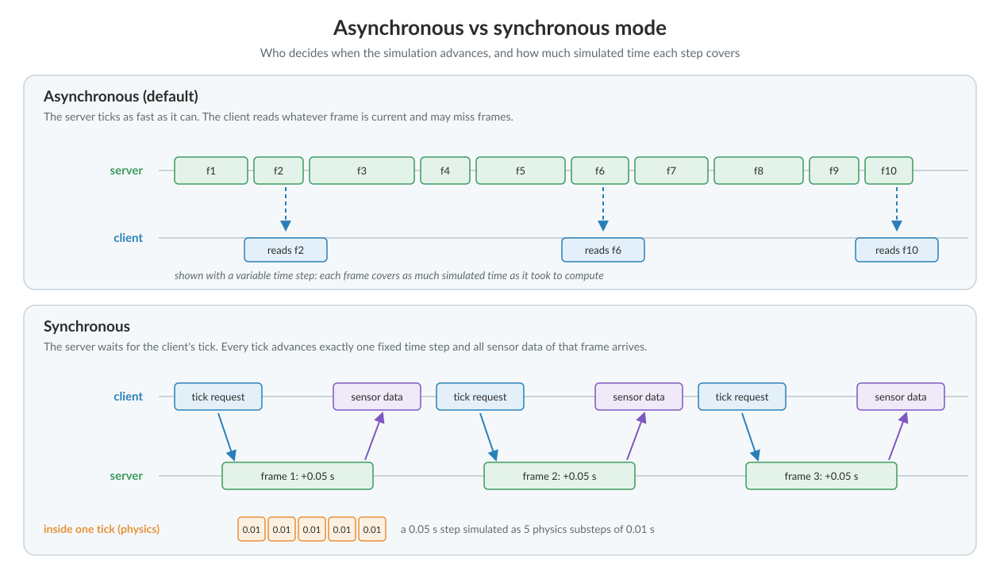

# Foundations

CARLA runs as a server that holds the simulation, and one or more clients that ask it for information and tell it what to change. This page covers the two objects a client works through — the client itself and the world — and how the two sides keep time with each other.


<div class="img-caption">CARLA client-server architecture: clients, Traffic Manager, server components and default ports.</div>

Everything here goes through the [__Python API__](python_api.md). Installing it is covered in [Quick start](start_quickstart.md) for a package, and in [Building CARLA](build_carla.md) for a source build. Every script starts by importing it:

```py
import carla
```

- [__Client__](#client)
- [__World__](#world)
- [__Synchronous and asynchronous mode__](#synchronous-and-asynchronous-mode)
- [__Recorder__](#recorder)


---

## Client

__The client__ is the module the user runs to ask for information or changes in the simulation. It reaches the server over the network, at an IP address and a port:

```py
client = carla.Client('localhost', 2000)
```

Use the address of another machine to drive a server across the network. The port defaults to 2000 and is set when the server is launched. Several clients can be connected at once, though more than one taking control needs care with [synchrony](core_synchrony.md).

From the client come the operations that affect the whole simulation rather than one actor — loading a map, recording, the Traffic Manager:

```py
client.load_world('Town10HD_Opt')

client.start_recorder('recording.log')
```

---
## World

__The world__ is an object representing the simulation. It acts as an abstract layer containing the main methods to spawn actors, change the weather, get the current state of the world, etc. There is only one world per simulation. It will be destroyed and substituted for a new one when the map is changed.

The world object is retrieved using the client object:

```py
world = client.get_world()
```


The world object can be used to access objects within the simulation, such as weather, vehicles, traffic lights, buildings and the map using its many methods:

```py
level = world.get_map()

weather = world.get_weather()

blueprint_library = world.get_blueprint_library()
```

[The client](core_client.md) and [The world](core_world.md) cover both objects in full, including weather, lights, debugging and world snapshots.

---
## Synchronous and asynchronous mode


<div class="img-caption">Asynchronous vs synchronous mode, and physics substeps inside one fixed time step.</div>

The mode decides who controls time. In __asynchronous mode__, the default, the server simulates as fast as it can and handles client requests as they arrive. In __synchronous mode__ the client takes the reins: the server computes nothing until the client calls `world.tick()`, and then advances exactly one step.

__Asynchronous mode__ is an appropriate mode to run CARLA if you are experimenting or setting up a simulation, so you can fly around the map with the spectator as you place your actors. When you want to start producing training data or deploying an agent within the simulation, it is advised that you use the __synchronous mode__ since this will give you more control and predictability.

Read more about [__synchronous and asynchronous modes__](core_synchrony.md).


!!! Note
    Only one client should tick. The server reacts to every tick received as if it came from the same client. Ticks from several clients will create inconsistencies between server and clients.

### Setting synchronous mode

Changing between synchronous and asynchronous mode is just a matter of a boolean state.  
```py
settings = world.get_settings()
settings.synchronous_mode = True # Enables synchronous mode
settings.fixed_delta_seconds = 0.05
world.apply_settings(settings)
```
!!! Warning
    If synchronous mode is enabled, and there is a Traffic Manager running, this must be set to sync mode too. Read [this](core_traffic_manager.md#synchronous-mode) to learn how to do it.

To disable it, set the same variable to `False`:

```py
settings = world.get_settings()
settings.synchronous_mode = False
world.apply_settings(settings)
```

`PythonAPI/util/config.py --no-sync` does the same from the terminal, which is useful to rescue a server left waiting for ticks by a script that died. The script can only disable synchronous mode, never enable it, because enabling it makes the server wait for a client that would have to keep ticking.

### Using synchronous mode

The synchronous mode becomes especially relevant with slow client applications, and when synchrony between different elements, such as sensors, is needed. If the client is too slow and the server does not wait, there will be an overflow of information. The client will not be able to manage everything, and it will be lost or mixed. On a similar tune, with many sensors and asynchrony, it would be impossible to know if all the sensors are using data from the same moment in the simulation.

The following fragment of code extends the previous one. The client creates a camera sensor, stores the image data of the current step in a queue, and ticks the server after retrieving it from the queue. A more complex example with several sensors is in [`PythonAPI/examples/sensor_synchronization.py`][syncmodelink].

```py
settings = world.get_settings()
settings.synchronous_mode = True
world.apply_settings(settings)

camera = world.spawn_actor(blueprint, transform)
image_queue = queue.Queue()
camera.listen(image_queue.put)

while True:
    world.tick()
    image = image_queue.get()
```
[syncmodelink]: https://github.com/carla-simulator/carla/blob/ue58-dev/PythonAPI/examples/sensor_synchronization.py


!!! Note
    Data coming from GPU-based sensors, mostly cameras, is usually generated with a delay of a couple of frames. Synchrony is essential here.


The world has asynchrony methods to make the client wait for a server tick, or do something when it is received.

```py
# Wait for the next tick and retrieve the snapshot of the tick.
world_snapshot = world.wait_for_tick()

# Register a callback to get called every time we receive a new snapshot.
world.on_tick(lambda world_snapshot: do_something(world_snapshot))
```

---
## Recorder

The recorder enables all data required to reproduce a previous simulation to be saved into a file. The data includes details like the position and speed of vehicles, the state of traffic lights, the position and speed of pedestrians and the position of the sun and weather conditions. The data gets recorded into a binary file that can be loaded at a later time by the carla server to exactly reproduce the simulation.

Actors are updated on every frame according to the data contained in the recorded file. Actors in the current simulation that appear in the recording will be either moved or re-spawned to emulate it. Those that do not appear in the recording will continue their way as if nothing happened.

!!! Note
    At the end of the playback, vehicles may be returned to autopilot and pedestrians stop, depending on how the replayer was configured. See [Recorder](core_recorder.md).

The recorder file includes information regarding many different elements.

*   __Actors__ — creation and destruction, bounding and trigger boxes.  
*   __Traffic lights__ — state changes and time settings.  
*   __Vehicles__ — position and orientation, linear and angular velocity, light state, and physics control.  
*   __Pedestrians__ — position and orientation, and linear and angular velocity.  
*   __Lights__ — Light states from buildings, streets, and vehicles.

### Recording

To start recording there is only need for a file name. Using `\`, `/` or `:` characters in the file name will define it as an absolute path. If no path is detailed, the file will be saved in `CarlaUnreal/Saved`.

```py
client.start_recorder("/home/carla/recording01.log")
```

By default, the recorder is set to store only the necessary information to play the simulation back. In order to save all the information previously mentioned, the argument `additional_data` has to be configured when starting the recording.

```py
client.start_recorder("/home/carla/recording01.log", True)
```

!!! Note
    Additional data includes: linear and angular velocity of vehicles and pedestrians, traffic light time settings, execution time, actors' trigger and bounding boxes, and physics controls for vehicles.

To stop the recording, the call is also straightforward.

```py
client.stop_recorder()
```

!!! Note
    As an estimate, 1h recording with 50 traffic lights and 100 vehicles takes around 200MB in size.

### Simulation playback

A playback can be started at any point during a simulation. Besides the path to the log file, this method needs some parameters.

```py
client.replay_file("recording01.log", time_start, duration, follow_id)
```

| Parameter | Description |
| --- | --- |
| `time_start` | Recording time in seconds to start at. Positive counts from the beginning of the recording, negative from the end. |
| `duration` | Seconds to play back. `0` plays the whole recording. |
| `follow_id` | ID of the actor the spectator follows. `0` leaves the spectator free. |

`replay_file` also takes `replay_sensors`, `replay_weather`, `offset` and `map_override`. See [Recorder](core_recorder.md) for the full list.

### Recorder file format

The recorder saves all of the data in a custom binary file format, specified in [Recorder binary file format](ref_recorder_binary_file_format.md).

---