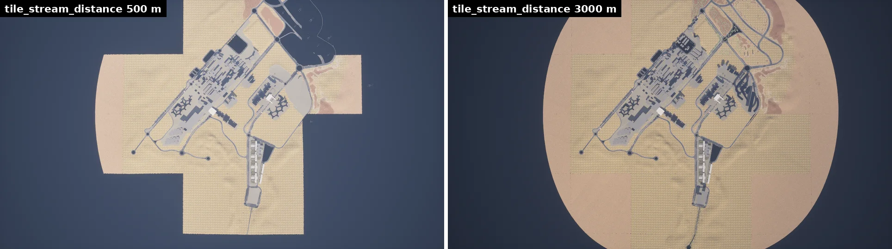

# Large maps overview

Town11, Town12, Town13 and Town15 are too big to keep in memory at once. They are __World Partition__ maps: the level is a grid of cells that the engine streams in and out around the actors that move through it. There are no tiles, no origin rebasing and no large-map API: from the client they load and behave like any other map, and the only thing to tune is how much of the map stays loaded around your ego vehicle. [Maps and navigation](core_map.md#large-maps-and-world-partition) introduces World Partition and how a legacy tiled town is converted.

- [__What loads, and around what__](#what-loads-and-around-what)
- [__Setting the streaming distance__](#setting-the-streaming-distance)
- [__Settings that no longer apply__](#settings-that-no-longer-apply)
- [__Synchronous mode__](#synchronous-mode)
- [__Pedestrian navigation__](#pedestrian-navigation)

---
## What loads, and around what

A cell loads when a __streaming source__ is near it. The server adds one to every vehicle and walker it spawns, and the spectator is one too:

| Source | Loading radius |
| --- | --- |
| A vehicle or walker whose `role_name` contains `hero` or `ego_vehicle` (in any case: `Hero` counts) | `tile_stream_distance` of [carla.WorldSettings](python_api.md#carla.WorldSettings), 3000 m by default |
| Any other vehicle or walker | 200 m |
| The spectator | the engine's own loading range (on Town15, fully loaded to about 250 m), whatever `spectator_as_ego` says |

Background traffic only needs the ground under its wheels; the ego's radius is the one that decides what sensors can see. Spawning waits until the cells under the new actor are loaded, which can take tens of seconds with a large radius, so the actor does not fall through a road that is not there yet. With a radius of 1500 m or more, a hero spawned at the western end of Town15 has been seen to fall through the map, because the spawn returned before its cell had loaded; spawn the ego with a smaller radius, or further into the map, if that happens.

The engine loads whole cells, so the loaded area is wider than the radius and follows the cell grid rather than a circle. On Town15, a radius of 400 m kept the ground fully loaded up to 500–800 m from the ego, depending on the spot, and scattered cells up to about 2 km.


<div class="img-caption">What is loaded around an ego vehicle in the middle of the map, seen from 2 km above: the cells of a 500 m radius (left) and of the default 3000 m (right).</div>


<div class="img-caption">An ego vehicle at the western end of the map with a 400 m radius (red circle): the loaded cells reach beyond the circle, the rest of the map is not loaded.</div>

!!! Warning
    Only the loaded part of the map exists. A sensor pointed at an unloaded region sees nothing there, while waypoint and OpenDRIVE queries still answer for the whole map. Raise `tile_stream_distance` when a sensor has to see further than the ego's cells.

---
## Setting the streaming distance

The radius of a source is set when its actor spawns. Changing `tile_stream_distance` afterwards does not change the area around an ego that already exists: apply the setting first, then spawn the ego (or destroy and respawn it).

```py
settings = world.get_settings()
settings.tile_stream_distance = 1500.0   # metres around the ego
settings.actor_active_distance = 1500.0  # keep it at or below tile_stream_distance, see below
world.apply_settings(settings)

ego_bp = world.get_blueprint_library().find('vehicle.lincoln.mkz')
ego_bp.set_attribute('role_name', 'hero')
ego = world.spawn_actor(ego_bp, world.get_map().get_spawn_points()[0])
```

From the command line, set both values, or the default `actor_active_distance` of 2000 m raises the distance back to 2000 (see below):

```sh
python3 PythonAPI/util/config.py --tile-stream-distance 1500 --actor-active-distance 1500
```

---
## Settings that no longer apply

These belonged to the tiled maps of earlier releases. On World Partition maps the server retires the old large-map manager that implemented them:

- __Dormant actors.__ No actor becomes dormant: `actor.is_dormant` is always `False`, and physics and rendering run for every actor whatever its distance to the ego. `actor_active_distance` has one effect left: when it is larger than `tile_stream_distance`, the server raises `tile_stream_distance` to match and logs `TileStreamingDistance will be increased`. Its default is 2000 m, so to stream less than 2000 m around the ego, lower `actor_active_distance` as well.
- __`spectator_as_ego`.__ The spectator streams the map around itself in both cases.
- __The Traffic Manager's dormant respawn__ ([`set_respawn_dormant_vehicles`](python_api.md#carla.TrafficManager.set_respawn_dormant_vehicles)) relies on dormant actors, so it has nothing to respawn on these maps.
- __A single ego.__ There can be more than one: every actor with a `hero` or `ego_vehicle` role gets the ego radius.

---
## Synchronous mode

Spawning loads the cells under the new actor in any mode, and a vehicle that drives keeps its cells loaded in synchronous mode too: on Town15, an ego on autopilot drove 3.8 km in synchronous mode (0.05 s steps) without losing the ground under it. Long jumps are different: a vehicle teleported 2 km away got none of its new cells in 600 synchronous ticks, while in asynchronous mode they loaded in about 10 s. To move an actor far away, spawn it again at the destination instead of teleporting it.

---
## Pedestrian navigation

On the other maps, walkers navigate with a `.bin` navigation mesh that the client downloads and runs itself. World Partition maps that ship an engine navigation mesh, streamed in cells with the rest of the map, navigate __on the server__ instead: Town12, Town13 and Town15 ship one. The client asks the server when the map loads and picks the mode on its own, so the code is the same in both cases: [`get_random_location_from_navigation`](python_api.md#carla.World.get_random_location_from_navigation), the `controller.ai.walker` methods ([`start`](python_api.md#carla.WalkerAIController.start), [`go_to_location`](python_api.md#carla.WalkerAIController.go_to_location), [`set_max_speed`](python_api.md#carla.WalkerAIController.set_max_speed), [`stop`](python_api.md#carla.WalkerAIController.stop)), [`set_pedestrians_cross_factor`](python_api.md#carla.World.set_pedestrians_cross_factor) and [`set_pedestrians_seed`](python_api.md#carla.World.set_pedestrians_seed). These maps need no `.bin`, and a package that ships only the map navigates with it.

What changes with the server doing the work:

- __Walkers move without the client.__ They keep walking between client calls in asynchronous mode, where the client-side crowd only advances inside `world.wait_for_tick()`.
- __Physics and collisions stay on.__ The client-side crowd turns them off for the walkers it drives; on the server the walker keeps its collision and its movement component.
- __Only the loaded part of the map has navigation.__ `get_random_location_from_navigation` samples the loaded navigation mesh, so the locations it returns are near a streaming source, and it returns `None` when nothing is loaded yet. To spread walkers across the map, raise `tile_stream_distance` before spawning the ego, or spawn the walkers where the cells are already loaded.
- __Manual control wins.__ [`apply_control`](python_api.md#carla.Walker.apply_control) on a walker that is navigating takes over from the navigation.
