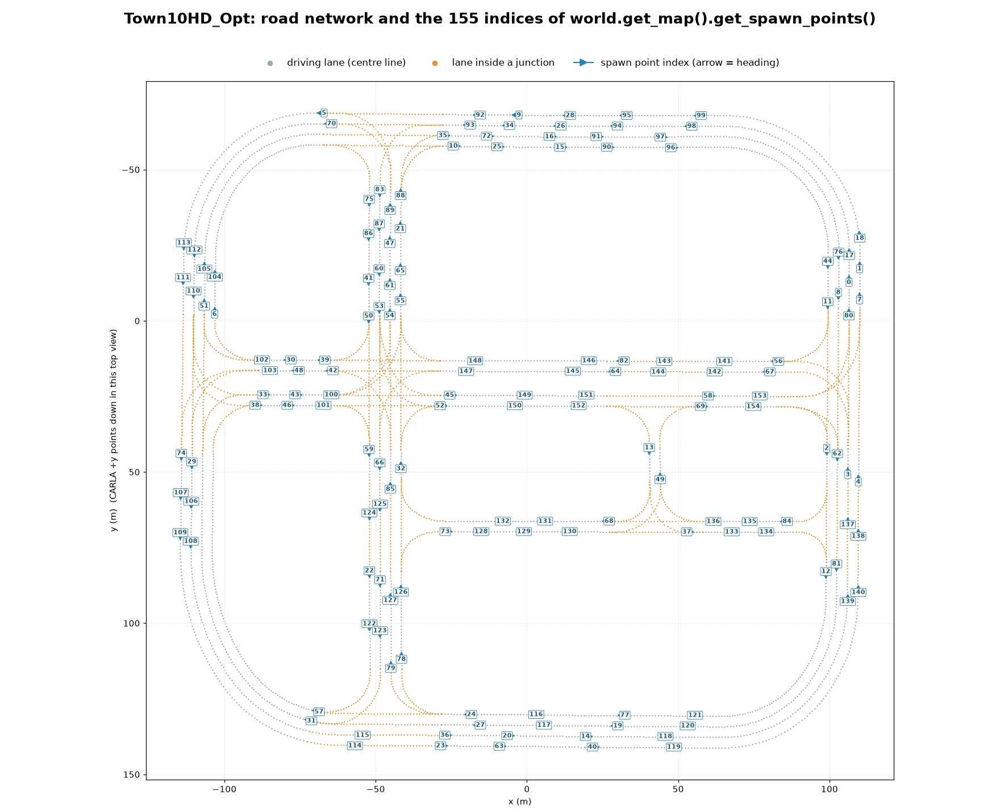
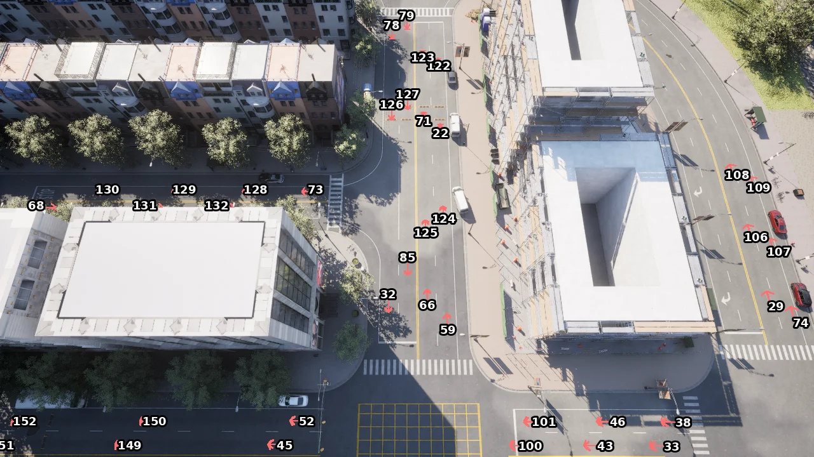
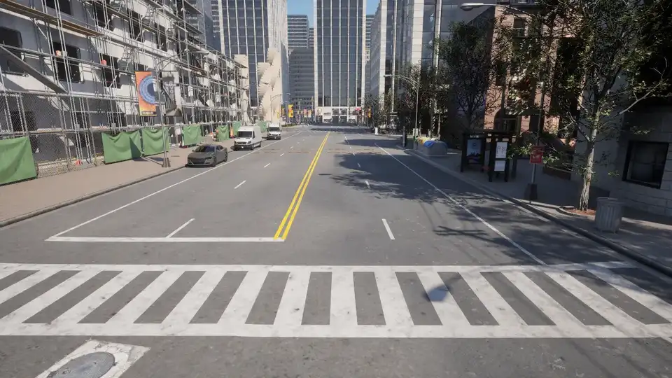

# Maps and navigation

After discussing about the world and its actors, it is time to put everything into place and understand the map and how do the actors navigate it.

- [__The map__](#the-map)
- [__Navigation in CARLA__](#navigation-in-carla)
- [__Geographic coordinates__](#geographic-coordinates)
- [__Left-handed traffic__](#left-handed-traffic)
- [__Large maps and World Partition__](#large-maps-and-world-partition)


---
## The map

A map includes both the 3D model of a town and its road definition. A map's road definition is based on an OpenDRIVE file, a standarized, annotated road definition format. The way the [ASAM OpenDRIVE standard](https://www.asam.net/standards/detail/opendrive/) defines roads, lanes, junctions, etc. determines the functionality of the Python API and the reasoning behind decisions made. To run a simulation from an OpenDRIVE file alone, without a 3D map, see [OpenDRIVE standalone mode](core_opendrive.md).

The Python API acts as a high level querying system to navigate these roads. It is constantly evolving to provide a wider set of tools.

### Changing the map

__To change the map, the world has to change too__. The simulation will be recreated from scratch. You can either restart with the same map in a new world or you can change both the map and the world:

- `reload_world()` creates a new instance of the world with the same map.
- `load_world()` changes the current map and creates a new world.
- `load_world_if_different()` loads the map only when it is not the one already running, and otherwise leaves the simulation alone. A script that needs a particular map can ask for it without destroying the actors of a session that is already on it.

```py
world = client.load_world('Town01_Opt')
world = client.load_world_if_different('Town01_Opt')   # no-op when Town01_Opt is already loaded
```

A map's `name` is its content path, not a bare town name: on Town10HD_Opt it reads `Carla/Maps/Town10HD_Opt`. To get a list of what the server can load:

```py
print(client.get_available_maps())
```

A source build has fifteen maps: `Town01_Opt` to `Town07_Opt` and `Town10HD_Opt`, the four large maps `Town11`, `Town12`, `Town13` and `Town15`, `Town_C`, `Mine_01` for off-road machinery, and `Eixample`, a district of Barcelona built with the [digital twin](content_authoring_maps_digital_twin.md) tool. The default package ships `Town10HD_Opt`, `Town12` and `Town15`; the other maps reach a package as [content packs](map_content_packs.md).

### Landmarks

Traffic signs defined in the OpenDRIVE file are translated to CARLA as landmark objects that can be queried from the API. The following methods and classes can be used to manipulate and work with landmark objects:

- __[`carla.Landmark`](python_api.md#carla.Landmark)__ objects represent OpenDRIVE signals. The attributes and methods of this class describe the landmark and its area of influence.
	- [`carla.LandmarkOrientation`](python_api.md#carla.LandmarkOrientation) states the orientation of the landmark with regard to the road's geometry definition.
	- [`carla.LandmarkType`](python_api.md#carla.LandmarkType) contains common landmark types to facilitate translation to OpenDRIVE types.
- __[`carla.Waypoint`](python_api.md#carla.Waypoint)__ can get landmarks located a certain distance ahead of it. The landmark type to get can be specified.
- __[`carla.Map`](python_api.md#carla.Map)__ retrieves sets of landmarks: `get_all_landmarks()`, or those sharing an id, a type or a group with `get_all_landmarks_from_id()`, `get_all_landmarks_of_type()` and `get_landmark_group()`.
- __[`carla.World`](python_api.md#carla.World)__ acts as intermediary between landmarks and the `carla.TrafficSign` and `carla.TrafficLight` that represent them in the simulation.

```py
my_waypoint.get_landmarks(200.0,True)
```

### Waypoints

A [`carla.Waypoint`](python_api.md#carla.Waypoint) is a 3D-directed point in the CARLA world corresponding to an OpenDRIVE lane. Everything related to waypoints happens on the client-side; communication with the server is only needed once to get the [map object](python_api.md#carla.Map) containing the waypoint information.

Each waypoint contains a [`carla.Transform`](python_api.md#carla.Transform) which states its location on the map and the orientation of the lane containing it. The variables `road_id`,`section_id`,`lane_id` and `s` correspond to the OpenDRIVE road. The `id` of the waypoint is constructed from a hash combination of these four values.

!!! Note
    Waypoints closer than __2cm within the same road__ share the same `id`.

A waypoint holds information about the __lane__ containing it. This information includes the lane's left and right __lane markings__, a boolean to determine if it's inside a junction, the lane type, width, and lane changing permissions.

```py
# Access lane information from a waypoint
inside_junction = waypoint.is_junction
width = waypoint.lane_width
right_lm_color = waypoint.right_lane_marking.color
```

### Lanes

The lane types defined by [ASAM OpenDRIVE standard](https://www.asam.net/standards/detail/opendrive/) are translated to the API in [`carla.LaneType`](python_api.md#carla.LaneType) as a series of enum values.

The lane markings surrounding a lane are accessed through [`carla.LaneMarking`](python_api.md#carla.LaneMarking). Lane markings are defined by a series of variables:

- __color:__ [`carla.LaneMarkingColor`](python_api.md#carla.LaneMarkingColor) are enum values that define the marking's color.
- __lane_change:__ [`carla.LaneChange`](python_api.md#carla.LaneChange) states if the lane permits turning left, right, both or none.
- __type:__ [`carla.LaneMarkingType`](python_api.md#carla.LaneMarkingType) are enum values  that define the type of marking according to the OpenDRIVE standard.
- __width:__ defines the marking's thickness.

The below example shows to get information about the lane type, lane markings, and lane change permissions at a specific waypoint:

```py
# Get the lane type of the waypoint
lane_type = waypoint.lane_type

# Get the type of lane marking on the left.
left_lanemarking_type = waypoint.left_lane_marking.type

# Get available lane changes for this waypoint.
lane_change = waypoint.lane_change
```

### Junctions

A [`carla.Junction`](python_api.md#carla.Junction) represents an OpenDRIVE junction. This class encompasses a junction with a bounding box to identify lanes or vehicles within it.

A junction is reached from a waypoint inside it, or from the map by id, and `get_waypoints` returns a pair of waypoints for every lane of the requested type within it, at the start and end points of the junction boundaries.

```py
junction = waypoint.get_junction()               # None when the waypoint is not in one
junction = carla_map.get_junction_by_id(junction_id)
all_junctions = carla_map.get_junctions()

waypoints_junc = junction.get_waypoints(carla.LaneType.Driving)
```

### Crosswalks

`get_crosswalks()` returns the crosswalk polygons the OpenDRIVE file defines, as a flat list of [`carla.Location`](python_api.md#carla.Location) points. Each polygon repeats its first point at the end, which is what separates one from the next.

```py
points = carla_map.get_crosswalks()
```

### The road network as objects

Waypoints sample the road at a distance of your choosing. [`carla.Road`](python_api.md#carla.Road), [`carla.LaneSection`](python_api.md#carla.LaneSection) and [`carla.Lane`](python_api.md#carla.Lane) instead expose the OpenDRIVE structure itself, so the network can be walked without sampling it first.

| Level | Object | OpenDRIVE element |
| ----- | ------ | ----------------- |
| Road | [`carla.Road`](python_api.md#carla.Road) | `<road>`: its length, its junction, and the roads before and after it |
| Lane section | [`carla.LaneSection`](python_api.md#carla.LaneSection) | `<laneSection>`: the stretch of road over which the lane layout does not change |
| Lane | [`carla.Lane`](python_api.md#carla.Lane) | `<lane>`: its type, width, level and direction of travel |

They are reached from the map by id, or listed whole, and every level produces waypoints on demand:

```py
carla_map = world.get_map()

for road in carla_map.get_roads():
    for section in road.get_sections():
        for lane in section.get_lanes(carla.LaneType.Driving):
            waypoints = lane.get_waypoints(2.0)      # this lane, sampled every 2 m
            start = lane.get_transform(lane.s_start)
```

Each level reaches its neighbours, so a search can start from a waypoint and continue on the objects:

```py
lane = carla_map.get_waypoint(vehicle.get_location()).get_lane()
overtaking_lane = lane.get_left_lane()
lane_ahead = lane.get_next_lane()
road = lane.get_road()
```

Junctions answer in objects too, with `get_connecting_roads()`, `get_adjacent_roads()`, `get_entry_lanes()` and `get_exit_lanes()` beside the waypoint equivalents.

### Environment objects

Every object on a CARLA map has a set of associated variables which can be found [here][env_obj]. Included in these variables is a [unique ID][env_obj_id] that can be used to [toggle][toggle_env_obj] that object's visibility on the map. You can use the Python API to [fetch][fetch_env_obj] the IDs of each environment object based on their [semantic tag][semantic_tag]:

```py
# Get the buildings in the world
world = client.get_world()
env_objs = world.get_environment_objects(carla.CityObjectLabel.Buildings)

# Access individual building IDs and save in a set
building_01 = env_objs[0]
building_02 = env_objs[1]
objects_to_toggle = {building_01.id, building_02.id}

# Toggle buildings off
world.enable_environment_objects(objects_to_toggle, False)
# Toggle buildings on
world.enable_environment_objects(objects_to_toggle, True)
```

[env_obj]: python_api.md#carla.EnvironmentObject
[env_obj_id]: python_api.md#carla.EnvironmentObject.id
[toggle_env_obj]: python_api.md#carla.World.enable_environment_objects
[fetch_env_obj]: python_api.md#carla.World.get_environment_objects
[semantic_tag]: python_api.md#carla.CityObjectLabel


---
## Navigation in CARLA

Navigation in CARLA is managed via the Waypoint API, a combination of methods from [`carla.Waypoint`](python_api.md#carla.Waypoint) and [`carla.Map`](python_api.md#carla.Map).

The client must initially communicate with the server to retrieve the map object containing the waypoint information. This is only required once, all subsequent queries are performed on the client side.

### Navigating through waypoints

The Waypoint API exposes methods that allow waypoints to connect to each other and construct a path along a road for vehicles to navigate:

- `next(d)` creates a list of waypoints within an approximate distance, `d`, __in the direction of the lane__. The list contains one waypoint for each possible deviation.
- `previous(d)` creates a list of waypoints waypoint within an approximate distance, `d`, __in the opposite direction of the lane__. The list contains one waypoint for each possible deviation.
- `next_until_lane_end(d)` and `previous_until_lane_start(d)` return a list of waypoints a distance `d` apart. The lists go from the current waypoint to the end and beginning of its lane, respectively.
- `get_right_waypoint()` and `get_left_waypoint()` return the equivalent waypoint in an adjacent lane, if one exists. A lane change maneuver can be made by finding the next waypoint to the one on its right/left lane, and moving to it.
- `get_lane()`, `get_road()` and `get_junction()` leave the waypoints behind and return [the objects](#the-road-network-as-objects) the waypoint sits on, for a query the sampling cannot answer.

!!! Warning
    These two were called `get_right_lane()` and `get_left_lane()` until CARLA 0.10.0, which read as if they returned a lane. The old names still work and raise a `DeprecationWarning`. On [`carla.Lane`](python_api.md#carla.Lane), `get_right_lane()` and `get_left_lane()` do return lanes.

```py
# Find next waypoint 2 meters ahead. next() returns a list, one entry
# per possible continuation, so a junction gives several.
waypoint = waypoint.next(2.0)[0]
```

### Generating map navigation

The client needs to make a request to the server to get the `.xodr` map file and parse it to a [`carla.Map`](python_api.md#carla.Map) object. This only needs to be done once.

To get the map object:

```py
carla_map = world.get_map()
```

The map object contains __recommended spawn points__ for the creation of vehicles. You can get a list of these spawn points, each one containing a [`carla.Transform`](python_api.md#carla.Transform), using the method below. Bear in mind that the spawn points may be occupied already, resulting in failed creation of vehicles due to collisions.

```py
spawn_points = world.get_map().get_spawn_points()
```

The list is in a fixed order for each map, so tutorials refer to a spawn point by its index (`spawn_points[43]`). On Town10HD_Opt:


<div class="img-caption">Town10HD_Opt road network with the index and heading of every spawn point.</div>

To find the indices you want without leaving the simulator, draw them into the world. `draw_string` labels each point and `draw_arrow` shows which way a vehicle spawned there will face:

```py
spawn_points = world.get_map().get_spawn_points()

for i, spawn_point in enumerate(spawn_points):
    world.debug.draw_string(spawn_point.location, str(i), life_time=100)
    world.debug.draw_arrow(spawn_point.location,
                           spawn_point.location + spawn_point.get_forward_vector(),
                           life_time=100)
```


<div class="img-caption">Spawn points drawn with draw_arrow, labelled with their index. draw_string text only shows in the spectator window, so the numbers here were added to the image.</div>

Both are drawn in the spectator window only, so a rendered server is needed; they do not appear in sensor captures.

### Spawning somewhere of your own

A map's spawn points are on the road and facing along it, which is what traffic needs. For a scenario that starts somewhere specific, fly the spectator to the spot instead and spawn there: the transform carries both its position and its heading.

```py
spectator = world.get_spectator()
vehicle = world.try_spawn_actor(vehicle_bp, spectator.get_transform())
```


<div class="img-caption">A vehicle spawned at the spectator's transform drops onto the road and settles.</div>

The vehicle takes the spectator's rotation as well as its location, so point the spectator the way the vehicle should face. Spawn from high up and the vehicle falls to the ground; spawn too close to it and the spawn fails on collision. Print the transform to keep the spot:

```py
print(spectator.get_transform())
```

You can get started with waypoints by __[getting](python_api.md#carla.Map.get_waypoint) the closest waypoint__ to a specific location or to a particular `road_id`, `lane_id` and `s` value in the map's OpenDRIVE definition:

```py
# Nearest waypoint in the center of a Driving or Sidewalk lane.
waypoint01 = carla_map.get_waypoint(vehicle.get_location(),project_to_road=True, lane_type=(carla.LaneType.Driving | carla.LaneType.Sidewalk))

# Nearest waypoint but specifying OpenDRIVE parameters. 
waypoint02 = carla_map.get_waypoint_xodr(road_id,lane_id,s)
```

The below example shows how to __generate a collection of waypoints__ to visualize the city lanes. This will create waypoints all over the map, for every road and lane. All of them will approximately 2 meters apart:

```py
waypoint_list = carla_map.generate_waypoints(2.0)
```

To __generate a minimal graph of road topology__, use the example below. This will return a list of pairs (tuples) of waypoints. The first element in each pair connects with the second element and both define the start and end points of each lane in the map. More information on this method is found in the [PythonAPI](python_api.md#carla.Map.get_topology).

```py
waypoint_tuple_list = carla_map.get_topology()
```

Use the following example to __save road information__ in OpenDRIVE format to disk:

```py
info_map = carla_map.to_opendrive()     # the XML as a string
carla_map.save_to_disk(path)            # or straight to a file
```

---
## Geographic coordinates

The OpenDRIVE header of a map carries a `geoReference` string: the [PROJ](https://proj.org/) definition of the projection the map's coordinates came from. CARLA parses it and converts through it, so geographic coordinates agree with the data the map was built from.

```py
carla_map = world.get_map()

geo = carla_map.transform_to_geolocation(vehicle.get_location())   # carla.GeoLocation
transform = carla_map.geolocation_to_transform(geo)                # and back
projection = carla_map.get_geoprojection()                         # the map's own projection
```

| `+proj=` in `geoReference` | Projection object |
| -------------------------- | ----------------- |
| `tmerc` | [`carla.GeoProjectionTM`](python_api.md#carla.GeoProjectionTM) |
| `utm` | [`carla.GeoProjectionUTM`](python_api.md#carla.GeoProjectionUTM), which also applies the header's `<offset>` |
| `merc` | [`carla.GeoProjectionWebMerc`](python_api.md#carla.GeoProjectionWebMerc) |
| `lcc` | [`carla.GeoProjectionLCC2SP`](python_api.md#carla.GeoProjectionLCC2SP) |

Both conversions take an optional projection, to read or write coordinates in one that is not the map's:

```py
geo = carla_map.transform_to_geolocation(location, carla.GeoProjectionUTM(zone=31, north=True))
```

`get_georeference()` returns the geographic location of the map origin declared by the header.

!!! Note
    A map whose `geoReference` is missing, or that names a projection CARLA does not implement, falls back to a transverse Mercator projection on the map origin and logs a warning.

---
## Left-handed traffic

CARLA supports left-hand traffic (LHT) rules defined in the OpenDRIVE file. To opt a road into LHT, set its `rule` attribute to `"LHT"` (the counterpart for right-hand traffic is `"RHT"`):

```xml
<road name="Road 0" length="1.3310253693587601e+1" id="0" junction="-1" rule="LHT">
    <link>
        <predecessor elementType="road" elementId="3" contactPoint="end" />
        <successor elementType="road" elementId="10" contactPoint="start" />
    </link>
...
</road>
```

!!! Note
    RHT is the default. A road with no `rule` attribute (or an unrecognized value) is treated as RHT. You may also wish to set this explicitly with `rule="RHT"`.

CARLA applies the LHT convention to every road tagged with `rule="LHT"`. A client reads the rule back from `is_rht`, on both [`carla.Waypoint`](python_api.md#carla.Waypoint) and [`carla.Road`](python_api.md#carla.Road), so an agent can tell which side of the road it is on without parsing the OpenDRIVE file:

```py
if not waypoint.is_rht:
    ...        # this road drives on the left
```

Note that the LHT/RHT convention affects not only the behaviour of traffic but also the traffic signs and signals affecting the road. Therefore, if the map has assets placed manually for right-handed traffic conventions (e.g. road signs or traffic lights), these will need to be adjusted. Traffic lights defined in the OpenDRIVE definition for left-handed traffic are automatically placed by CARLA in the appropriate position upon importing the map.

---

## Large maps and World Partition

Town11, Town12, Town13 and Town15 are too big to keep in memory at once. Under Unreal Engine 5 they are __[World Partition](https://dev.epicgames.com/documentation/en-us/unreal-engine/world-partition-in-unreal-engine)__ maps: the level is divided into a grid of cells that the engine streams in and out around whatever is moving through it, and coordinates are double precision ([Large World Coordinates](https://dev.epicgames.com/documentation/en-us/unreal-engine/large-world-coordinates-in-unreal-engine-5)), so nothing is rebased as a vehicle drives away from the origin.

This replaces the tile system CARLA used before, and the difference matters mostly because it is invisible. There are no map tiles to query, no rebasing to compensate for, and no large-map-specific API: from the client a World Partition town is a map like any other, and a location stays the same number however far from the origin it is.

### What loads, and around what

A cell loads when a __streaming source__ comes near it, and CARLA registers one on every vehicle and walker it spawns:

| Actor | Loading radius |
| ----- | -------------- |
| A vehicle or walker with `role_name` set to `hero` or `ego_vehicle` | `tile_stream_distance` on [carla.WorldSettings](python_api.md#carla.WorldSettings) |
| Any other vehicle or walker | 200 m around itself |

The hero's ring is the one to tune; the rest only need the ground under their wheels. Spawning blocks until the cells under the new actor are resident, so an actor never falls through a road that has not loaded yet.

Two further settings apply only to these maps:

- `actor_active_distance` — beyond this distance from the hero, actors become dormant: still registered, no longer simulated. It is never allowed to exceed `tile_stream_distance`; the server raises the streaming distance to match and warns if you set it higher.
- `spectator_as_ego` — whether the spectator also loads cells around itself when no ego actor exists. Turn it off if your script spawns its ego immediately.

```py
settings = world.get_settings()
settings.tile_stream_distance = 2000.0     # metres of map kept loaded around the hero
settings.actor_active_distance = 1000.0    # beyond this, actors go dormant
settings.spectator_as_ego = False
world.apply_settings(settings)

ego_bp = world.get_blueprint_library().find('vehicle.lincoln.mkz')
ego_bp.set_attribute('role_name', 'hero')  # what makes this actor a streaming source
```

!!! Warning
    Only the loaded part of the map exists. A sensor pointed at an unloaded region sees nothing there, and a waypoint query still answers from the OpenDRIVE definition, which is always complete. Raise `tile_stream_distance` when a sensor has to see further than the hero's ring.

### Converting a tiled map

A legacy tiled town is converted in place with the `CarlaLargeMapConvert` commandlet, which registers the old tiles as streaming levels, reads the layout from the map's `TilesInfo.txt`, and removes the legacy static lighting rig the weather-driven sky now replaces:

```sh
UnrealEditor CarlaUnreal.uproject -run=CarlaLargeMapConvert \
    /Game/Carla/Maps/Town12/Town12 -ConversionSuffix \
    -AllowCommandletRendering -unattended -nosound
```

---
