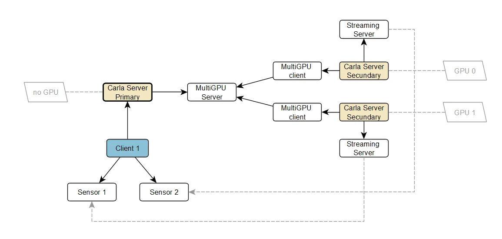

# Multi-GPU

Multi-GPU spreads the rendering of a single simulation across several GPUs. One __primary server__ owns the world — physics, actors and the client connection — and hands the sensor rendering to one or more __secondary servers__, each bound to its own GPU. The primary itself usually renders nothing.


<div class="img-caption">A primary server with two secondary servers, each rendering on its own GPU, and a client with two sensors.</div>

It is transparent to the client: it connects to the primary as always, spawns sensors as always, and receives their data directly from whichever secondary rendered it.

- [__How it works__](#how-it-works)
- [__Start the primary server__](#start-the-primary-server)
- [__Start the secondary servers__](#start-the-secondary-servers)
- [__Choose the GPU__](#choose-the-gpu)
- [__Synchronous mode__](#synchronous-mode)
- [__Frame authority__](#frame-authority)
- [__What secondaries mirror__](#what-secondaries-mirror)
- [__Sensor assignment__](#sensor-assignment)
- [__ROS 2__](#ros-2)
- [__Limitations__](#limitations)

---
## How it works

The primary server keeps the authoritative world: it runs the physics, owns the actors and answers the client's RPC calls. Each secondary server connects to it, receives the scene state every frame, and renders the sensors the primary assigned to it. The primary assigns each sensor to a secondary when a client first listens to it.

The primary is also the only clock: a secondary advances one frame for each frame of the primary, by the primary's time step, so the data it renders carries the primary's frame numbers and timestamps (see [Frame authority](#frame-authority)).

The order to start them in is: primary first, then the secondaries, then the client.

A server becomes a secondary when, and only when, it is given `-carla-primary-host`. Without that flag it is a primary.

Run the same CARLA build on every server. The frame data has no compatibility layer between builds: a secondary of another build logs that the primary's frames carry packets it does not know, or drops them as unreadable, and stops following the primary.

---
## Start the primary server

```sh
./CarlaUnreal.sh -nullrhi
```

`-nullrhi` disables rendering entirely, so the primary needs no GPU of its own. It is not required — a primary can render — but on a machine whose GPUs are all driving secondaries it keeps one free.

The primary listens for secondaries on the __secondary port__, 2002 by default:

```sh
./CarlaUnreal.sh -nullrhi -carla-secondary-port=3002
```

| Flag | Default | What it does |
|---|---|---|
| `-nullrhi` | off | Disables rendering, so the server uses no GPU. |
| `-carla-rpc-port=N` | 2000 | Port the client connects to. Also moves the other two ports, see below. |
| `-carla-secondary-port=N` | RPC port + 2 | Port the secondaries connect to. |

The three server ports are derived from the RPC port: RPC `N`, streaming `N+1`, secondary `N+2`. Setting `-carla-rpc-port=3000` therefore moves the secondary port to 3002, and the secondaries have to be told about it. `-carla-streaming-port` and `-carla-secondary-port` override their own port afterwards.

!!! Warning
    `-carla-primary-port` does __not__ set the port the primary listens on. It tells a *secondary* which port to connect to, and on a primary it has no effect at all. The primary's listening port is `-carla-secondary-port`.

A `-nullrhi` primary has no fallback renderer:

- It never renders a camera itself. Every camera (RGB, depth, semantic and instance segmentation, normals, optical flow, DVS and the wide-angle and ray-traced lens cameras) needs a connected rendering secondary.
- If no secondary is connected when a client calls `listen()` on a camera, the call fails with a `RuntimeError` ("this server cannot render (-nullrhi) and no rendering secondary server is connected ..."). The server stays up and keeps simulating.
- `enable_for_ros()` on a camera is refused in the same situation, but the refusal only appears in the server log: the Python call does not wait for the server's answer, so it returns without raising.
- CPU sensors (LiDAR, semantic LiDAR, radar, GNSS, IMU, collision, obstacle) do not need a GPU and keep working on a `-nullrhi` primary.

A primary started without `-nullrhi` keeps a GPU device, loads the world's render resources into VRAM and renders any camera that is not assigned to a secondary. This costs several GB of VRAM it does not need, so start it with `-nullrhi` unless it must also render cameras on its own.

---
## Start the secondary servers

Start one secondary per GPU. Each one needs the address of the primary, its own free RPC port, and the GPU it should render on:

```sh
# First secondary, rendering on GPU 0
./CarlaUnreal.sh -carla-rpc-port=3000 -carla-primary-host=127.0.0.1 -graphicsadapter=0

# Second secondary, rendering on GPU 1
./CarlaUnreal.sh -carla-rpc-port=4000 -carla-primary-host=127.0.0.1 -graphicsadapter=1
```

| Flag | Default | What it does |
|---|---|---|
| `-carla-primary-host=IP` | empty | Address of the primary. Giving it is what makes this server a secondary. |
| `-carla-primary-port=N` | 2002 | Port of the primary, matching its `-carla-secondary-port`. |
| `-carla-rpc-port=N` | 2000 | This server's own RPC port. Clients never use it, but it must be free. |
| `-graphicsadapter=N` | — | GPU this server renders on, see [Choose the GPU](#choose-the-gpu). |

A secondary still opens its own RPC, streaming and secondary ports, so on a shared machine give each one an RPC port far enough from the others — the example uses 3000 and 4000, which claim 3000-3002 and 4000-4002.

If the primary was started with a non-default secondary port, pass it:

```sh
./CarlaUnreal.sh -carla-rpc-port=3000 -carla-primary-host=127.0.0.1 -carla-primary-port=3002 -graphicsadapter=0
```

Each secondary follows the primary through `load_world()`: after the reload it resynchronizes the full world state before it renders again. A world generated with `generate_opendrive_world()` is forwarded too: the primary sends the OpenDRIVE and the generation parameters with the map load, and each secondary generates the same world. A secondary keeps that OpenDRIVE in a folder of its own process (`Saved/OpenDrive/MultiGpuSecondary-<instance id>/`, removed when it exits), so servers that run from the same installation never read each other's files.

!!! Warning
    A secondary that starts, or restarts, after the primary called `load_world()` or `reload_world()` loads the primary's current map when it connects, because the primary remembers the last map it loaded, even if no secondary was connected at that time. The primary waits for the secondary to finish loading, so a late secondary can stall the simulation tick for the duration of the map load.

A secondary only mirrors. Every call that would change the simulation (`tick`, `apply_settings`, `load_world`, spawning and destroying actors, controls, weather, lights and so on) is refused on its RPC port with `this is a Multi-GPU secondary server: it mirrors the primary and answers read-only calls only; send this call to the primary server`. Calls the client waits on raise that error; calls it sends without waiting for an answer (`set_weather`, `apply_control` and others) are dropped, and the refusal only shows in the secondary's log. Read-only calls work there: `get_world()`, `get_settings()` (which reports synchronous mode, as a secondary always follows the primary's frames), snapshots and actor queries.

---
## Choose the GPU

`-graphicsadapter=N` picks the rendering device by index, counting from 0, and is read by both the Vulkan and the D3D12 backends. An index beyond the number of devices present falls back to the first one and logs a warning, so check the server log when a secondary seems to land on the wrong GPU.

Two negative values are also accepted: `-1` prefers a discrete GPU over an integrated one and is the default, and `-2` takes the first device the driver reports, unsorted.

The same choice can be made through the engine's `r.GraphicsAdapter` console variable, which the flag overrides. It is read once at startup and cannot be changed afterwards, so it has to come from the command line or from `Config/DefaultEngine.ini`:

```sh
./CarlaUnreal.sh -carla-primary-host=127.0.0.1 -ini:Engine:[/Script/Engine.RendererSettings]:r.GraphicsAdapter=1
```

!!! Note
    The `-ini:` form needs the `Engine:` file name in the middle, and the engine strips `-ini:` overrides out of Shipping builds, which is what a packaged CARLA is. `-graphicsadapter=N` works in every build and is the one to reach for.

!!! Note
    With Vulkan, the device index does not always match the `nvidia-smi` index: a duplicate Vulkan ICD registration, for example, makes each GPU appear twice. Check the `LogVulkanRHI: ... DeviceName:` line in each secondary's log to confirm which GPU it opened.

---
## Synchronous mode

As soon as the first secondary connects, the primary switches the simulation to synchronous mode with a fixed time step of 1/20 s (20 FPS), whatever the client asked for before. A client connecting afterwards therefore has to tick the world, and can change the step with [`carla.WorldSettings`](python_api.md#carla.WorldSettings) as usual. Secondaries always run synchronously, driven by the primary's frames, whatever `apply_settings()` was given to them.

There is no distributed frame-completion barrier. `world.tick()` returns once the primary has simulated the frame and sent it, not when every secondary has rendered and delivered its sensors. For lockstep capture, wait in the client until each sensor has delivered the frame returned by `world.tick()` before the next tick. Otherwise a slower secondary can fall behind the primary. A secondary logs `Secondary server is falling behind the primary` when its queue of frames still to process keeps growing, and logs again once it has caught up.

---
## Frame authority

The primary is the only clock. Every frame it sends carries the primary's frame number, the time step its world ticked with, the episode's elapsed and visual time, its world's time counters and its episode settings. A secondary:

- Waits at the start of each engine frame for the next primary frame, then ticks with exactly that time step (as a fixed time step), so every timestamp and frame number it gives a sensor is the primary's. A sensor's `sensor_tick` follows the primary's sensor too: the primary lists in each frame which sensors tick and with which time step, and the secondary's copy ticks on exactly those frames, also when it was created later.
- Copies the primary's settings (fixed time step, substepping, culling distance and so on). It always runs in synchronous mode and never renders its own viewport (no-rendering mode); its sensors render as usual.
- Asks the primary for a full resynchronization when it misses a frame (a frame that cannot be read is dropped and logged), and gets the whole world state again on the next frame.
- Runs on its own clock, at most 50 frames per second, only while it has no primary to follow (not connected, or a map load or a world travel in progress). It captures nothing during those frames.

Sensors that keep state between ticks get it from the primary as well: the random seeds of the noise models, where a LiDAR's sweep starts, and the previous readings the IMU and the radar use. A sensor on a secondary therefore produces the data the primary would, in the same frame.

---
## What secondaries mirror

Every frame the primary sends what changed in its world, and on a full resynchronization (a secondary connecting, or one that missed a frame) everything:

- __Actors.__ Spawns and removals, attachments (sensors on vehicles move with them), and every actor's pose, with rotations as quaternions. Mirrors never simulate physics or move on their own: walkers do not walk, vehicles do not drive, props do not fall, and before capturing a secondary checks that no mirror moved since the primary's pose was applied.
- __Motion.__ Linear and angular velocities of vehicles, walkers and props that simulate physics, so the IMU, the radar, the V2X messages and the world snapshot report the primary's motion.
- __Vehicle parts.__ Each wheel's steering, spin and suspension, the current gear, lights, and the open doors' poses.
- __Walkers and bikers.__ Their animation inputs.
- __Traffic.__ Traffic-light states and timings (a secondary's traffic lights never advance on their own).
- __World.__ Every weather change, loaded map layers, environment objects enabled or disabled, scene lights, the day/night cycle setting, the IMU gravity and ROS 2 TF publishing.
- __Appearance.__ Each actor's collision, visibility and scale.

---
## Sensor assignment

- A sensor is assigned when a client first calls `listen()` or `enable_for_ros()` on it, not when it is spawned.
- While at least one secondary is connected, the primary assigns every sensor round-robin across the connected secondaries. That includes CPU sensors such as LiDAR, GNSS and IMU. The exceptions are the collision sensor, the V2X sensors (`sensor.other.v2x` and `sensor.other.v2x_custom`, which exchange messages between sensors) and the world observer stream, which always stay on the primary.
- The assignment is sticky. The sensor stays on its secondary until it is destroyed or that secondary is lost (see below). It never rebalances, and assignment does not take the load on each GPU into account.
- When no secondary is connected, sensors are served by the primary. On a `-nullrhi` primary that only works for CPU sensors, as described above.
- A secondary that disconnects takes its sensors' streams with it: they stop delivering data until a secondary connects again.
- When a secondary connects, the primary assigns it the sensors that were lost, under the same stream ids, and re-enables ROS 2 publication on the ones that had it. Destroyed sensors are not reassigned.
- Clients that are already listening resume without calling `listen()` again only if the new secondary uses the same streaming address and port as the one that left (for example, the same secondary restarted with the same command line). Otherwise they must call `listen()` again. This recovery has only been validated while the primary is on its default map.
- If several secondaries restart at once, the first one to connect takes all the lost sensors, whichever secondary served them before.

---
## ROS 2

- `--ros2` on the primary publishes what the primary produces: clock, TF and the data of sensors that run on the primary.
- A `-nullrhi` primary with `--ros2` never renders or publishes camera images.
- Camera images can only be published by a rendering secondary started with `--ros2`. The secondary publishes the cameras it owns.
- Ownership of ROS 2 publication across several ROS-enabled secondaries is not solved yet. A ROS-enabled secondary can publish topics for sensors it only mirrors, and a topic can have more than one publisher. Check the publishers of each topic (`ros2 topic info -v`) before relying on a multi-secondary ROS 2 setup.

---
## Limitations

- __No camera fallback on a `-nullrhi` primary.__ If every secondary disconnects, cameras stop producing data, and new camera `listen()` calls fail until a secondary connects.
- __No frame barrier.__ See [Synchronous mode](#synchronous-mode).
- __Round-robin only.__ Sensors are not weighted by cost or GPU capacity, and cannot move between secondaries, except that the sensors of a lost secondary go to the next one that connects.
- __Streams do not follow a different endpoint.__ A client keeps retrying the address it was given. Sensors reassigned to a secondary on another address or port need a new `listen()`, and a stale listener is rejected by the secondary it keeps contacting, which fills that secondary's log.
- __GBuffer streams__ (`listen_to_gbuffer`) are not available through Multi-GPU routing. A `-nullrhi` primary rejects them.
- __Textures applied at runtime__ (`apply_textures_to_object` and the other `apply_*texture*` calls) are not replicated to secondaries.
- __Not mirrored.__ Debug shapes (`world.debug`), console variables and render settings changed at runtime, meshes spawned with `spawn_actor` from a custom mesh, and content packs mounted at runtime stay on the server they were sent to. Mount the same content packs on every server.
- __Walker poses.__ A secondary animates its walkers from the primary's animation inputs and velocities. A secondary that connects while walkers are already walking can show them at another point of their walk cycle, and ragdolls are not mirrored.
- __Render history.__ Temporal effects (anti-aliasing, Lumen, auto exposure, DVS events) build up over the frames each secondary renders, so a camera's first frames after it is assigned, or after a resynchronization, can differ from a camera that has been rendering for a while.
- __Instance segmentation ids__ are assigned by each server, so the same actor can have another color on another secondary. Semantic LiDAR and obstacle detection report the primary's actor ids.
- __World Partition maps.__ Environment objects and scene lights are matched by name and light id. Some that are created when a cell streams in can have other ids on a secondary, and then keep the secondary's own state (an environment object id that a secondary does not have is logged as an error there).
- __Environment objects in map layers.__ Objects disabled in a layer that is then unloaded come back enabled when the layer is loaded again, on the primary and on the secondaries alike.
- __Navigation of generated worlds.__ A secondary builds no navigation mesh for a world generated with `generate_opendrive_world()`, so its own clients get none for it. Clients of the primary are not affected.
- __A lost primary.__ A secondary that loses its primary, or fails a map load, stops following it until it is restarted. Detecting a dead connection takes up to about 25 seconds (TCP keepalive).
