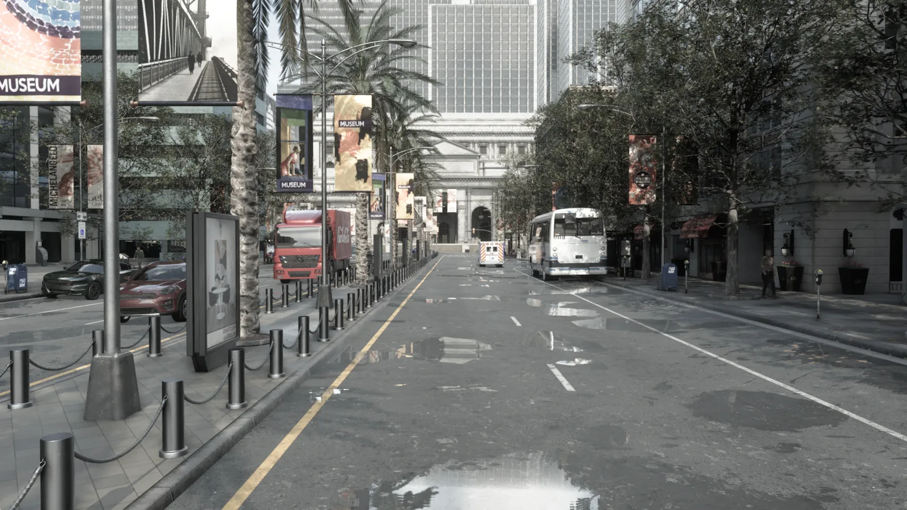
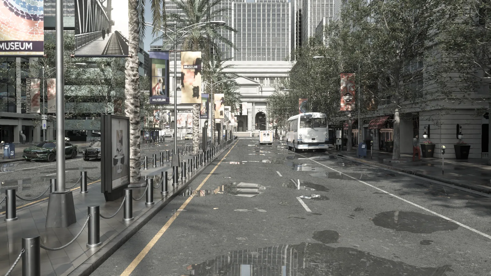
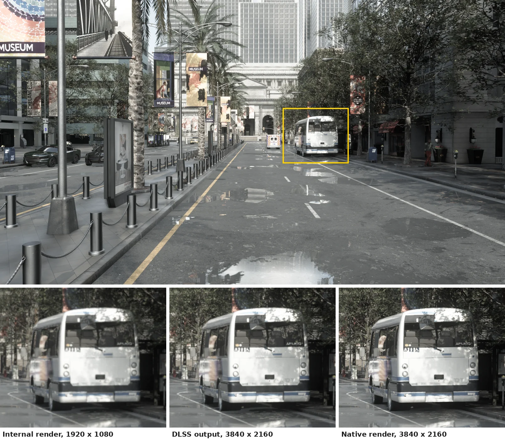
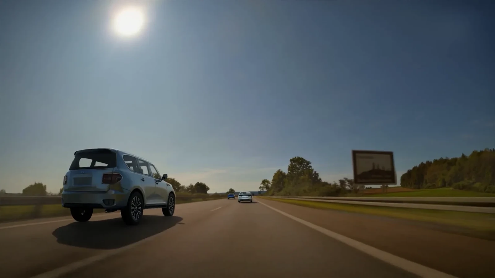
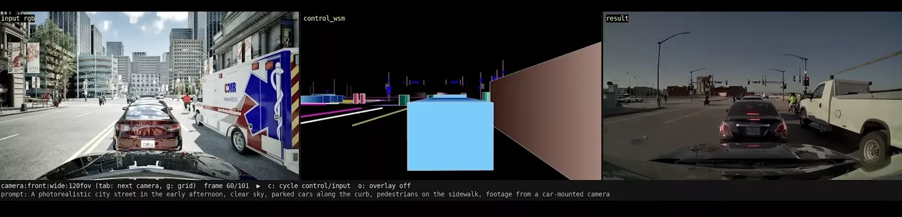
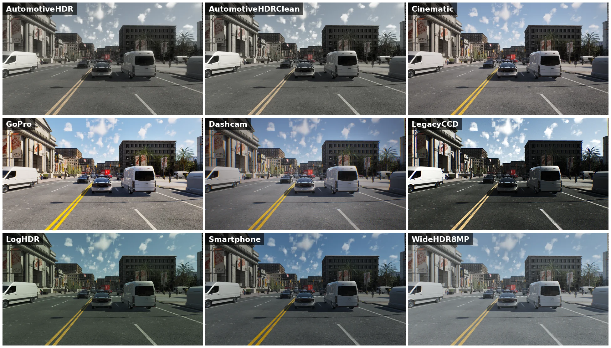

# Rendering

CARLA can produce images in several ways. Most sensors are rendered by Unreal Engine's own renderer, but the same simulation can also be path traced through a physical lens model, upscaled with DLSS, rendered from a neural reconstruction of a real recorded drive, or turned afterwards into photoreal video by a world model. This page explains what each path renders and when to pick it, and links to the page that covers it in detail.

- [__Choosing a renderer__](#choosing-a-renderer)
- [__Unreal Engine native rendering__](#unreal-engine-native-rendering)
- [__Ray-traced lens cameras__](#ray-traced-lens-cameras)
- [__NVIDIA DLSS Super Resolution__](#nvidia-dlss-super-resolution)
- [__NVIDIA NuRec neural reconstruction__](#nvidia-nurec-neural-reconstruction)
- [__NVIDIA Cosmos world models__](#nvidia-cosmos-world-models)
- [__Camera post-process presets__](#camera-post-process-presets)
- [__Multi-GPU__](#multi-gpu)

---
## Choosing a renderer

| Path | What it renders | When | Needs |
| ---- | --------------- | ---- | ----- |
| [Unreal Engine native rendering](#unreal-engine-native-rendering) | The CARLA world, rasterized with Lumen global illumination, Nanite geometry and virtual shadow maps | Live, every tick | Nothing extra. Hardware ray tracing on cameras needs an RTX-class GPU and the `Epic` tier |
| [Ray-traced lens cameras](#ray-traced-lens-cameras) | The CARLA world, path traced through a physical lens model: colour, per-pixel distance and instance ids | Live, every tick | NVIDIA RTX-class GPU with hardware ray tracing (Vulkan) |
| [DLSS Super Resolution](#nvidia-dlss-super-resolution) | A native camera rendered at a lower internal resolution and reconstructed to full size | Live, every tick | NVIDIA RTX-class GPU. Elsewhere the camera falls back to a bilinear upscale |
| [NuRec](#nvidia-nurec-neural-reconstruction) | A real recorded drive, reconstructed as a neural scene, with CARLA running the actors and the physics | Live, every tick | NVIDIA GPU, Docker with the NVIDIA Container Toolkit, the NRE container |
| [Cosmos](#nvidia-cosmos-world-models) | Photoreal video variations (weather, time of day, road surface) of a captured CARLA run | Offline, after the run | A Cosmos job server on NVIDIA GPUs |
| [Camera post-process presets](#camera-post-process-presets) | The look of a camera (exposure, tonemapper, white balance, bloom, noise) on top of the native or ray-traced image | Live, every tick | Nothing extra |
| [Multi-GPU](#multi-gpu) | Native rendering of the sensors, spread across several GPUs | Live, every tick | One secondary server per GPU |

Start with the native renderer: it is what every camera uses unless told otherwise. Move to the ray-traced lens cameras when the lens geometry has to match a real camera, such as a wide-angle or fisheye calibration. Add DLSS Super Resolution when a large camera rig is too slow. Use NuRec when the scene itself has to be a real place, and Cosmos when a recorded CARLA run needs photoreal appearance rather than real-time output.

---
## Unreal Engine native rendering

Town10HD_Opt with a few puddles after a shower, rendered by Unreal Engine at <code>-quality-level=Epic</code> through an RGB camera with the <code>AutomotiveHDRClean</code> profile: Lumen lights the street, and the puddles reflect the buildings and the sky.

Every camera sensor (`sensor.camera.rgb`, `depth`, `semantic_segmentation`, `instance_segmentation`, `optical_flow`, `dvs`) and the spectator view are rendered by Unreal Engine's own renderer. [Lumen](core_rendering.md#lighting-and-geometry) provides dynamic global illumination and reflections, so the weather and the time of day light every surface with no baked lighting; [Nanite](core_rendering.md#lighting-and-geometry) streams the towns' detailed meshes; virtual shadow maps cast the shadows. Four [quality levels](core_rendering.md#quality-levels), `Low` to `Epic`, trade lighting quality for frame rate without changing what is in the world, and a camera can opt into hardware ray tracing at the `Epic` tier.

See [Unreal Engine rendering](core_rendering.md) for Lumen, Nanite and virtual shadow maps, the quality levels, the ray tracing defaults, DLSS, ray-traced lens tuning, no-rendering mode and off-screen mode.

---
## Ray-traced lens cameras

The same street path traced by <code>sensor.camera.rt_lens</code>: 64 samples per pixel, denoised, <code>AutomotiveHDRClean</code> profile.

The ray-traced lens camera family renders with Unreal Engine's path tracer and generates its primary rays directly through a physical lens model: pinhole, the classic fisheye projections, Kannala-Brandt, Brown-Conrady, a calibrated lookup table or NVIDIA's f-theta polynomial. Where an ordinary camera approximates distortion as a post-process on a pinhole render, these cameras distort the rays themselves, so wide-angle and fisheye images are geometrically exact. NVIDIA DLSS Ray Reconstruction denoises each frame, which makes low sample counts usable in real time.

Three blueprints share the same lens attributes, so a pixel-aligned set can be configured from one dictionary:

| Blueprint | Output |
| --------- | ------ |
| [`sensor.camera.rt_lens`](ref_sensors.md#ray-traced-lens-camera) | Path-traced colour image |
| [`sensor.camera.rt_lens_distance`](ref_sensors.md#ray-traced-lens-distance-camera) | Euclidean distance in metres along each pixel's lens ray |
| [`sensor.camera.rt_lens_instance`](ref_sensors.md#ray-traced-lens-instance-camera) | Semantic label and instance id per pixel |

They need hardware ray tracing and have no rasterized fallback. The path tracer is the most memory-hungry sensor in CARLA, and the first camera pays most of that cost. The engine settings that control sample passes, denoiser lifetime and synchronous-mode readback are in [Ray-traced lens tuning](core_rendering.md#ray-traced-lens-tuning).

---
## NVIDIA DLSS Super Resolution

A 3840 &times; 2160 RGB camera with DLSS Super Resolution at <code>dlss_screen_percentage=50</code>: it renders internally at 1920 &times; 1080 and DLSS reconstructs the 4K image. The crops of the framed area compare the internal render (scaled up), the DLSS output and a native 4K render.

DLSS Super Resolution lowers the cost of a camera: with `enable_dlss=True` the camera renders internally at `dlss_screen_percentage` of its output resolution (`50.0` by default) and DLSS reconstructs the full-size image. It is opt-in per camera and needs `enable_postprocess_effects=True`. It is meant for RGB rigs, not for ground-truth cameras, because reconstructed pixels corrupt label and depth maps.

`PythonAPI/examples/manual_control_5cam.py` spawns a five-camera rig and toggles DLSS with `D`, so the difference can be compared live. See [NVIDIA DLSS](core_rendering.md#nvidia-dlss) and the [RGB camera attributes](ref_sensors.md#rgb-camera).

---
## NVIDIA NuRec neural reconstruction

A CARLA SUV overtakes the ego on the left inside the neural reconstruction of a recorded highway drive. The vehicle is path traced, lit by the scene's sun and casts its shadow on the reconstructed road.

NVIDIA NuRec turns recorded camera and LIDAR data into a 3D scene that can be rendered from new viewpoints. CARLA loads the scenario's OpenDRIVE road network, spawns the recorded actors and runs the simulation loop, while NVIDIA's Neural Reconstruction Engine (NRE) container renders photoreal camera frames at the poses CARLA reports each tick. Because CARLA owns the loop, a real drive can be perturbed with the full CARLA API: the ego re-driven, vehicles handed to the Traffic Manager, assets inserted.

The [hybrid rendering example](nvidia_nurec.md#hybrid-rendering-example) composites CARLA vehicles and pedestrians into the neural scene with the ray-traced lens cameras. Installing the container and running replays is covered in [NVIDIA Neural Reconstruction](nvidia_nurec.md).

---
## NVIDIA Cosmos world models

A CARLA camera frame (left), the world-scenario control video rendered from its ground truth (centre) and the frame Cosmos generated from them with the prompt shown below (right).

Cosmos works after the simulation, not during it. `PythonAPI/examples/nvidia/cosmos/` captures frame-exact multi-camera clips from a CARLA run with their depth, segmentation and edge control videos, exports the ground truth as an NVIDIA ClipGT scene package, and submits generation jobs through the `carla-cosmos` CLI. NVIDIA's Cosmos video world models then generate photoreal variations of the run, such as a different weather, time of day or road surface over the same trajectory.

The capture client, the CLI and the job server run today, and a mock worker exercises the whole pipeline without a GPU; the Cosmos 3 and Transfer 2.5 workers are awaiting validation on GPU hardware. See [Cosmos](nvidia.md#cosmos) and `PythonAPI/examples/nvidia/cosmos/README.md`.

---
## Camera post-process presets

The same Town10HD_Opt view through each of the post-process presets shipped with CARLA.

A camera's look (exposure, tonemapper, white balance, bloom, lens flare, noise) comes from a post-process preset, a JSON file the server loads by name. Most of the presets shipped with CARLA reproduce the camera of a public driving dataset, and a sensor picks one with its `post_process_profile` attribute. `sensor.camera.rgb`, `sensor.camera.rgb_fisheye` and `sensor.camera.rt_lens` take the attribute. Presets change the image processing only, never what is rendered or the geometry of the lens.

See [Camera post-process presets](core_camera_presets.md) for the shipped presets and how to create new ones.

---
## Multi-GPU

A primary server with two secondary servers, each rendering on its own GPU, and a client with two sensors.

Multi-GPU spreads the sensor rendering of one simulation across several GPUs. A primary server owns the world, the physics and the client connection, and hands the sensors to secondary servers, each bound to its own GPU. The client connects to the primary as always and receives each sensor's data from whichever secondary rendered it.

See [Multi-GPU](core_multigpu.md).
