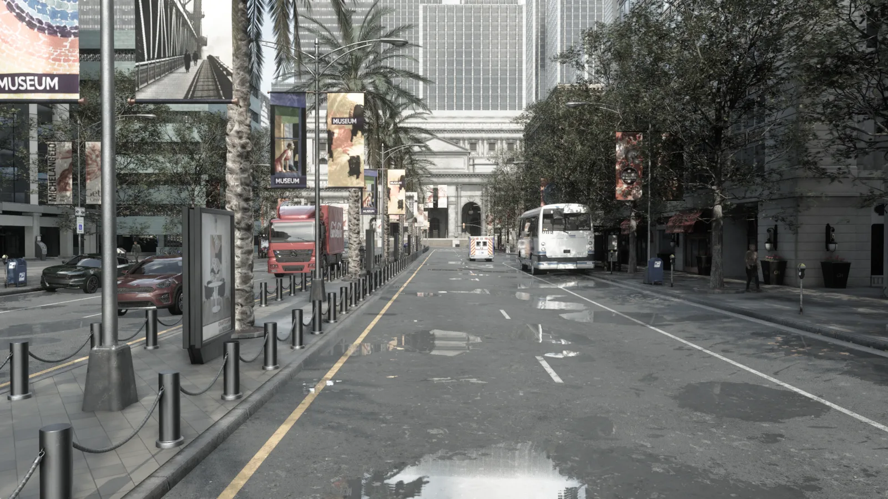
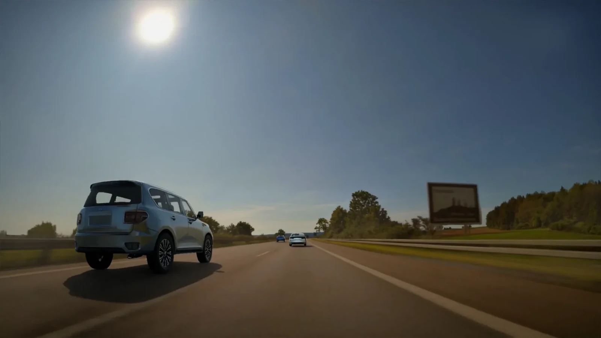
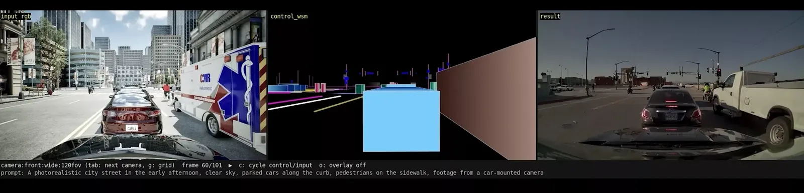
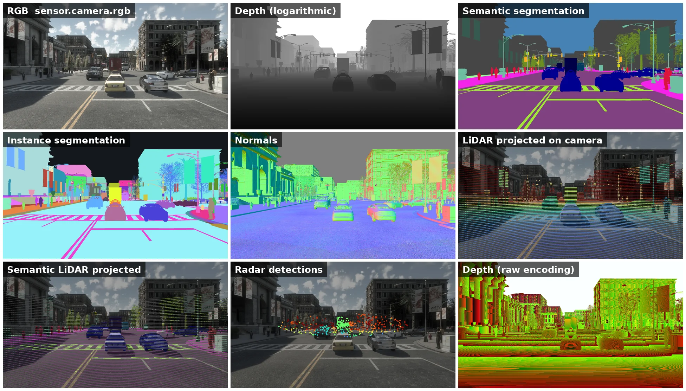

# Sensor simulation

CARLA can produce images in several ways. Most sensors are rendered by Unreal Engine's own renderer, but the same simulation can also be path traced through a physical lens model, upscaled with DLSS, rendered from a neural reconstruction of a real recorded drive, or turned afterwards into photoreal video by a world model. This page explains what each path renders and when to pick it, and links to the page that covers it in detail. The [sensors](#sensors-and-data) that read the simulation, cameras among them, are summarized at the end.

- [__Choosing a renderer__](#choosing-a-renderer)
- [__Unreal Engine native rendering__](#unreal-engine-native-rendering)
- [__NVIDIA NuRec neural reconstruction__](#nvidia-nurec-neural-reconstruction)
- [__NVIDIA Cosmos world models__](#nvidia-cosmos-world-models)
- [__Sensors and data__](#sensors-and-data)

---
## Choosing a renderer

| Path | What it renders | When | Needs |
| ---- | --------------- | ---- | ----- |
| [Unreal Engine native rendering](#unreal-engine-native-rendering) | The CARLA world, rasterized with Lumen global illumination, Nanite geometry and virtual shadow maps | Live, every tick | Nothing extra. Hardware ray tracing on cameras needs an RTX-class GPU and the `Epic` tier |
| [NuRec](#nvidia-nurec-neural-reconstruction) | A real recorded drive, reconstructed as a neural scene, with CARLA running the actors and the physics | Live, every tick | NVIDIA GPU, Docker with the NVIDIA Container Toolkit, the NRE container |
| [Cosmos](#nvidia-cosmos-world-models) | Photoreal video variations (weather, time of day, road surface) of a captured CARLA run | Offline, after the run | A Cosmos job server on NVIDIA GPUs |

Start with the native renderer: it is what every camera uses unless told otherwise. Its [camera features](core_rendering.md#camera-features) cover the rest of the live cases: a post-process preset for the look of a real camera, the ray-traced lens cameras when the lens geometry has to match a real calibration, such as a wide-angle or fisheye lens, and DLSS Super Resolution when a large camera rig is too slow. Use NuRec when the scene itself has to be a real place, and Cosmos when a recorded CARLA run needs photoreal appearance rather than real-time output.

## Unreal Engine native rendering

Town10HD_Opt with a few puddles after a shower, rendered by Unreal Engine at <code>-quality-level=Epic</code> through an RGB camera with the <code>AutomotiveHDRClean</code> profile: Lumen lights the street, and the puddles reflect the buildings and the sky.

Every camera sensor (`sensor.camera.rgb`, `depth`, `semantic_segmentation`, `instance_segmentation`, `optical_flow`, `dvs`) and the spectator view are rendered by Unreal Engine's own renderer. [Lumen](core_rendering.md#lighting-and-geometry) provides dynamic global illumination and reflections, so the weather and the time of day light every surface with no baked lighting; [Nanite](core_rendering.md#lighting-and-geometry) streams the towns' detailed meshes; virtual shadow maps cast the shadows. Four [quality levels](core_rendering.md#quality-levels), `Low` to `Epic`, trade lighting quality for frame rate without changing what is in the world, and a camera can opt into hardware ray tracing at the `Epic` tier.

The same renderer carries three camera features, covered from its page: [post-process presets](core_camera_presets.md) for the look of a camera, [ray-traced lens cameras](core_rt_lens.md) that path trace through a physical lens model, and [DLSS Super Resolution](core_dlss.md) to lower the cost of large camera rigs.

<a href="../core_rendering" class="btn btn-neutral" title="Go to Unreal Engine native rendering">
Go to Unreal Engine native rendering</a>

---
## NVIDIA NuRec neural reconstruction

A CARLA SUV overtakes the ego on the left inside the neural reconstruction of a recorded highway drive. The vehicle is path traced, lit by the scene's sun and casts its shadow on the reconstructed road.

NVIDIA NuRec turns recorded camera and LIDAR data into a 3D scene that can be rendered from new viewpoints. CARLA loads the scenario's OpenDRIVE road network, spawns the recorded actors and runs the simulation loop, while NVIDIA's Neural Reconstruction Engine (NRE) container renders photoreal camera frames at the poses CARLA reports each tick. Because CARLA owns the loop, a real drive can be perturbed with the full CARLA API: the ego re-driven, vehicles handed to the Traffic Manager, assets inserted.

The [hybrid rendering example](nvidia_nurec.md#hybrid-rendering-example) composites CARLA vehicles and pedestrians into the neural scene with the ray-traced lens cameras.

<a href="../nvidia_nurec" class="btn btn-neutral" title="Go to NVIDIA NuRec">
Go to NVIDIA NuRec</a>

---
## NVIDIA Cosmos world models

A CARLA camera frame (left), the world-scenario control video rendered from its ground truth (centre) and the frame Cosmos generated from them with the prompt shown below (right).

Cosmos works after the simulation, not during it. `PythonAPI/examples/nvidia/cosmos/` captures frame-exact multi-camera clips from a CARLA run with their depth, segmentation and edge control videos, exports the ground truth as an NVIDIA ClipGT scene package, and submits generation jobs through the `carla-cosmos` CLI. NVIDIA's Cosmos video world models then generate photoreal variations of the run, such as a different weather, time of day or road surface over the same trajectory.

The capture client, the CLI and the job server run today, and a mock worker exercises the whole pipeline without a GPU; the Cosmos 3 and Transfer 2.5 workers are awaiting validation on GPU hardware.

<a href="../nvidia_cosmos" class="btn btn-neutral" title="Go to NVIDIA Cosmos">
Go to NVIDIA Cosmos</a>

---
## Sensors and data

The same frame through nine sensor outputs: RGB, depth, semantic and instance segmentation, normals, LiDAR, semantic LiDAR, radar and raw depth.

Sensors are the actors that read the simulation. Cameras (RGB, depth, semantic and instance segmentation, optical flow, normals, DVS, fisheye and the ray-traced lens cameras) use the renderers above; LiDAR, radar, GNSS, IMU and the collision, lane invasion and obstacle detectors read the world directly. Every sensor is spawned from a blueprint, attached to a parent actor and streams its data to a callback, every tick or on events.

<a href="../core_sensors" class="btn btn-neutral" title="Go to Sensors and data">
Go to Sensors and data</a>

