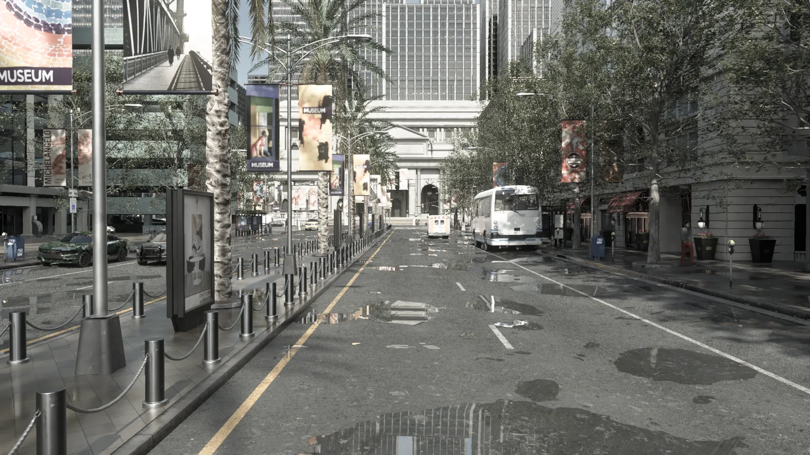
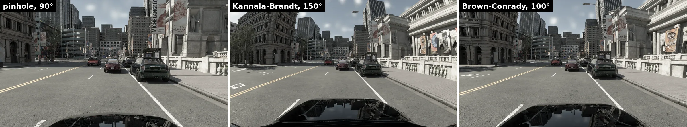

# Ray-traced lens cameras

The ray-traced lens cameras render the CARLA world with Unreal Engine's __path tracer__ and generate their primary rays directly through a physical lens model. An ordinary camera renders a pinhole image and bends it afterwards to imitate a lens; these cameras bend the rays themselves, so wide-angle and fisheye images are geometrically exact, with no resolution loss towards the borders and no missing field of view. The path tracer also gives physically based light transport, so reflections, shadows and indirect light match what a real camera would record.

- [__The three cameras__](#the-three-cameras)
- [__Lens models__](#lens-models)
- [__When to use them__](#when-to-use-them)
- [__Cost and video memory__](#cost-and-video-memory)
- [__Tuning__](#tuning)

---
## The three cameras


<div class="img-caption">Town10HD_Opt after a shower, path traced by <code>sensor.camera.rt_lens</code>: 64 samples per pixel, denoised, <code>AutomotiveHDRClean</code> profile.</div>

Three blueprints share the same lens attributes, so a pixel-aligned set can be configured from one dictionary:

| Blueprint | Output |
| --------- | ------ |
| [`sensor.camera.rt_lens`](ref_sensors.md#ray-traced-lens-camera) | Path-traced colour image |
| [`sensor.camera.rt_lens_distance`](ref_sensors.md#ray-traced-lens-distance-camera) | Euclidean distance in metres along each pixel's lens ray, exact for every lens model |
| [`sensor.camera.rt_lens_instance`](ref_sensors.md#ray-traced-lens-instance-camera) | Semantic label and instance id per pixel, with the byte layout of `sensor.camera.instance_segmentation` |

Each frame is denoised by [NVIDIA DLSS Ray Reconstruction](core_dlss.md#dlss-ray-reconstruction), which makes low sample counts usable in real time. In synchronous mode the image of a tick is delivered on that same tick. `show_only_tags`, `shadow_catcher_tags` and `show_only_actor_ids` restrict a capture to a subset of the actors, for compositing; the [NuRec hybrid rendering example](nvidia_nurec.md#hybrid-rendering-example) uses them to insert CARLA vehicles into a neural scene.

---
## Lens models


<div class="img-caption">The same view through three lens models: pinhole (90&deg;), Kannala-Brandt fisheye (150&deg;) and Brown-Conrady barrel (100&deg;).</div>

The `camera_model` attribute selects the projection: pinhole, the classic fisheye projections (equidistant, equisolid, orthographic, stereographic), Kannala-Brandt, Brown-Conrady, a calibrated lookup table, or NVIDIA's f-theta polynomial. With the coefficients of a real calibration, the camera reproduces that camera's geometry. The [sensor reference](ref_sensors.md#ray-traced-lens-camera) lists every model, its coefficients and the camera attributes (`samples_per_pixel`, `enable_denoiser`, `exposure_mode`, `post_process_profile` and the rest).

```py
bp = world.get_blueprint_library().find('sensor.camera.rt_lens')
bp.set_attribute('image_size_x', '1920')
bp.set_attribute('image_size_y', '1080')
bp.set_attribute('camera_model', 'kannala_brandt')
bp.set_attribute('fov', '150')
bp.set_attribute('distortion_coeffs', '0.03,-0.005,0,0')
bp.set_attribute('samples_per_pixel', '32')
camera = world.spawn_actor(bp, carla.Transform(carla.Location(x=1.5, z=1.6)), attach_to=vehicle)
```

`PythonAPI/examples/manual_control_rtlens.py` boots directly into a fisheye configuration, and `manual_control.py` includes pinhole, fisheye and barrel presets in its camera cycle.

!!! agent "Agentic CARLA"
    *"Attach a 150 degree Kannala-Brandt fisheye rt_lens camera to the front of the ego and save its images with the matching distance images."*

    Skills: `create-sensor`, `read-sensor`. [Set up Agentic CARLA](agent_skills.md#set-up-agentic-carla).

---
## When to use them

CARLA has two ways to get a wide-angle or fisheye image. The `*_fisheye` cameras are the older, raster ones: they render a cube map and resample it through the same lens models, at about the cost of a pinhole camera. The ray-traced lens cameras are the newer ones: exact geometry and photoreal light, at a much higher cost.

* __Use `rt_lens`__ when the lens geometry has to match a real calibrated camera, when the image has to be photoreal, or when distance and instance images must line up exactly with a distorted colour image.
* __Use the [fisheye cameras](ref_sensors.md#fisheye-cameras)__ when you need many wide-angle frames fast and the approximation is acceptable.
* __Use the ordinary [RGB camera](ref_sensors.md#rgb-camera)__ for pinhole images at raster speed, optionally with [DLSS Super Resolution](core_dlss.md).

---
## Cost and video memory

The ray-traced lens cameras need hardware ray tracing (an NVIDIA RTX-class GPU on Vulkan) and have no rasterized fallback. They work at every [quality level](core_rendering.md#quality-levels).

The path tracer is the most memory-hungry sensor in CARLA, and the cost is dominated by the camera rather than by the scene: the first camera allocates gigabytes of path-tracing and denoiser buffers, which are then pooled and reused, so further cameras are nearly free. Budget for that first one. If it does not fit, the server dies with a Vulkan `Out Of Memory` fatal error, which the client sees as a time-out. Lower the resolution or the sample count, or reduce the ray-tracing and Nanite pool sizes in `Unreal/CarlaUnreal/Config/DefaultEngine.ini`.

---
## Tuning

The [ray-traced lens camera family](ref_sensors.md#ray-traced-lens-camera) (`sensor.camera.rt_lens`, `sensor.camera.rt_lens_distance`, `sensor.camera.rt_lens_instance`) is driven by a handful of engine console variables, set project-wide in `Unreal/CarlaUnreal/Config/DefaultEngine.ini` (`[SystemSettings]` and `[/Script/Engine.RendererSettings]` sections). An editor or development build can also be tuned live from the in-game console.

| CVar | Default | What it does | When to change it |
|---|---|---|---|
| `r.PathTracing.FramePassCount` | Engine: `1`. CARLA project (`DefaultEngine.ini`): `0` | Sample passes the path tracer runs per rendered frame. `0` = automatic: run as many passes as needed to finish the sensor's remaining `samples_per_pixel` that frame (capped at 16 by the engine). `N` = run up to N passes per frame (also capped at 16). | Leave at the CARLA default (`0`). It is what lets a *moving* camera reach and denoise its full `samples_per_pixel` budget every frame instead of restarting accumulation at 1 sample; without it only `samples_per_pixel=1` sensors reach the denoise gate while driving. |
| `r.PathTracing.MaxFramePassCount` | Engine: `16`. CARLA project: `64` | Upper bound on `r.PathTracing.FramePassCount`, i.e. the most sample passes one rendered frame may run. A sensor's `samples_per_pixel` above this value cannot finish (and denoise) within one tick, and with a moving camera never reaches the denoise gate at all: `sensor.camera.rt_lens`'s `Set()` clamps `samples_per_pixel` to this cvar and logs a warning when it does. | Raise it to allow higher `samples_per_pixel` sensors to converge every frame (CARLA already raises it to 64); lower it to cap the worst-case per-frame path-tracing cost. Measured: 32 samples/pixel under a 16-pass cap was about 4&times; noisier than the same count under a cap that lets it finish. |
| `r.PathTracing.DLSSRR.FeatureIdleReleaseSeconds` | `0` (off) | Optional wall-clock fallback: seconds a DLSS Ray Reconstruction / DLSS Super Resolution feature (one per distinct view/lens configuration) may sit unused before its GPU memory is released. `0` disables it. | Not normally needed. A sensor's DLSS-RR feature (measured ~342 MB at 1080p) is released within about a second of the sensor being destroyed, because its lifetime is tied to the sensor's view state rather than to a timeout. That is what lets a live sensor go arbitrarily long between captures (a slow synchronous client, a sparse `sensor_tick`) without losing the denoiser's temporal history: the previous default of `10.0` re-created the feature and reset that history on every capture slower than 10 s. Set a value only as a safety net for a leak you have actually observed; any live sensor slower than the value then pays the reset again. |
| `carla.RTLens.SyncModeBlockingReadback` | `1` | In synchronous mode, `1` delivers each `rt_lens*` image captured on the *same* tick, through a per-tick batched blocking GPU readback shared by every camera. `0` forces the asynchronous, one-tick-late, droppable readback (see [Readback and synchronous-mode delivery](ref_sensors.md#ray-traced-lens-camera)) even in synchronous mode. | Rollback valve. Leave at the default (`1`) for frame-accurate synchronous captures; set to `0` only to debug or work around a regression in the batched readback path. |
