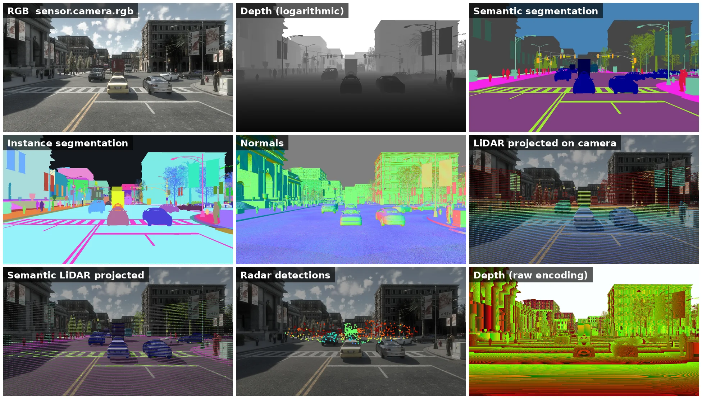

# Sensors and data

Sensors are actors that retrieve data from their surroundings. They are crucial to create learning environment for driving agents.

This page summarizes everything necessary to start handling sensors. It introduces the types available and a step-by-step guide of their life cycle. The specifics for every sensor can be found in the [sensors reference](ref_sensors.md).

* [__Sensors step-by-step__](#sensors-step-by-step)  
	*   [Setting](#setting)  
	*   [Spawning](#spawning)  
	*   [Listening](#listening)  
	*   [Data](#data)  
* [__Types of sensors__](#types-of-sensors)  
	*   [Cameras](#cameras)  
	*   [Detectors](#detectors)  
	*   [Other](#other) 
* [__Sensors reference__](ref_sensors.md)

---
## Sensors step-by-step

The class [carla.Sensor](python_api.md#carla.Sensor) defines a special type of actor able to measure and stream data.

* __What is this data?__ It varies a lot depending on the type of sensor. All the types of data are inherited from the general [carla.SensorData](python_api.md#carla.SensorData). 
* __When do they retrieve the data?__ Either on every simulation step or when a certain event is registered. Depends on the type of sensor. 
* __How do they retrieve the data?__ Every sensor has a `listen()` method to receive and manage the data.

Despite their differences, all the sensors are used in a similar way.

### Setting

As with every other actor, find the blueprint and set specific attributes. This is essential when handling sensors. Their attributes will determine the results obtained. These are detailed in the [sensors reference](ref_sensors.md).

The following example sets a dashboard HD camera.

```py
# Find the blueprint of the sensor.
blueprint = world.get_blueprint_library().find('sensor.camera.rgb')
# Modify the attributes of the blueprint to set image resolution and field of view.
blueprint.set_attribute('image_size_x', '1920')
blueprint.set_attribute('image_size_y', '1080')
blueprint.set_attribute('fov', '110')
# Set the time in seconds between sensor captures
blueprint.set_attribute('sensor_tick', '1.0')
```

### Spawning

`attach_to` and `attachment_type` are the two arguments that matter. A sensor is normally attached to a parent actor, usually a vehicle, so it follows it around; the attachment type decides how its position is updated relative to that vehicle.

* __Rigid attachment.__ Movement is strict regarding its parent location. This is the proper attachment to retrieve data from the simulation.  
* __SpringArm attachment.__ Movement is eased with little accelerations and decelerations. This attachment is only recommended to record videos from the simulation. The movement is smooth and "hops" are avoided when updating the cameras' positions.  
* __SpringArmGhost attachment.__ Like the previous one but without doing the collision test, so the camera or sensor could cross walls or other geometries.

```py
transform = carla.Transform(carla.Location(x=0.8, z=1.7))
sensor = world.spawn_actor(blueprint, transform, attach_to=my_vehicle,
                           attachment_type=carla.AttachmentType.Rigid)
```
!!! Important
    When spawning with attachment, location must be relative to the parent actor.

### Listening

Every sensor has a [`listen()`](python_api.md#carla.Sensor.listen) method. This is called every time the sensor retrieves data.

The argument `callback` is a [lambda function](https://www.w3schools.com/python/python_lambda.asp). It describes what should the sensor do when data is retrieved. This must have the data retrieved as an argument.

```py
# do_something() will be called each time a new image is generated by the camera.
sensor.listen(lambda data: do_something(data))

...

# This collision sensor prints every time a collision is detected.
def callback(event):
    print('Collision with %s' % event.other_actor.type_id)

sensor02.listen(callback)
```

### Data

Most sensor data objects have a function to save the information to disk. This will allow it to be used in other environments.

Sensor data differs a lot between sensor types. Take a look at the [sensors reference](ref_sensors.md) to get a detailed explanation. However, all of them are always tagged with some basic information.

| Sensor data attribute                                                                  | Type                                                                                   | Description                                                                            |
| -------------------------------------------------------------------------------------- | -------------------------------------------------------------------------------------- | -------------------------------------------------------------------------------------- |
| `frame`                                                                                | int                                                                                    | Frame number when the measurement took place.                                          |
| `timestamp`                                                                            | double                                                                                 | Timestamp of the measurement in simulation seconds since the beginning of the episode. |
| `transform`                                                                            | [carla.Transform](<python_api.md#carla.Transform>)                                      | World reference of the sensor at the time of the measurement.                          |

<br>


!!! Note
    `is_listening()` reports whether the sensor is currently streaming; start and stop it with `listen()` and `stop()`.
    `sensor_tick` is a __blueprint attribute__ that sets the simulation time between readings.

---
## Types of sensors


<div style="text-align: right"><i>The same frame through nine sensor outputs: RGB, depth, semantic and instance segmentation, normals, LiDAR, semantic LiDAR, radar and raw depth. Town10HD_Opt &middot; AutomotiveHDR &middot; sunny afternoon</i></div>
 
### Cameras

Take a shot of the world from their point of view. For cameras that return [carla.Image](<python_api.md#carla.Image>), you can use the helper class [carla.ColorConverter](python_api.md#carla.ColorConverter) to modify the image to represent different information.

* __Retrieve data__ every simulation step.


|Sensor |Output | Overview       |
| ----------------- | ---------- | ------------------ |
| [Depth](ref_sensors.md#depth-camera) | [carla.Image](<python_api.md#carla.Image>)  |Renders the depth of the elements in the field of view in a gray-scale map.          |
| [RGB](ref_sensors.md#rgb-camera)      | [carla.Image](<python_api.md#carla.Image>)   | Provides clear vision of the surroundings. Looks like a normal photo of the scene.   |
| [Optical Flow](ref_sensors.md#optical-flow-camera)    | [carla.Image](<python_api.md#carla.Image>)  | Renders the motion of every pixel from the camera.  |
| [Semantic segmentation](ref_sensors.md#semantic-segmentation-camera)    | [carla.Image](<python_api.md#carla.Image>)  | Renders elements in the field of view with a specific color according to their tags. |
| [Instance segmentation](ref_sensors.md#instance-segmentation-camera)    | [carla.Image](<python_api.md#carla.Image>)  | Renders elements in the field of view with a specific color according to their tags and a unique object ID. |
| [DVS](ref_sensors.md#dvs-camera)    | [carla.DVSEventArray](<python_api.md#carla.DVSEventArray>)  | Measures changes of brightness intensity asynchronously as an event stream.  |
| [Normals](ref_sensors.md#normals-camera) | [carla.Image](<python_api.md#carla.Image>) | Renders the surface normal of every pixel. |
| [Fisheye](ref_sensors.md#fisheye-cameras) | as the pinhole camera each mirrors | Wide-angle versions of the RGB, depth and segmentation cameras, with their own intrinsics and distortion. |
| [Ray-traced lens](ref_sensors.md#ray-traced-lens-camera) | [carla.Image](<python_api.md#carla.Image>) | Path-traced camera with a physical lens model, plus its distance and instance twins. |

<br>


### Detectors

Retrieve data when the object they are attached to registers a specific event.

* __Retrieve data__ when triggered.

| Sensor                                                                                                                                                                                          | Output                                                                                                                                                                                          | Overview                                                                                                                                                                                        |
| ----------------------------------------------------------------------------------------------------------------------------------------------------------------------------------------------- | ----------------------------------------------------------------------------------------------------------------------------------------------------------------------------------------------- | ----------------------------------------------------------------------------------------------------------------------------------------------------------------------------------------------- |
| [Collision](ref_sensors.md#collision-detector)                                                                   | [carla.CollisionEvent](<python_api.md#carla.CollisionEvent>)                 | Retrieves collisions between its parent and other actors.                   |
| [Lane invasion](ref_sensors.md#lane-invasion-detector)                                                               | [carla.LaneInvasionEvent](<python_api.md#carla.LaneInvasionEvent>)           | Registers when its parent crosses a lane marking.                           |
| [Obstacle](ref_sensors.md#obstacle-detector)                                                                    | [carla.ObstacleDetectionEvent](<python_api.md#carla.ObstacleDetectionEvent>) | Detects possible obstacles ahead of its parent.                             |

<br>


### Other

Different functionalities such as navigation, measurement of physical properties and 2D/3D point maps of the scene.

* __Retrieve data__ every simulation step.

| Sensor                                                                                                                                                                                          | Output                                                                                                                                                                                          | Overview                                                                                                                                                                                        |
| ----------------------------------------------------------------------------------------------------------------------------------------------------------------------------------------------- | ----------------------------------------------------------------------------------------------------------------------------------------------------------------------------------------------- | ----------------------------------------------------------------------------------------------------------------------------------------------------------------------------------------------- |
| [GNSS](ref_sensors.md#gnss-sensor)                                                                                                                                                                                            | [carla.GNSSMeasurement](<python_api.md#carla.GnssMeasurement>)                                                                                                                                   | Retrieves the geolocation of the sensor.                                                                                                                                                        |
| [IMU](ref_sensors.md#imu-sensor)                                                                                                                                                                                             | [carla.IMUMeasurement](<python_api.md#carla.IMUMeasurement>)                                                                                                                                     | Comprises an accelerometer, a gyroscope, and a compass.                                                                                                                                         |
| [LIDAR](ref_sensors.md#lidar-sensor)                                                                                                                                                                                           | [carla.LidarMeasurement](<python_api.md#carla.LidarMeasurement>)                                                                                                                                 | A rotating LIDAR. Generates a 4D point cloud with coordinates and intensity per point to model the surroundings.                                                                                |
| [Radar](ref_sensors.md#radar-sensor)                                                                                                                                                                                           | [carla.RadarMeasurement](<python_api.md#carla.RadarMeasurement>)                                                                                                                                 | Point cloud of detections, each with depth, azimuth, altitude and the velocity relative to the sensor.                                                                                          |
| [Semantic LIDAR](ref_sensors.md#semantic-lidar-sensor)                                                                                                                                                                                  | [carla.SemanticLidarMeasurement](<python_api.md#carla.SemanticLidarMeasurement>)                                                                                                                 | A rotating LIDAR. Generates a 3D point cloud with extra information regarding instance and semantic segmentation.                                                                               |
| [Hybrid Solid-State LiDAR](ref_sensors.md#hybrid-solid-state-lidar-sensor) | [carla.LidarMeasurement](<python_api.md#carla.LidarMeasurement>) | A forward-facing solid-state LiDAR with a fixed scan pattern. |
| [V2X](ref_sensors.md#v2x-sensor) | [carla.CAMEvent](<python_api.md#carla.CAMEvent>) | Receives ETSI cooperative awareness messages from other V2X sensors. |
| [Custom V2X](ref_sensors.md#custom-v2x-message) | [carla.CustomV2XEvent](<python_api.md#carla.CustomV2XEvent>) | Sends and receives arbitrary messages between V2X sensors. |
| [Vehicle status](ref_sensors.md#vehicle-status-sensor) | [carla.SensorData](<python_api.md#carla.SensorData>) | The parent vehicle's kinematic and control state, for the Autoware bridge. |
| [Autoware GNSS](ref_sensors.md#autoware-gnss-sensor) | [carla.GnssMeasurement](<python_api.md#carla.GnssMeasurement>) | A GNSS sensor publishing in the shape the Autoware stack expects. |

<br>


---
That is a wrap on sensors and how they retrieve simulation data. The [sensors reference](ref_sensors.md) covers each one in detail.

<div class="build-buttons">
<p>
<a href="../adv_synchrony_timestep" target="_blank" class="btn btn-neutral" title="Synchrony and time-step">
Synchrony and time-step</a>
</p>
</div>

* __Experiment freely.__ Take a look at the __References__ section of this documentation. It 
  contains detailed information on the classes in the Python API, sensors, code snippets and much 
  more.

<div class="build-buttons">
<p>
<a href="../python_api" target="_blank" class="btn btn-neutral" title="Python API reference">
Python API reference</a>
</p>
</div>


* __Give your two cents.__ Any doubts, suggestions and ideas are welcome in the forum.

<div class="build-buttons">
<p>
<a href="https://github.com/carla-simulator/carla/discussions/" target="_blank" class="btn btn-neutral" title="Go to the CARLA forum">
CARLA forum</a>
</p>
</div>


