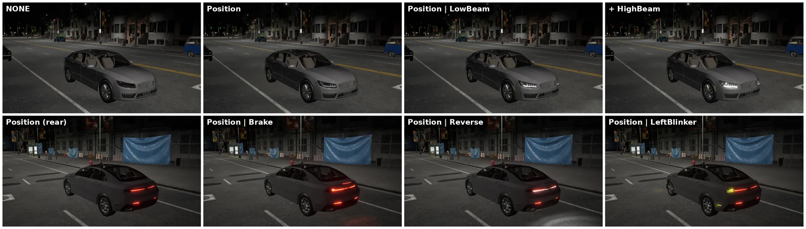

# World and client

The client and the world are two of the fundamentals of CARLA, a necessary abstraction to operate the simulation and its actors.

This tutorial goes from defining the basics and creation of these elements, to describing their possibilities. If any doubt or issue arises during the reading, the [CARLA forum](https://github.com/carla-simulator/carla/discussions/) is there to solve them.

*   [__The client__](#the-client)
    *   [Client creation](#client-creation)
    *   [World connection](#world-connection)
    *   [Using commands](#using-commands)
    *   [Other client utilities](#other-client-utilities)
*   [__The world__](#the-world)
    *   [Actors](#actors)
    *   [Weather](#weather)
    *   [Lights](#lights)
    *   [Debugging](#debugging)
    *   [World snapshots](#world-snapshots)
    *   [World settings](#world-settings)

---
## The client

Clients are one of the main elements in the CARLA architecture. They connect to the server, retrieve information, and command changes. That is done via scripts. The client identifies itself, and connects to the world to then operate with the simulation.

Besides that, clients are able to access advanced CARLA modules, features, and apply command batches. Only command batches will be covered in this section. These are useful for basic things such as spawning lots of actors. The rest of features are more complex, and they will be addressed in their respective pages in __Advanced steps__.

Take a look at [__carla.Client__](python_api.md#carla.Client) in the Python API reference to learn on specific methods and variables of the class.


### Client creation

Two things are needed: the __IP__ address of the server and the __RPC port__ it listens on, 2000 by default. The server also opens the next two ports, 2001 for sensor streaming and 2002 for a secondary server, but the client is given only the first one. An optional third parameter sets the number of working threads, all of them (`0`) by default. [carla.Client](python_api.md#carla.Client.__init__) in the Python API reference has a snippet that parses these as script arguments.

```py
client = carla.Client('localhost', 2000)
```
By default, CARLA uses local host IP, and port 2000 to connect but these can be changed at will. The second port will always be `n+1`, 2001 in this case.

Once the client is created, set its __time-out__. This limits all networking operations so that these don't block the client forever. An error will be returned if connection fails.

```py
client.set_timeout(10.0) # seconds
```

It is possible to have many clients connected, as it is common to have more than one script running at a time. Working in a multiclient scheme with advanced CARLA features, such as the traffic manager, is bound to make communication more complex.

!!! Note
    Client and server have different `libcarla` modules. If the versions differ, issues may arise. This can be checked using the `get_client_version()` and `get_server_version()` methods.

### World connection

A client can connect and retrieve the current world fairly easily.

```py
world = client.get_world()
```

The client can also get a list of available maps to change the current one. This will destroy the current world and create a new one.
```py
print(client.get_available_maps())
...
world = client.load_world('Town01_Opt')
# client.reload_world() creates a new instance of the world with the same map. 
```

Every world object has an `id` or episode. Everytime the client calls for `load_world()` or `reload_world()` the previous one is destroyed. A new one is created from scratch with a new episode. Unreal Engine is not rebooted in the process.

### Using commands

__Commands__ are adaptations of some of the most-common CARLA methods, that can be applied in batches. For instance, the [command.SetAutopilot](python_api.md#command.SetAutopilot) is equivalent to [Vehicle.set_autopilot()](python_api.md#carla.Vehicle.set_autopilot), enables the autopilot for a vehicle. However, using the methods [Client.apply_batch](python_api.md#carla.Client.apply_batch) or [Client.apply_batch_sync()](python_api.md#carla.Client.apply_batch_sync), a list of commands can be applied in one single simulation step. This becomes extremely useful for methods that are usually applied to even hundreds of elements.

The following example uses a batch to destroy a list of vehicles all at once.

```py
client.apply_batch([carla.command.DestroyActor(x) for x in vehicles_list])
```

Every available command is listed at the end of the [Python API reference](python_api.md#command.SpawnActor).

### Other client utilities

The main purpose of the client object is to get or change the world, and apply commands. However, it also provides access to some additional features.

*   __Traffic manager.__ This module is in charge of every vehicle set to autopilot to recreate urban traffic.  
*   __[Recorder](adv_recorder.md).__ Allows to reenact a previous simulation. Uses [snapshots](core_world.md#world-snapshots) summarizing the simulation state per frame.

---
## The world

The major ruler of the simulation. Its instance should be retrieved by the client. It does not contain the model of the world itself, that is part of the [Map](core_map.md) class. Instead, most of the information, and general settings can be accessed from this class.

*   Actors in the simulation and the spectator.  
*   Blueprint library.  
*   Map.  
*   Simulation settings.  
*   Snapshots.  
*   Weather and light manager.

Some of its most important methods are _getters_, precisely to retrieve information or instances of these elements. Take a look at [carla.World](python_api.md#carla.World) to learn more about it.

### Actors

The world has different methods related with actors that allow for different functionalities.

*   Spawn actors (but not destroy them). 
*   Get every actor on scene, or find one in particular.  
*   Access the blueprint library.  
*   Access the spectator actor, the simulation's point of view.  
*   Retrieve a random location that is fitting to spawn an actor.

Spawning will be explained in [2nd. Actors and blueprints](core_actors.md). It requires some understanding on the blueprint library, attributes, etc.

### Weather

The weather is not a class on its own, but a set of parameters accessible from the world. The parametrization includes sun orientation, cloudiness, wind, fog, and much more. The helper class [carla.WeatherParameters](python_api.md#carla.WeatherParameters) is used to define a custom weather.  
```py
weather = carla.WeatherParameters(
    cloudiness=80.0,
    precipitation=30.0,
    sun_altitude_angle=70.0)

world.set_weather(weather)

print(world.get_weather())
```

Every parameter, with the range the server accepts and its default:

| Parameter | Range | Default | What it does |
| --------- | ----- | ------- | ------------ |
| `cloudiness` | 0-100 | 0 | Cloud cover. Above 80 the clouds close into an overcast deck. |
| `precipitation` | 0-100 | 0 | Rain falling. |
| `precipitation_deposits` | 0-100 | 0 | Water left on the ground, as puddles. |
| `wetness` | 0-100 | 0 | Water on the camera lens and on surfaces. |
| `wind_intensity` | 0-100 | 0.35 | Wind, which drives the rain and the vegetation. |
| `sun_azimuth_angle` | 0-360&deg; | 0 | Where the sun is, around the horizon. |
| `sun_altitude_angle` | -90 to 90&deg; | 75 | How high the sun is. Below 0 is night. |
| `fog_density` | 0-100 | 0 | Thickness of the fog. |
| `fog_distance` | 0 m upwards | 0 | How far from the camera the fog starts. |
| `fog_falloff` | 0 upwards | 0.2 | How heavy the fog is: 0 covers the whole scene, 1 reaches the height of a building, above 5 it is compressed to ground level. |
| `scattering_intensity` | 0 upwards | 0 | How much light contributes to volumetric fog. |
| `mie_scattering_scale` | 0-5 | 0 | Light scattering off large particles — pollen, pollution — for haze and halos around light sources. |
| `rayleigh_scattering_scale` | 0-2 | 0.0331 | Light scattering off air molecules, which is what makes the sky blue by day and red at dusk. |
| `dust_storm` | 0-100 | 0 | Strength of a dust storm. |

There are some weather presets that can be directly applied to the world. These are listed in [carla.WeatherParameters](python_api.md#carla.WeatherParameters) and accessible as an enum.

```py
world.set_weather(carla.WeatherParameters.WetCloudySunset)
```

Two scripts drive the weather from the terminal.

__`PythonAPI/util/set_weather.py`__ sets the weather once. It starts from a named preset and overrides individual parameters.

```sh
python3 set_weather.py --list-presets             # print the preset names
python3 set_weather.py --show                     # print the current weather, change nothing
python3 set_weather.py --preset WetCloudySunset
python3 set_weather.py --preset ClearNoon --fog-density 40 --wetness 60
```

Every field of [carla.WeatherParameters](python_api.md#carla.WeatherParameters) has a flag of the same name with dashes, so `--sun-altitude-angle`, `--precipitation`, `--mie-scattering-scale` and the rest all work.

__`PythonAPI/examples/dynamic_day_night_weather_cycle.py`__ animates the weather instead, cycling the sun and the storms.

| Flag | Default | What it does |
| --- | --- | --- |
| `--day-length` | 180.0 | Seconds for one full day/night cycle. |
| `--storm-length` | 240.0 | Seconds for one full clear → storm → clear cycle. |
| `--speed` | 1.0 | Time multiplier; `2.0` runs twice as fast. |
| `--warmup` | 5.0 | Seconds to blend from the current weather into the cycle. |
| `--set-weather-hz` | 10.0 | How often per second the weather is actually pushed to the server. |
| `--time-only` | off | Animate only the sun. |
| `--weather-only` | off | Animate only the storm cycle. |
| `--quiet` | off | Do not print the live status line. |

!!! Note
    Changes in the weather do not affect physics. They are only visuals that can be captured by the camera sensors.

Under Unreal Engine 5, the weather parameters drive the engine's physically-based sky system directly: sun position and intensity, sky light, clouds, fog and wet surfaces all respond to [carla.WeatherParameters](python_api.md#carla.WeatherParameters) in physical lighting units, in the viewport and in every camera sensor alike.

__Night mode starts when sun_altitude_angle < 0__, which is considered sunset. This is when lights become especially relevant. At night the scene is lit by a physically consistent night rig: street lamps cast real light on the road, an ambient moon/sky floor keeps unlit areas readable, vehicle headlights project actual light beams, and the night sky shows stars.

#### Lighting the scene with a captured sky

The sky light normally captures CARLA's own procedural atmosphere, and that capture is what lights the scene indirectly: ambient fill and reflections. It can be replaced with a real environment map, so that CARLA's actors are lit by the same surroundings as footage they are being composited into. This is what the [NuRec hybrid example](nvidia_nurec.md) uses to make a path-traced vehicle sit convincingly in a neural reconstruction.

```py
world.set_sky_light_map(width, height, pixels, intensity)   # equirectangular float32 linear RGB(A)
world.has_sky_light_map()
world.clear_sky_light_map()                                 # back to the procedural atmosphere
```

The override survives weather changes but not `load_world()` or `reload_world()`, so set it again on a new map. Two things decide whether the result looks right, and both are detailed in [`carla.World.set_sky_light_map`](python_api.md#carla.World.set_sky_light_map): the panorama is read in CARLA's own frame, and its values are radiance in the project's photometric units, so a panorama normalized to `[0, 1]` needs an `intensity` in the thousands to hold up against daylight.

### Lights

<div style="text-align: right"><i>carla.VehicleLightState combinations on a Lincoln MKZ at night, front (top) and rear (bottom). Town10HD_Opt &middot; sensor.camera.rgb &middot; Cinematic &middot; ClearNight</i></div>

*   __Street lights__ automatically turn on when the simulation enters night mode. The lights are placed by the developers of the map, and accessible as [__carla.Light__](python_api.md#carla.Light) objects. Properties such as color and intensity can be changed at will. The variable __light_state__ of type [__carla.LightState__](python_api.md#carla.LightState) allows setting all of these in one call.  
Street lights are categorized using their attribute __light_group__, of type [__carla.LightGroup__](python_api.md#carla.LightGroup). This allows to classify lights as street lights, building lights... An instance of [__carla.LightManager__](python_api.md#carla.LightManager) can be retrieved to handle groups of lights in one call.

```py
# Get the light manager and lights
lmanager = world.get_lightmanager()
mylights = lmanager.get_all_lights()

# Custom a specific light
light01 = mylights[0]
light01.turn_on()
light01.set_intensity(100.0)
state01 = carla.LightState(200.0, carla.Color(255, 0, 0), carla.LightGroup.Building, True)
light01.set_light_state(state01)

# Custom a group of lights
my_lights = lmanager.get_light_group(carla.LightGroup.Building)
lmanager.turn_on(my_lights)
lmanager.set_color(my_lights, carla.Color(255, 0, 0))
lmanager.set_intensities(my_lights, [200.0] * len(my_lights))
```

In `manual_control.py`, press `U` to toggle all street lights and `Shift+U` to toggle the automatic day/night street light cycle.

* __Vehicle lights__ are turned on and off by the user. Each vehicle has the set of lights listed in [__carla.VehicleLightState__](python_api.md#carla.VehicleLightState); not every vehicle has all of them, and which ones a model carries is listed in [Actors](core_actors.md#vehicles).

The lights of a vehicle are read and set with [carla.Vehicle.get_light_state](python_api.md#carla.Vehicle.get_light_state) and [carla.Vehicle.set_light_state](python_api.md#carla.Vehicle.set_light_state), using binary operations to combine them.

```py
# Turn on position lights
current_lights = carla.VehicleLightState.NONE
current_lights |= carla.VehicleLightState.Position
vehicle.set_light_state(current_lights)
```

!!! Note
    Street lights can also be toggled from `manual_control.py` with `U`, and the automatic day/night cycle with `Shift+U`.

### Debugging

World objects have a [carla.DebugHelper](python_api.md#carla.DebugHelper) object as a public attribute. It allows for different shapes to be drawn during the simulation. These are used to  trace the events happening. The following example would draw a red box at an actor's location and rotation.

```py
debug = world.debug
debug.draw_box(carla.BoundingBox(actor_snapshot.get_transform().location,carla.Vector3D(0.5,0.5,2)),actor_snapshot.get_transform().rotation, 0.05, carla.Color(255,0,0,0),0)
```

This example is extended in a snipet in [carla.DebugHelper](python_api.md#carla.DebugHelper.draw_box) that shows how to draw boxes for every actor in a world snapshot.

Shapes and strings drawn with a `life_time` of `0` are persistent: they stay until the map is reloaded. Both can be cleared on demand instead.

```py
debug.clear_debug_shape()     # every shape drawn so far
debug.clear_debug_string()    # every HUD string
```

### World snapshots

Contains the state of every actor in the simulation at a single frame. A sort of still image of the world with a time reference. The information comes from the same simulation step, even in asynchronous mode.

```py
# Retrieve a snapshot of the world at current frame.
world_snapshot = world.get_snapshot()
```

A [carla.WorldSnapshot](python_api.md#carla.WorldSnapshot) contains a [carla.Timestamp](python_api.md#carla.Timestamp) and a list of [carla.ActorSnapshot](python_api.md#carla.ActorSnapshot). Actor snapshots can be searched using the `id` of an actor. A snapshot lists the `id` of the actors appearing in it.

```py
timestamp = world_snapshot.timestamp # Get the time reference 

for actor_snapshot in world_snapshot: # Get the actor and the snapshot information
    actual_actor = world.get_actor(actor_snapshot.id)
    actor_snapshot.get_transform()
    actor_snapshot.get_velocity()
    actor_snapshot.get_angular_velocity()
    actor_snapshot.get_acceleration()  

actor_snapshot = world_snapshot.find(actual_actor.id) # Get an actor's snapshot
```

### World settings

The world has access to some advanced configurations for the simulation. These determine rendering conditions, simulation time-steps, and synchrony between clients and server. They are accessible from the helper class [carla.WorldSettings](python_api.md#carla.WorldSettings).

For the time being, default CARLA runs with the best graphics quality, a variable time-step, and asynchronously. To dive further in this matters take a look at the __Advanced steps__ section. The pages on [synchrony and time-step](adv_synchrony_timestep.md), and [rendering options](adv_rendering_options.md) could be a great starting point.

One of them is worth knowing about when working with maps generated from OpenDRIVE. Traffic signs and traffic lights are placed at the height the OpenDRIVE file declares, which on terrain that does not match can leave them floating or sunk. `adjust_signs_height_to_ground` traces the ground under each of them and snaps them to it.

```py
settings = world.get_settings()
settings.adjust_signs_height_to_ground = True
world.apply_settings(settings)
```

!!! Note
    It is off by default, and only moves signs and lights that CARLA generated from OpenDRIVE. Actors placed by hand in a map are never moved. Signs are generated when the map loads, so enabling the setting later re-snaps the ones already spawned.

---
That is a wrap on the world and client objects. The next step takes a closer look at actors and blueprints.

<div class="build-buttons">
<p>
<a href="https://github.com/carla-simulator/carla/discussions/" target="_blank" class="btn btn-neutral" title="CARLA forum">
CARLA forum</a>
</p>
<p>
<a href="../core_actors" class="btn btn-neutral" title="Actors and blueprints">
Actors and blueprints</a>
</p>
</div>
