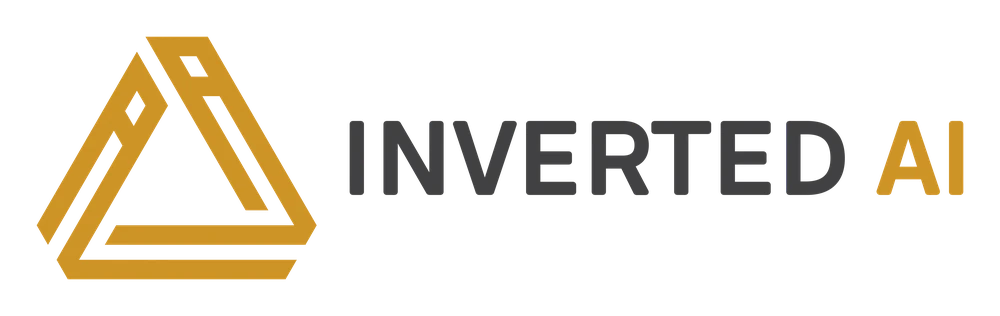

# Inverted AI



Inverted AI drives non-player vehicles with models learned from real human driving, through a hosted API, so the traffic around the ego behaves the way people do rather than following hand-written rules. It replaces the [Traffic Manager](core_traffic_manager.md) for those vehicles; CARLA still owns the simulation, the ego and the sensors.

<video controls width="100%" src="https://ecosystem.carla.org/video/iai-pipeline.mp4"></video>

- [__Using Inverted AI with CARLA__](#using-inverted-ai-with-carla)
- [__The products__](#the-products)

---
## Using Inverted AI with CARLA

`PythonAPI/examples/invertedai_traffic.py` is a working integration. It needs the `invertedai` package, which is in the examples' requirements, and an API key.

```sh
cd PythonAPI/examples
pip3 install -r requirements.txt

export IAI_API_KEY=<your key>          # or pass --iai-key
python3 invertedai_traffic.py -n 30 -w 10
```

| Flag | Default | What it does |
|---|---|---|
| `--iai-key` | `IAI_API_KEY` | API key. The environment variable wins over the flag. |
| `--location` | `carla:Town10HD` | Map, in Inverted AI's naming. Only Town10HD is tested. |
| `--number-of-vehicles`, `-n` | 50 | Vehicles for Inverted AI to drive. |
| `--number-of-walkers`, `-w` | 0 | Pedestrians, driven by CARLA's own controllers. |
| `--sim-length` | 60 | Seconds to simulate. |
| `--width` | 250 | Width in metres of the area Inverted AI populates. |
| `--height` | 250 | Height of that area, also in metres. |
| `--map-center` | `-50 20` | Its centre, as `X Y`. |
| `--capacity` | 100 | Agents per quadtree leaf before it splits. |
| `--api-model` | `nBu1` | Inverted AI model version. |
| `--iai-async` | `True` | Call the API asynchronously. |
| `--seed`, `-s` | random | Seed, for a repeatable run. |
| `--record` | off | Record the run with CARLA's recorder. |
| `--iai-log` | off | Write an Inverted AI log and a birdview GIF. |
| `--capture-video` | off | Record video from a camera on one of the vehicles. |

The quadtree covers the `--width` by `--height` area around `--map-center`, and splits a leaf once more than `--capacity` agents fall inside it, which is how the API scales to a crowded map.

`--iai-log` and `--capture-video` both write into a new directory named after the run's timestamp, created in the working directory. The log is a `.json` plus a `.gif`, and it can be reopened later with [Inverted AI's own tools](https://github.com/inverted-ai/invertedai/blob/master/examples/scenario_log_example.py).

The simulation runs at a fixed 0.1 s step, which is the only step length the API supports.

---
## The products

Four products build on the same models. See the [Inverted AI website](https://www.inverted.ai/home) and their [Python API documentation](https://docs.inverted.ai/en/latest/pythonapi/).

| Product | What it does |
| --- | --- |
| [DRIVE](https://www.inverted.ai/apis#DRIVE) | Drives the NPCs with diverse, realistic and reactive behavior. This is what the CARLA example uses. |
| [INITIALIZE](https://www.inverted.ai/apis#INITIALIZE) | Starts a simulation from a realistic set of initial conditions — agent density, types, speeds, placements and orientations — instead of burning in. |
| [SCENARIO](https://www.inverted.ai/apis#SCENARIO) | Whole-scene guided scenario generation, including pedestrians, bikes, buses and lights. |
| [BLAME](https://www.inverted.ai/apis#BLAME) | Determines from logs which agents caused a collision and why, to sort through run results. |

