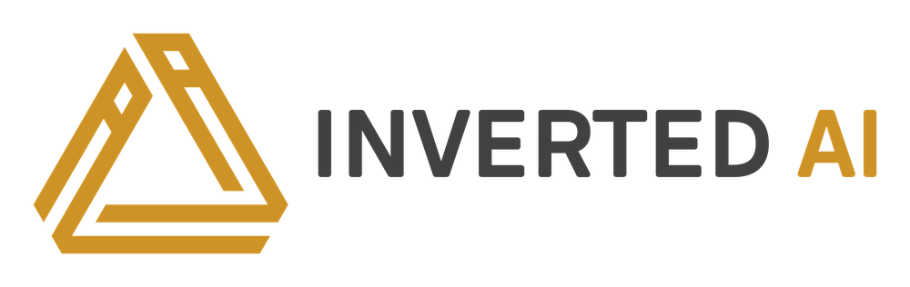

# Inverted AI



<video controls width="100%" src="https://ecosystem.carla.org/video/iai-pipeline.mp4"></video>

Inverted AI drives non-player vehicles with models learned from real human driving, through a hosted API, so the traffic around the ego behaves the way people do rather than following hand-written rules. It replaces the [Traffic Manager](adv_traffic_manager.md) for those vehicles; CARLA still owns the simulation, the ego and the sensors.

- [__Using Inverted AI with CARLA__](#using-inverted-ai-with-carla)
- [__The products__](#the-products)

---
## Using Inverted AI with CARLA

`PythonAPI/examples/invertedai_traffic.py` is a working integration. It needs the `invertedai` package, which is in the examples' requirements, and an API key.

```sh
cd PythonAPI/examples
pip3 install -r requirements.txt

export IAI_API_KEY=<your key>          # or pass --iai-key
python3 invertedai_traffic.py -n 30 -w 10
```

| Flag | Default | What it does |
| --- | --- | --- |
| `--iai-key` | `IAI_API_KEY` from the environment | The API key. The environment variable wins when both are set. |
| `--location` | `carla:Town10HD` | The map, in Inverted AI's naming. Only Town10HD has been tested. |
| `-n`, `--number-of-vehicles` | | Vehicles for Inverted AI to drive. |
| `-w`, `--number-of-walkers` | | Pedestrians, which CARLA's own controllers drive. |
| `--sim-length` | | Seconds to simulate. |
| `--capacity` | 100 | Agents per quadtree leaf before it splits, which is how the API scales to a crowded map. |
| `--record` | off | Record the run with CARLA's recorder. |
| `-s`, `--seed` | | Seed, for a repeatable run. |

The simulation runs at a fixed 0.1 s step, which is the only step length the API supports.

---
## The products

Four products build on the same models. See the [Inverted AI website](https://www.inverted.ai/home) and their [Python API documentation](https://docs.inverted.ai/en/latest/pythonapi/).

| Product | What it does |
| --- | --- |
| [DRIVE](https://www.inverted.ai/apis#DRIVE) | Drives the NPCs with diverse, realistic and reactive behavior. This is what the CARLA example uses. |
| [INITIALIZE](https://www.inverted.ai/apis#INITIALIZE) | Starts a simulation from a realistic set of initial conditions — agent density, types, speeds, placements and orientations — instead of burning in. |
| [SCENARIO](https://www.inverted.ai/apis#SCENARIO) | Whole-scene guided scenario generation, including pedestrians, bikes, buses and lights. |
| [BLAME](https://www.inverted.ai/apis#BLAME) | Determines from logs which agents caused a collision and why, to sort through run results. |

