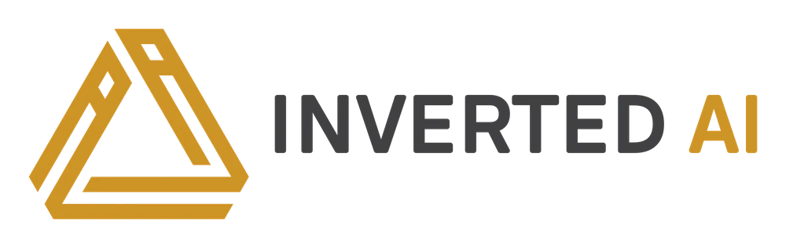

# Inverted AI



Inverted AI drives non-player vehicles with models learned from real human driving, through a hosted API, so the traffic around the ego behaves the way people do rather than following hand-written rules. It replaces the [Traffic Manager](core_traffic_manager.md) for those vehicles; CARLA still owns the simulation, the ego and the sensors.

<video controls width="100%" src="https://ecosystem.carla.org/video/iai-pipeline.mp4"></video>

- [__Using Inverted AI with CARLA__](#using-inverted-ai-with-carla)
- [__The products__](#the-products)

---
## Using Inverted AI with CARLA

!!! agent "Agentic CARLA"
    *"Set up my Inverted AI key and fill Town10 with 30 cars driven by Inverted AI around the ego."*

    Skill: `invertedai-traffic`. [Set up Agentic CARLA](agent_skills.md#set-up-agentic-carla).

`PythonAPI/examples/invertedai_traffic.py` is a working integration. It needs the `invertedai` package, which is in the examples' requirements, and an API key.

```sh
cd PythonAPI/examples
pip3 install -r requirements.txt

export IAI_API_KEY=<your key>          # or pass --iai-key
python3 invertedai_traffic.py -n 30 -w 10
```

| Flag | Default | What it does |
|---|---|---|
| `--iai-key` | `IAI_API_KEY` | API key. The environment variable wins over the flag. |
| `--location` | `carla:Town10HD` | Map, in Inverted AI's naming: `carla:Town01` to `carla:Town07` and `carla:Town10HD`. CARLA loads the `_Opt` variant when the plain map is not available, as on UE 5. Set `--map-center` to a point of that map. Inverted AI's `carla:Town15` does not line up with CARLA's Town15: it is rotated 180 degrees, so its vehicles and lights land in the wrong places. |
| `--number-of-vehicles`, `-n` | 50 | Vehicles for Inverted AI to drive. |
| `--number-of-walkers`, `-w` | 0 | Pedestrians, driven by CARLA's own controllers. |
| `--sim-length` | 60 | Seconds to simulate. |
| `--width` | 250 | Width in metres of the area Inverted AI populates. |
| `--height` | 250 | Height of that area, also in metres. |
| `--map-center` | `-50 20` | Its centre, as `X Y`. |
| `--capacity` | 100 | Agents per quadtree leaf before it splits. |
| `--api-model` | `nBu1` | Inverted AI model version. |
| `--traffic-lights` | `carla` | Who runs the traffic lights: `carla` or `iai`. See [Traffic lights](#traffic-lights). |
| `--iai-async` | `True` | Call the API asynchronously. |
| `--seed`, `-s` | random | Seed, for a repeatable run. |
| `--record` | off | Record the run with CARLA's recorder. |
| `--iai-log` | off | Write an Inverted AI log and a birdview GIF. |
| `--capture-video` | off | Record video from a camera on one of the vehicles. |

The quadtree covers the `--width` by `--height` area around `--map-center`, and splits a leaf once more than `--capacity` agents fall inside it, which is how the API scales to a crowded map.

`--iai-log` and `--capture-video` both write into a new directory named after the run's timestamp, created in the working directory. The log is a `.json` plus a `.gif`, and it can be reopened later with [Inverted AI's own tools](https://github.com/inverted-ai/invertedai/blob/master/examples/scenario_log_example.py).

The simulation runs at a fixed 0.1 s step, which is the only step length the API supports.

### Traffic lights

CARLA and Inverted AI number their traffic lights differently, so the example pairs them by position. Each Inverted AI light goes to the CARLA light whose stop line is on the same lane, facing the same way, up to 20 m before it. One side then runs the lights and the other follows it, so both always show the same states:

- `--traffic-lights carla` (default). CARLA's own light cycle runs. After every tick its states are sent to Inverted AI, so the agents react to the lights CARLA shows in that frame.
- `--traffic-lights iai`. Inverted AI's server runs the lights. CARLA's lights are frozen and set every step to the states the Inverted AI agents acted on, and released when the example ends. The server picks a step's lights inside the call that moves the agents, so CARLA shows the Inverted AI vehicles 0.1 s late, together with the lights they reacted to. Walkers, which CARLA drives, are not delayed.

Each step is checked: in `carla` mode the server must report the states that were sent, and in `iai` mode CARLA's lights must show the states that were set. The example prints the number of mismatches when it ends.

The two maps do not always have the same lights, and the example prints the lights that differ when it starts:

- **A light only Inverted AI has** is sent as off in `carla` mode, matching CARLA. In `iai` mode CARLA cannot show it.
- **A light only CARLA has** (one on Town03) is switched off in `iai` mode. In `carla` mode the Inverted AI agents do not see it.
- **Per-lane lights.** Inverted AI can give each lane of an approach its own light where CARLA has one light for all of them. On Town06, for example, the outer lane often stays green while the others cycle. In `carla` mode every lane gets CARLA's state. In `iai` mode CARLA shows the state of most of the lanes, and the summary counts the steps where they differed.

Inverted AI's stop lines are a few metres further along the lane than CARLA's, so its vehicles stop slightly past the CARLA stop line.

---
## The products

Four products build on the same models. See the [Inverted AI website](https://www.inverted.ai/home) and their [Python API documentation](https://docs.inverted.ai/en/latest/pythonapi/).

| Product | What it does |
| --- | --- |
| [DRIVE](https://www.inverted.ai/apis#DRIVE) | Drives the NPCs with diverse, realistic and reactive behavior. This is what the CARLA example uses. |
| [INITIALIZE](https://www.inverted.ai/apis#INITIALIZE) | Starts a simulation from a realistic set of initial conditions — agent density, types, speeds, placements and orientations — instead of burning in. |
| [SCENARIO](https://www.inverted.ai/apis#SCENARIO) | Whole-scene guided scenario generation, including pedestrians, bikes, buses and lights. |
| [BLAME](https://www.inverted.ai/apis#BLAME) | Determines from logs which agents caused a collision and why, to sort through run results. |

