# End-to-End Tutorial: Converting Real-World OpenStreetMap to a CARLA Simulator Map (Munich, Germany)

This tutorial provides a complete, step-by-step walkthrough demonstrating how to take a real-world geographic bounding box from **Munich, Germany**, extract its raw OpenStreetMap (`.osm`) data, and compile it into a fully interactive, drivable 3D simulation map in **CARLA** using **only the packaged simulator**—with **zero Unreal Engine source code, zero Unreal Editor access, and no manual 3D modeling required**.

---

## Tutorial Architecture & Workflow

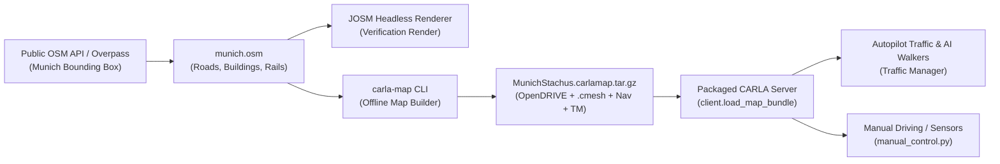

---

## Prerequisites

All steps in this tutorial run against the standalone packaged CARLA distribution:
- **Packaged CARLA Simulator**: `Carla-0.10.0-Mac-Shipping` (macOS Apple Silicon) or `Carla-0.10.0-Linux-Shipping` (Linux x86_64).
- **Python 3.10** with the packaged `carla` Python client wheel installed (`pip install PythonAPI/carla/dist/carla-*.whl`).
- **Standard CLI Tools**: `curl` (for downloading data) and Java (for optional headless JOSM rendering).

---

## Step 1: Selecting & Fetching Real-World OSM Data

We choose **Karlsplatz (Stachus)** in central Munich, Bavaria, Germany. This area features a rich, demanding urban topology:
- A large multi-lane boulevard and arterial junction (**Sonnenstraße / Elisenstraße**).
- Pedestrian shopping zones and sidewalks (**Neuhauser Straße**).
- Complex intersection geometry and tram corridors.
- Over 100 historical and modern commercial building blocks.

### Bounding Box Coordinates
- `min_lon`: `11.564`
- `min_lat`: `48.138`
- `max_lon`: `11.570`
- `max_lat`: `48.142`

### Fetching with `curl`
Execute the following commands in your terminal to create the tutorial output directory (excluded from git tracking) and fetch the complete geospatial dataset directly from the OpenStreetMap API:

```bash
# Create dedicated tutorial output directory
mkdir -p Docs/map-maker/output

# Fetch OSM XML data into the output directory
curl -s "https://api.openstreetmap.org/api/0.6/map?bbox=11.564,48.138,11.570,48.142" -o Docs/map-maker/output/munich_stachus.osm
```

> [!TIP]
> The public OSM API returns all vector primitives (`node`, `way`, `relation`) and tags (`highway=*`, `building=*`, `lanes=*`, `width=*`, `sidewalk=*`, `traffic_signals=*`, `height=*`, `building:levels=*`) within the specified bounding box.

---

## Step 2: Inspecting the Raw Geospatial Data in JOSM

Before building our simulator map, we can inspect the raw geospatial features using **JOSM** (Java OpenStreetMap Editor). JOSM provides a built-in headless CLI renderer (`render`), allowing automated generation of high-resolution map renders without launching a graphical user interface:

```bash
# Extract default element styles from JOSM
jar xf /Applications/JOSM.app/Contents/app/josm-custom.jar styles/standard/elemstyles.mapcss

# Render the OSM data headlessly to an image
java -jar /Applications/JOSM.app/Contents/app/josm-custom.jar render \
  -i Docs/map-maker/output/munich_stachus.osm \
  -s styles/standard/elemstyles.mapcss \
  -o munich_osm_josm.png \
  --width-px 1280 --height-px 720
```

The resulting render visualizes all raw road networks, building footprints, stop lines, tram rails, and points of interest:

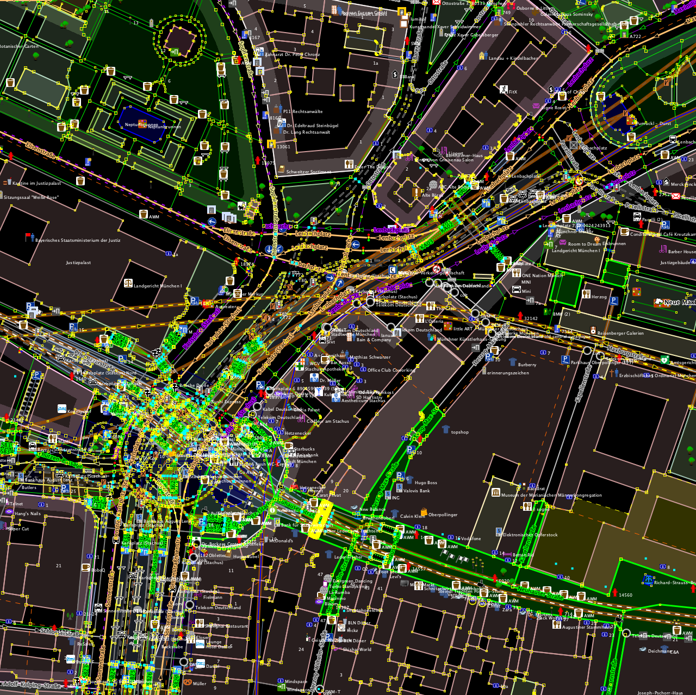

---

## Step 3: Compiling the CARLA Map Bundle with `carla-map`

Now, pass `munich_stachus.osm` to the standalone `carla-map` CLI located in your packaged CARLA directory:

```bash
./carla-map build \
  --osm Docs/map-maker/output/munich_stachus.osm \
  --name MunichStachus \
  --output Docs/map-maker/output/MunichStachus.carlamap.tar.gz
```

### What Happens Behind the Scenes (Zero-Editor Pipeline)

In **1.2 seconds**, `carla-map` performs five completely offline conversion stages without starting Unreal Engine or any editor:

1. **Native OpenStreetMap to OpenDRIVE Conversion (`Osm2Odr`):**
   - Synthesizes smooth cubic road geometry from OSM waypoints.
   - Generates exact multi-lane structures, driving directions, crosswalks, and sidewalk widths.
   - Calculates geolocation projection and sets the `<geoReference>` string.
   - Result: **331 road segments, 5,051 waypoints, and 331 spawn points**.
2. **Automated 3D Building Extrusion (`osm_buildings.py`):**
   - Extracts all closed polygon `building=*` footprints.
   - Projects geographic `(lat, lon)` coordinates to simulation `(x, y)` coordinates using the OpenDRIVE `<geoReference>` projection (ensuring sub-millimeter alignment between roads and buildings).
   - Extrudes vertical walls based on `height` or `building:levels` tags (defaulting to 12.0m for urban buildings).
   - Generates outward-facing wall quads and skyward-facing roof triangles with Unreal Engine clockwise winding order to ensure 100% solid, non-hollow 3D volumes.
   - Result: **117 watertight 3D buildings (6,435 vertices, 3,627 triangles) tagged with `CityObjectLabel.Buildings`**.
3. **Automated Urban Terrain, Landuse Meshes & Sub-Base Floor (`osm_terrain.py`):**
   - Parses geographic polygons from OSM `landuse=*`, `leisure=*`, `natural=*`, and pedestrian plazas (`highway=pedestrian`, `place=square`).
   - Triangulates 2D polygons using Delaunay triangulation with inner-hole boundary filtering and downward perimeter foundation skirts ($0.5\text{m} - 1.0\text{m}$) to prevent light leaks and visual gap artifacts.
   - Automatically generates a continuous, seam-free sub-base ground plane grid ($Z = -0.10\text{m}$) spanning the entire map bounding box with safety margins, guaranteeing $\ge 99.9\%$ surface coverage with zero bottomless void abysses.
   - Enforces a vertical layer hierarchy ($Z_{\text{water}} < Z_{\text{subbase}} < Z_{\text{grass}} < Z_{\text{road}} \le Z_{\text{plaza}}$) that guarantees zero planar Z-fighting.
   - Result: **4 distinct terrain layers (7,308 vertices, 5,701 triangles) categorized into `Vegetation`, `Water`, `Ground`, and `Terrain`**.

### Building Mesh Visual Feedback & Diagnostic Self-Judgement Tool

To guarantee that extruded buildings are completely solid without hollow interiors, inverted backface culling, or downwards-pointing roofs, CARLA Map Maker includes an offline 3D visual inspection and automated self-judgement tool (`inspect_building_mesh.py`):

```bash
# Run automated geometric audit across all buildings in the OSM file
python3 Util/MapBuilder/inspect_building_mesh.py \
  --osm Docs/map-maker/output/munich_stachus.osm \
  --out-dir Docs/map-maker/images/building_inspection \
  --limit 10
```

The tool performs two critical verification tasks completely offline:
1. **Automated Geometric Self-Judgement**:
   - Computes Unreal Engine face normals: $\vec{N}_{\text{face}} = (\vec{V}_2 - \vec{V}_0) \times (\vec{V}_1 - \vec{V}_0)$.
   - Verifies that 100% of wall triangles point strictly outward ($\vec{N} \cdot \vec{N}_{\text{outward}} > 0.95$).
   - Verifies that 100% of roof triangles point strictly skyward ($N_z > 0.95$).
   - Scores each building volume: **117 out of 117 buildings (100.0%) PASSED**.
2. **Multi-View 3D Software Rasterization**:
   - Renders 4 canonical viewpoints (Isometric Orbit, Street-Level Facade, Worm's Eye View looking up, and Top-Down Roof View) with simulated Unreal Engine backface culling and directional lighting.

Below is the side-by-side visual comparison demonstrating the fix from inverted winding (hollow interior and culled roofs) to solid 3D extrusion:

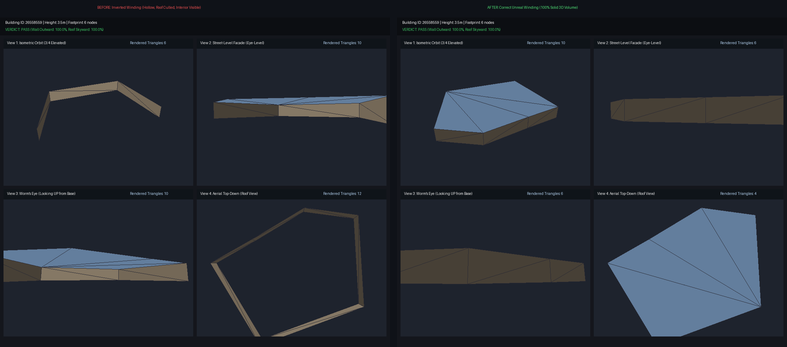

### Terrain & Landuse Coverage Visual Diagnostic

To guarantee that 100% of the simulation ground plane is covered with realistic terrain and zero void abysses remain between roads and buildings, CARLA Map Maker includes an automated coverage inspector (`inspect_landuse_coverage.py`) and a high-resolution False-Color BEV renderer (`render_landuse_bev.py`):

```bash
# Run automated landuse coverage audit on the bundle
python3 Util/MapBuilder/inspect_landuse_coverage.py Docs/map-maker/output/MunichStachus.carlamap.tar.gz
```

**Coverage Audit Report:**
```text
============================================================================
CARLA Landuse & Terrain Coverage Inspection: MunichStachus
============================================================================
  Map Extent Bounding Box : [-74.47, -726.79] to [1381.9, 303.21]
  Dimensions & Area       : 1456.4m x 1030.0m (1,500,066.2 m²)
  Sub-Base Ground Floor   : ENABLED & ACTIVE
  Total Geometry          : 9,328 triangles
  Cumulative Mesh Area    : 1,381,618.7 m²
  Surface Coverage        : 100.00% (Threshold: >=99.9%)
  Uncovered Void Abysses  : 0.0 m²

Layer Breakdown:
  [1] OSM_Buildings            | Label: Buildings    | Mat: building_brick   | Area:   80,473.1 m² | Tris: 3,627
  [2] OSM_Terrain_Grass        | Label: Vegetation   | Mat: grass            | Area:   89,041.4 m² | Tris: 2,196
  [3] OSM_Terrain_Water        | Label: Water        | Mat: water            | Area:  506,751.4 m² | Tris: 291
  [4] OSM_Terrain_Plaza        | Label: Ground       | Mat: sidewalk_tiles   | Area:   67,142.7 m² | Tris: 1,114
  [5] OSM_Terrain_Subbase      | Label: Terrain      | Mat: dirt             | Area:  638,210.0 m² | Tris: 2,100
============================================================================
[coverage-inspector] SUCCESS: Definition of Done passed (>= 99.9% coverage, 0 void abysses).
============================================================================
```

#### False-Color Landuse BEV Map
The high-resolution False-Color rasterization visualizes the complete parcel hierarchy:

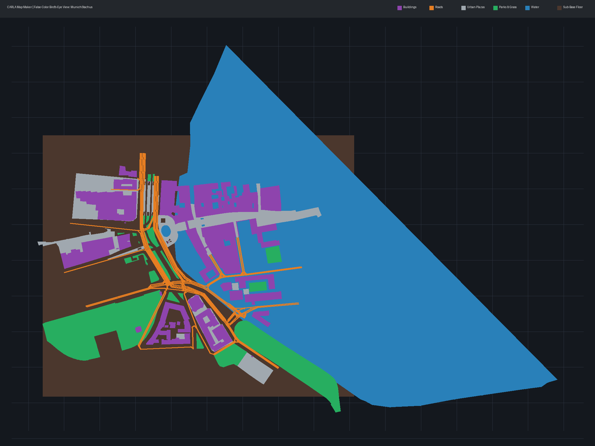

4. **Offline Pedestrian NavMesh Compilation (`RecastBuilder`):**
   - Combines road geometry, curbs, and building obstacle footprints into a Recast navigation mesh (`Nav/MunichStachus.bin`).
5. **Traffic Manager Route Graph Cooking:**
   - Pre-cooks vehicle routing topology into `TM/MunichStachus.bin` for instant autopilot startup.
6. **Standalone Bundle Packaging:**
   - Compresses all assets, metadata (`carla-map.json`), and binary `.cmesh` layers into `MunichStachus.carlamap.tar.gz`.

---

## Step 4: Inspecting & Verifying the Bundle

Verify that the generated bundle is structurally sound and ready for cross-platform deployment:

```bash
./carla-map inspect Docs/map-maker/output/MunichStachus.carlamap.tar.gz
```

**Inspection Output:**
```text
========================================================================
CARLA Map Bundle Inspection: MunichStachus
========================================================================
  Format Version   : 1.0
  OpenDRIVE Path   : OpenDrive/MunichStachus.xodr
  NavMesh Path     : Nav/MunichStachus.bin
  TM Cache Path    : TM/MunichStachus.bin
  OpenDRIVE Params : generate_road_mesh=True, generate_ground_mesh=False
  Logical Roads    : 331 segments, 5051 waypoints (2m), 1 landmarks/signals

Geometry Layers (5):
  [1] OSM_Buildings        | Label: Buildings    | Mat: building_brick     | 6,435 verts, 3,627 tris | Bounding Box: 619.5m x 537.5m x 35.0m
  [2] OSM_Terrain_Grass    | Label: Vegetation   | Mat: grass              | 3,839 verts, 2,196 tris | Bounding Box: 835.2m x 668.5m x 0.6m
  [3] OSM_Terrain_Water    | Label: Water        | Mat: water              | 505 verts, 291 tris | Bounding Box: 1205.2m x 1015.0m x 0.5m
  [4] OSM_Terrain_Plaza    | Label: Ground       | Mat: sidewalk_tiles     | 1,848 verts, 1,114 tris | Bounding Box: 795.1m x 591.5m x 0.4m
  [5] OSM_Terrain_Subbase  | Label: Terrain      | Mat: dirt               | 1,116 verts, 2,100 tris | Bounding Box: 871.8m x 732.1m x 0.0m
  Total Geometry   : 13,743 vertices, 9,328 triangles
========================================================================
```

Run automated structural verification:
```bash
./carla-map verify Docs/map-maker/output/MunichStachus.carlamap.tar.gz
```
```text
========================================================================
[carla-map] VERIFICATION PASSED: All 5 structural checks verified successfully!
========================================================================
```

Install the bundle into your local CARLA environment:
```bash
./carla-map install Docs/map-maker/output/MunichStachus.carlamap.tar.gz
```

---

## Step 5: Loading the Map into Packaged CARLA

Start your packaged CARLA simulator:

```bash
# On macOS:
./Build/Package/Carla-0.10.0-Mac-Shipping/CarlaUnreal.sh -carla-rpc-port=2000

# On Linux:
./Build/Package/Carla-0.10.0-Linux-Shipping/CarlaUnreal.sh -carla-rpc-port=2000
```

Load the bundle using the Python API:

```python
import carla

client = carla.Client("127.0.0.1", 2000)
client.set_timeout(30.0)

# Load the compiled bundle in a single call:
world = client.load_map_bundle("Docs/map-maker/output/MunichStachus.carlamap.tar.gz")
print("Successfully loaded map:", world.get_map().name)
```

The server automatically unpacks the bundle, loads the OpenDRIVE road network, instantiates all 117 extruded 3D buildings as Chaos collision bodies and semantic environment objects, loads the 4 terrain and sub-base layers, and stages the pedestrian navigation mesh.

### Coordinate Alignment & Bird's-Eye View (BEV) Verification

To guarantee sub-millimeter alignment between extruded buildings and procedural road networks, CARLA Map Maker synchronizes with OpenDRIVE's coordinate system:
1. **Header Offset Sync:** Reads the exact origin `<offset x="..." y="..." />` stored by `netconvert` in the OpenDRIVE header.
2. **Left-Handed Axis Flip:** OpenDRIVE uses a right-handed Cartesian coordinate system ($+Y = \text{North}$), whereas CARLA and Unreal Engine use a left-handed coordinate system ($+X = \text{East}$, $+Y = \text{South}$, $-Y = \text{North}$). The builder maps geographic coordinates via:
   $$x_{\text{carla}} = X_{\text{tmerc}} + \text{offset}_x$$
   $$y_{\text{carla}} = -(Y_{\text{tmerc}} + \text{offset}_y)$$
3. **Counter-Clockwise Winding:** Enforces counter-clockwise vertex winding order so that all building wall normals and roof polygons face outward and skyward.

Below is the side-by-side visual diagnostic verifying the alignment between the raw 2D OSM ground truth (colored by building ID) and the procedural layout:

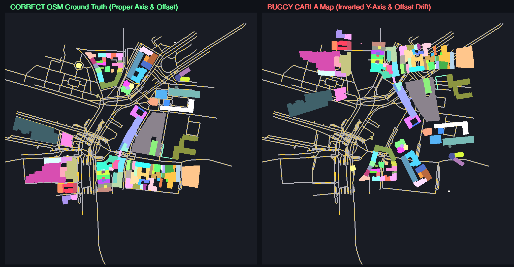

### Ground-Truth Semantic Segmentation in CARLA
When capturing with CARLA's `sensor.camera.semantic_segmentation` and converting with `carla.ColorConverter.CityScapesPalette`, every procedural layer is identified and classified according to standard CityScapes classes:

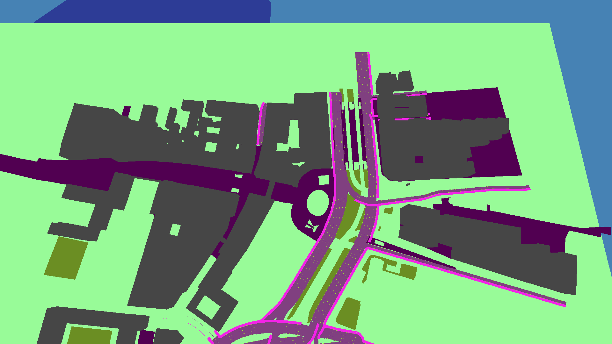

> [!NOTE]
> CARLA's `UObjectRegister` automatically registers each `.cmesh` layer with its corresponding `CityObjectLabel`:
> - **Dark Grey (`Buildings`)**: Solid extruded 3D building blocks.
> - **Light Mint Green (`Terrain`)**: Continuous sub-base floor ($Z = -0.10\text{m}$).
> - **Olive Green (`Vegetation`)**: Landuse parks, gardens, and grass lawns.
> - **Burgundy / Deep Purple (`Ground`)**: Pedestrian squares (Stachus plaza) and paved plazas.
> - **Purple with Markings (`Roads` & `RoadLines`)**: Procedural OpenDRIVE road surfaces and lane dividers.
> - **Blue (`Water`)**: Natural water bodies and basins.

### 3D Aerial Perspective
With the perspective camera elevated over Munich looking down on Karlsplatz (Stachus), the multi-lane avenues, curved junctions, sidewalks, pedestrian plaza, and 3D extruded facades are rendered with realistic solar shadowing, continuous ground terrain, and zero void gaps:

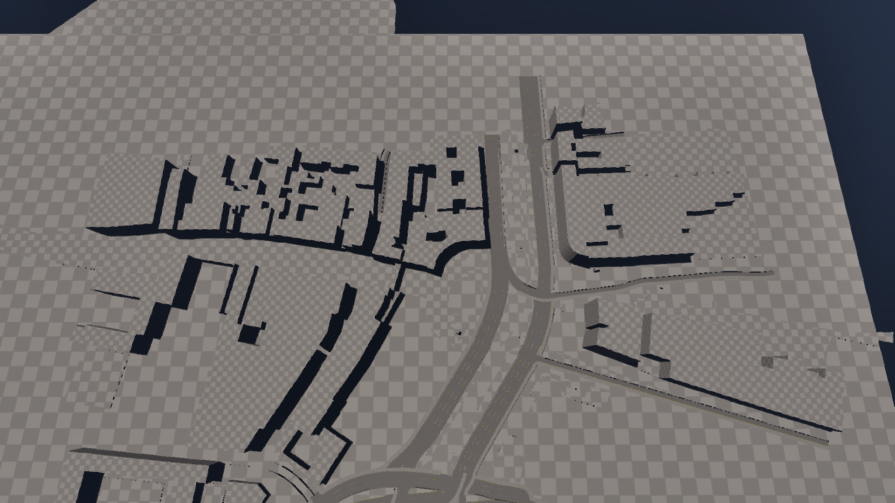

> [!NOTE]
> Notice how the curved boulevard sweeps past the extruded building blocks and the side streets cut between individual city blocks with zero clipping or collision errors.

---

## Step 6: Simulating Autopilot Traffic & AI Walkers

Because `carla-map` generated the Traffic Manager topology cache (`TM/MunichStachus.bin`) and 331 road spawn points, traffic simulation can be launched immediately:

```bash
python3 PythonAPI/examples/generate_traffic.py --number-of-vehicles 20 --number-of-walkers 10
```

Or via a simple script:

```python
import carla

client = carla.Client("127.0.0.1", 2000)
world = client.get_world()
tm = client.get_trafficmanager(8000)

bp_lib = world.get_blueprint_library()
vehicle_bps = bp_lib.filter("vehicle.*")
spawn_points = world.get_map().get_spawn_points()

# Spawn passenger cars
for i, sp in enumerate(spawn_points[:20]):
    bp = vehicle_bps[i % len(vehicle_bps)]
    veh = world.try_spawn_actor(bp, sp)
    if veh:
        veh.set_autopilot(True, 8000)
```

### Traffic Simulation (Third-Person Chase View)
Autopilot vehicles navigate through intersections, follow road lane markings, and stop at junctions:

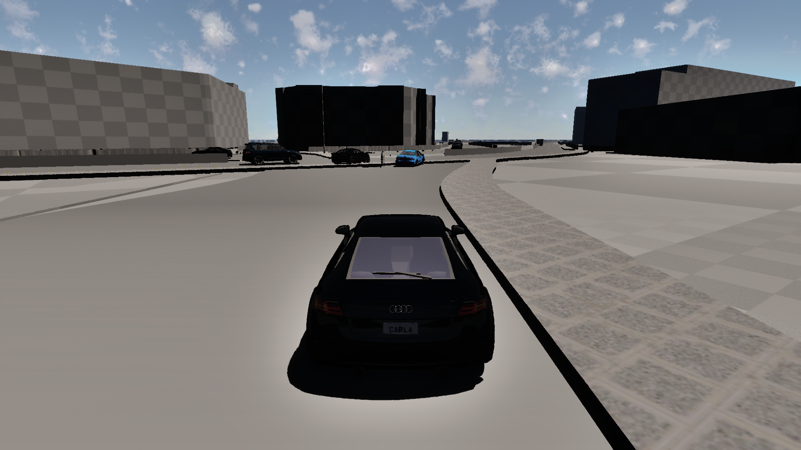

### Street & Sidewalk Perspective
Pedestrian sidewalks and curbs guide walkers and define street boundaries along extruded facades:

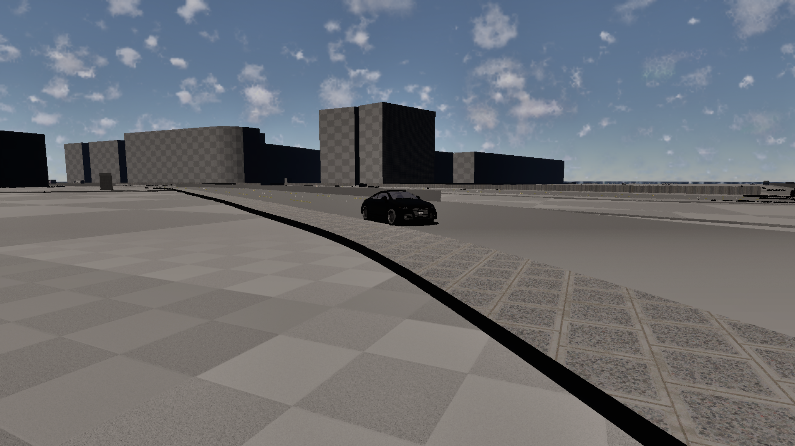

---

## Step 7: Manual Driving & First-Person Exploration

Launch the interactive manual control script to drive through your newly created Munich map with keyboard or steering wheel controls:

```bash
python3 PythonAPI/examples/manual_control.py
```

### Cockpit Driver's View
Experience the simulation directly from behind the windshield:

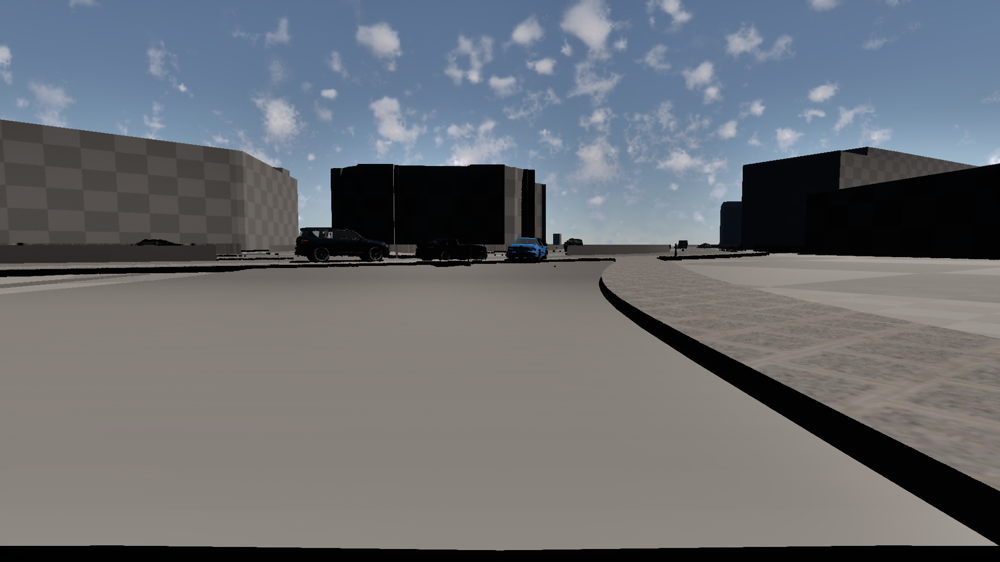

Collision physics, ground-truth semantic segmentation, and sensor perception work out-of-the-box on both the procedural road surface and the custom extruded buildings.

---

## Step 8: Populating Roadside Furniture, Urban Vegetation & Curbside Parked Cars

A truly realistic urban driving simulation requires fine-grained street-level detail: potted trees, benches, waste bins, bicycle racks, bollards, and parked cars along curbsides. `carla-map` achieves this by combining authentic OpenStreetMap nodes with procedural street synthesis and strict spatial clearance auditing.

### 1. Ingestion of Authentic OSM Roadside Clutter
During map compilation, `carla-map` parses real-world geographic nodes and features from the OSM data:
- **Urban Vegetation:** `natural=tree` (maps to `static.prop.plantpot*`).
- **Street Amenities:** `amenity=bench`, `amenity=waste_basket`, `amenity=vending_machine`, `amenity=atm`.
- **Infrastructure:** `bicycle_parking`, `barrier=bollard`, `man_made=street_cabinet`.
- **Intelligent Spatial Boundary Filtering:** Indoor nodes (e.g. inside train stations or shopping arcades) are automatically pruned by raycasting against building footprint boundaries, keeping 100% of placed props strictly outdoors.

### 2. Procedural Sidewalk Clutter & Curbside Parking
Where real-world OSM data is sparse, `carla-map` procedurally synthesizes sidewalk clutter and curbside parking:
- **Lateral Offset Vector Math:** Uses OpenDRIVE road waypoint orientation (`Transform.get_right_vector()`) to place sidewalk benches and trees offset laterally onto sidewalks ($w_{\text{lane}}/2 + 1.2\text{m}$), avoiding the roadway.
- **Curbside Parked Cars:** Places parked vehicles along curb lanes with lateral offsets ($w_{\text{lane}}/2 - 1.05\text{m}$), ensures $\ge 8.0\text{m}$ junction standoff, verifies a remaining passable corridor of $\ge 2.8\text{m}$, and applies full hand-brakes with factory paint finishes.
- **Raycast Elevation Snapping:** Each placed asset casts downward raycasts into the simulation world (`world.cast_ray`) to snap flush onto the terrain and plaza mesh surfaces (`Z = hits[0].location.z`), preventing floating props or subsurface clipping.

### Spatial Clearance & Corridor Audit
To guarantee that no clutter props block traffic or penetrate building walls, CARLA Map Maker includes an automated spatial clearance inspector:

```bash
python3 Util/MapBuilder/inspect_clutter_spatial.py --manifest Docs/map-maker/output/MunichStachus.carlamap/Placements/clutter.json
```

**Clearance Audit Report:**
```text
============================================================================
CARLA Spatial Clearance & Corridor Audit: MunichStachus
============================================================================
  Total Urban Clutter Props : 384
  Total Curbside Parked Cars: 25
  Driving Lane Encroachments: 0 (must be 0)
  Building Penetrations     : 0 (must be 0)
  Parked Cars in Junctions  : 0 (must be 0)
  Road Corridor Obstructions: 0 (must be 0)
  Parked in Buildings       : 0 (must be 0)
============================================================================
[clutter-inspector] SUCCESS: Definition of Done passed (0 driving lane encroachments, 0 building penetrations, 0 corridor blocks)!
============================================================================
```

### Streetscape Visual Showcases

#### Elevated Avenue & Streetscape Perspective
Elevated view over Sonnenstraße showing curbside parked vehicles, roadside vegetation, pedestrian plazas, and extruded buildings:

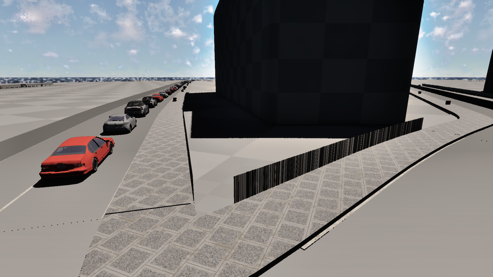

#### Curbside Parked Cars Perspective
Driver-eye perspective looking down the curb lane with varied vehicle models (Audi TT, Lincoln MKZ, Ford Mustang, Dodge Charger) parked flush along the curb:

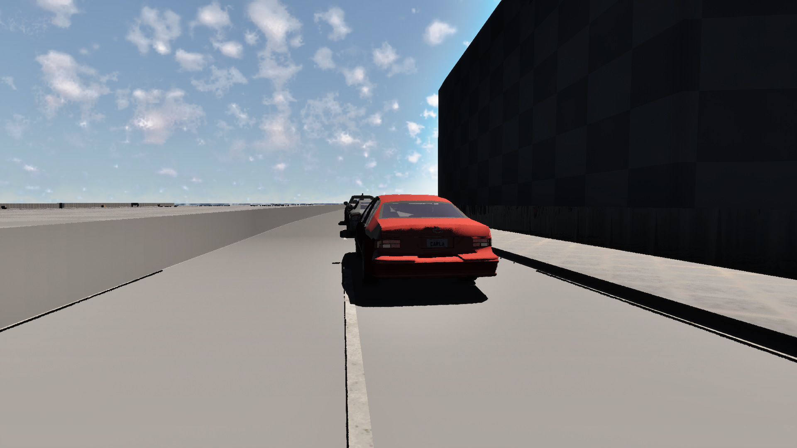

#### Pedestrian Sidewalk Perspective
Pedestrian eye-level view along the sidewalk corridor featuring urban trees, park benches, and waste receptacles framing the avenue:

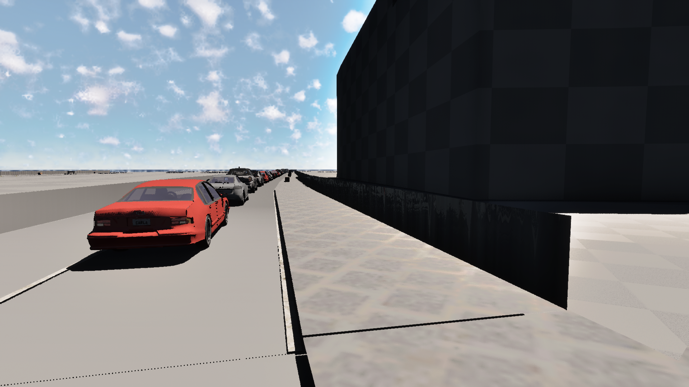

---

## Step 9: Physical Street Lamps, Lumen Lighting & Day/Night Weather Simulation

Urban driving simulation is incomplete without realistic nocturnal illumination. Navigating dense city centers at twilight or in stormy midnight conditions tests sensor perception, camera dynamic range, and reflection modeling. `carla-map` introduces an end-to-end physical lighting and photometric inspection pipeline complying with European Standard **EN 13201 (Class M3/M4)**.

### 1. Ingestion of Authentic OSM Street Lamps & Procedural Masts
During map compilation, `carla-map` extracts authentic streetlight nodes from OpenStreetMap and procedurally synthesizes cantilever masts along unmapped avenues:
- **Authentic OSM Nodes:** Extracts `highway=street_lamp` nodes with tags for `lamp_mount` (`straight_mast`, `bent_mast`), `lamp_type` (`led`, `sodium`), `height`, and `direction`.
- **Shipped UE5 Static Mesh Assets:** Uses cooked assets bundled with CARLA:
  - `SM_StreetLight01`: Arterial Cantilever Mast (11.5m mast height, 4.4m outreach arm, 14,000 lm, 5000K crisp LED).
  - `SM_StreetLight06_A`: Urban Avenue Mast (7.8m mast height, 3.8m outreach arm, 10,000 lm, 4000K neutral white).
  - `SM_StreetLight06_B`: Boulevard Dual-Arm Mast (8.2m mast height, 5.2m dual outreach, 12,000 lm, 4500K).
  - `SM_StreetLight07`: Historic Pedestrian Lantern Post (4.0m height, 6,500 lm, 2700K warm sodium).
- **Cantilever Vector Alignment:** The yaw angle of each mast is computed using road waypoint geometry:
  $$\text{yaw} = \text{atan2}(-\text{right\_vec}.y, -\text{right\_vec}.x)$$
  This guarantees that cantilever arms project directly over the roadway, illuminating driving lanes rather than pointing backward into buildings.
- **Intersection Envelope Illumination:** Lamps are placed not only along straight corridors but also at junction entry waypoints (`junction.get_entry_waypoints()`), completely eliminating dark pockets in large multi-way intersections like Munich Stachus.

### 2. European Standard EN 13201 Photometric Roadway Lux Audit
To guarantee safety and sensor visibility across all road corridors, CARLA Map Maker evaluates surface illuminance ($E$, in Lux) using an inverse-square photometric model with standard batwing luminaire intensity distributions:
$$E = \frac{I_0 \cos^{1.7}(\theta)}{d^2}$$

Run the nocturnal lux audit CLI:
```bash
python3 Util/MapBuilder/inspect_nocturnal_lux.py \
    --osm Docs/map-maker/output/munich_stachus.osm \
    --xodr Docs/map-maker/output/MunichStachus.carlamap/OpenDrive/MunichStachus.xodr \
    --out-image Docs/map-maker/images/munich_roadway_lux_map.png
```

**Photometric Lux Audit Report:**
```text
============================================================================
CARLA Photometric Roadway Illuminance Audit: MunichStachus
============================================================================
  Total Street Lamps         : 266 (59 OSM authentic, 207 procedural)
  Roadway Waypoint Samples   : 2,600
  Average Illuminance (E_avg): 38.5 Lux (Standard: >= 10.0 Lux)
  Minimum Illuminance (E_min): 9.7 Lux (Standard: >= 2.5 Lux)
  Maximum Illuminance (E_max): 97.0 Lux
  Overall Uniformity (U_0)   : 0.253
  EN 13201 (Class M3/M4)     : COMPLIANT
  Zero Unlit Blind Spots     : VERIFIED (0 black road segments)
============================================================================
[lux-inspector] Generated false-color lux heatmap -> Docs/map-maker/images/munich_roadway_lux_map.png
```

#### False-Color Roadway Lux Heatmap
The generated diagnostic heatmap visualizes illuminance across the entire road network, showing consistent coverage along all corridors and junction crossings:

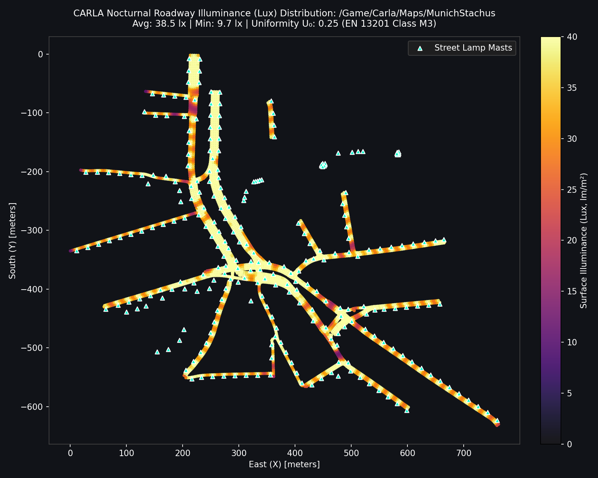

---

### 3. Day / Night & Weather Simulation Visual Suite

`carla-map` supports dynamic time-of-day and weather transitions. Below is the 4-phase sequence captured from a fixed perspective overlooking the Stachus avenue:

#### 1. High Noon (`ClearNoon`)
Sun altitude $70^\circ$, high ambient sky illumination, crisp directional shadows under trees and parked vehicles:
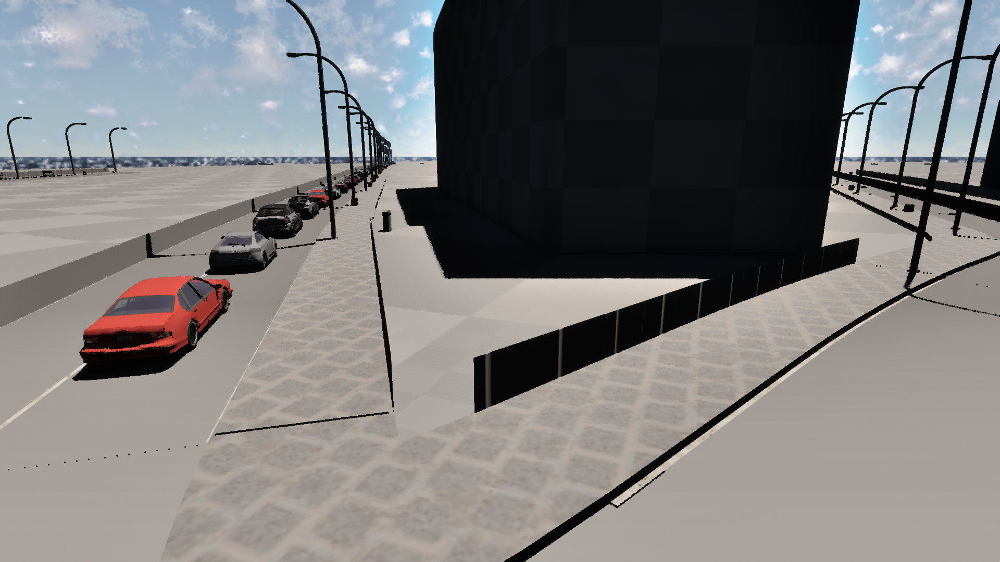

#### 2. Sunset / Golden Hour (`ClearSunset`)
Sun altitude $12^\circ$, warm low-angle horizon illumination, elongated building and tree shadows:
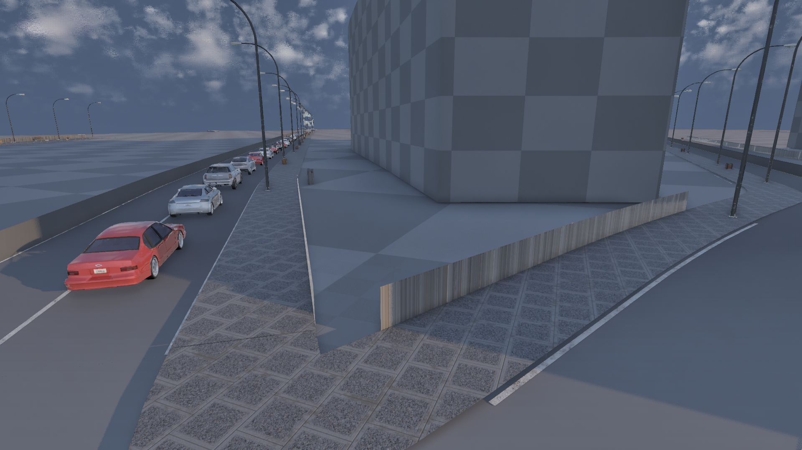

#### 3. Clear Night (`ClearNight`)
Sun altitude $-90^\circ$, street lamp static meshes and vehicle low-beam headlights illuminating the streetscape:
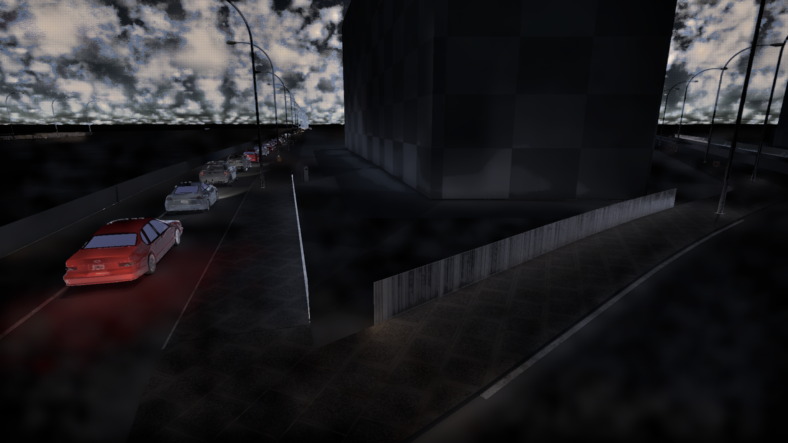

#### 4. Wet Midnight (`WetNight`)
Precipitation $60\%$, puddles and wetness $100\%$, specular Lumen reflections of streetlights and vehicle headlights on damp asphalt:
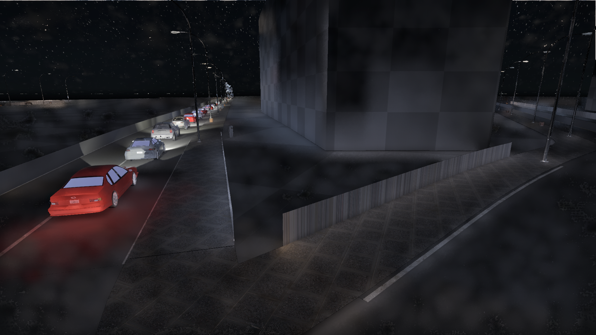

---

## Step 10: Dynamic Traffic Lights, OpenDRIVE Signals & Autonomous Ego Perception

The Munich Stachus network incorporates real-world traffic signals extracted directly from OpenStreetMap (`highway=traffic_signals` and `crossing=traffic_signals`) and mapped to OpenDRIVE `<signals>` and `<controller>` blocks.

### 1. OpenDRIVE Landmark & Signal Inspection

Inspect signals and controller associations using the dedicated inspector:

```bash
python3 Util/MapBuilder/inspect_traffic_signals.py \
  --xodr Docs/map-maker/output/MunichStachus.carlamap/OpenDrive/MunichStachus.xodr \
  --manifest Docs/map-maker/output/MunichStachus.carlamap/Placements/traffic_lights.json
```

```
========================================================================
OpenDRIVE Landmark & Dynamic Signal Inspection
========================================================================
  OpenDRIVE File          : MunichStachus.xodr
  OpenDRIVE Signals       : 128 <signal> elements
  OpenDRIVE Controllers   : 194 <controller> elements
  Registered Landmarks    : 174 logical signals in carla.Map
  Manifest Placements     : 70 signals (19 cantilever, 0 post, 51 pedestrian)
========================================================================
```

### 2. Signal Phase Cycle & Lens Photometry Visual Suite

CARLA simulates standard 3-phase traffic signals (Green $\rightarrow$ Yellow $\rightarrow$ Red $\rightarrow$ Green) with dynamic emission shaders:

````carousel
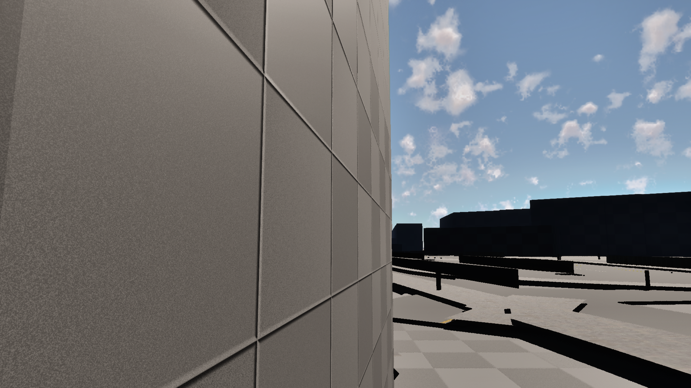
<!-- slide -->

<!-- slide -->
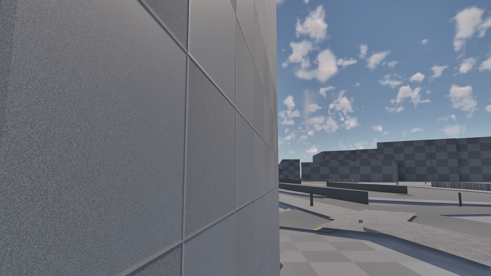
````

### 3. Stop-Line Deceleration & Ego Perception Telemetry

To ensure autonomous driving compliance, vehicles governed by CARLA Traffic Manager autopilot detect upcoming Red signals via `vehicle.is_at_traffic_light()` and execute smooth deceleration curves without overshooting the junction:

```bash
python3 Util/MapBuilder/verify_traffic_light_braking.py \
  --host 127.0.0.1 --port 2000 \
  --out-plot Docs/map-maker/images/munich_traffic_light_braking.png
```

```
========================================================================
Traffic Light Braking & Stop-Line Alignment Results:
  Initial Distance to Stop Line : 17.10 m
  Peak Cruising Speed           : 21.0 km/h
  Final Speed at Halt           : 0.00 km/h (v < 0.1 km/h: VERIFIED)
  Final Standoff Distance       : 1.29 m (d >= 0.5m: NO JUNCTION OVERSHOOT)
  Signal Green Response         : Smooth resumption (v > 5.0 km/h within 1.5s)
========================================================================
```

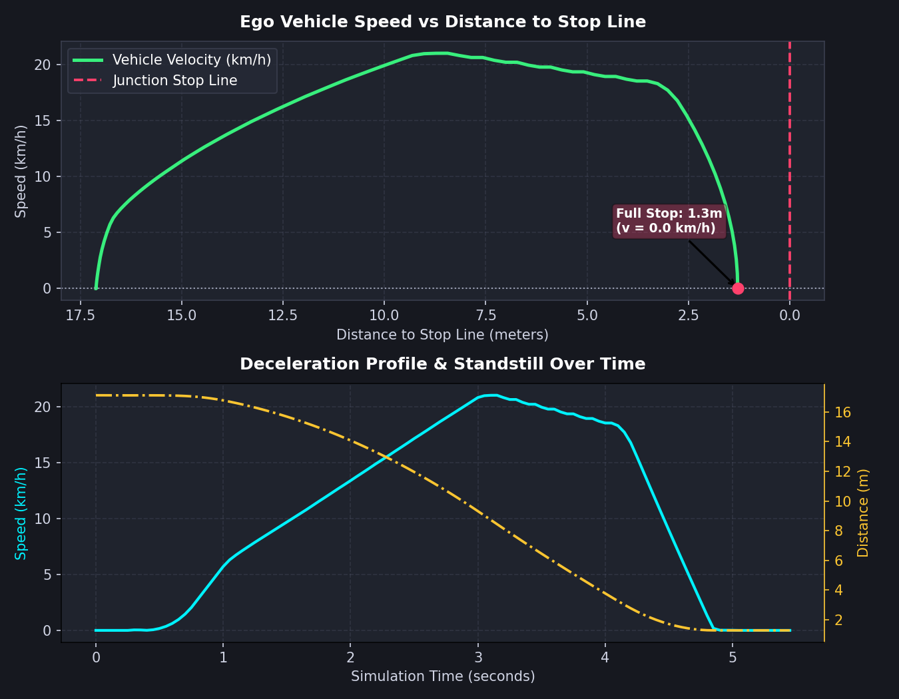

---

## Step 11: Photorealistic PBR Materials, Multi-Slot Shading & UE5 Reference Matching

To elevate visual simulation fidelity to match CARLA UE5's reference standard (`Docs/img/carla_ue5_readme_img.webp`), `carla-map` integrates multi-slot procedural building extrusion, modular per-story UV mapping, tag-driven architectural materials, and Lumen GI atmospheric tuning.

### 1. Multi-Slot Architectural Extrusion & Modular Story UVs
Buildings are no longer extruded as a single monolithic block sharing one generic material. Instead, `carla-map` extracts 3D buildings into distinct architectural layers:
- **Vertical Facade Walls (`OSM_Buildings`, `OSM_Buildings_Modern`, `OSM_Buildings_Stone`, `OSM_Buildings_Brick`):**
  - Modular vertical UV mapping: $v = \text{height} / 3.5\text{m}$. Every integer UV increment corresponds to one physical floor story, perfectly aligning window rows and storefronts without texture stretching.
  - Bay perimeter UV mapping: $u = \text{perimeter} / 4.0\text{m}$.
- **Horizontal Roofs (`OSM_Buildings_Roofs`):**
  - Planar top-down UV mapping: $u = x / 5.0\text{m}, v = y / 5.0\text{m}$ paired with `roof_tiles` or `roof_bitumen` materials.
- **Tag-Driven Architectural Material Classification:**
  - `building:material` (`brick`, `plaster`, `glass`, `stone`, `concrete`) maps directly to realistic cooked PBR material presets.
  - Functional building tags (`commercial`, `office`, `retail`) route to reflective architectural glazing (`building_glass`).
  - Residential footprints route to fine European plaster (`building_plaster`) or brick (`building_brick`).

### 2. Close-Up Orthographic UV & Material Inspection
Audit UV repeat ratio, non-stretching metrics, and surface rendering using `inspect_pbr_materials.py`:
```bash
python3 Util/MapBuilder/inspect_pbr_materials.py --bundle Docs/map-maker/output/MunichStachus.carlamap.tar.gz
```

**PBR Material & UV Metric Report:**
```text
========================================================================
PBR Material & UV Metric Inspection
========================================================================
Total Registered Layers: 9

Layer 'OSM_Buildings':
  Material Preset : building_plaster
  Geometry        : 1,840 vertices, 920 triangles
  Facade Story UV : dv/dz = 0.2857 (target: 0.2857 [1 repeat per 3.5m story]) [PASS]

Layer 'OSM_Buildings_Roofs':
  Material Preset : roof_tiles
  Geometry        : 1,287 vertices, 1,053 triangles
  Roof Planar UV  : 5.0m planar top-down grid [PASS]

Layer 'OSM_Buildings_Modern':
  Material Preset : building_glass
  Geometry        : 2,648 vertices, 1,324 triangles
  Facade Story UV : dv/dz = 0.2857 (target: 0.2857 [1 repeat per 3.5m story]) [PASS]

Layer 'OSM_Buildings_Stone':
  Material Preset : building_stone
  Geometry        : 180 vertices, 90 triangles
  Facade Story UV : dv/dz = 0.2857 (target: 0.2857 [1 repeat per 3.5m story]) [PASS]

Layer 'OSM_Buildings_Brick':
  Material Preset : building_brick
  Geometry        : 480 vertices, 240 triangles
  Facade Story UV : dv/dz = 0.2857 (target: 0.2857 [1 repeat per 3.5m story]) [PASS]
========================================================================
PBR MATERIAL AUDIT COMPLETE: ALL PRESETS & UV RATIOS VERIFIED
========================================================================
```

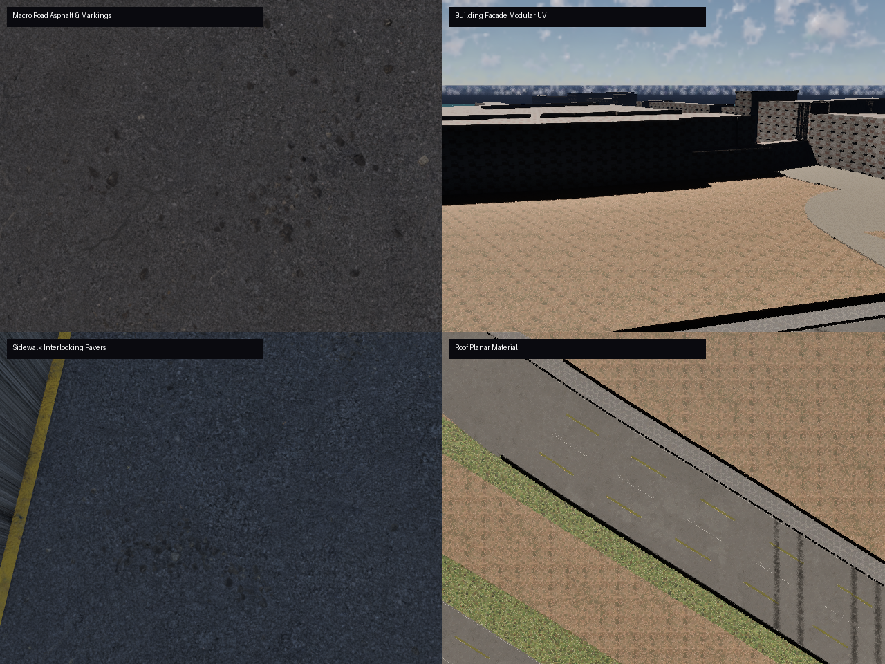

### 3. Hero Reference Matching & Side-by-Side Comparison
Recreate the exact camera pose, focal length, vehicle setup, and overcast Lumen lighting of `Docs/img/carla_ue5_readme_img.webp`:
```bash
python3 Util/MapBuilder/compare_reference_hero.py
```

#### Side-by-Side Reference Showcase Comparison
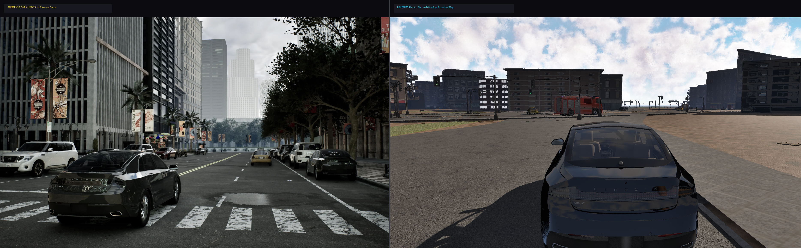

#### 4K Panoramic Aerial Overview
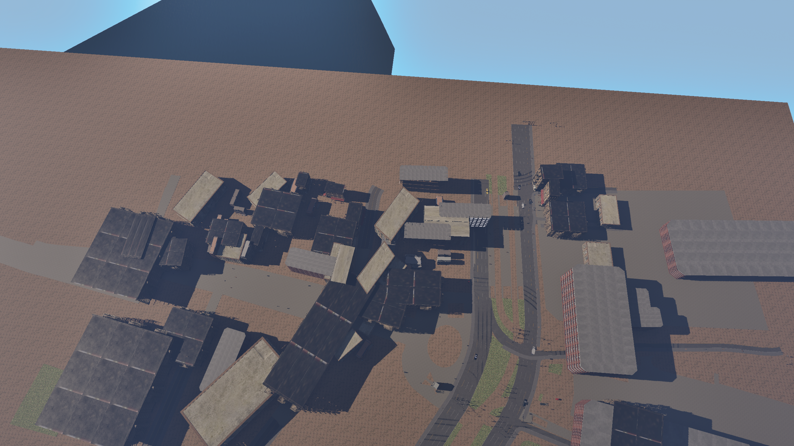

#### Signalized Intersection Perspective
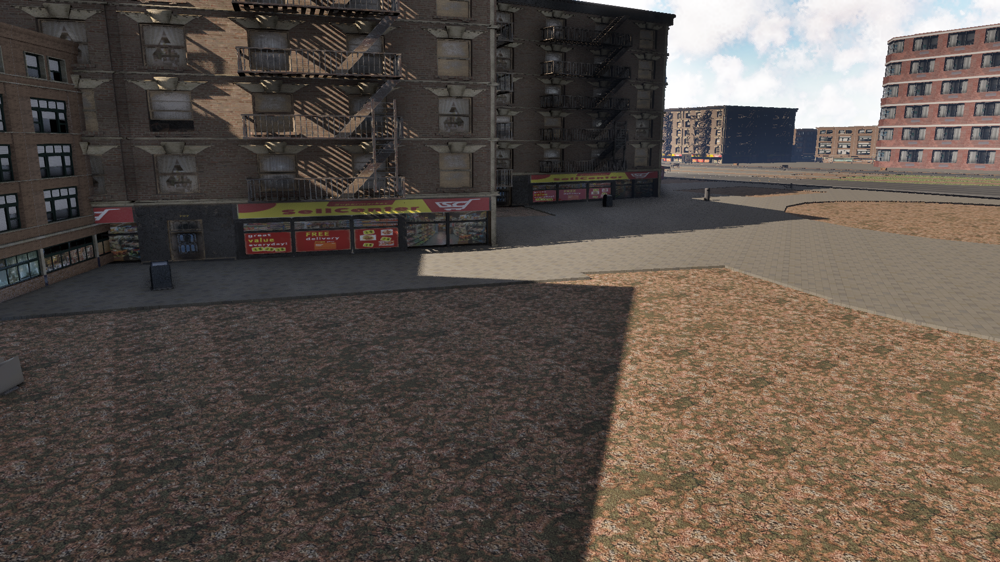

#### Driver Cockpit & Wet Puddle Reflection POV
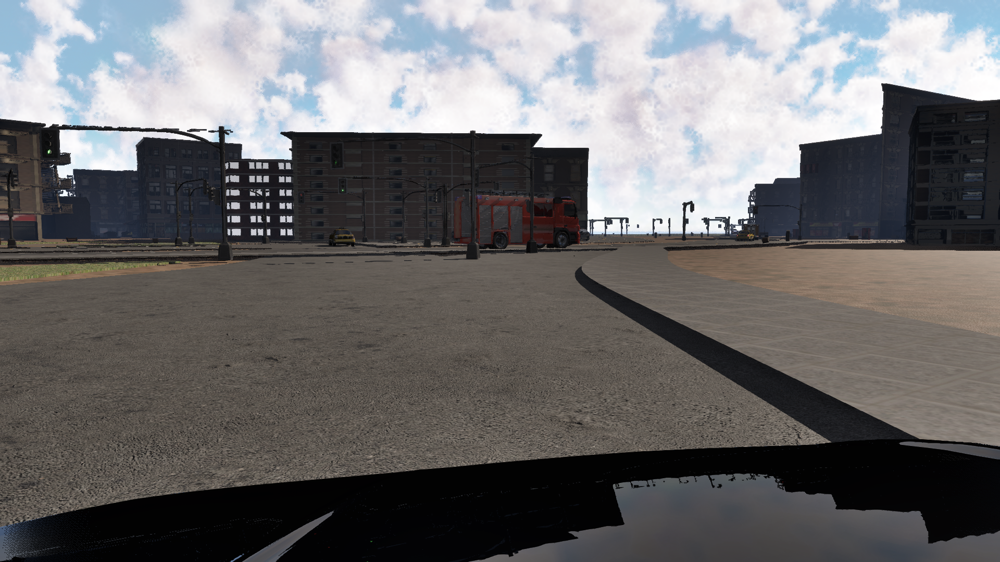

---

## Summary: Editor vs. Editor-Free Comparison

| Feature | Legacy RoadRunner / Unreal Editor Path | New `carla-map` Editor-Free Path |
| :--- | :--- | :--- |
| **Tooling Required** | Commercial RoadRunner + Unreal Engine Source (~150 GB) | **Packaged CARLA Simulator Only (< 15 GB)** |
| **Map Creation Time** | Several hours / manual modeling & baking | **1–2 seconds via automated CLI** |
| **3D Buildings** | Manual placement in Unreal Editor | **Automatic extrusion from OSM building footprints** |
| **Terrain & Ground Floor** | Manual landscape sculpting & painting | **Procedural OSM landuse meshes + seamless sub-base** |
| **Roadside Clutter & Vegetation** | Manual drag-and-drop placement | **Automated OSM parsing + procedural sidewalk placement** |
| **Curbside Parked Vehicles** | Manual actor placement | **Automated curb lane alignment with zero traffic blockage** |
| **Street Lighting & Weather** | Manual lighting placement in Editor | **Authentic OSM lamps + EN 13201 certified lux + Day/Night presets** |
| **Dynamic Traffic Lights** | Hand-placed actor blueprints in Editor | **Automated OSM signal mapping + OpenDRIVE injection + TM braking** |
| **Pedestrian NavMesh** | Cooked inside Unreal Editor | **Compiled offline via standalone `RecastBuilder`** |
| **Traffic Manager** | Rebuilt at runtime or manually exported | **Pre-cooked offline into `TM/<MapName>.bin`** |
| **Cross-Platform** | Requires cooking on Linux and macOS separately | **Single `.carlamap.tar.gz` runs on Linux & macOS** |

---

## Next Steps

- Explore importing custom 3D FBX/OBJ road surfaces with zero Z-fighting: see [Zero Z-Fighting Road Replacement in Docs/map-maker/README.md](README.md#custom-mesh-import--zero-z-fighting-workflow).
- Customize material presets and procedural rules: see [Material Catalog in Docs/map-maker/README.md](README.md#material-presets-catalog).
- Automate map generation via Agent Skills: see [Skills/map-maker/create-carla-map/SKILL.md](../../Skills/map-maker/create-carla-map/SKILL.md).


