# Towns available as content packs

The CARLA package ships Town10HD_Opt, Town15 and Mine_01. The towns below are kept in the CARLA content repository but are not cooked into the package: to use one, build a [content pack](content_packs.md) with it from a CARLA source checkout and install the pack into your package.

```sh
# on the source checkout that built the package
carla-pack create MyTowns Town03_Opt Town12

# on the machine running the CARLA package
carla-pack install MyTowns-1.0.0-<release>.tar.gz --server /opt/carla/Linux
```

Once installed, the towns load like any other map: `client.load_world('Town12')`. See [Existing CARLA towns](content_packs.md#a-existing-carla-towns) for the build options and [Installing a pack](content_packs.md#installing-a-pack) for mounting a pack from the Python API.

| Map name | Summary | |
| --- | --- | --- |
| `Town01_Opt` | A small town with numerous T-junctions and a variety of buildings, surrounded by coniferous trees, with several small bridges over a river that divides the town in two. | 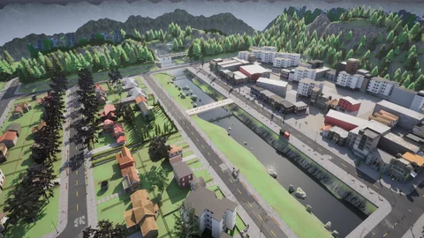 |
| `Town02_Opt` | A small town with numerous T-junctions, a variety of buildings, patches of coniferous trees, a park and a residential and commercial area. | 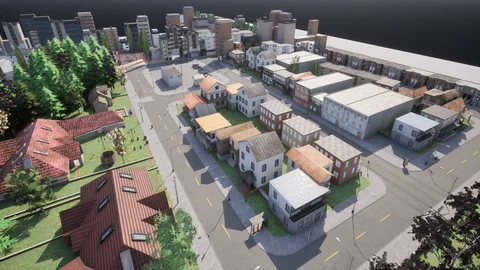 |
| `Town03_Opt` | A larger town with features of a downtown urban area: a central roundabout, underpasses and overpasses, a raised metro track and a large building under construction. | 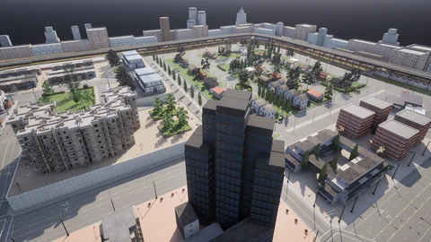 |
| `Town04_Opt` | A small town with a backdrop of snow-capped mountains and conifers, circled by a multi-lane "figure of 8" ring road with an underpass and overpass at its crossing. | 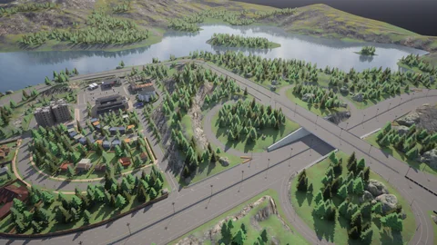 |
| `Town05_Opt` | An urban environment set among conifer-covered hills, with a raised highway and large multi-lane roads and junctions. | 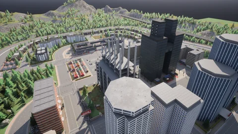 |
| `Town06_Opt` | A low-density town in a coniferous landscape, with long 4 to 6 lane roads and special junctions such as the Michigan left. | 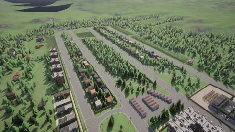 |
| `Town07_Opt` | A quiet rural community with cornfields, barns, grain silos and windmills, unmarked roads and a simple set of junctions. | 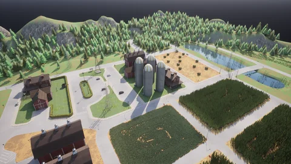 |
| `Town11` | A [World Partition](large_map_overview.md) map without decoration (no buildings, sidewalks or vegetation): sprawling single-lane roads with small clusters of gridded junctions over hilly, grass-textured terrain. | 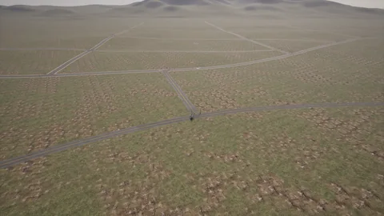 |
| `Town12` | A 10x10 km<sup>2</sup> [World Partition](large_map_overview.md) map partially inspired by Amarillo, Texas, with urban, residential and rural regions and a highway system with a ring road around the city. | 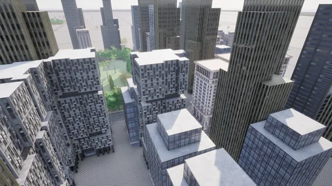 |
| `Town13` | A [World Partition](large_map_overview.md) map of about 13x10 km of roads, with urban, residential and rural regions and a ring road, designed as a train-test pair with Town12: same kind of layout, different building styles, textures and vegetation. | 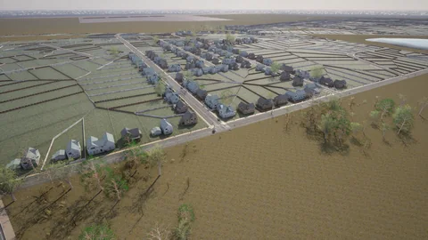 |
| `Town_C` | A city with high-rise blocks, a stadium and an industrial area of warehouses, on flat open land. | 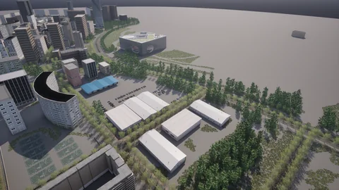 |
| `Eixample` | A [digital twin](adv_digital_twin.md) of the Eixample district of Barcelona, a World Partition map with the street grid of the district; the buildings are simple untextured volumes. | 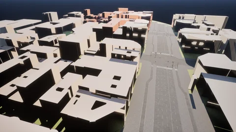 |

<div class="img-caption">One view per map from above its spawn points.</div>

!!! Note
    Two packs that ship the same town collide on a server. Put each town in one pack only.
