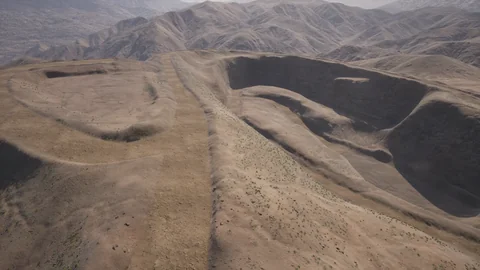

# Towns available as content packs

The CARLA package ships Town10HD_Opt, Town12 and Town15. The towns below are not cooked into the package; they come as a [content pack](content_authoring_packs.md), the __AdditionalMaps__ pack, which is built and published together with each release package.

## Installing AdditionalMaps

Download a package and the `AdditionalMaps` tarball built with it. The latest pair is under `https://downloads.carlasim.com/Linux/Dev/`: `CARLA_UE5_AdditionalMaps_Latest.tar.gz` (the package) and `CARLA_UE5_AdditionalMaps_Latest_AdditionalMaps.tar.gz` (the pack). The nightly `CARLA_UE5_Latest.tar.gz` is a different build and has no pack that installs into it. Install the pack with `carla-pack`. Installing only needs `Util/ContentPacks/carla_pack.py` from the CARLA repository (Python 3.8+, standard library only):

```sh
python3 carla_pack.py install CARLA_UE5_AdditionalMaps_Latest_AdditionalMaps.tar.gz --server /opt/carla/Linux
```

Once installed, the towns load like any other map: `client.load_world('Town13')`. The pack only installs into the package it was built with: a pack from another build is refused (`was built against base release ...`). See [Installing a pack](content_authoring_packs.md#installing-a-pack) for mounting a pack from the Python API.

## Building it yourself

For a package you built, or a package without a published pack, build the pack on the source checkout that built the package, right after the `package` target:

```sh
cmake --build Build --target package
cmake --build Build --target package-additional-maps
# -> Build/Package/AdditionalMaps-<version>-<release>.tar.gz
```

The maps come from `Util/ContentPacks/AdditionalMaps.json`. For another selection, point `CARLA_ADDITIONAL_MAPS_FILE` at your own list, a JSON list of map names or an object with a `maps` list:

```sh
echo '{"maps": ["Town03_Opt", "Town13"]}' > my_maps.json
cmake Build -DCARLA_ADDITIONAL_MAPS_FILE=$PWD/my_maps.json
cmake --build Build --target package-additional-maps
```

`package-additional-maps-dry-run` prints the cook command without running it. The same works without CMake: `carla-pack create MyTowns --maps-file my_maps.json` (or the map names as arguments). See [Existing CARLA towns](content_authoring_packs.md#a-existing-carla-towns) for the options.

## Towns in AdditionalMaps

| Map name | Summary | |
| --- | --- | --- |
| [`Town01_Opt`](map_town01.md) | A small town with numerous T-junctions and a variety of buildings, surrounded by coniferous trees, with several small bridges over a river that divides the town in two. |  |
| [`Town02_Opt`](map_town02.md) | A small town with numerous T-junctions, a variety of buildings, patches of coniferous trees, a park and a residential and commercial area. |  |
| [`Town03_Opt`](map_town03.md) | A larger town with features of a downtown urban area: a central roundabout, underpasses and overpasses, a raised metro track and a large building under construction. |  |
| [`Town04_Opt`](map_town04.md) | A small town with a backdrop of snow-capped mountains and conifers, circled by a multi-lane "figure of 8" ring road with an underpass and overpass at its crossing. |  |
| [`Town05_Opt`](map_town05.md) | An urban environment set among conifer-covered hills, with a raised highway and large multi-lane roads and junctions. |  |
| [`Town06_Opt`](map_town06.md) | A low-density town in a coniferous landscape, with long 4 to 6 lane roads and special junctions such as the Michigan left. |  |
| [`Town07_Opt`](map_town07.md) | A quiet rural community with cornfields, barns, grain silos and windmills, unmarked roads and a simple set of junctions. |  |
| [`Town11`](map_town11.md) | A [World Partition](core_large_maps.md) map without decoration (no buildings, sidewalks or vegetation): sprawling single-lane roads with small clusters of gridded junctions over hilly, grass-textured terrain. |  |
| [`Town13`](map_town13.md) | A [World Partition](core_large_maps.md) map of about 13x10 km of roads, with urban, residential and rural regions and a ring road, designed as a train-test pair with Town12: same kind of layout, different building styles, textures and vegetation. |  |
| [`Town_C`](map_town_c.md) | A city contributed by Synkrotron, modelled on the Shanghai International Automobile City in Jiading, with recreations of its landmark buildings. |  |
| [`Mine_01`](map_mine.md) | An industrial, off-road environment: an open-cast mine of unpaved access roads, haul roads spiralling into the pit and a parking area, set in bare hills. |  |
| [`Eixample`](map_eixample.md) | A [digital twin](content_authoring_maps_digital_twin.md) of the Eixample district of Barcelona, a World Partition map with the street grid of the district; the buildings are simple untextured volumes. |  |

<div class="img-caption">One view per map from above its spawn points.</div>

!!! Note
    Two packs that ship the same town collide on a server. Put each town in one pack only: if you install `AdditionalMaps`, remove any pack of your own that ships one of these towns.
