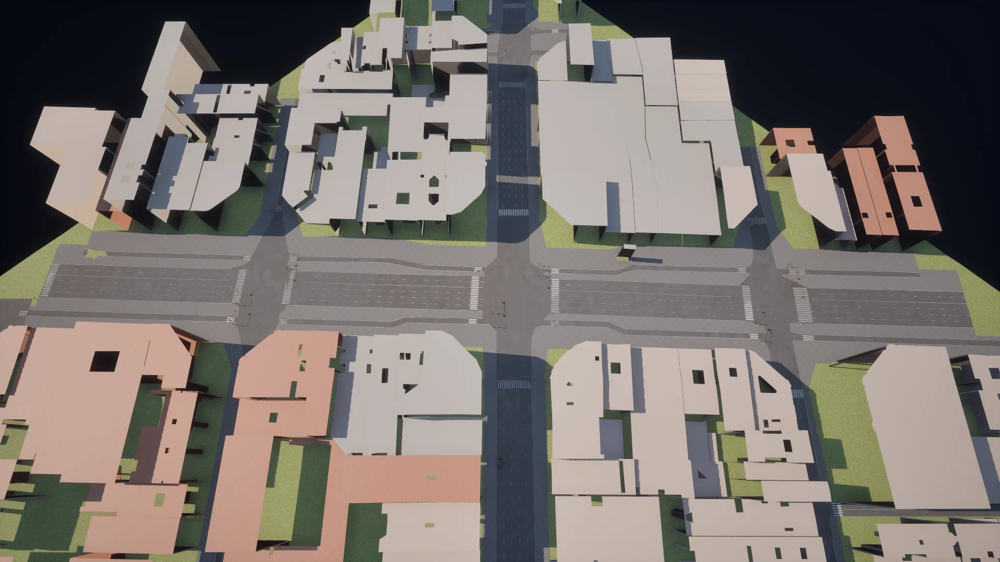
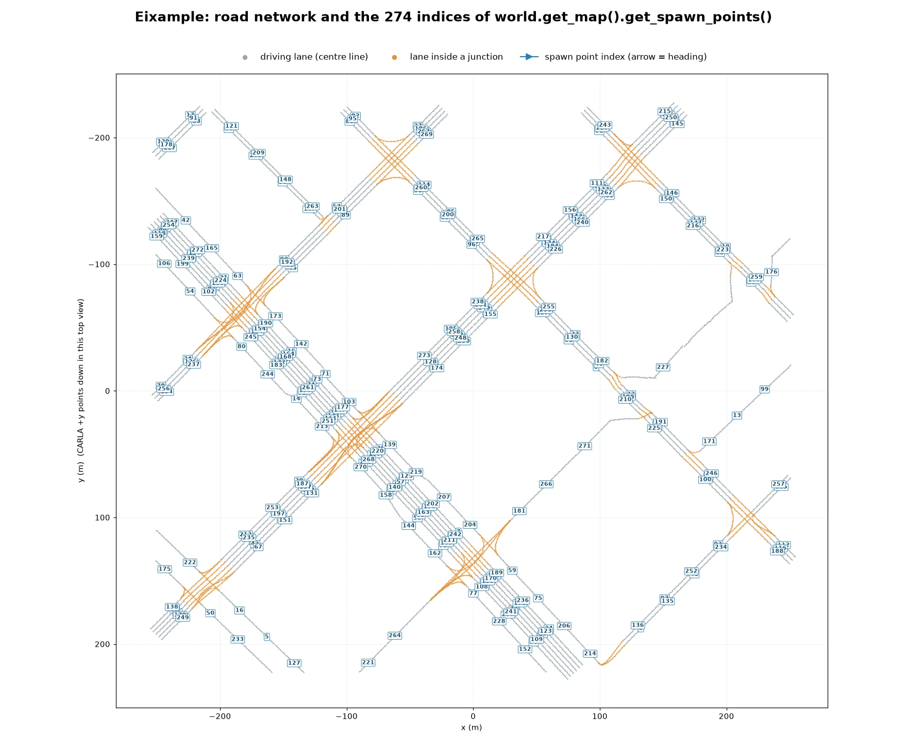
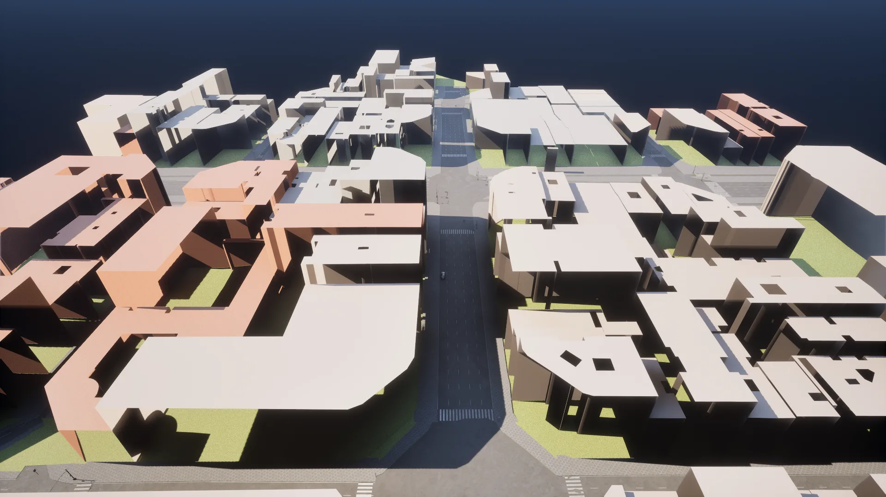

# Eixample


<div class="img-caption">Eixample from above at an angle and from almost overhead: the street grid of the district between untextured building volumes.</div>

Eixample is a [digital twin](content_authoring_maps_digital_twin.md) of part of the Eixample district of Barcelona: the street grid of the district, generated from map data, with the buildings as simple untextured volumes. It is a small [World Partition](core_large_maps.md) map.

| | |
| --- | --- |
| __Map name__ | `Eixample` |
| __Package available__ | [Additional maps package](https://github.com/carla-simulator/carla/releases/tag/1.0), or a source build |
| __Map type__ | a [World Partition](core_large_maps.md) map: the server streams the cells around the vehicle with `role_name=hero` |
| __Size__ | about 510 x 455 m of roads |
| __Spawn points__ | 274, from `world.get_map().get_spawn_points()` |
| __Junctions__ | 15, with 27 traffic lights |

Load it like any other map:

```py
world = client.load_world('Eixample')
```

Only the cells around the ego vehicle are loaded. Spawn the ego with `role_name=hero` before placing sensors, as described in [Large maps](core_large_maps.md).

!!! Note
    The buildings are volumes without textures or windows, so street-level camera images are mostly flat walls. The map is best suited to driving and planning tests on a real street layout.

!!! Note
    The content also holds `EixampleDemo`, the same district with procedural façades, vegetation and staged traffic signals. It references assets of the `CarlaDigitalTwinsTool` content, which CARLA does not distribute, so without that content its buildings load grey and untextured. See [Digital Twin Tool](content_authoring_maps_digital_twin.md).

---
## Road network

The streets follow the diagonal grid of the district: wide avenues of up to three lanes in each direction crossed by narrower streets.


<div class="img-caption">Eixample from almost overhead: one of the wide avenues across the grid.</div>


<div class="img-caption">The road network of Eixample from the Map API, with the index of each spawn point.</div>

---
## Buildings

Each block of the grid is filled with untextured building volumes of different heights around inner courtyards, in the layout of the real district.


<div class="img-caption">The building volumes and inner courtyards of the blocks along a street of the grid.</div>
