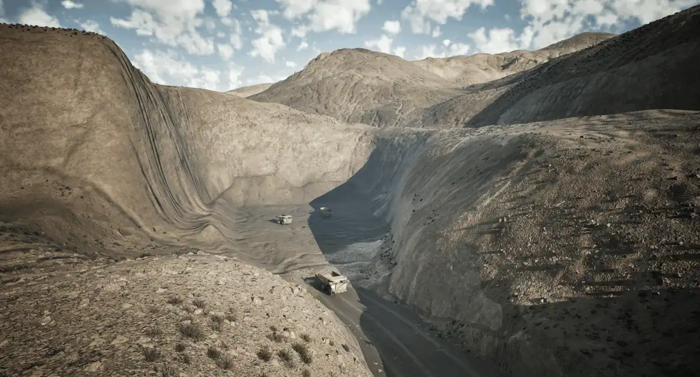
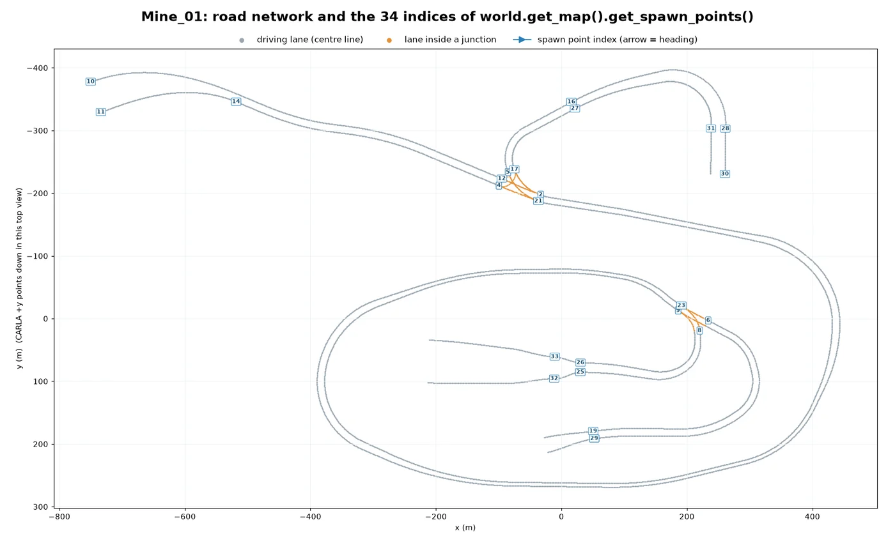
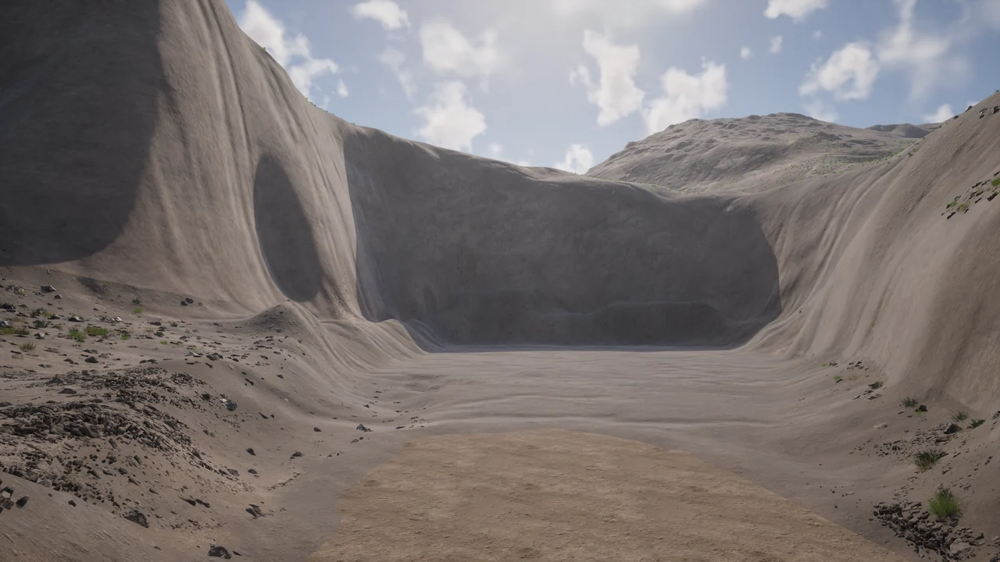
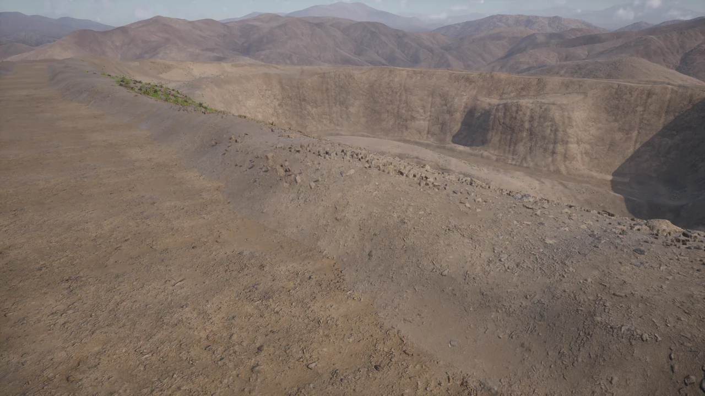
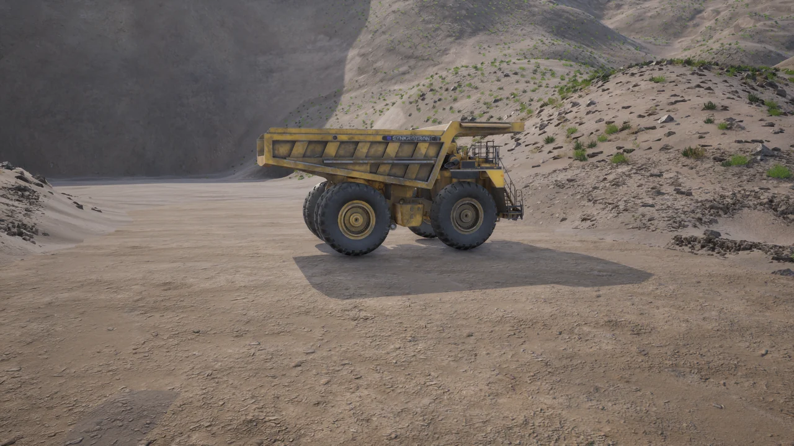
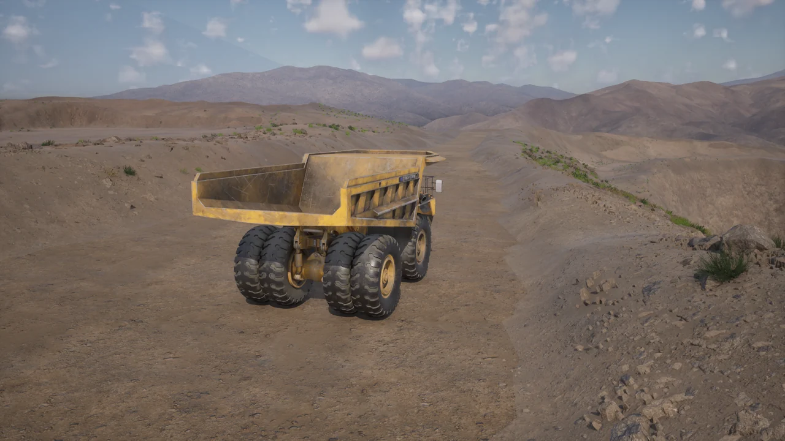

# Open-cast mine (Mine_01)


<div class="img-caption">The open-cast pit of Mine_01 seen from the rim.</div>

A model of an open-cast mining environment of the kind used for extracting minerals around the world. The mining area is connected to a parking area by a small network of access roads. The map was contributed by CARLA consortium members and sponsors [Synkrotron](https://www.synkrotron.ai/).

| | |
| --- | --- |
| __Map name__ | `Mine_01` |
| __In the default package__ | no: use a source build, or install it from a [content pack](map_content_packs.md) |
| __Surface__ | unpaved access roads and an open pit, rather than the asphalt grid of the towns |
| __Size__ | about 1.2 x 0.7 km of roads, with 160 m of height between the pit floor and the highest point |
| __Spawn points__ | 34, from `world.get_map().get_spawn_points()` |
| __Map-specific assets__ | `vehicle.miningtruck.miningtruck`, the mining earth mover, is only spawnable while this map is loaded |

Load it like any other map:

```py
world = client.load_world('Mine_01')
```

- [__Road network__](#road-network)
- [__Open pit__](#open-pit)
- [__Haul roads on the rim__](#haul-roads-on-the-rim)
- [__Parking area__](#parking-area)
- [__The mining earth mover__](#the-mining-earth-mover)

---
## Road network

A loop of two-lane haul roads runs around the pit, with two junctions. Dead-end branches go down to the pit floor and up to the north-east, and a long road leads west to the parking area at the top of the map.


<div class="img-caption">The road network of Mine_01 from the Map API, with the index of each spawn point. Some spawn points share a location, so their numbers overlap.</div>

---
## Open pit

The pit floor is the lowest part of the map, about 65 m below the origin, surrounded by steep walls. The haul road reaches it from the eastern junction.


<div class="img-caption">The pit floor from the end of the road near spawn point 25.</div>

---
## Haul roads on the rim

The roads around the pit are wide dirt tracks along the rim, with the mountains around the mine in the distance.


<div class="img-caption">The rim road from the western junction, near spawn point 21, looking towards the pit.</div>

---
## Parking area

The western road ends in a flat area at the top of the map, the highest point of the network, where the level places a mining truck.


<div class="img-caption">The mining truck placed in the parking area by the level.</div>

---
## The mining earth mover

`vehicle.miningtruck.miningtruck` is defined in `Content/Carla/Config/Mine_01/Vehicles.json`, a vehicle list that the server reads only while `Mine_01` is loaded, so the blueprint is not in the library of any other map. It spawns like any other vehicle:

```py
world = client.load_world('Mine_01')
blueprint = world.get_blueprint_library().find('vehicle.miningtruck.miningtruck')
spawn_point = world.get_map().get_spawn_points()[21]
truck = world.spawn_actor(blueprint, spawn_point)
```


<div class="img-caption"><code>vehicle.miningtruck.miningtruck</code> spawned at spawn point 21.</div>

See the [vehicle catalogue](catalogue_vehicles.md#mining-earth-mover) for its attributes.
