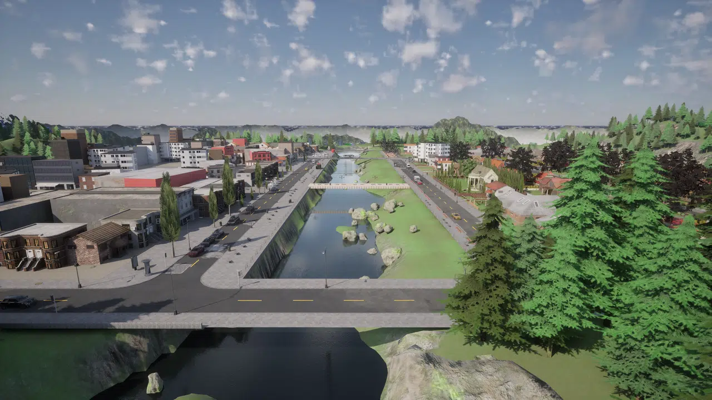
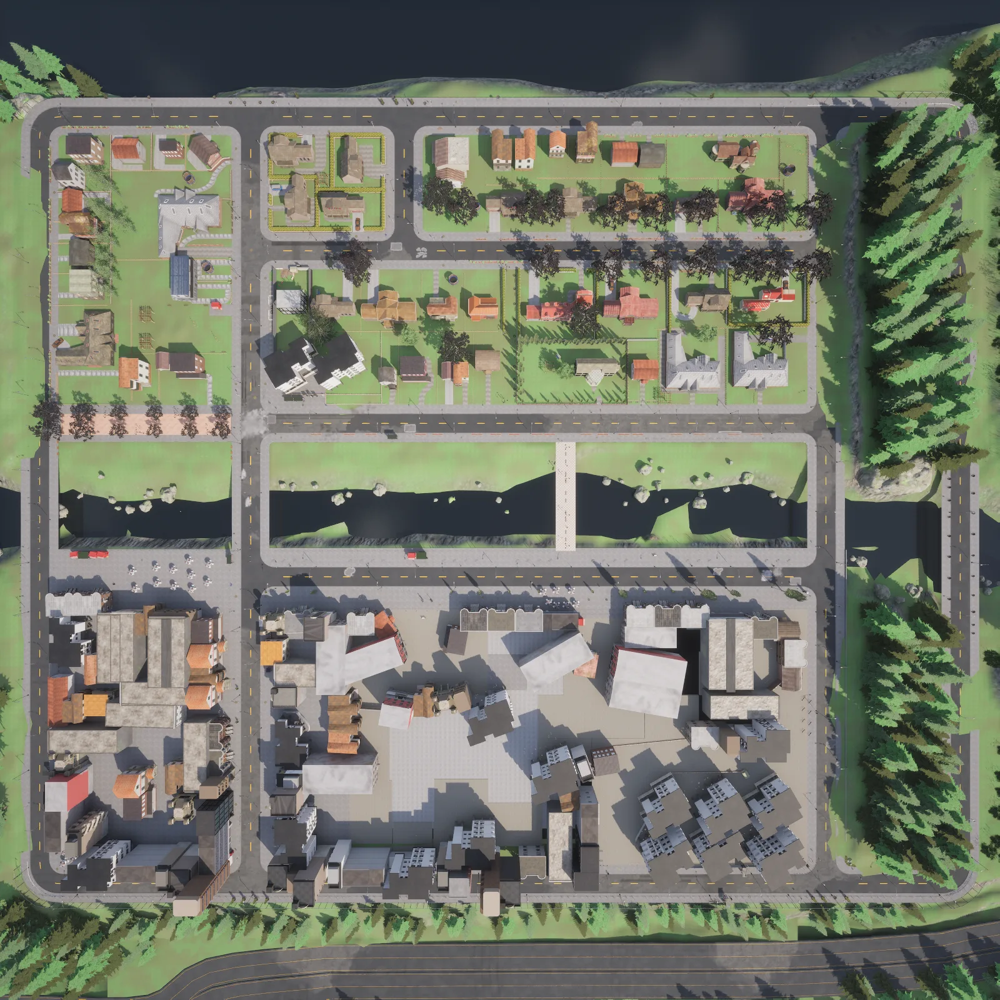
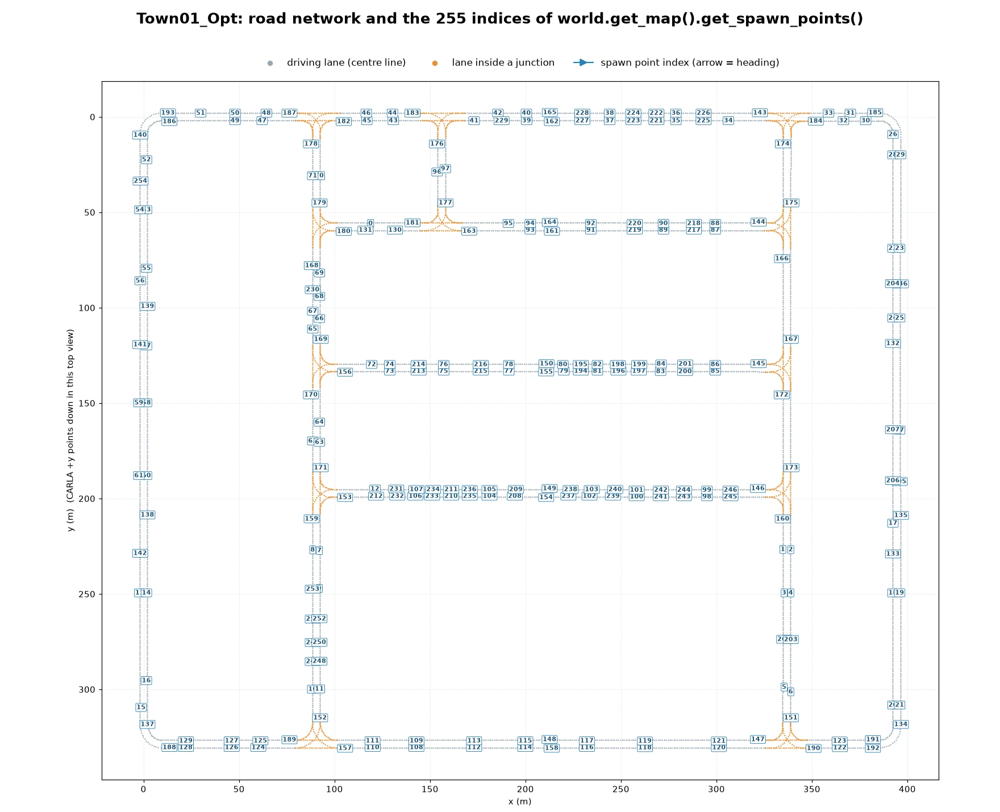
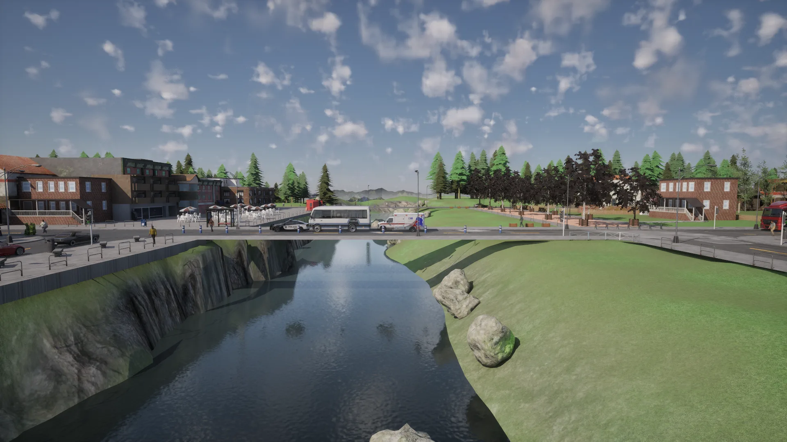
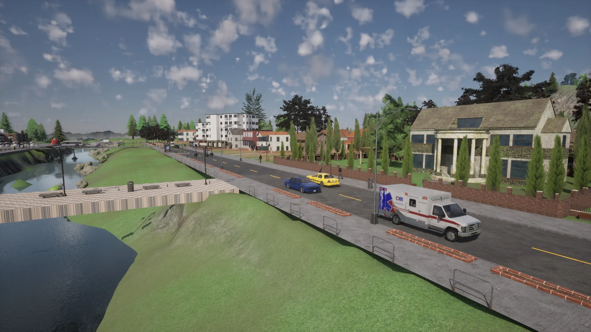
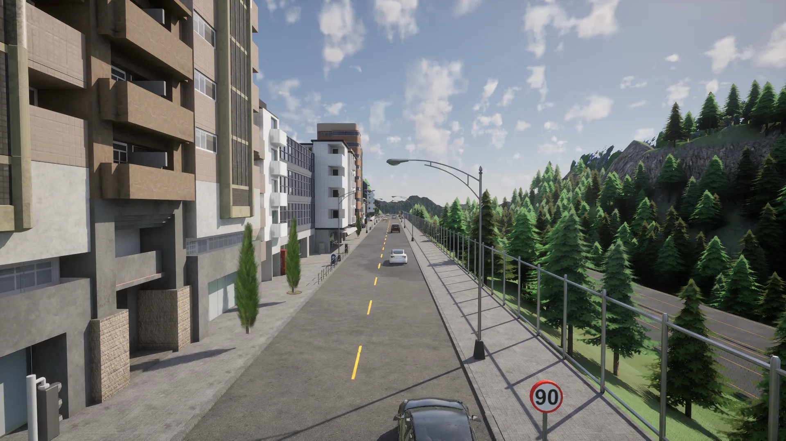
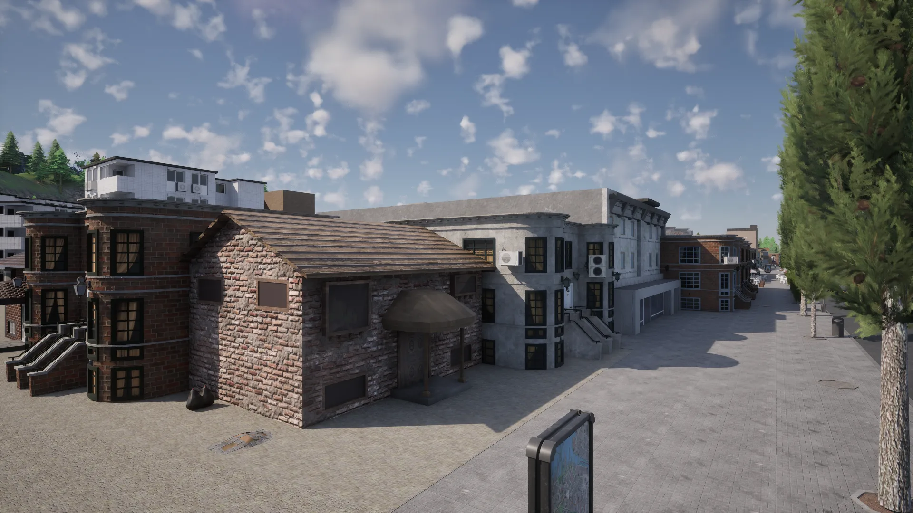
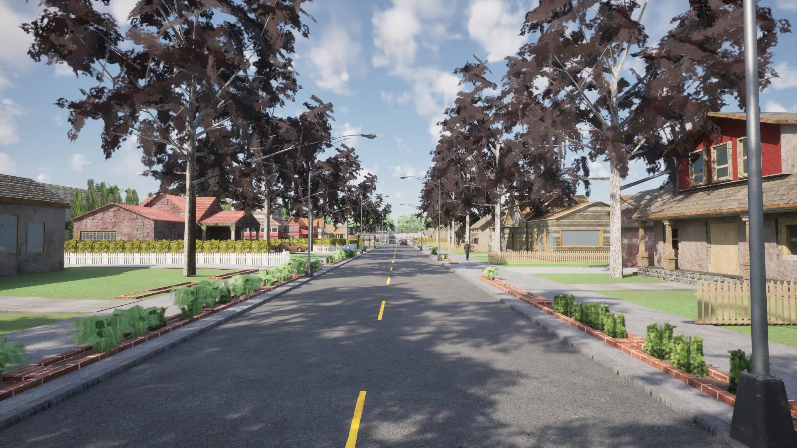
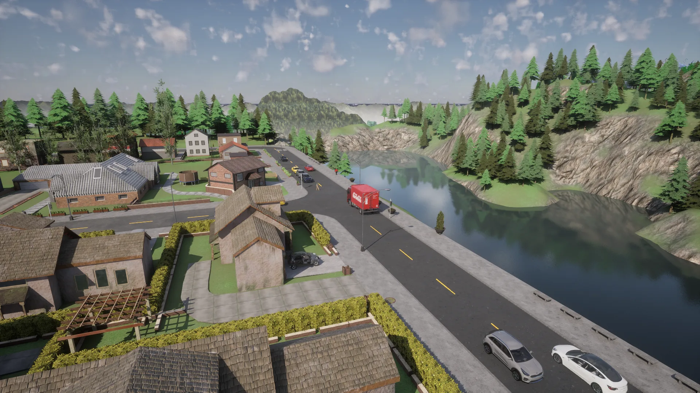

# Town01


<div class="img-caption">Town01_Opt over the river, from above, at a road bridge, in the commercial quarter and in a residential street.</div>

Town01 is a small town with numerous T-junctions and a variety of buildings, surrounded by coniferous trees and featuring several small bridges spanning a river that divides the town in two halves: a residential half of detached houses on one bank and a commercial half of shops and apartment blocks on the other.

| | |
| --- | --- |
| __Map name__ | `Town01_Opt` |
| __In the default package__ | no: install a [content pack](map_content_packs.md) that contains it, such as AdditionalMaps, or use a source build |
| __Size__ | about 400 x 330 m of roads |
| __Spawn points__ | 255, from `world.get_map().get_spawn_points()` |
| __Junctions__ | 12, all of them T-junctions, 36 traffic lights |

Load it like any other map:

```py
world = client.load_world('Town01_Opt')
```

- [__Road network__](#road-network)
- [__The river and its bridges__](#the-river-and-its-bridges)
- [__Commercial buildings__](#commercial-buildings)
- [__Residential buildings__](#residential-buildings)

---
## Road network

The road network is a rectangular grid of two-lane roads, one lane in each direction, that meet in simple T-junctions. Five roads run parallel to the river, and the cross roads that link them pass over it on bridges.


<div class="img-caption">Town01_Opt from above, oriented like the plot below: the residential half at the top, the river across the middle and the commercial half at the bottom.</div>


<div class="img-caption">The road network of Town01_Opt from the Map API, with the index of each spawn point.</div>

---
## The river and its bridges

A small river crosses the town between two strips of grass and rocks. Four road bridges and a footbridge cross it.


<div class="img-caption">The river and one of the road bridges that cross it.</div>


<div class="img-caption">The footbridge in the middle of the river, with the road that runs along the bank.</div>

---
## Commercial buildings

The commercial half has shops, brick terraces and apartment blocks around a paved square.


<div class="img-caption">Apartment blocks along the edge of the commercial quarter.</div>


<div class="img-caption">Brick buildings on the paved square at the centre of the commercial quarter.</div>

---
## Residential buildings

The residential half is made of detached houses with gardens, along tree-lined streets.


<div class="img-caption">A tree-lined residential street with detached houses.</div>


<div class="img-caption">The residential streets at the edge of the town, with the lake and the wooded hills behind them.</div>
