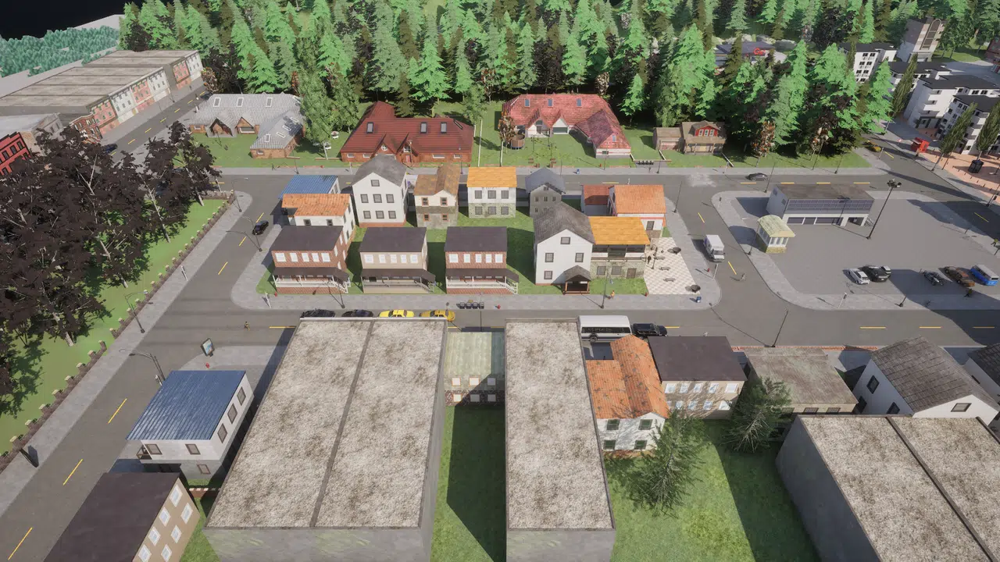
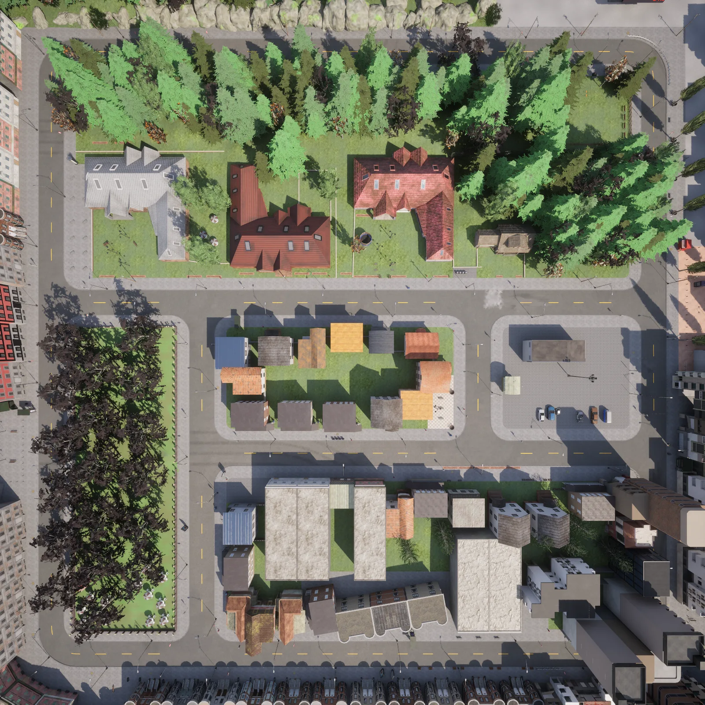
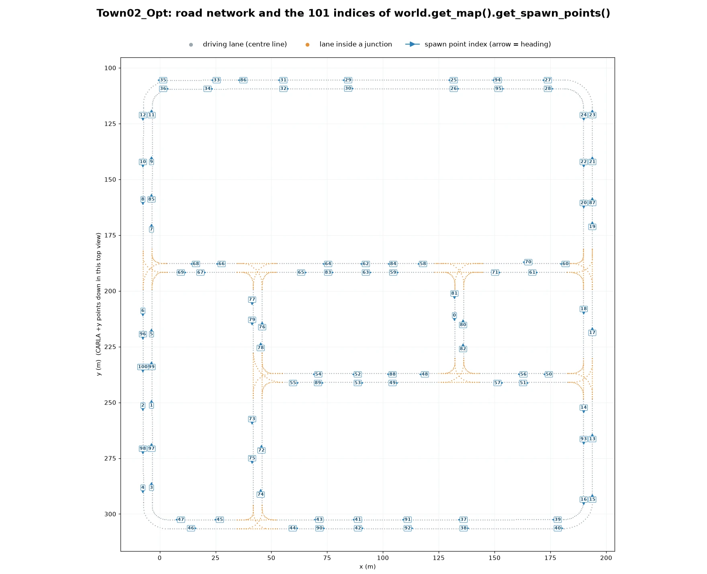
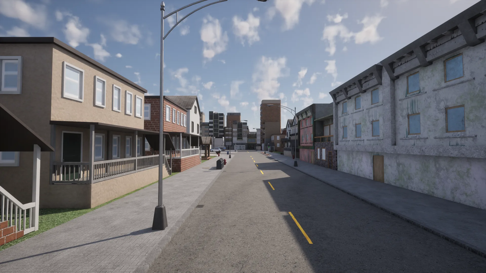
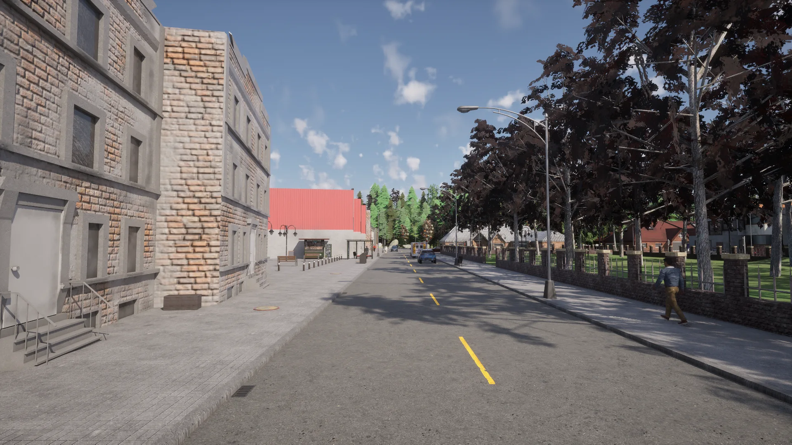
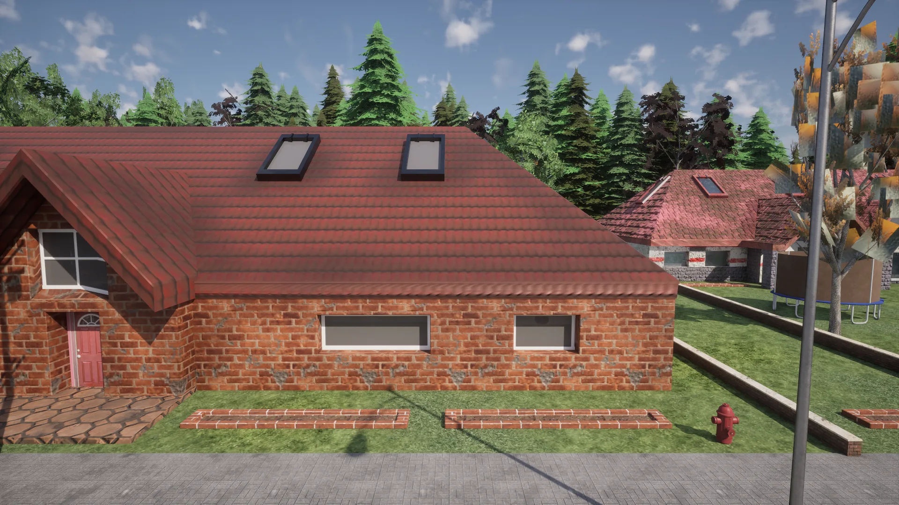
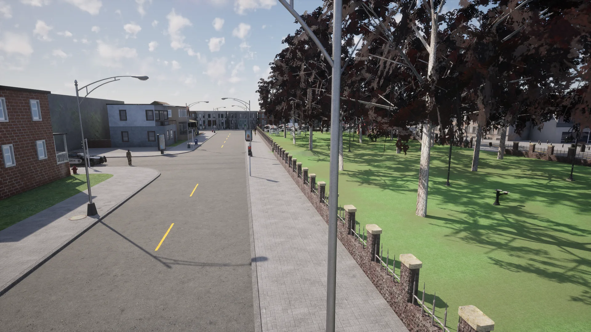
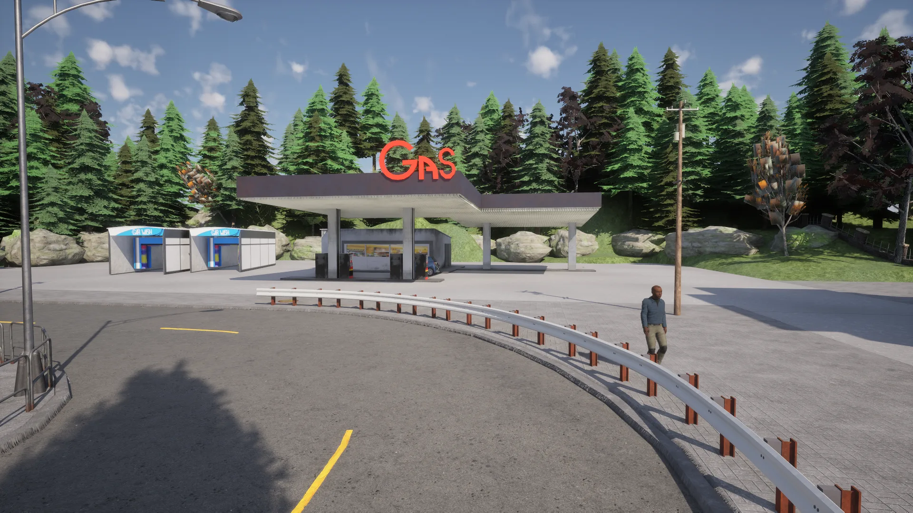
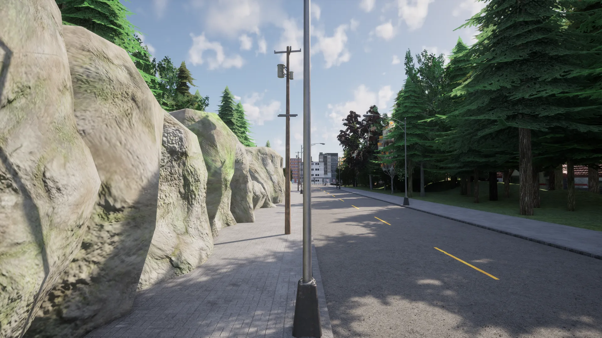

# Town02


<div class="img-caption">Town02_Opt from above, from directly overhead, in the high street, at the gas station and along the park.</div>

Town02 is a small town with numerous T-junctions and a variety of buildings, with patches of coniferous trees, a park, and a residential and a commercial area. It is smaller than [Town01](map_town01.md) and uses the same kind of two-lane roads.

| | |
| --- | --- |
| __Map name__ | `Town02_Opt` |
| __In the default package__ | no: install a [content pack](map_content_packs.md) that contains it, such as AdditionalMaps, or use a source build |
| __Size__ | about 200 x 200 m of roads |
| __Spawn points__ | 101, from `world.get_map().get_spawn_points()` |
| __Junctions__ | 8, all of them T-junctions, 24 traffic lights |

Load it like any other map:

```py
world = client.load_world('Town02_Opt')
```

- [__Road network__](#road-network)
- [__Commercial area and high street__](#commercial-area-and-high-street)
- [__Residential buildings__](#residential-buildings)
- [__The park__](#the-park)
- [__Gas station__](#gas-station)
- [__Roads through the woods__](#roads-through-the-woods)

---
## Road network

The road network is a small grid of two-lane roads, one lane in each direction, joined by simple T-junctions.


<div class="img-caption">Town02_Opt from above, oriented like the plot below: the large houses and the wood at the top, the park on the left and the commercial blocks at the bottom.</div>


<div class="img-caption">The road network of Town02_Opt from the Map API, with the index of each spawn point.</div>

---
## Commercial area and high street

The map features a commercial area and a high street lined with shops and terraced buildings.


<div class="img-caption">The high street, with terraced buildings on both sides and the apartment blocks of the town centre at the end.</div>

---
## Residential buildings

There are residential apartment buildings, terraced houses and large detached houses with gardens.


<div class="img-caption">Apartment buildings on one side of the street and the park railings on the other.</div>


<div class="img-caption">One of the detached brick houses at the edge of the wood.</div>

---
## The park

A park with deciduous trees fills one block of the town.


<div class="img-caption">The park and the street that runs along it.</div>

---
## Gas station

There is a gas station on the road that runs along the wood.


<div class="img-caption">The gas station, with its forecourt and car wash, at the edge of the wood.</div>

---
## Roads through the woods

On the edge of the town, the roads run between rock walls and conifer woods.


<div class="img-caption">A road at the edge of the town, between a rock wall and the conifer wood.</div>
