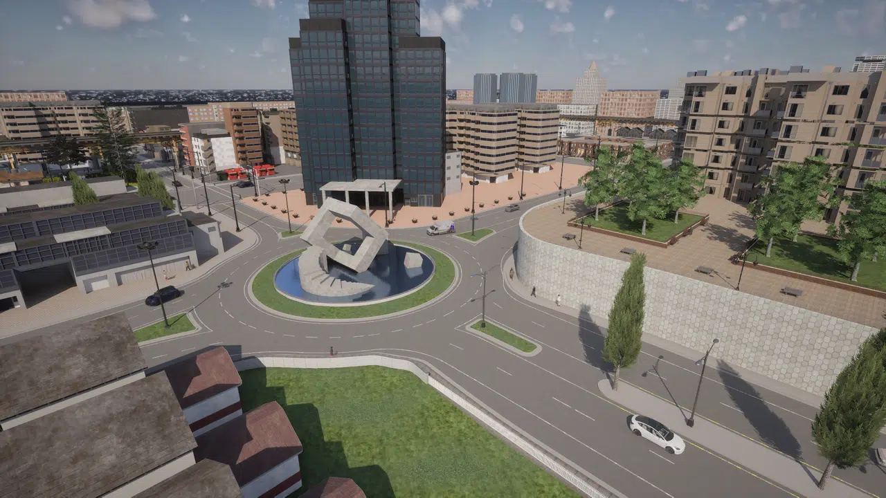
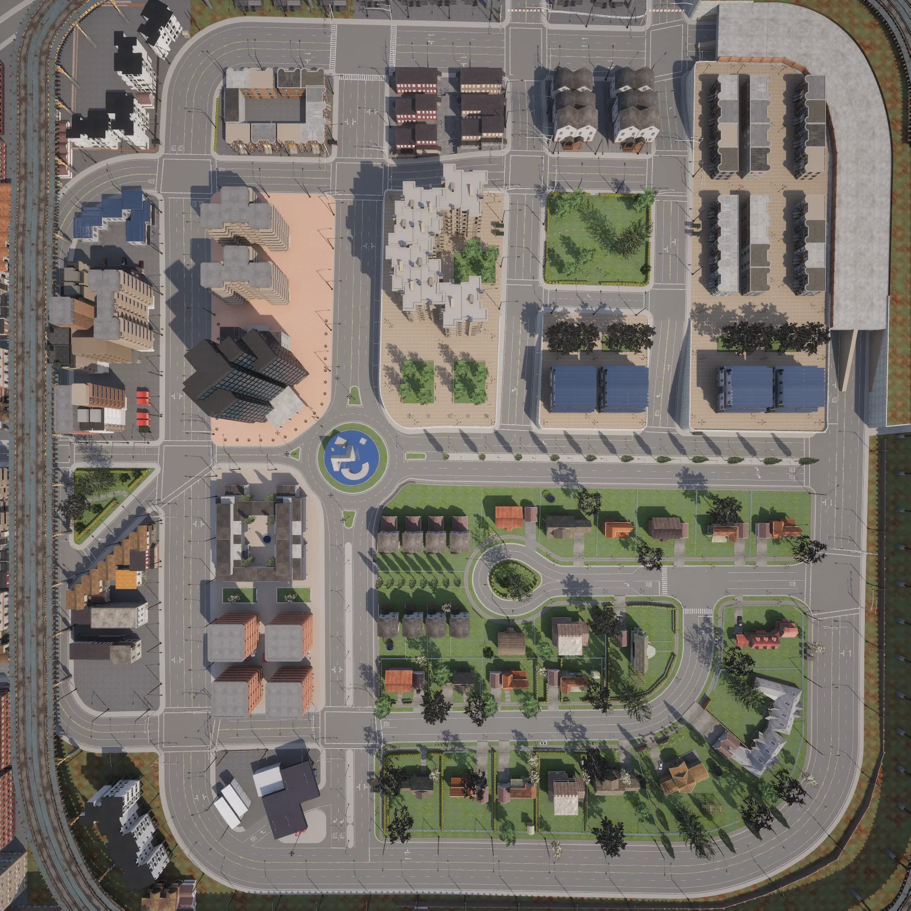
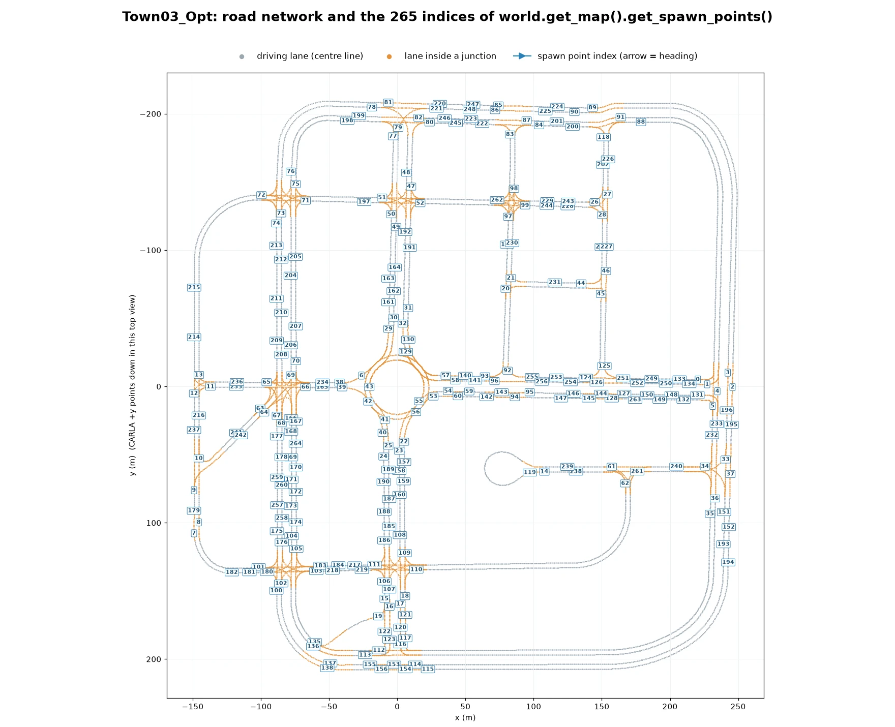
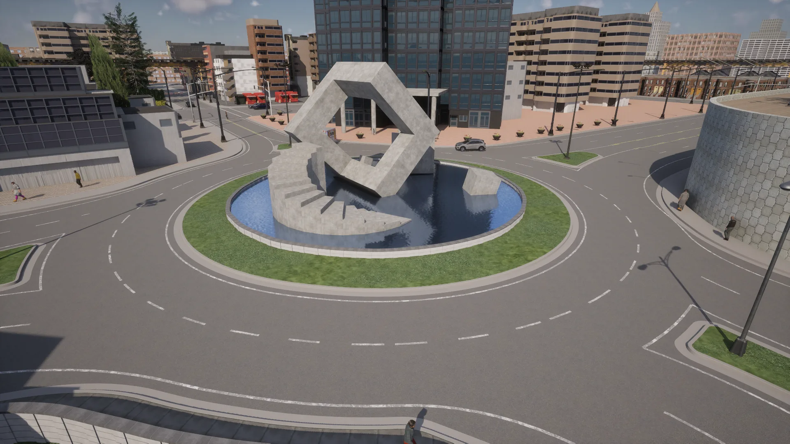
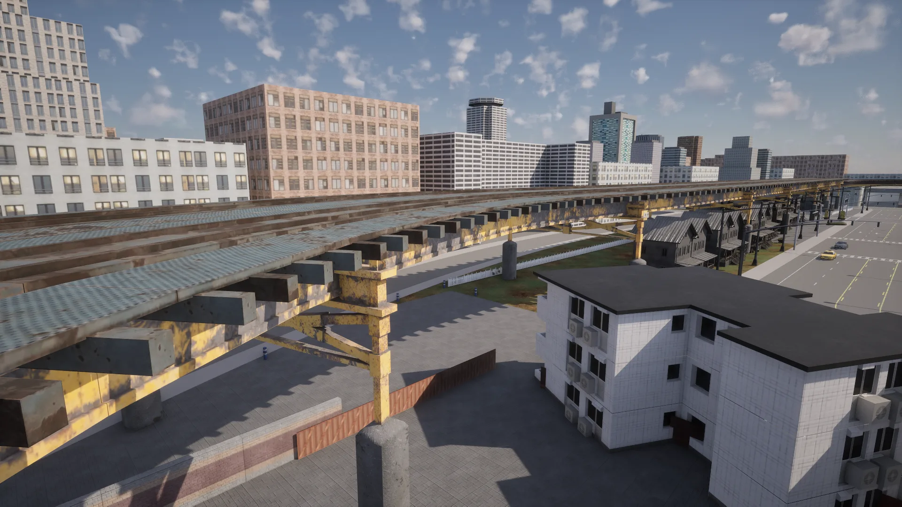
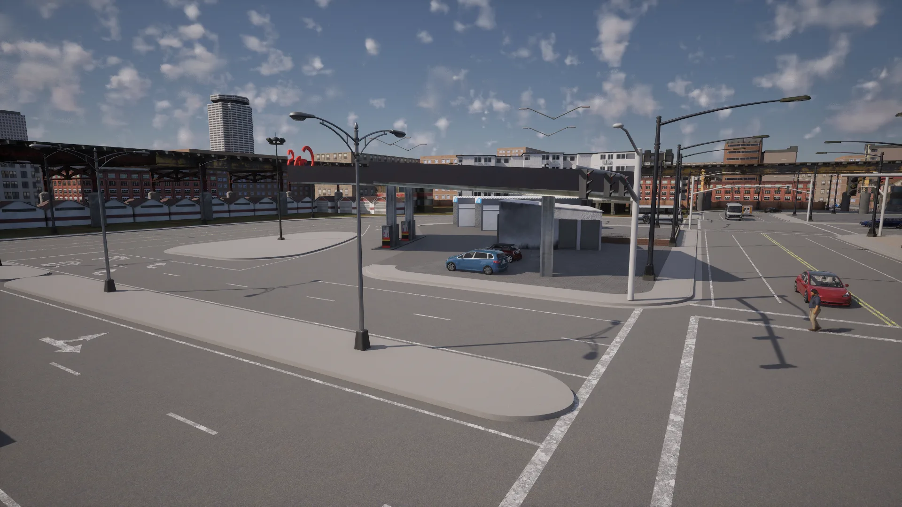
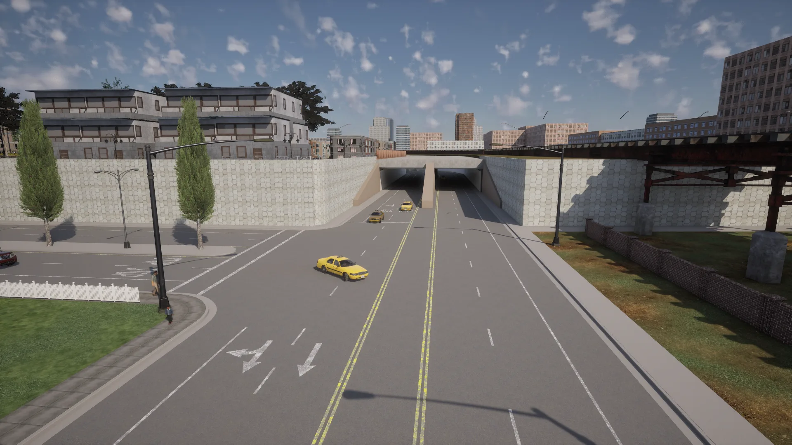
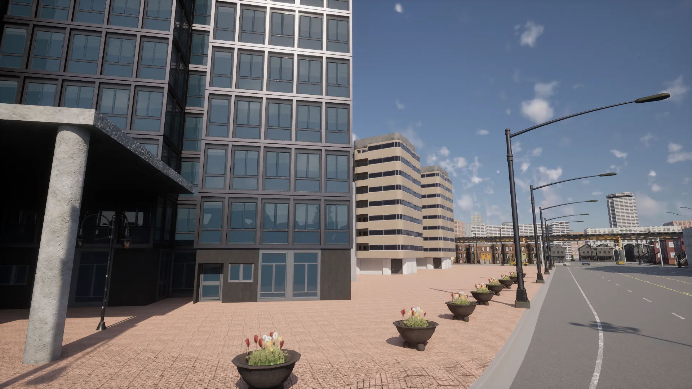
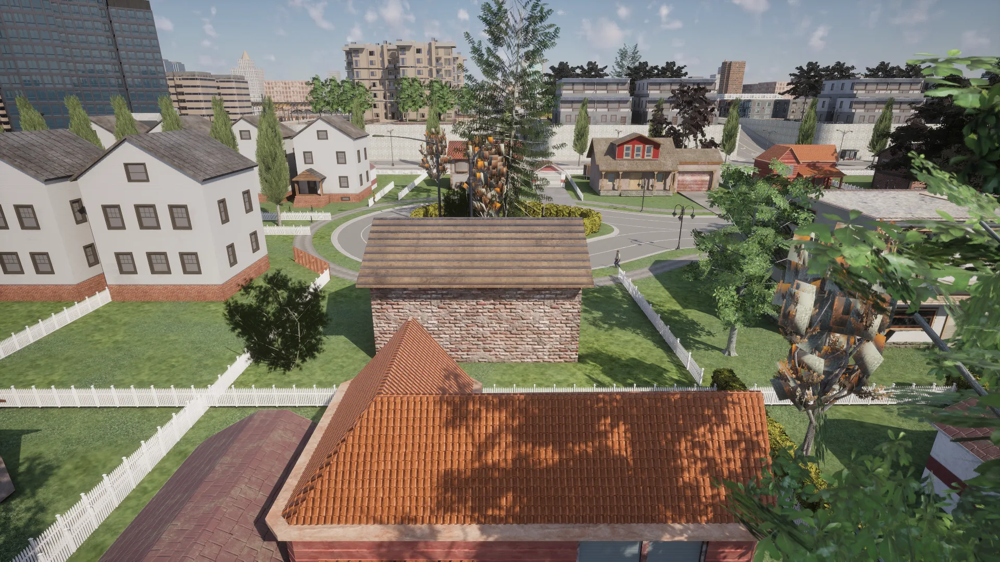

# Town03


<div class="img-caption">Town03_Opt over the central roundabout, from above, at the roundabout, along the raised metro track and at the underpass.</div>

Town03 is a larger town with features of a downtown urban area. The road network includes some interesting features such as a roundabout, an underpass and roads on raised ground, and the town is circled by a raised metro track.

| | |
| --- | --- |
| __Map name__ | `Town03_Opt` |
| __In the default package__ | no: install a [content pack](map_content_packs.md) that contains it, such as AdditionalMaps, or use a source build |
| __Size__ | about 400 x 415 m of roads |
| __Spawn points__ | 265, from `world.get_map().get_spawn_points()` |
| __Junctions__ | 31: the central roundabout, 4-way junctions and T-junctions, with 38 traffic lights and 20 stop signs |

Load it like any other map:

```py
world = client.load_world('Town03_Opt')
```

- [__Road network__](#road-network)
- [__The central roundabout__](#the-central-roundabout)
- [__The raised metro track__](#the-raised-metro-track)
- [__Gas station and large junction__](#gas-station-and-large-junction)
- [__Underpass__](#underpass)
- [__Buildings__](#buildings)

---
## Road network

The road network features a central roundabout and a residential cul-de-sac, along with numerous 4-way junctions and T-junctions. Some roads have two lanes in each direction, and one block of the town sits on raised ground about 8 m above the rest.


<div class="img-caption">Town03_Opt from above, oriented like the plot below: the roundabout in the centre, the residential cul-de-sac below it and the metro track around the edge.</div>


<div class="img-caption">The road network of Town03_Opt from the Map API, with the index of each spawn point.</div>

---
## The central roundabout

The map features a prominent central roundabout with a modernist monument standing in water.


<div class="img-caption">The central roundabout and its monument, with the downtown towers behind it.</div>

---
## The raised metro track

A raised metro track runs around the town on steel supports.


<div class="img-caption">The raised metro track along the edge of the town.</div>

---
## Gas station and large junction

There is a gas station next to a large junction.


<div class="img-caption">The gas station beside a large junction, with the metro track behind it.</div>

---
## Underpass

On the edge of the town a road passes under the raised ground and the metro track.


<div class="img-caption">The underpass, a two-lane-per-direction road through a tunnel under the raised ground.</div>

---
## Buildings

There are parks and a variety of commercial and residential buildings in varying styles: office towers downtown, apartment blocks, and detached houses around the cul-de-sac.


<div class="img-caption">Office towers and a paved plaza downtown.</div>


<div class="img-caption">Detached houses around the residential cul-de-sac.</div>
