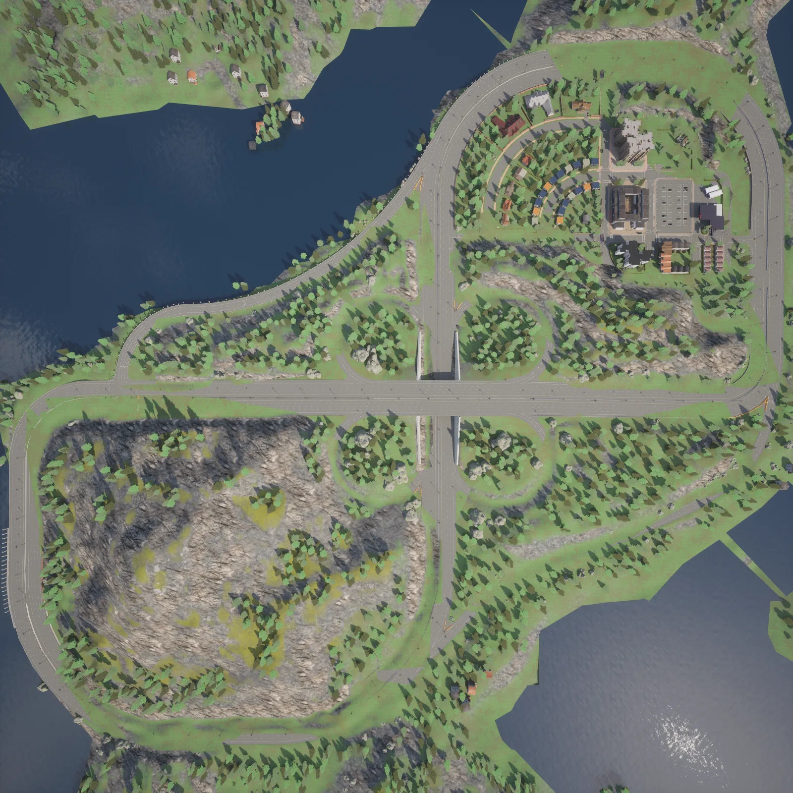
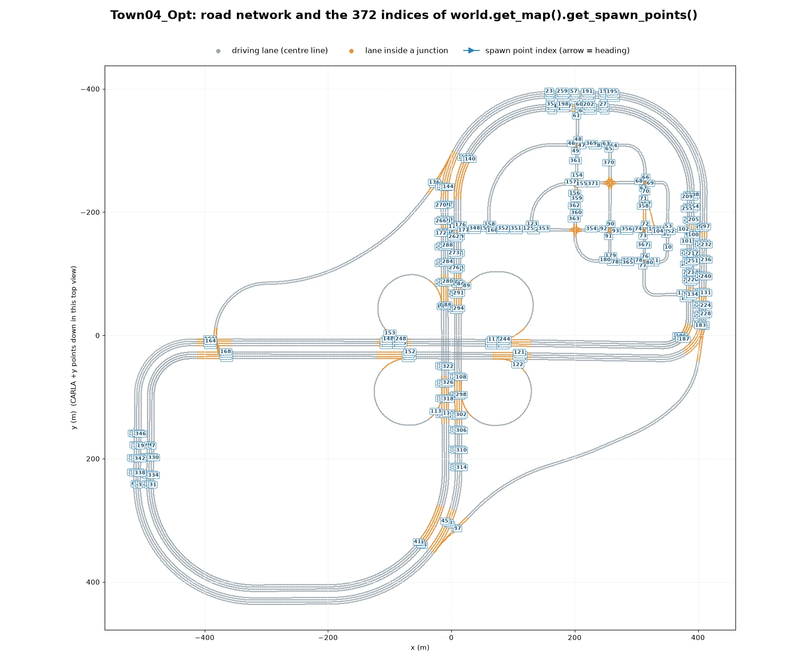
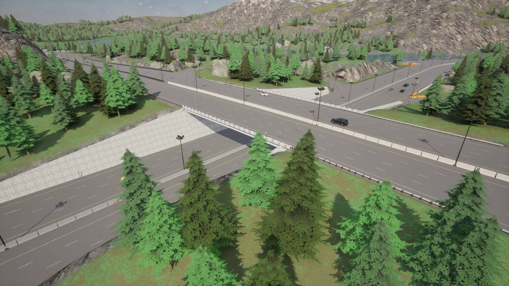
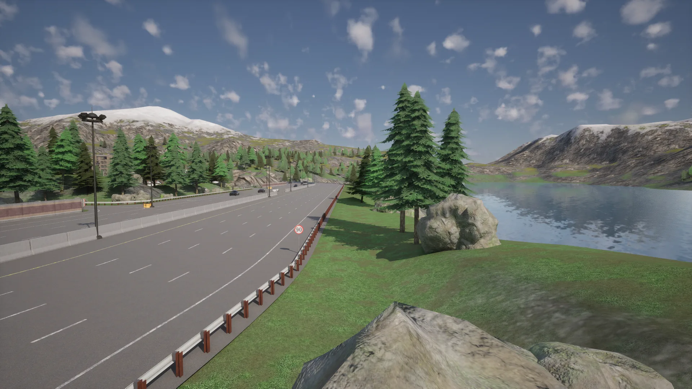
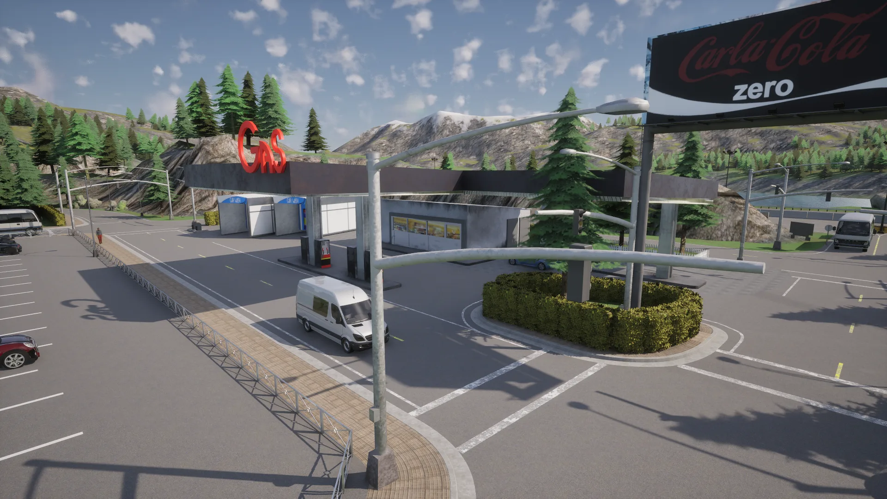
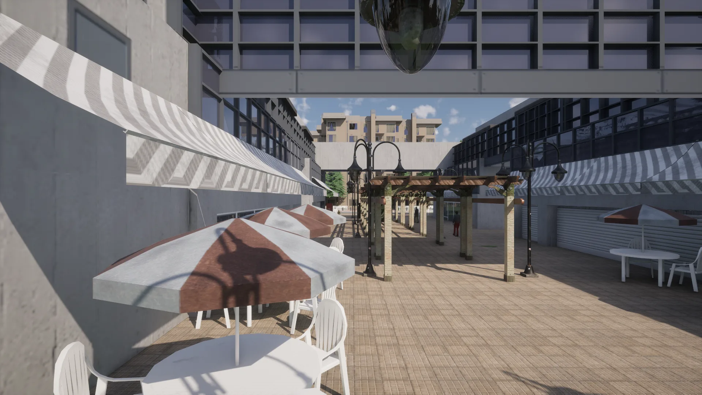
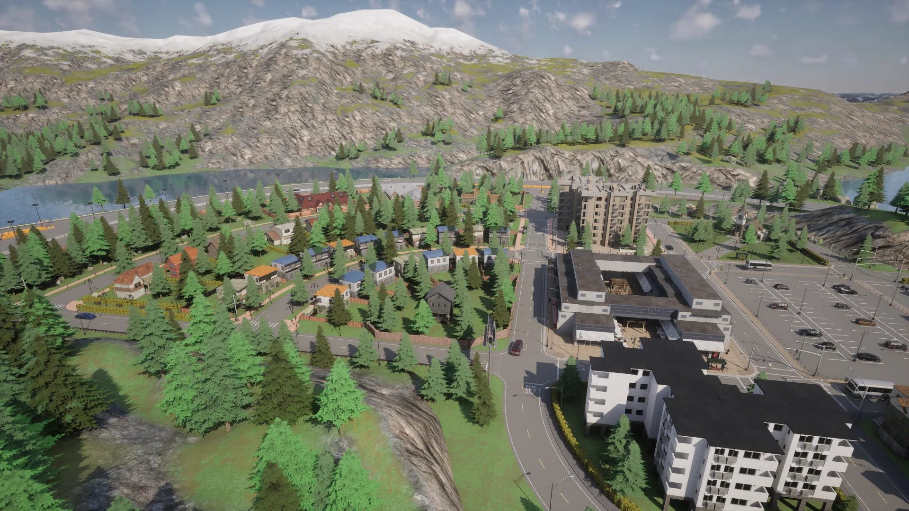
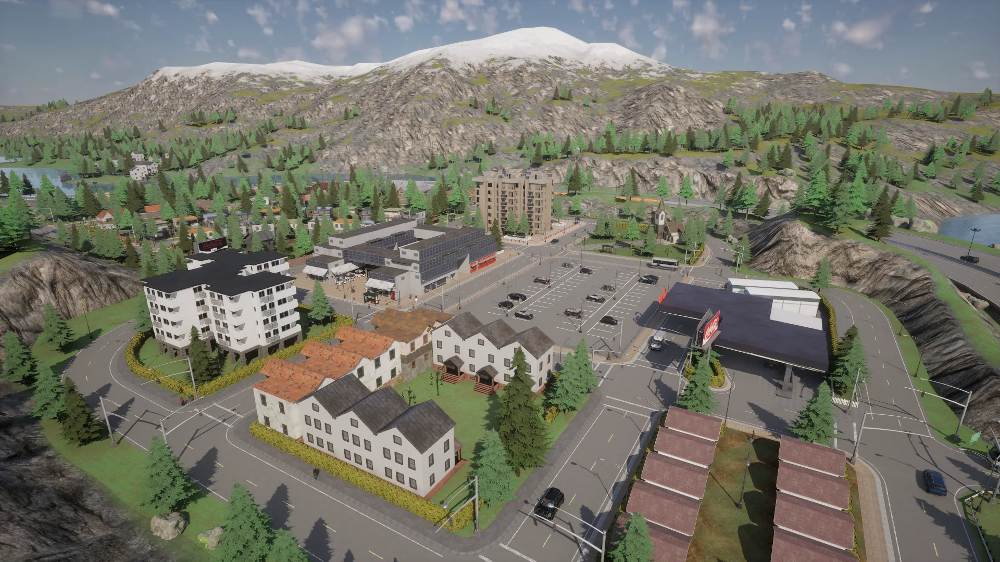
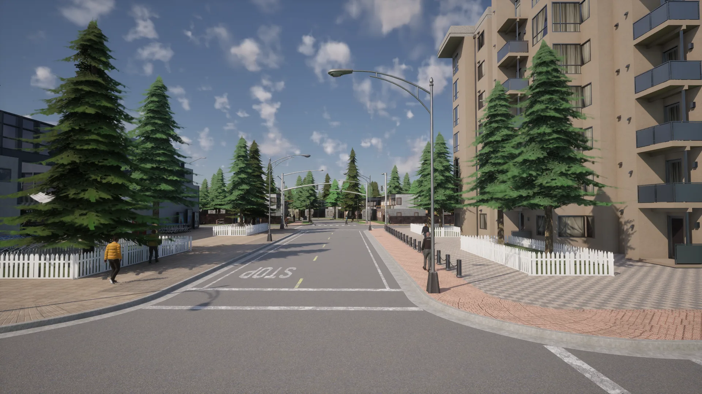

# Town04


<div class="img-caption">Town04_Opt from above the town, from directly overhead, at the overpass, at the gas station and in the shopping arcade.</div>

Town04 is a small town with a backdrop of snow-capped mountains and conifers. A multi-lane road circles the town and a nearby mountain in a "figure of 8", an *infinite* highway with no dead ends.

| | |
| --- | --- |
| __Map name__ | `Town04_Opt` |
| __In the default package__ | no: use a source build, or install it from a [content pack](map_content_packs.md) |
| __Size__ | about 930 x 830 m of roads |
| __Spawn points__ | 372, from `world.get_map().get_spawn_points()` |
| __Junctions__ | 27, with 43 traffic lights, 8 stop signs and 4 yield signs |

Load it like any other map:

```py
world = client.load_world('Town04_Opt')
```

- [__Road network__](#road-network)
- [__The overpass__](#the-overpass)
- [__The ring road__](#the-ring-road)
- [__Gas station__](#gas-station)
- [__The shopping arcade__](#the-shopping-arcade)
- [__Streets and buildings__](#streets-and-buildings)

---
## Road network

The road network consists of a small network of short streets and junctions nested between commercial and residential buildings, with a "figure of 8" ring road that circles the buildings and a nearby mountain. The ring road has up to four lanes in each direction.


<div class="img-caption">Town04_Opt from above, oriented like the plot below: the town at the top right, the crossing of the figure of 8 in the centre and the mountain at the bottom left, between two lakes.</div>


<div class="img-caption">The road network of Town04_Opt from the Map API, with the index of each spawn point.</div>

---
## The overpass

The two loops of the figure of 8 cross on an overpass, about 11 m above the road beneath, linked to it by circular slip roads.


<div class="img-caption">The crossing of the figure of 8: the overpass and the road that runs under it.</div>

---
## The ring road

The ring road runs along the lakes, with the mountains behind them.


<div class="img-caption">The ring road beside one of the lakes, with the snow-capped mountains behind it.</div>

---
## Gas station

There is a gas station set against the mountainous backdrop.


<div class="img-caption">The gas station next to a car park, with a billboard and the mountains behind it.</div>

---
## The shopping arcade

In the middle of the town is a pedestrian shopping arcade with outdoor seating.


<div class="img-caption">The pedestrian shopping arcade, with café tables under the awnings.</div>

---
## Streets and buildings

There are various styles of residential and commercial buildings, and streets with trees and billboards.


<div class="img-caption">The town from above: the detached houses on the left, the arcade and the apartment blocks on the right, with the lake and the mountains behind.</div>


<div class="img-caption">Apartment blocks, terraced houses and the gas station around the car park.</div>


<div class="img-caption">A residential street with apartment blocks and conifers.</div>
