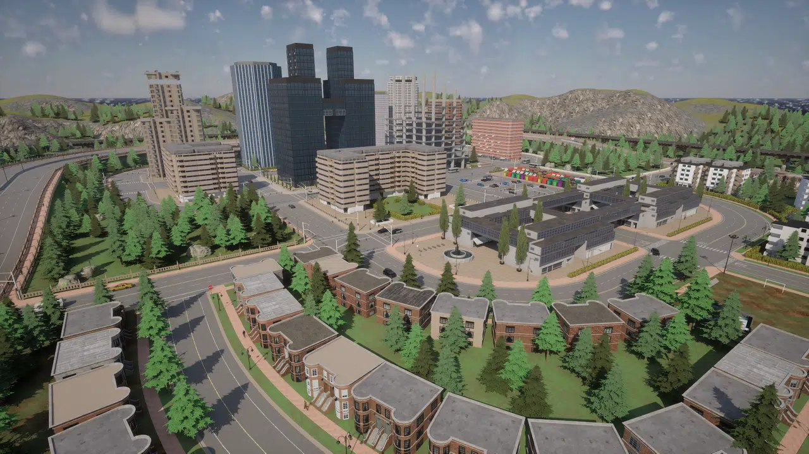
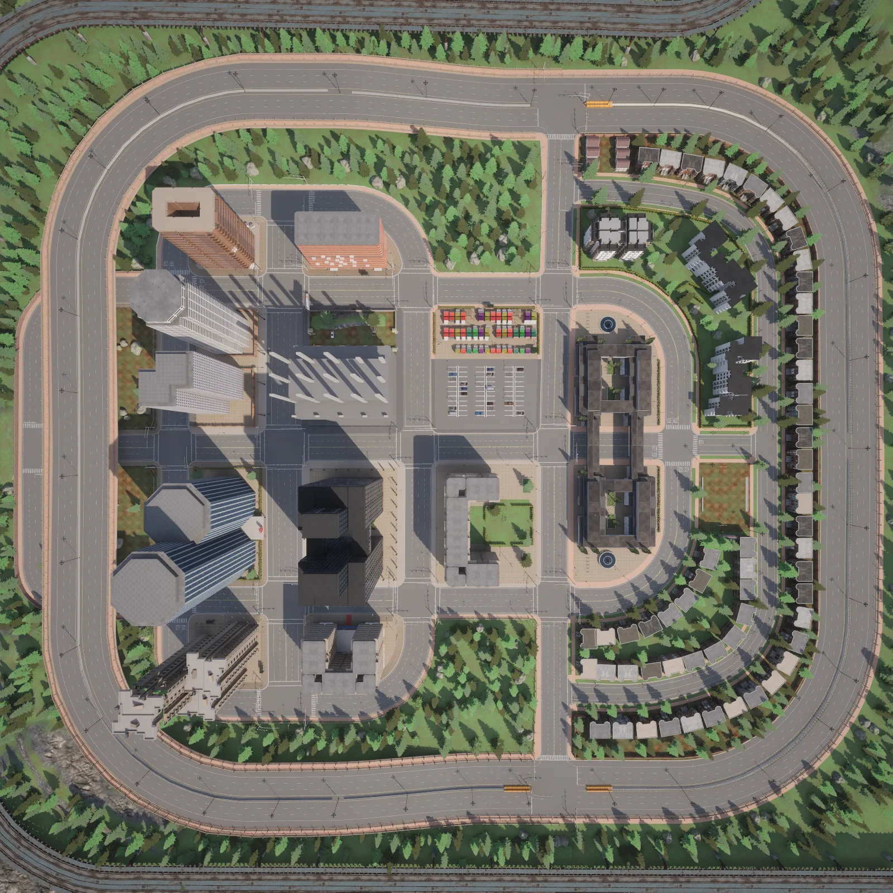
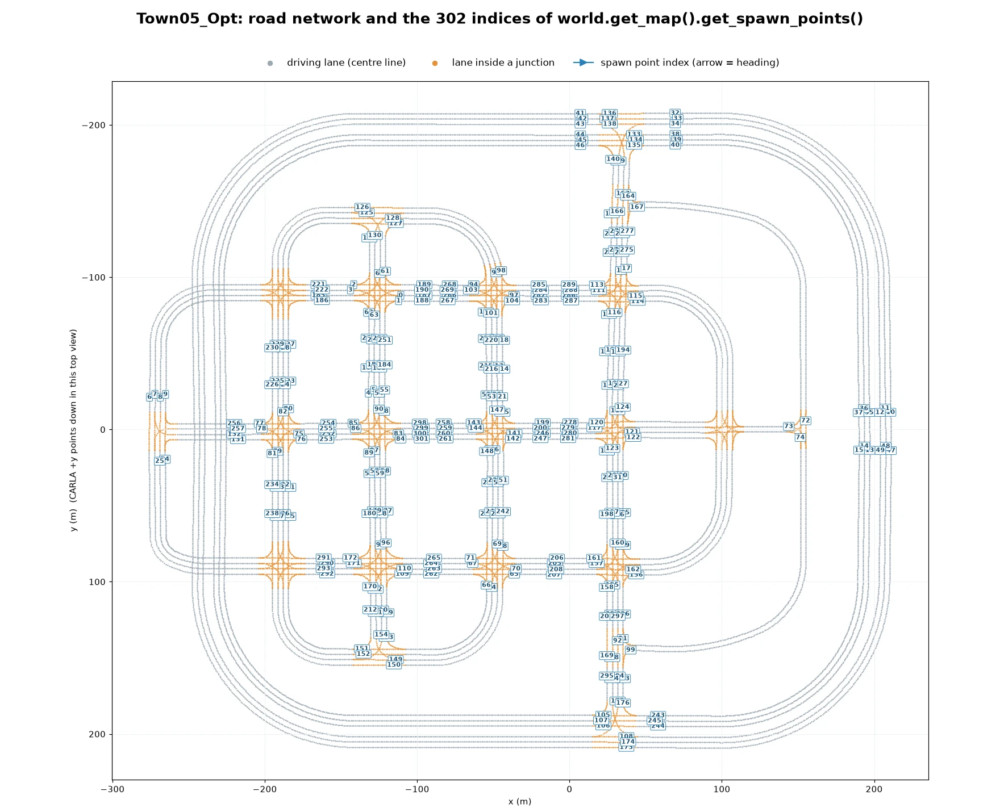
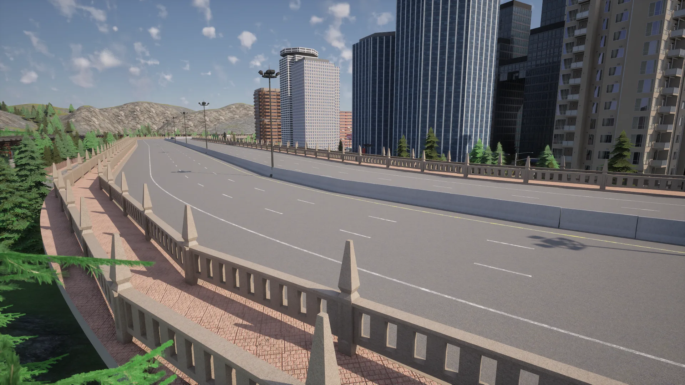
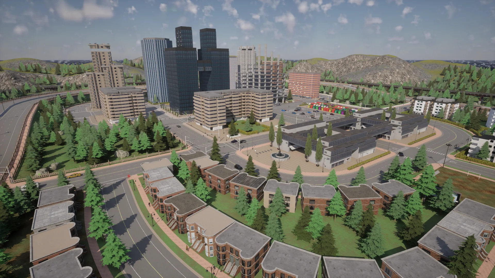
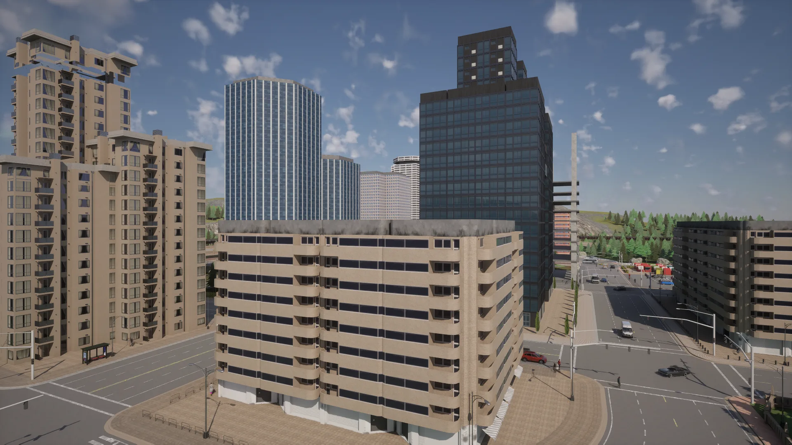
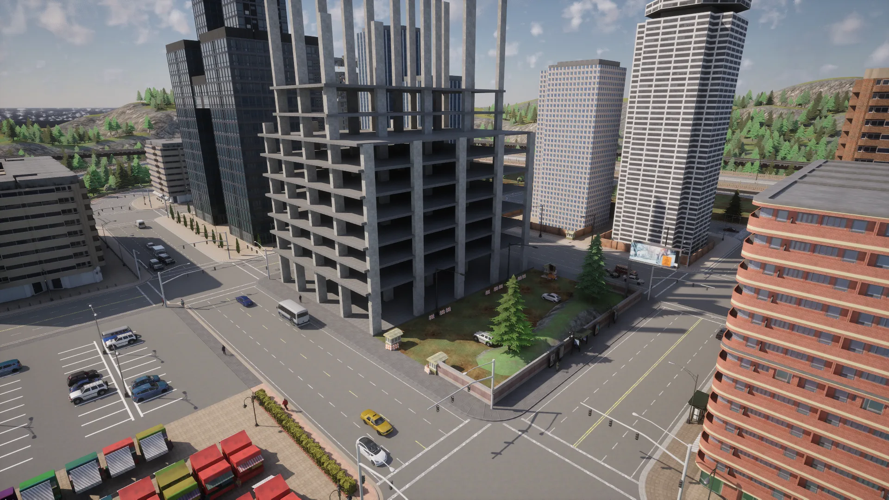
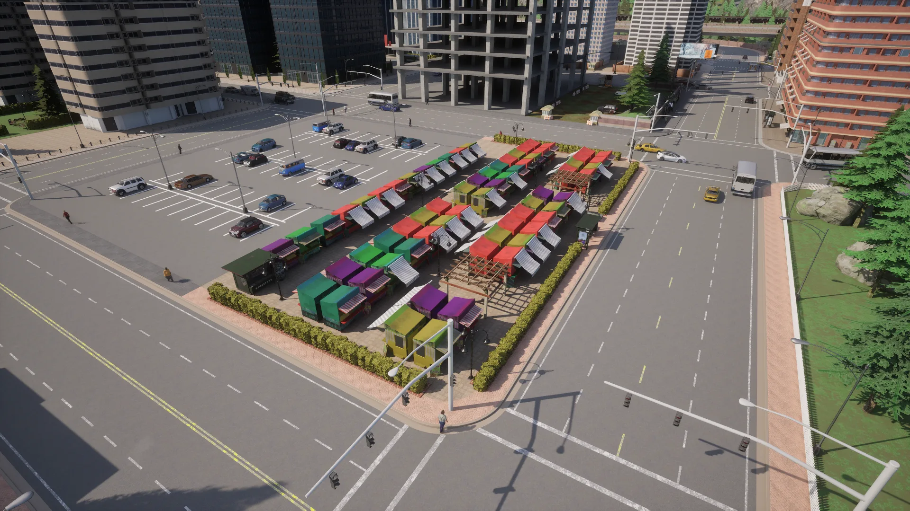
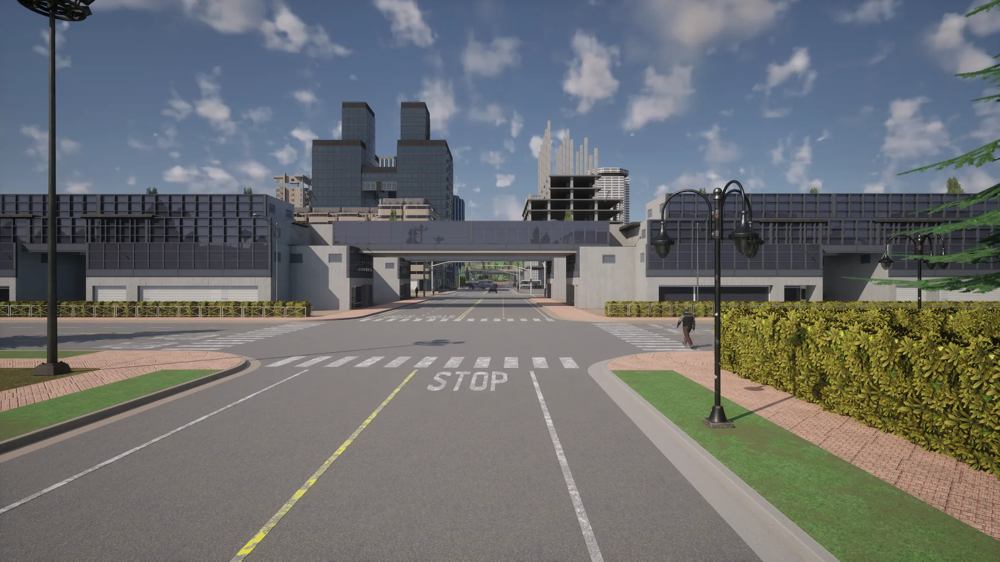

# Town05


<div class="img-caption">Town05_Opt from above, from directly overhead, on the raised highway, at the building under construction and where the road passes under a building.</div>

Town05 is an urban environment set against a backdrop of conifer-covered hills, with a raised highway and large multi-lane roads and junctions. Its wide roads make it a good town for lane changes.

| | |
| --- | --- |
| __Map name__ | `Town05_Opt` |
| __In the default package__ | no: use a source build, or install it from a [content pack](map_content_packs.md) |
| __Size__ | about 490 x 415 m of roads |
| __Spawn points__ | 302, from `world.get_map().get_spawn_points()` |
| __Junctions__ | 21: 13 four-way junctions and 8 T-junctions, with 54 traffic lights and 33 stop signs |

Load it like any other map:

```py
world = client.load_world('Town05_Opt')
```

- [__Road network__](#road-network)
- [__The raised highway__](#the-raised-highway)
- [__Commercial buildings__](#commercial-buildings)
- [__Building under construction__](#building-under-construction)
- [__Car park and market__](#car-park-and-market)
- [__Road under a building__](#road-under-a-building)

---
## Road network

The roads are multi-lane urban roads, with up to three lanes in each direction, that meet at large 4-way junctions. Junctions on each side of the town give access to a raised highway that serves as a ring road.


<div class="img-caption">Town05_Opt from above, oriented like the plot below: the towers on the left, the terraced houses along the curve on the right and the ring road around the town.</div>


<div class="img-caption">The road network of Town05_Opt from the Map API, with the index of each spawn point.</div>

---
## The raised highway

The ring road runs on a raised deck, up to about 10 m above the town, between stone parapets.


<div class="img-caption">The raised highway that circles the town, with the office towers beside it.</div>

---
## Commercial buildings

The town features numerous commercial buildings: office towers and large apartment and office blocks.


<div class="img-caption">The town from above: terraced houses in the foreground, the office towers and the building under construction behind.</div>


<div class="img-caption">Apartment and office blocks around a large junction.</div>

---
## Building under construction

In the middle of the town there is a building under construction, its concrete frame still open.


<div class="img-caption">The building under construction and its fenced site, with the car park and the market in the foreground.</div>

---
## Car park and market

A car park and a market of colourful stalls occupy one city block.


<div class="img-caption">The car park and the market stalls beside it.</div>

---
## Road under a building

In one place the road passes beneath a commercial building.


<div class="img-caption">The road that passes under a long commercial building.</div>
