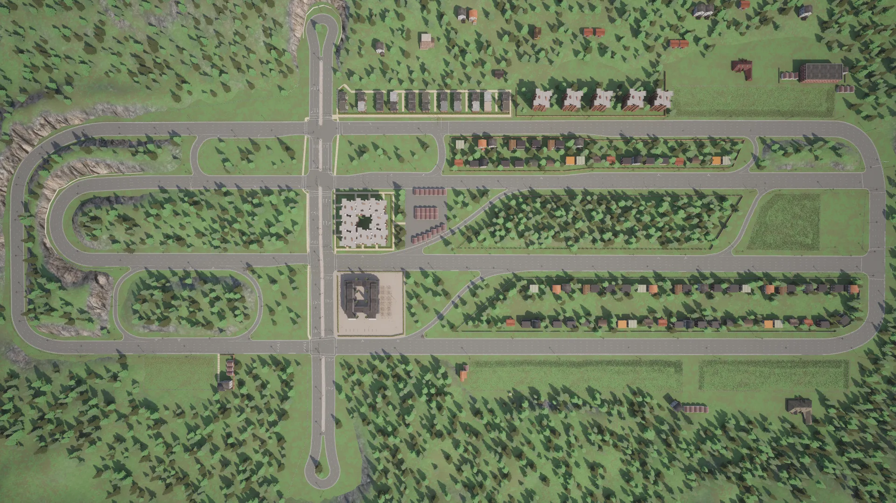
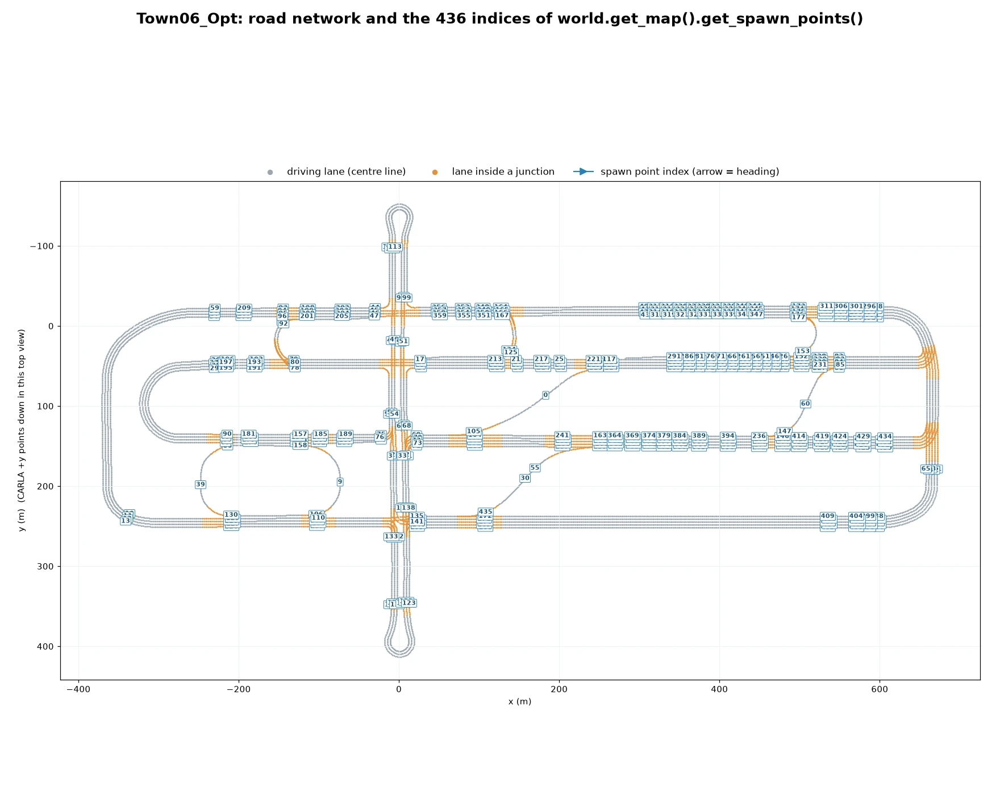
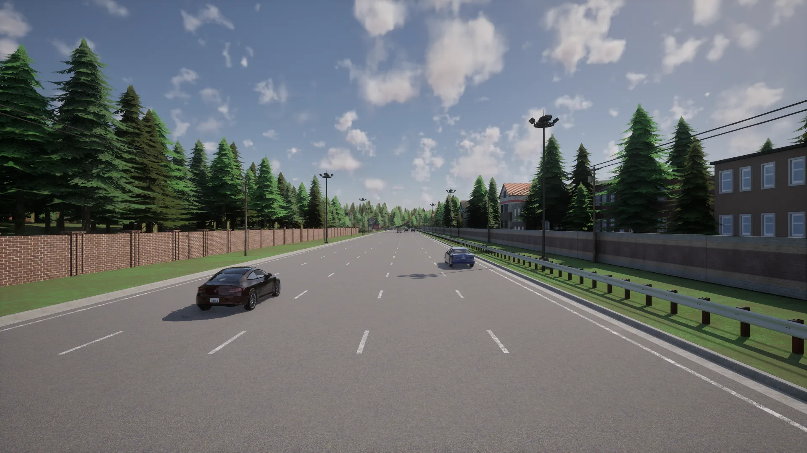
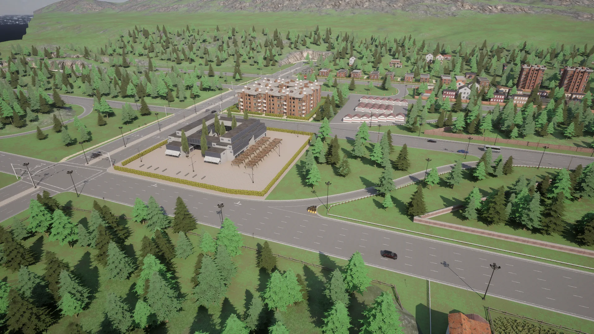
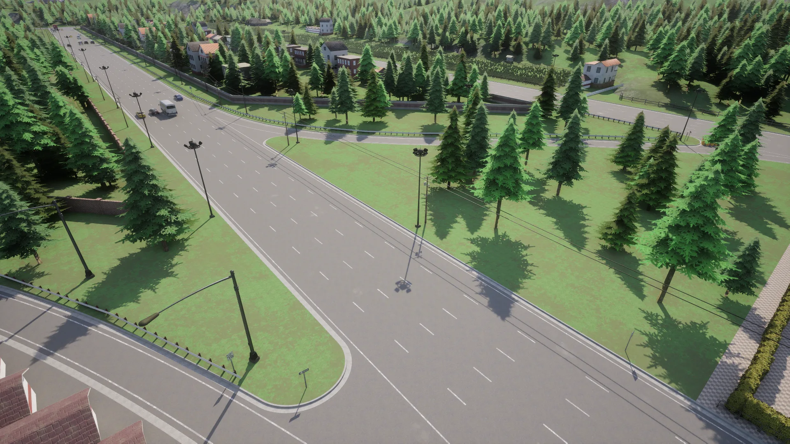
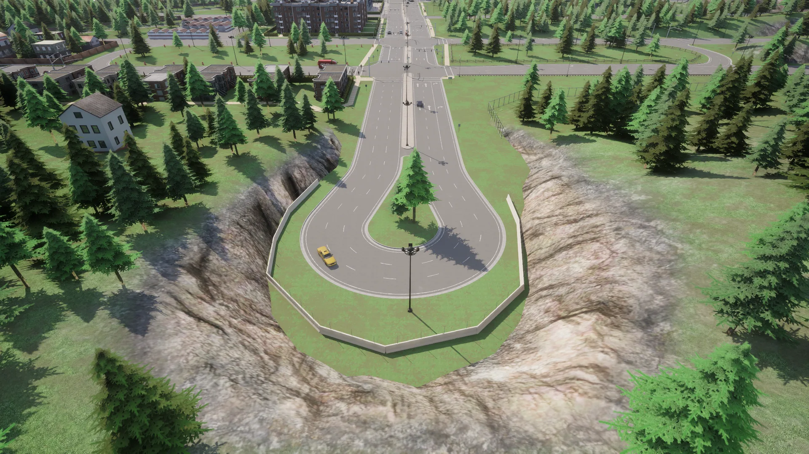

# Town06


<div class="img-caption">Town06_Opt from above, from directly overhead, on one of the long multi-lane roads, at a slip road and at one of the U-turn loops.</div>

Town06 is a low-density town set in a coniferous landscape, with long roads of 4 to 6 lanes and special junctions like the [Michigan left](https://en.wikipedia.org/wiki/Michigan_left).

| | |
| --- | --- |
| __Map name__ | `Town06_Opt` |
| __Package available__ | [Additional maps package](https://github.com/carla-simulator/carla/releases/tag/1.0), or a source build |
| __Size__ | about 1040 x 565 m of roads |
| __Spawn points__ | 436, from `world.get_map().get_spawn_points()` |
| __Junctions__ | 23, with 19 traffic lights, 1 stop sign and 4 yield signs |

Load it like any other map:

```py
world = client.load_world('Town06_Opt')
```

- [__Road network__](#road-network)
- [__Long multi-lane roads__](#long-multi-lane-roads)
- [__Slip roads__](#slip-roads)
- [__U-turn loops__](#u-turn-loops)

---
## Road network

The road network has 4 long parallel roads, with up to three lanes in each direction, linked at their ends by curves and in the middle by a cross road, several slip roads and junctions.


<div class="img-caption">Town06_Opt from above, oriented like the plot below: the four parallel roads, the cross road with a U-turn loop at each end, and rows of houses between the roads.</div>


<div class="img-caption">The road network of Town06_Opt from the Map API, with the index of each spawn point.</div>

---
## Long multi-lane roads

The parallel roads are long, wide and straight, which suits lane changes and driving at higher speed. Low-rise houses and apartment blocks line some of them behind brick walls.


<div class="img-caption">One of the long parallel roads, three lanes in each direction.</div>


<div class="img-caption">The centre of the town from above: the cross road, the apartment blocks and the parallel roads in the conifer landscape.</div>

---
## Slip roads

Numerous slip roads join the parallel roads and the cross road, with designated turning lanes.


<div class="img-caption">A slip road leaving one of the parallel roads.</div>

---
## U-turn loops

The cross road ends at each side of the town in a U-turn loop cut into the hillside.


<div class="img-caption">The U-turn loop at one end of the cross road, with the centre of the town behind it.</div>
