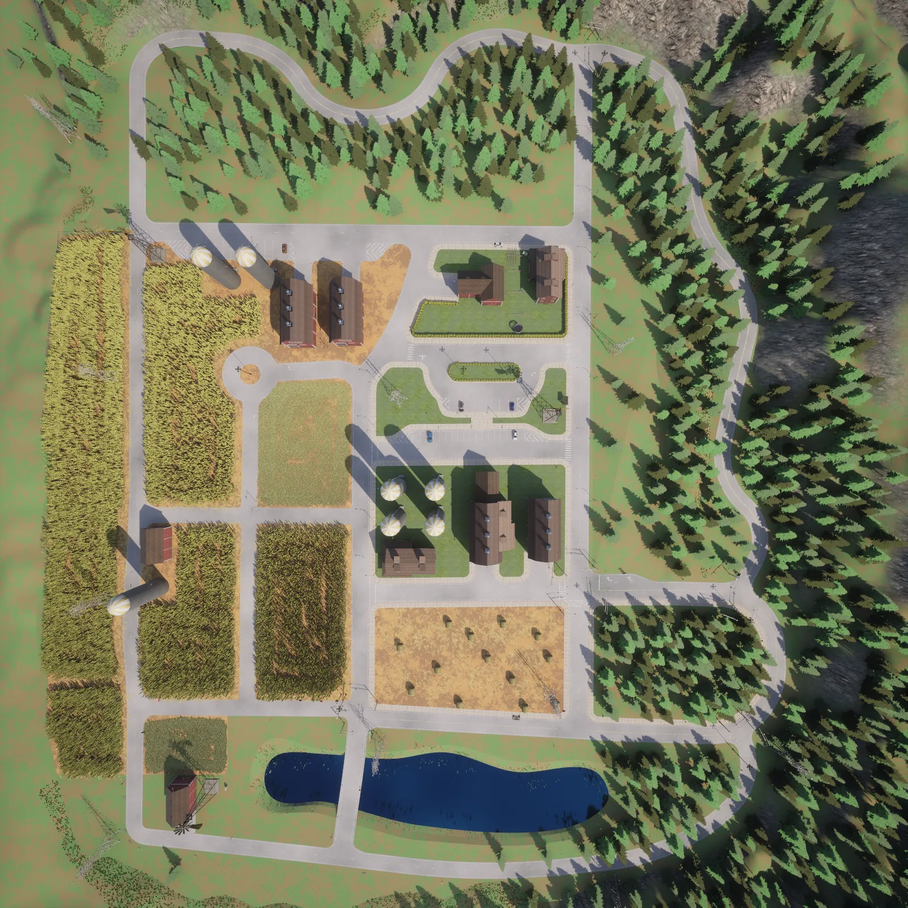
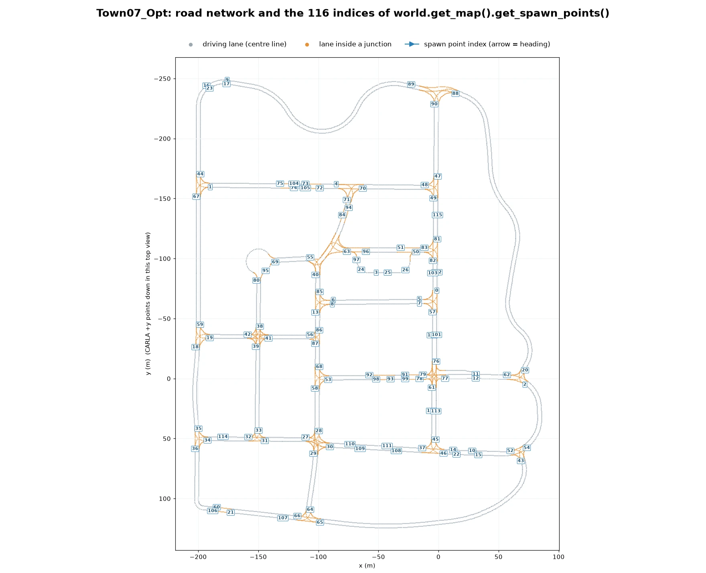
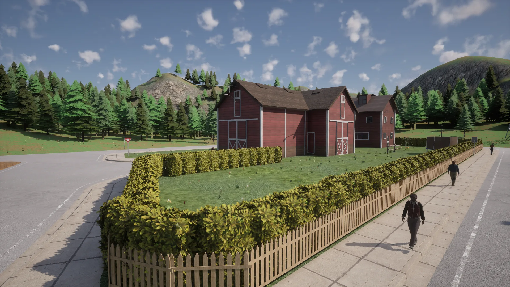
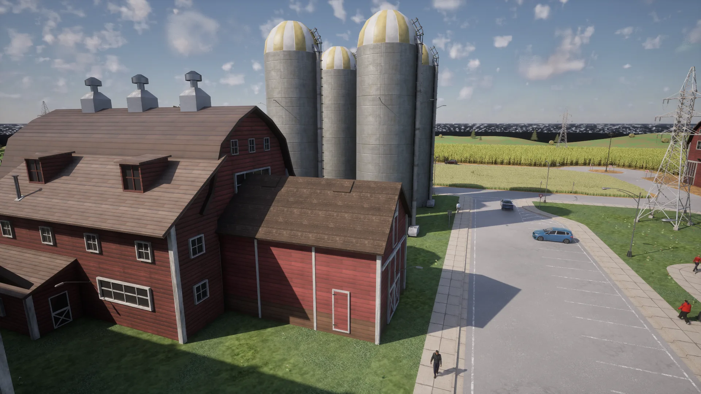
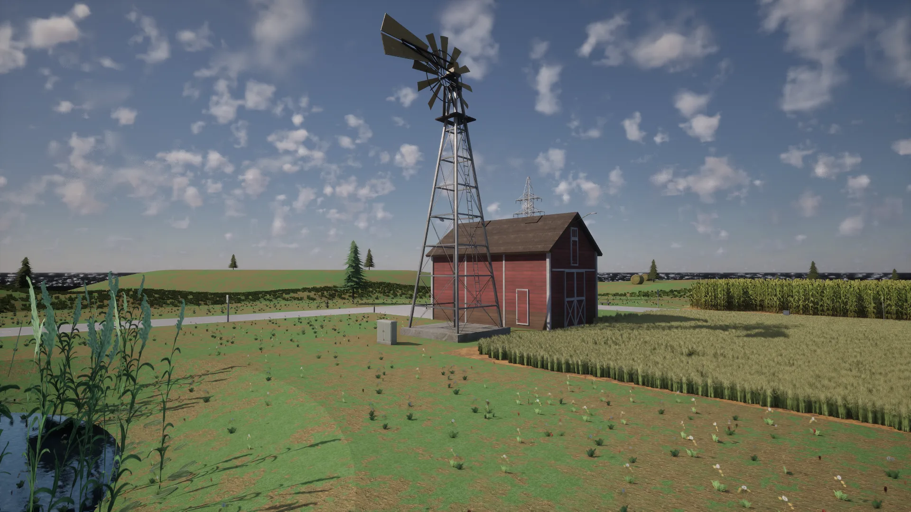
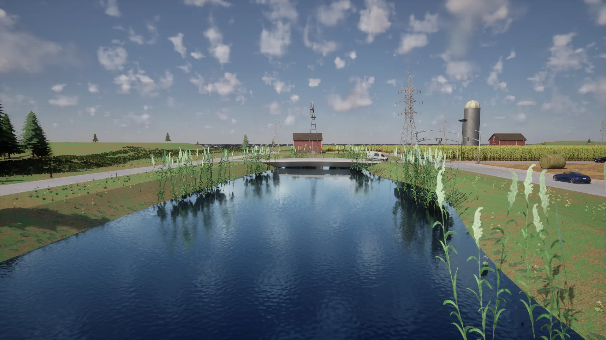
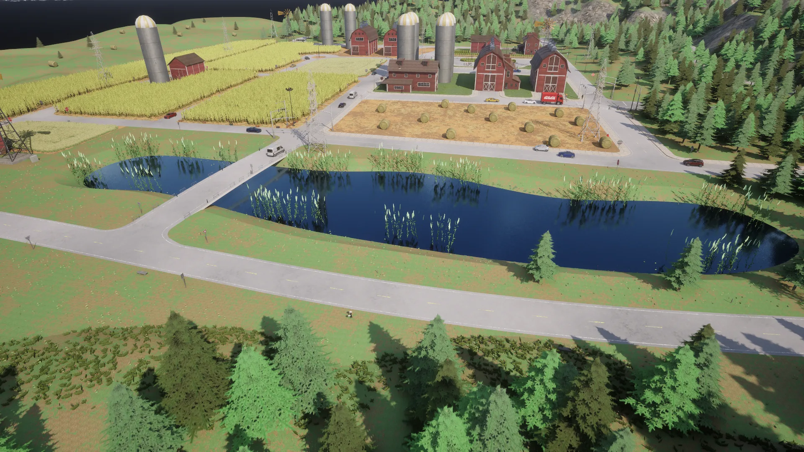
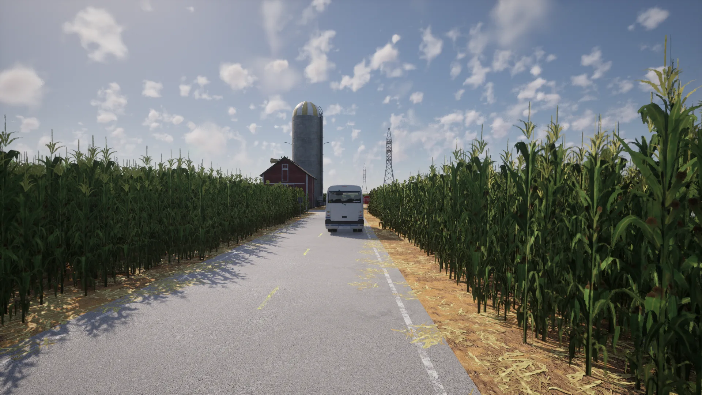

# Town07


<div class="img-caption">Town07_Opt from above the lake, from directly overhead, along a road through the cornfields, at the barns and silos, and at the bridge over the lake.</div>

Town07 imitates a quiet rural community: a green landscape filled with cornfields, barns, grain silos and windmills, with few traffic lights and mostly narrow, unmarked roads.

| | |
| --- | --- |
| __Map name__ | `Town07_Opt` |
| __In the default package__ | no: install a [content pack](map_content_packs.md) that contains it, such as AdditionalMaps, or use a source build |
| __Size__ | about 290 x 375 m of roads |
| __Spawn points__ | 116, from `world.get_map().get_spawn_points()` |
| __Junctions__ | 31, most controlled by signs: 17 traffic lights, 19 stop signs and 20 yield signs |

Load it like any other map:

```py
world = client.load_world('Town07_Opt')
```

- [__Road network__](#road-network)
- [__Barns and farm buildings__](#barns-and-farm-buildings)
- [__Grain silos and windmills__](#grain-silos-and-windmills)
- [__The lake and its bridge__](#the-lake-and-its-bridge)
- [__Cornfields__](#cornfields)

---
## Road network

The road network is small, with a simple set of junctions, roads that are mostly unmarked and a couple of residential parking streets. A loop road runs through the woods around the farmland.


<div class="img-caption">Town07_Opt from above, oriented like the plot below: the loop road through the woods at the top, the fields, barns and silos in the middle and the lake at the bottom.</div>


<div class="img-caption">The road network of Town07_Opt from the Map API, with the index of each spawn point.</div>

---
## Barns and farm buildings

The buildings include wooden barns and farm buildings.


<div class="img-caption">Farm buildings behind a hedge and a picket fence.</div>

---
## Grain silos and windmills

There are structures expected only in rural farming environments, like grain silos and windmills.


<div class="img-caption">A barn and its grain silos beside a car park.</div>


<div class="img-caption">A windmill and a barn at the edge of the fields.</div>

---
## The lake and its bridge

There is a small body of water spanned by a short road bridge.


<div class="img-caption">The lake and the road bridge that crosses it.</div>


<div class="img-caption">The lake, the fields and the farm buildings from above.</div>

---
## Cornfields

Some of the roads are lined by cornfields.


<div class="img-caption">A road between two cornfields, with a barn and a silo at the end.</div>
