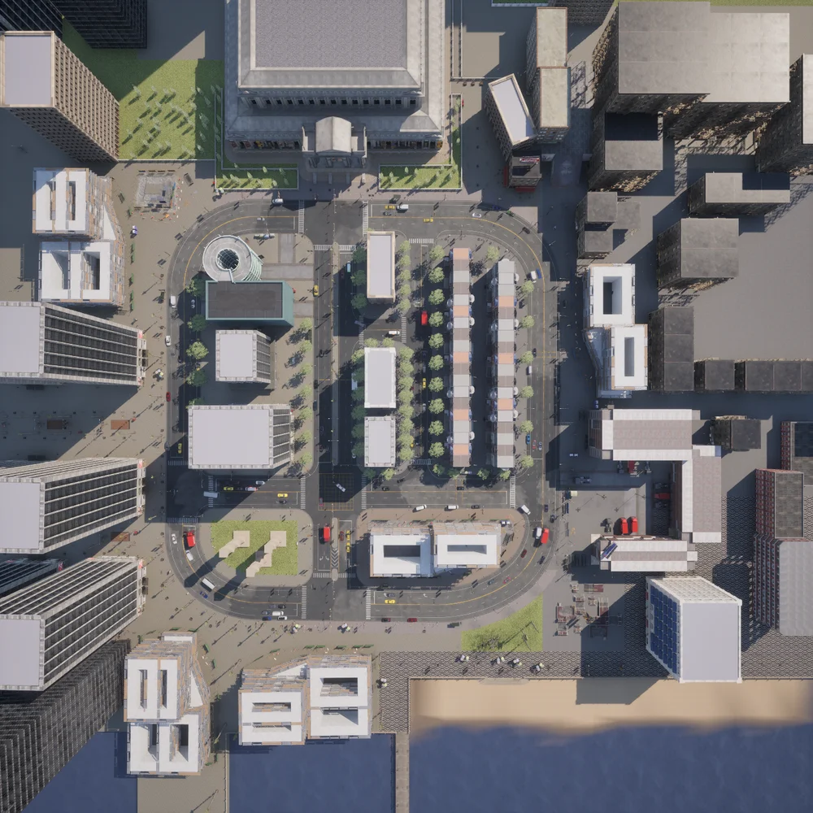
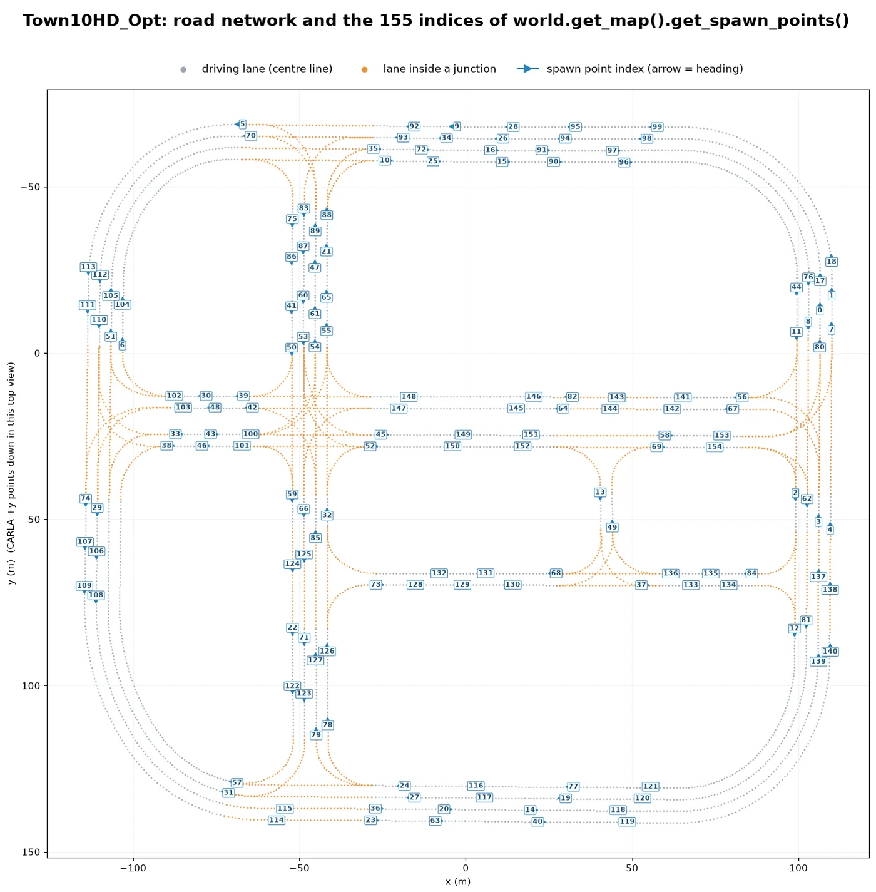
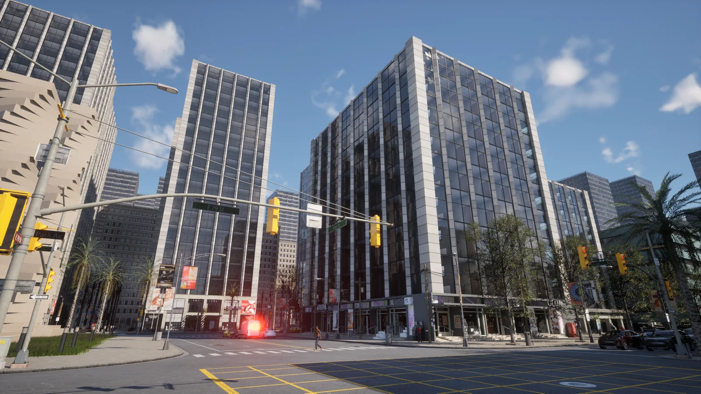
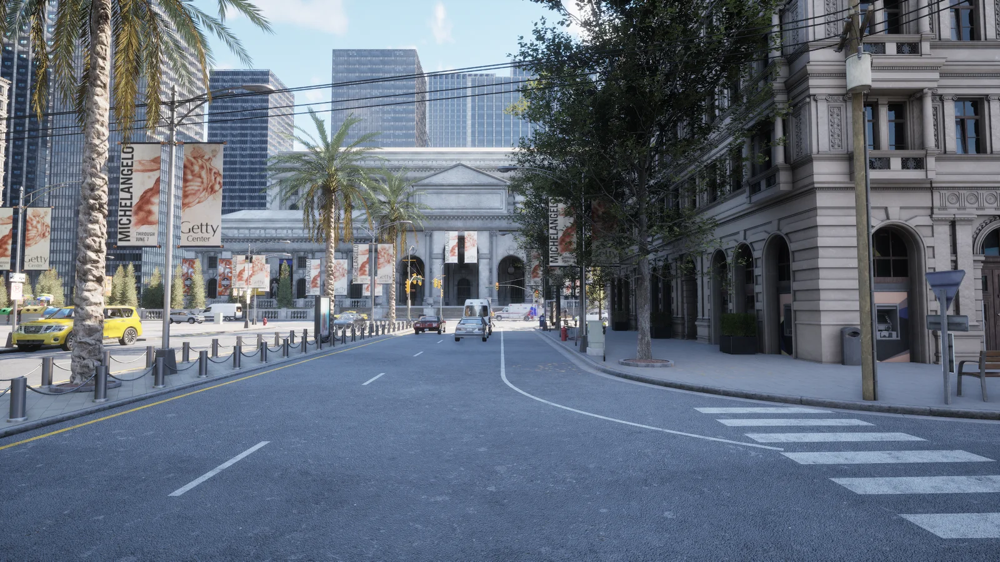
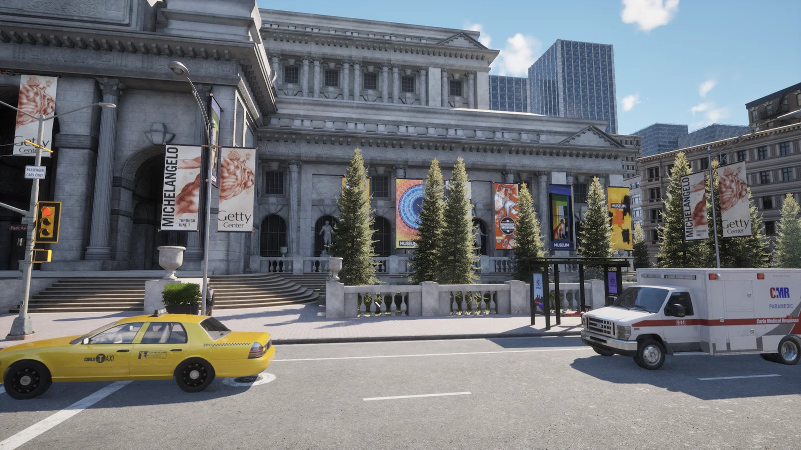
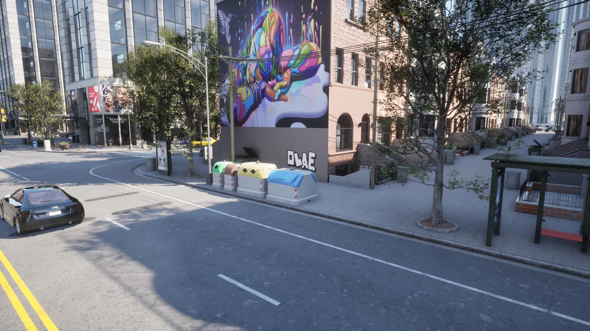

# Town10


<div style="text-align: right"><i>Town10HD_Opt from the default spectator position, from above, and at street level: the museum, a palm boulevard, the skyscrapers and the town houses. Town10HD_Opt &middot; sensor.camera.rgb &middot; Cinematic &middot; sunny afternoon</i></div>

Town10 mixes inner-city features: glossy skyscrapers and industrial buildings beside waterfront promenades, apartment blocks, hotels, public buildings and tree-lined boulevards. Its road network has a variety of junction arrangements, lane markings, crossings and signal types.

| | |
| --- | --- |
| __Map name__ | `Town10HD_Opt` |
| __In the default package__ | yes, and it is the map a server boots into |
| __Size__ | about 225 x 210 m of roads |
| __Spawn points__ | 155, from `world.get_map().get_spawn_points()` |

Load it like any other map:

```py
world = client.load_world('Town10HD_Opt')
```

- [__Road network__](#road-network)
- [__Skyscrapers with commercial units__](#skyscrapers-with-commercial-units)
- [__Tree-lined boulevards__](#tree-lined-boulevards)
- [__Public buildings with classical architecture__](#public-buildings-with-classical-architecture)
- [__Residential streets with town houses__](#residential-streets-with-town-houses)

---
## Road network

The road network is a grid with several kinds of junctions, among them a 4-way yellow-box junction, dedicated turning lanes and central reservations.


<div style="text-align: right"><i>Town10HD_Opt from above: the central plaza and the grid of streets around it. Town10HD_Opt &middot; sensor.camera.rgb &middot; Cinematic &middot; sunny afternoon</i></div>


<div style="text-align: right"><i>The road network of Town10HD_Opt from the Map API, with the index of each spawn point.</i></div>

---
## Skyscrapers with commercial units

A multitude of skyscrapers occupy the skyline and city blocks, with commercial units in the ground floors.


<div style="text-align: right"><i>The skyscrapers of the Town10HD_Opt centre. Town10HD_Opt &middot; sensor.camera.rgb &middot; Cinematic &middot; sunny afternoon</i></div>

---
## Tree-lined boulevards

Town10 has tree-lined boulevards adorned with tropical vegetation.


<div style="text-align: right"><i>A tree-lined boulevard with palm trees, leading to the museum. Town10HD_Opt &middot; sensor.camera.rgb &middot; Cinematic &middot; sunny afternoon</i></div>

---
## Public buildings with classical architecture

The map also includes public buildings with classical architecture styles such as the museum.


<div style="text-align: right"><i>The museum, one of the public buildings in classical style. Town10HD_Opt &middot; sensor.camera.rgb &middot; Cinematic &middot; sunny afternoon</i></div>

---
## Residential streets with town houses

Town houses, similar to those of many North American cities, line some of the streets of Town10, with bus stops, street furniture and kerbside bins along the sidewalks.


<div style="text-align: right"><i>A residential street with town houses and a bus stop, with traffic. Town10HD_Opt &middot; sensor.camera.rgb &middot; Cinematic &middot; sunny afternoon</i></div>
